# Appendix A. Incident Command System

## Purpose

This appendix provides additional explanation and examples of the Incident Command System (ICS), but it is not ICS training.

ICS is used for a broad spectrum of incidents (routine to complex, naturally occurring and human-caused) and by all levels of government (local, state, tribal, territorial, insular area, and Federal) as well as nongovernmental organizations (NGO) and the private sector. ICS combines facilities, equipment, personnel, procedures, and communications involved with on-scene incident management activities.

The important steps in applying ICS to an incident are:

- Establishing and transferring command as appropriate;
- Identifying and activating the organizational elements that are needed;
- Delegating authority as appropriate;
- Establishing incident facilities as needed to support field operations;
- Using ICS common terminology in establishing organizational elements, position titles, facilities, and resources; and
- Determining incident objectives and initiating the incident action planning process; transitioning from oral plans to written Incident Action Plans (IAP).

## Organization of This Appendix

The major elements of ICS are organized into the following ten tabs:

- Tab 1—ICS Organization
- Tab 2—The Operations Section
- Tab 3—The Planning Section
- Tab 4—The Logistics Section
- Tab 5—The Finance/Administration Section
- Tab 6—The Intelligence/Investigations Function
- Tab 7—Consolidating the Management of Multiple Incidents
- Tab 8—Incident Action Planning
- Tab 9—ICS Forms
- Tab 10—Primary Functions of Incident Commander or Unified Command, Command Staff, and General Staff Positions

---

## ICS Tab 1—ICS Organization

### Functional Structure

ICS consists of five major functional areas, staffed as needed. They are Command, Operations, Planning, Logistics, and Finance/Administration.

### Modular Expansion

The ICS organizational structure is modular, expanding to incorporate all elements necessary for the type, size, scope, and complexity of an incident. The ICS structure builds from the top down; responsibility and performance begin with incident command. If one individual can simultaneously manage all major functional areas, no further organization is needed. If one or more of the functions needs independent management, an individual is assigned responsibility for that function.

The initial Incident Commander determines which Command or General Staff positions to staff in order to maintain a manageable span of control and ensure appropriate attention to the necessary incident management functions. An Incident Commander activates Command Staff officers (e.g., Public Information Officer [PIO], Safety Officer, and Liaison Officer) and four section chiefs (Operations, Planning, Logistics, and Finance/Administration) as needed. Personnel in these positions further delegate management authority for their areas as necessary. The Command Staff may assign assistants, and section chiefs may assign deputies and assistants and may establish branches, groups, divisions, or units, depending on the section.

Modular expansion at an incident is based on the following considerations:

- Developing the organization’s structure to match the function or task to be performed;
- Staffing only the organizational elements needed to perform the task;
- Ensuring manageable span of control;
- Performing the function of any non-activated organizational element at the next higher level; and
- Demobilizing organizational elements no longer needed.

The use of deputies and assistants is a vital part of both the organizational structure and the modular concept. The Incident Commander may have one or more deputies who may be from the same or an assisting jurisdiction/organization. The primary reasons to designate a Deputy Incident Commander are:

- To perform specific tasks as the Incident Commander directs;
- To perform the command function in a relief capacity (e.g., to take over the next operational period; in this case, the deputy then assumes the primary role); and
- To represent an assisting agency that may share jurisdiction or have jurisdiction in the future.

Deputies are used at section and branch levels of the incident organization. A deputy, whether at the command, section, or branch level, is qualified to assume the position.

Assistants are used on Command Staffs and to support section chiefs. Unlike deputies, assistants have a level of technical capability, qualification, and responsibility subordinate to the primary positions and need not be fully qualified to assume the position.

For reference, Table A-1 describes the distinctive title or titles assigned to each element of the ICS organization, as well as the titles of corresponding leadership and support positions.

**Table A-1: ICS Organization**

| Organizational Element | Leadership Position Title | Support Positions |
| :--- | :--- | :--- |
| **Incident Command** | Incident Commander | Deputy |
| **Command Staff** | Officer | Assistant |
| **Section** | Chief | Deputy, Assistant |
| **Branch** | Director | Deputy |
| **Divisions/Groups** | Supervisors | N/A |
| **Unit** | Unit Leader | Manager, Coordinator |
| **Strike Team/Task Force** | Leader | Single Resource Boss |
| **Single Resource** | Boss, Leader | N/A |
| **Technical Specialist** | Specialist | N/A |

### Command Staff

In an ICS organization, incident command consists of the Incident Commander and various Command Staff positions. The Command Staff are specifically designated, report directly to the Incident Commander, and are assigned responsibility for key activities that are not a part of the General Staff functional elements. Three Command Staff positions are typically identified in ICS: PIO, Safety Officer, and Liaison Officer. The Incident Commander may assign technical specialists as additional command advisors, depending on the nature, scope, complexity, and location(s) of the incident(s), or according to specific needs the Incident Commander or Unified Command establishes.

#### Public Information Officer

The PIO is responsible for interfacing with the public, the media, and with other jurisdictions/organizations with incident-related information needs. The PIO gathers, verifies, coordinates, and disseminates accurate, accessible, and timely information regarding the incident. The Incident Commander or Unified Command approves the release of incident-related information. The PIO serves as the primary on-scene connection to other ongoing Joint Information System (JIS) activities and participates in or leads the Joint Information Center (JIC) to ensure consistency of information provided to the public. The PIO also monitors the media and other sources of public information to collect relevant information and transmits this information to the appropriate personnel at the incident, a supporting Emergency Operations Center (EOC), and/or a Multiagency Coordination Group (MAC Group).

The PIO performs a key public information-monitoring role by implementing measures for rumor control and monitoring/updating incident-related social media posts.

A lead PIO is designated, regardless of whether the command structure is single or unified. The PIO may have assistants, as necessary, which other agencies, departments, or organizations involved in the incident may assign.

#### Safety Officer

The Safety Officer monitors incident operations and advises the Incident Commander or Unified Command on all matters relating to operational safety, including the health and safety of incident personnel. Ultimately, responsibility for conducting incident management operations safely rests with the Incident Commander or Unified Command and supervisory personnel at all levels of incident management. The Safety Officer, in turn, is responsible to the Incident Commander or Unified Command for the systems and procedures necessary to ensure the ongoing assessment of hazardous environments, including development of the incident Safety Plan, coordination of multiagency safety efforts, and implementation of measures to promote incident personnel safety, as well as the general safety of incident operations. To carry out these responsibilities, the Safety Officer alters, suspends, or terminates any activities that are immediately dangerous to life and health of personnel.

In a Unified Command structure, a single Safety Officer[^20] is designated regardless of the involvement of multiple jurisdictions or organizations. The Safety Officer coordinates closely with all section chiefs regarding operational safety and emergency responder health and safety issues. The Safety Officer ensures the coordination of safety management functions and issues across jurisdictions, across functional agencies, and with NGOs and the private sector. The agencies, organizations, or jurisdictions that contribute to joint safety management efforts do not lose their individual identities or responsibility for their own programs, policies, and personnel. Rather, each entity contributes to the overall effort to protect all personnel involved in incident operations.

For more complex incidents, the Safety Officer may designate one or more Assistant Safety Officers to perform specific tasks and/or manage day-to-day functions on a more complex incident or to represent an assisting agency that may share jurisdiction or have jurisdiction in the future. The Safety Officer may also designate assistants to bring specific skill sets or expertise relevant to the incident. The following examples describe Assistant Safety Officers that a Safety Officer might request:

- An Assistant Safety Officer for hazardous material (HazMat) to carry out the functions outlined in 29 CFR 1910.120 (Hazardous Waste Operations and Emergency Response).
- An Assistant Safety Officer for Fire to oversee fire suppression operations.
- An Assistant Safety Officer for Food to oversee food handling and distribution.

Figure A-1 depicts Assistant Safety Officers for HazMat, Fire, and Food organizationally positioned in an incident. Assistant Safety Officers may also be assigned to divisions or groups in the field.

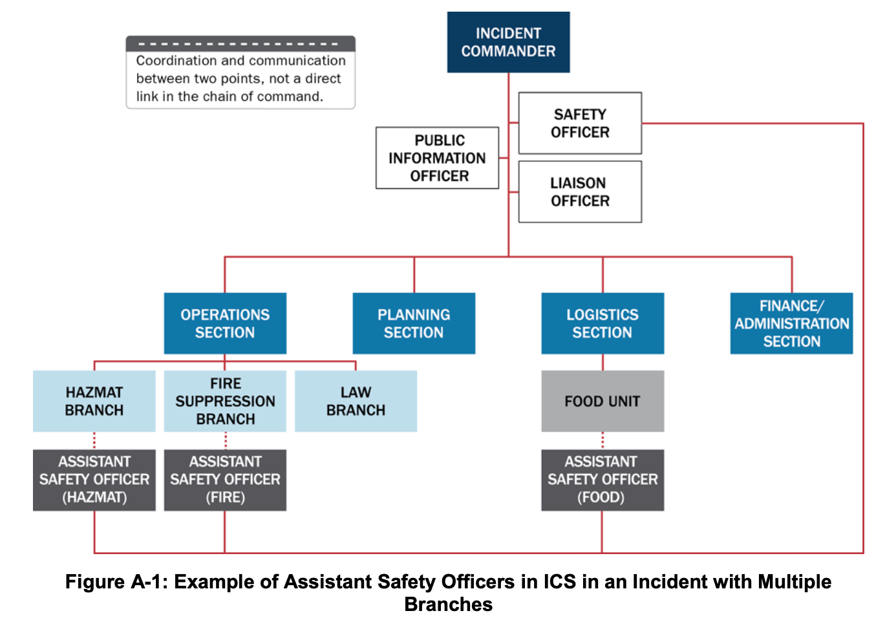
*Figure A-1: Example of Assistant Safety Officers in ICS in an Incident with Multiple Branches*

#### Liaison Officer

The Liaison Officer is a conduit of information and assistance between incident personnel and organizations that are assisting or cooperating with the response. Through the Liaison Officer, agencies lacking jurisdiction or legal authority for the management of the incident—such as other governmental organizations, NGOs, and private sector organizations—provide input regarding their policies, resource availability, and other incident-related matters. These organizations appoint Agency Representatives, who coordinate directly with the Liaison Officer. Whether a single Incident Commander or Unified Command structure is in place, representatives from assisting or cooperating agencies coordinate through the Liaison Officer. Agency Representatives assigned to an incident speak for their parent agencies or organizations.

Personnel from other agencies or organizations—public or private—involved in incident management activities are assigned to the Liaison Officer to facilitate coordination.

For more complex incidents, the Liaison Officer may have one or more assistants, who may be from the same or an assisting agency.

#### Command Advisors

In addition to the three Command Staff officer positions, the Incident Commander or Unified Command may choose to appoint technical specialists as command advisors. For example, the Incident Commander or Unified Command may appoint:

- A legal counsel to advise on legal matters such as those related to emergency declarations, evacuation and quarantine orders, and rights and restrictions pertaining to media access;
- A Medical Advisor to provide guidance and recommendations to incident command regarding a broad range of areas such as medical care, acute care, long-term care, behavioral services, mass casualties, vector control, epidemiology, or mass prophylaxis;
- A Science and Technology Advisor to monitor incident operations and advise incident command on the integration of science and technology into planning and decision making; and
- An Access and Functional Needs Advisor to provide expertise regarding communication, transportation, supervision, and essential services for diverse populations in the affected area.

Technical specialists may be assigned anywhere in the organization and are described in this appendix under ICS Tab 3.

---

## ICS Tab 2—The Operations Section

Operations Section staff are responsible for tactical activities that typically focus on saving lives, reducing the immediate hazard, protecting property and the environment, establishing situational control, and restoring normal operations. Lifesaving and responder safety are always the highest priorities.

The responsibility and composition of the Operations Section change according to incident type and complexity. Organizations that may work together in the Operations Section include fire, law enforcement, public health, public works, emergency medical services (EMS), NGOs, and the private sector. Depending on the situation, these organizations may be organized in branches, divisions, groups, task forces, and/or strike teams.

Figure A-2 depicts the organizational template for an Operations Section, though the structure’s configuration on any given incident varies according to the incident’s needs, the jurisdictions/organizations involved, and the objectives and tactics of the incident management effort. The following discussion presents several different methods of organizing tactical operations on an incident.

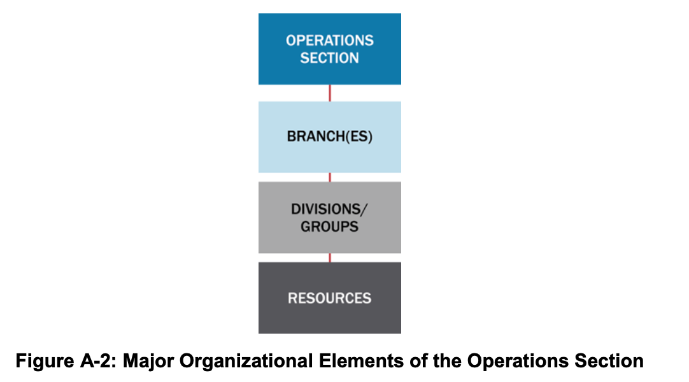
*Figure A-2: Major Organizational Elements of the Operations Section*

### Operations Section Chief

The Operations Section Chief manages tactical incident activities and oversees implementation of the IAP. The Operations Section Chief may have one or more deputies and/or assistants. The Operations Section Chief for each operational period has direct responsibilities for IAP development for the next operational period.

The Operations Section Chief may organize Operations Section staff in various ways to meet different challenges. In some cases, a strictly functional approach is used. In other cases, geographic or jurisdictional boundaries determine the organizational structure. In still others, a mix of functional and geographic considerations is appropriate. ICS offers flexibility in determining the right structural approach for the specific circumstances of the incident at hand.

#### Maintaining Manageable Span of Control for the Operations Section

The Operations Section Chief organizes the section and assigns subordinate supervisory personnel as necessary to maintain a manageable span of control. Different options for organizing the Operations Section are below.

### Branches

Branches are inserted between the Operations Section Chief and divisions and/or groups, as described below, when the number of divisions and/or groups exceeds a manageable span of control.

#### Geographic Branch Structure

The Operations Section Chief establishes geographic branches to maintain a manageable span of control in the Operations Section by grouping two or more divisions and/or groups. The boundaries of geographic branches are thus defined by the combined areas of the divisions that comprise each branch. For example, if four divisions are reporting to the Operations Section Chief and an additional two divisions are needed, and all need close oversight, a two-branch organization is formed (see Figure A-3).

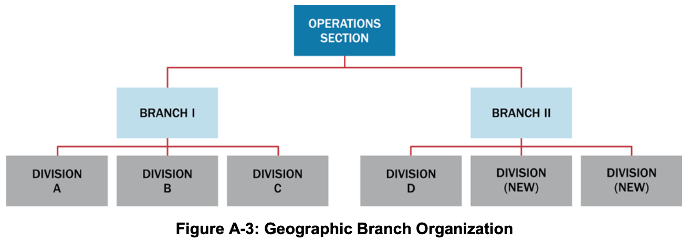
*Figure A-3: Geographic Branch Organization*

Geographic branch boundaries are depicted on incident maps and clearly communicated to incident personnel.

#### Functional Branch Structure

The following example illustrates a functional branch structure: If a large aircraft crashes in a local jurisdiction, various disciplines (including law enforcement, fire, EMS, public works, and public health) may each have a functional branch operating under a single Operations Section Chief’s direction. In this example (shown in Figure A-4), the Operations Section Chief is from the fire department with deputies from law enforcement and EMS. The Operations Section Chief may organize around different functional groups, depending on the jurisdiction’s plan and the incident type.

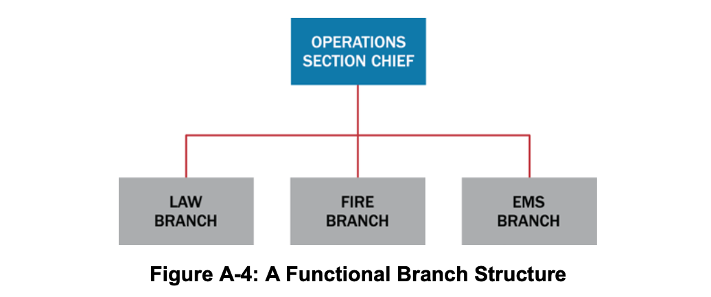
*Figure A-4: A Functional Branch Structure*

### Divisions and Groups

The Operations Section Chief establishes divisions and groups when the number of resources exceeds his or her manageable span of control. Divisions always refer to geographic assignments and groups always refer to functional assignments. Both divisions and groups may be used in a single incident. Maintaining proper coordination is vital to the success of these operations.

#### Divisions

Divisions separate physical or geographic areas of operation within the incident area. Divisions can be established according to political or natural terrain boundaries or other prominent geographic features, such as rivers, major roadways, or floors in a multistory building response. As with branch boundaries, division boundaries are depicted on incident maps and communicated to incident personnel (see Figure A-5).

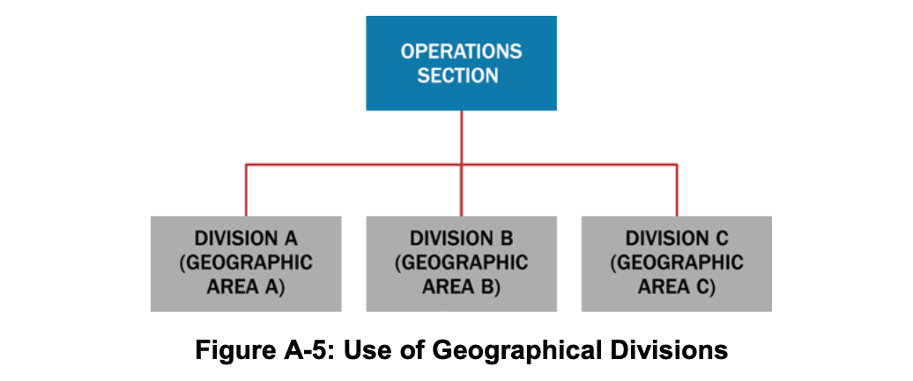
*Figure A-5: Use of Geographical Divisions*

#### Functional Groups

Groups are used to describe functional areas of similar activity (e.g., rescue, evacuation, law enforcement, or medical treatment or triage), as shown in Figure A-6.

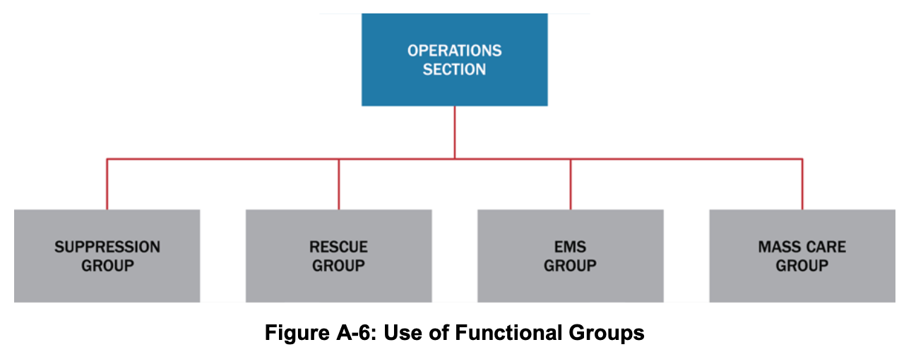
*Figure A-6: Use of Functional Groups*

#### Combined Geographic Divisions and Functional Groups

It is possible to have both divisions and groups within the Operations Section. Supervisors of divisions and groups have the same level of authority. For example, Divisions A, B, and C (based on geographic locations) may work in conjunction with functional groups assigned to specific tasks (e.g., traffic control and smoke ventilation) in those locations. Alternatively, groups may be assigned throughout the incident and may work independently or in conjunction with divisions.

### Organizing Resources

Consolidating single resources into task forces and strike teams reduces supervisors’ spans of control. As the incident grows in size and complexity, task forces and strike teams are typically organized into divisions and/or groups.

#### Single Resources

Resources may be employed on a single basis, such as an individual person or an individual piece of equipment with its associated operators.

#### Task Forces

Task forces combine different kinds and types of resources to accomplish a specific mission under a designated leader. They enable one supervisor to manage several key resource elements. As an example, during a flood, a public works task force may be established to open storm drains. The task force may consist of a dump truck, a backhoe, a five-person crew with shovels and transportation, and a task force leader (e.g., public works supervisor).

#### Strike Teams

Strike teams are another means of combining resources. Strike teams consist of a set number of resources of the same kind and type operating under a designated leader. As an example, a Debris Removal Strike Team could consist of five Type 3 dump trucks and a Strike Team Leader. In the law enforcement community, strike teams are known as resource teams.

### Air Operations Branch

When a single helicopter is the only air asset on an incident, it is usually under the Operations Section Chief’s direct control. When the complexity of air operations involves additional support and/or air-space control (including mixing tactical and support use of helicopters and other aircraft), the Operations Section Chief establishes an Air Operations Branch. An Air Operations Branch helps ensure the safe and efficient use of aviation resources. Figure A-7 shows a typical organizational structure for air operations.

When helicopters and fixed-wing aircraft operate simultaneously within the incident airspace, the Operations Section Chief designates an Air Tactical Group Supervisor. This individual coordinates all air activity with the assistance of a Helicopter Coordinator and a Fixed-Wing Coordinator.

Air Support Group staff establish and operate bases for helicopters and maintain a liaison with off-incident fixed-wing bases. Staff in the Air Support Group are responsible for all timekeeping for aviation resources assigned to the incident.

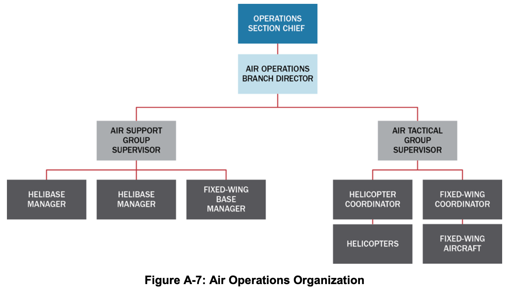
*Figure A-7: Air Operations Organization*

---

## ICS Tab 3—The Planning Section

Staff in the Planning Section collect, evaluate, and disseminate operational information pertaining to the incident. Staff in this section maintain information on the current and forecasted situation as well as the status of resources assigned to the incident. Planning Section staff prepare IAPs and incident maps and gather and disseminate information important to the incident.

The Planning Section Chief leads the Planning Section, which has four primary units (as shown in Figure A-8). The Planning Section may also include technical specialists who typically provide expertise in specific areas and assist in evaluating the situation and forecasting needs for additional personnel and equipment.

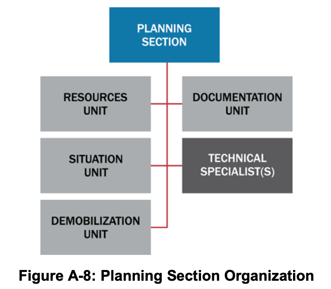
*Figure A-8: Planning Section Organization*

### Planning Section Chief

The Planning Section Chief oversees incident-related data gathering and analysis regarding incident operations and assigned resources, facilitates incident action planning meetings, and prepares the IAP for each operational period. This individual normally comes from the jurisdiction or organization with primary incident responsibility and may have one or more deputies who may come from other participating jurisdictions or organizations.

### Resources Unit

#### Responsibilities

Resources Unit staff track the location and status of all resources assigned to an incident. They ensure all assigned resources have checked in at the incident.

#### Resource Status

Staff in the Resources Unit track resource status continuously to manage resources effectively during an incident. They use the following status conditions for maintaining an up-to-date and accurate picture of resource status:

- **Assigned:** Resources that have been checked in and assigned work tasks on an incident.
- **Available:** Resources assigned to an incident, checked in, and available for a mission assignment, normally located in a staging area.
- **Out of Service:** Resources that are checked in, but are not assigned and not available for assignment for mechanical, rest, or personnel reasons.

> **Resource Tracking**
>
> The Resources Unit tracks resources assigned to an incident, but Logistics Section staff track resources that have been ordered but have not yet arrived at the incident.

When a resource’s status changes (e.g., a unit that was previously “out of service” is now “available”), the Unit Leader or the supervisor who approved the status change immediately notifies the Resources Unit Leader, who documents the status change.

### Situation Unit

Situation Unit staff collect, process, and organize situation information, prepare situation summaries, and develop projections and forecasts related to the incident. They gather and disseminate information for the IAP. This unit produces Situation Reports (SITREP) as scheduled or at the request of the Planning Section Chief or Incident Commander. The Situation Unit frequently includes Geographic/Geospatial Information Systems (GIS) Specialists, who produce maps, and other technical specialists. The Situation Unit may also include Field Observers to gather information on the incident and/or response.

### Documentation Unit

Documentation Unit staff maintain incident files and data for legal, analytical, and historical purposes, including a complete record of the major steps taken to resolve the incident. They also provide duplication services for incident personnel; compile, reproduce, and distribute the IAP; and maintain the files and records that are developed as part of the IAP and planning function.

### Demobilization Unit

Demobilization Unit staff develop an Incident Demobilization Plan that includes specific instructions for all personnel and other resources to be demobilized. They begin their work early in the incident, creating rosters of personnel and resources and obtaining any missing information as check-in proceeds. Once the Incident Commander or Unified Command has approved the Incident Demobilization Plan, Demobilization Unit staff ensure its distribution at the incident and elsewhere, as necessary. For major incidents, demobilization plans are dynamic and the staff in the Demobilization Unit may need to update them frequently.

### Technical Specialists

ICS functions in a wide variety of incidents that need technical specialists. Technical specialists have special expertise and skills, and they are activated only when needed. No specific qualifications are prescribed, as technical specialists normally perform the same duties during an incident that they perform in their everyday jobs, and they are typically certified in their fields or professions.

Technical specialists may serve anywhere within the organization depending on factors such as complexity, span of control, lines of communication, and subject matter expertise. They are most often assigned to the specific area (section, branch, division, group, or unit) where their services are needed. Technical specialists assigned to the Command Staff are called command advisors. In some situations, they are assigned to a separate unit within the Planning Section, much like a talent pool, and assigned out to various jobs on a temporary basis.

Generally, if the expertise is needed for only a short time and involves only one individual, that individual is assigned to the Situation Unit. If the expertise is needed on a long-term basis and necessitates several persons, a separate Technical Unit is established in the Planning Section.

> **Examples of Technical Specialists**
>
> - Access and functional needs advisor
> - Agricultural specialist
> - Community representative
> - Decontamination specialist
> - Environmental impact specialist
> - Epidemiologist
> - Flood control specialist
> - Health physicist
> - Industrial hygienist
> - Intelligence specialist
> - Legal advisor
> - Behavioral health specialist
> - Meteorologist
> - Science and technology advisor
> - Pharmacist
> - Veterinarian
> - Toxicologist

---

## ICS Tab 4—The Logistics Section

Logistics Section staff provide for all the incident’s support needs, such as ordering resources and providing facilities, transportation, supplies, equipment maintenance and fuel, communications, and food and medical services for incident personnel.

The Logistics Section Chief leads the Logistics Section, sometimes with one or more deputies and/or assistants. When the incident is very large or needs several facilities and/or large quantities of equipment, the Logistics Section Chief may divide the Logistics Section into branches. This helps maintain a manageable span of control by providing more effective supervision and coordination among the units.

Figure A-9 provides an example of the Logistics Section organized with Service and Support Branches.

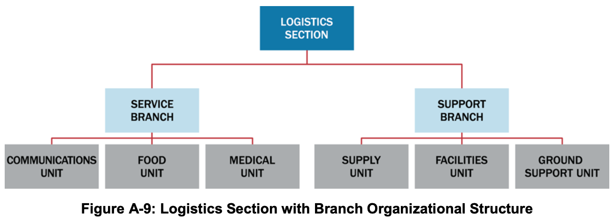
*Figure A-9: Logistics Section with Branch Organizational Structure*

### Logistics Section Chief

The Logistics Section Chief is responsible for providing facilities, services, people, and material for the incident. The Logistics Section Chief participates in the IAP’s development and supervises the Logistics Section’s branches or units.

### Supply Unit

Supply Unit staff order, receive, process, store, inventory, and distribute all incident-related resources. The Supply Unit staff are responsible for all off-incident ordering, including obtaining the following:

- Tactical and support resources (including personnel); and
- Expendable and nonexpendable supplies.

The Supply Unit staff provide support to receive, process, store, and distribute all supply orders. They handle tool operations, which includes storing, distributing, and servicing tools and portable, nonexpendable equipment. Additionally, the Supply Unit staff assist in projecting resource needs.

### Facilities Unit

Facilities Unit staff set up, maintain, and demobilize all facilities used in support of incident operations. This staff provides facility maintenance and law enforcement/security services needed for incident support.

Facilities Unit staff set up the Incident Command Post (ICP), Incident Base, and camps (including trailers or other forms of shelter in and around the incident area) and ensure the maintenance of those facilities. This unit’s staff provide and maintain personnel support facilities, including areas for eating, sleeping, sanitation and showers, and staging.

Staff in this unit order additional support items such as portable toilets, shower facilities, and lighting units through the Supply Unit.

> **Facilities Unit**
>
> The Facilities Unit provides facilities that support incident personnel. Providing emergency shelter for survivors is a tactical activity for which the Operations Section, not the Logistics Section, is responsible.

### Ground Support Unit

Ground Support Unit staff provide ground transportation in support of incident operations. They maintain and repair vehicles and mobile ground support equipment and perform pre- and post-use inspections on all ground equipment assigned to the incident. The staff supply fuel for incident mobile equipment, and develop and implement the incident Traffic Plan.

Additionally, during major incidents, Ground Support Unit staff maintain a transportation pool of vehicles (e.g., cars, buses, pickup trucks) suitable for transporting personnel, as opposed to tactical vehicles such as ambulances. Ground Support Unit staff also provide information to the Resources Unit on the location and status of vehicles assigned to the Ground Support Unit.

### Communications Unit

Communications Unit staff install and test communications equipment, supervise and operate the incident communications center, distribute and recover communications equipment assigned to incident personnel, and maintain and repair communications equipment on site.

Most complex incidents have an incident Communications Plan. Staff in the Communications Unit produce this plan, as they are responsible for assigning radio frequencies; establishing voice and data networks for command, tactical, support, and air units; setting up on-scene telephone and public-address equipment; and providing any necessary off-incident communication links.

### Food Unit

Food Unit staff determine the food and hydration needs of personnel assigned to the incident and plan menus, order food, provide cooking facilities, cook and serve food, maintain food service areas, and manage food security and safety.

Efficient food service is especially important for extended incidents. Food Unit staff anticipate incident needs, such as the number of people who will need to be fed and whether the incident’s type, location, or complexity predicates special food needs. The unit staff supply food to meet the nutritional needs during the entire incident, including all remote locations (e.g., camps and staging areas), and supply on-site food service to operations personnel who are unable to leave their assignments.

Careful planning and monitoring helps ensure food safety before and during food service operations, including the assignment, as needed, of public health professionals with expertise in environmental health and food safety.

> **Food Unit**
>
> The Food Unit only provides food for incident workers. Feeding people affected by the incident (e.g., evacuees and persons at shelters) is a tactical activity for which the Operations Section, not the Logistics Section, is responsible.

### Medical Unit

Medical Unit staff provide health and medical services for incident personnel. This includes providing pre-hospital and acute medical care, mental health care, occupational health support, and transportation of ill or injured incident personnel. The Medical Unit staff, in coordination with the Safety Officer, assist in controlling the transmission of disease among incident personnel.

The Medical Unit Leader develops a Medical Plan, which is part of the IAP. The Medical Plan provides specific information on medical assistance capabilities at incident locations, off-site medical assistance facilities, and procedures for handling medical emergencies involving incident personnel.

Medical Unit staff assist the Finance/Administration Section with the administrative needs related to injury compensation, including obtaining written authorizations, billing forms, witness statements, administrative medical documents, and reimbursement as needed.

> **Medical Unit**
>
> The Medical Unit provides medical services for incident personnel. Providing medical services for people affected by the incident (e.g., evacuees and persons at shelters) is a tactical activity for which the Operations Section, not the Logistics Section, is responsible.

---

## ICS Tab 5—The Finance/Administration Section

The Incident Commander or Unified Command establishes a Finance/Administration Section when on-site financial and/or administrative services are needed to support incident management activities. Large or evolving scenarios generally involve significant funding from multiple sources. In addition to monitoring multiple sources of funds, the Finance/Administration Section Chief tracks and reports accrued costs to the Incident Commander or Unified Command as the incident progresses, allowing the Incident Commander or Unified Command to forecast the need for additional funds before operations are negatively affected. This is particularly important if significant operational resources are provided under contracts.

Figure A-10 illustrates the basic organizational structure for a Finance/Administration Section. When the Incident Commander or Unified Command establishes this section, the Finance/Administration Section Chief staffs these units as needed.

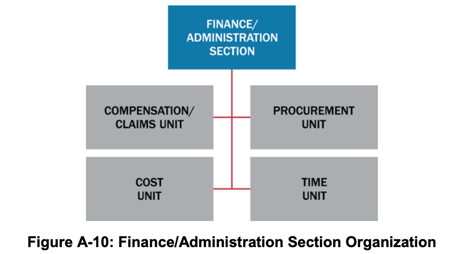
*Figure A-10: Finance/Administration Section Organization*

### Finance/Administration Section Chief

The Finance/Administration Section Chief monitors expenditures to ensure compliance with applicable laws, policies, and procedures. Close coordination with the Planning and Logistics Sections is essential so that operational records can be reconciled with financial documents.

The Finance/Administration Section Chief determines—given current and anticipated future needs—the need for establishing specific subordinate units. Because of the specialized nature of finance functions, the Section Chief typically comes from the jurisdiction/organization that has the greatest need for this support. The Finance/Administration Section Chief may have one or more deputies or assistants.

### Compensation and Claims Unit

Compensation and Claims Unit staff are responsible for financial concerns resulting from property damage, injuries, or fatalities at the incident. The specific activities vary depending on the incident. Staff handling injury compensation ensure that all forms needed by workers’ compensation programs and local agencies are completed. These staff also typically maintain files on injuries and illnesses associated with the incident and obtain written witness statements. Since Medical Unit staff may also perform some of these tasks, the Medical and the Compensation and Claims Units should coordinate closely. The Compensation and Claims Unit staff may assist with civil tort claims investigations involving incident property, and the staff maintain logs on the claims, obtain witness statements, and document investigations and agency follow-up activities.

### Cost Unit

Cost Unit staff track costs, analyze cost data, make estimates, and recommend cost-saving measures. They ensure that equipment and personnel for which payment is expected are properly identified, obtain and record cost data, and analyze and prepare estimates of incident costs. Cost Unit staff provide cost estimates for resource use to Planning Section staff. The Cost Unit staff maintain information on the actual costs of all assigned resources.

### Procurement Unit

The Procurement Unit staff administer all financial matters pertaining to leases and vendor contracts. Unit staff coordinate with local jurisdictions to identify sources for equipment, prepare and sign equipment rental agreements, and process documentation associated with equipment rental and supply contracts.

### Time Unit

Time Unit staff ensure the daily recording of incident personnel and equipment time in accordance with the policies of the relevant agencies. The Time Unit Leader may need assistance from personnel familiar with the relevant policies of any affected agencies. Time Unit staff verify these records, check them for accuracy, and post them according to policies.

---

## ICS Tab 6—The Intelligence/Investigations Function

The purpose of the intelligence/investigations function within ICS is to determine the source or cause of the incident (e.g., disease outbreak, fire, complex coordinated attack, or cyber incident) to control its impact and/or help prevent the occurrence of similar incidents. This involves collecting, analyzing, and sharing information and intelligence; informing incident operations to protect the lives and safety of response personnel as well as the public; and interfacing with counterparts outside the ICS organization to improve situational awareness.

These functions are typically performed by staff in the Operations and Planning Sections. However, for incidents that involve or may involve a significant level of intelligence/investigative work, the Incident Commander or Unified Command may choose to consolidate the intelligence/investigations function in the ICS organization in a number of ways. The intelligence/investigations function’s location in the ICS structure depends on factors such as the nature of the incident, the level of intelligence/investigations activity involved or anticipated, and the relationship of the intelligence/investigations activities to the other incident activities. The intelligence/investigations function can be incorporated as an element of the Planning Section, in the Operations Section, within the Command Staff, as a separate General Staff section, or in some combination of these locations. Figure A-11 depicts the various locations where the Incident Commander or Unified Command might opt to locate intelligence/investigations function.

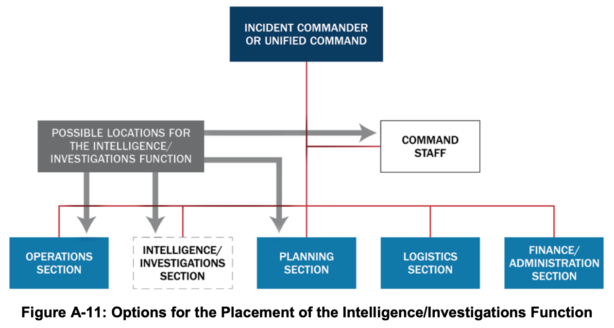
*Figure A-11: Options for the Placement of the Intelligence/Investigations Function*

### Intelligence/Investigations Function in the Planning Section

Integrating the intelligence/investigations function in the Planning Section—either as part of the Situation Unit or as a separate Intelligence/Investigations Unit—enhances the section’s normal information collection and analysis capabilities. It helps ensure that investigative information and intelligence is integrated into the context of the overall incident management mission. Intelligence/investigative staff benefit from access to Planning Section information management resources and tools, and Planning Section staff benefit from streamlined information sharing and the analytic and subject matter expertise of the intelligence/investigations personnel.

### Intelligence/Investigations Function in the Operations Section

The Operations Section typically integrates resources, capabilities, and activities from multiple organizations with multiple missions. Consolidating the intelligence/investigations activities in the Operations Section unifies all the incident operations (e.g., law enforcement, fire, EMS, hazardous materials response, public health, etc.) in one organization. This helps ensure that all incident activities are seamlessly integrated into the incident action planning process and conducted based on established incident objectives and priorities. This coordination enhances unity of effort, the effective use of all resources, and the safety and security of all incident personnel.

Within the Operations Section, the intelligence/investigations function may be configured as a new branch or group, integrated into an existing branch or group, or placed under the control of a new Deputy Operations Section Chief for Intelligence/Investigations.

As with all incidents, the leadership of the Operations Section should reflect the priority incident activities. During phases of incidents with extensive intelligence and investigative activities, such as a terrorist incident, intelligence/investigations personnel will dominate the Operations Section and should lead the section by filling the Operations Section Chief and other section leadership positions.

### Intelligence/Investigations Function in the Command Staff

When the incident has an intelligence/investigations dimension but does not currently have active intelligence/investigations operations, the Incident Command or Unified Command may assign intelligence/investigations personnel to serve as command advisors. These technical specialists interface with their parent organizations and provide subject matter expertise to incident leaders. Integrating the intelligence/investigations function into the Command Staff helps ensure that the intelligence/investigations personnel have immediate and constant access to the Incident Commander, Unified Command, other members of the Command Staff such as legal advisors, the Safety Officer, and the PIO. This in turn helps ensure that incident leaders understand the implications and potential second-order effects of incident management decisions and activities from an intelligence/investigations standpoint.

### Intelligence/Investigations Function as a Standalone General Staff Section

The Incident Commander or Unified Command may establish the intelligence/investigations function as a General Staff section when there is a need to manage the intelligence/investigations aspects of the incident separately from the other incident management operations and planning. This may occur when the incident involves an actual or potential criminal or terrorist act or when significant investigative resources are involved, such as for an epidemiological investigation.

The Intelligence/Investigations Section Chief leads the Intelligence/Investigations Section, which has groups for investigative operations, missing persons, intelligence, mass fatality management, forensics, and investigative support.[^21]

Establishing the intelligence/investigations function as a General Staff section has the potential to create overlaps with the responsibilities of the Planning, Operations, and Logistics Sections. The Intelligence/Investigations Section Chief and other General Staff members should clarify expectations with the Incident Commander or Unified Command and coordinate closely to ensure that requirements are not lost or duplicated between sections.

---

## ICS Tab 7—Consolidating the Management of Multiple Incidents

Large disasters or multiple different disasters occurring quickly in the same area may result in the establishment of multiple incident command organizations operating more or less independently. ICS provides several options for consolidating the management of separate incidents. These options, which are described below, can enhance coordination and improve the efficient use of resources.

### Incident Complex: Multiple Incidents Managed within a Single ICS Organization

An incident complex is an organizational structure that exists when two or more individual incidents located in the same general area are assigned to a single Incident Commander or Unified Command. When an incident complex is established over several individual incidents, the previously identified incidents become branches or divisions within the Operations Section of the incident complex. Each branch thus has the flexibility to establish divisions or groups. In addition, when divisions and groups have already been established at each of the incidents, the same basic structure can be propagated. If any of the incidents within an incident complex have the potential to become a large-scale incident, it is best to establish it as a separate incident with its own ICS organization.

The following are examples of when an incident complex may be appropriate:

- Disasters such as wildfires, earthquakes, tornadoes, floods, or other situations where many separate incidents occur in proximity;
- Several similar incidents occurring in proximity to one another; and
- One incident underway with an Incident Management Team (IMT) assigned, with other smaller incidents occurring in the same area.

The following are additional considerations for using an incident complex:

- A single Command and General Staff can adequately provide operations, planning, logistics, and finance/administration activities to the incidents that comprise the incident complex; and
- A combined management approach could achieve staff or logistical support economies.

### Area Command

An Area Command is established to oversee the management and support of multiple incidents or to oversee the management of a large or evolving incident with multiple ICS organizations.

#### Area Command Responsibilities

An Area Command does not have operational responsibilities, but prioritizes the use of scarce resources among the incidents. Additionally, the Area Command:

- Develops broad objectives for the impacted area(s);
- Coordinates the development of individual incident objectives and strategies;
- Allocates resources as the priorities change;
- Ensures that incidents are properly managed;
- Ensures effective communications;
- Ensures that incident management objectives are met and do not conflict with each other or with agency policies;
- Identifies critical resource needs and reports them to EOCs and/or MAC Groups; and
- For incidents that have a recovery dimension, ensures that short-term recovery is coordinated to assist in the transition to full-recovery operations.

#### Area Command Organization

The Area Command organization operates under the same basic principles as ICS. Typically, an Area Command comprises the following key personnel:

- **Area Commander (Unified Area Command):** Responsible for the overall direction of assigned incidents. This responsibility includes ensuring that conflicts are resolved, incident objectives are established, and strategies are selected for the use of scarce resources. The Area Commander coordinates with local, state, tribal, territorial, and Federal departments and agencies, as well as NGOs and other private sector elements.
- **Assistant Area Commander–Logistics:** Provides facilities, services, and materials at the Area Command level (by ordering resources needed to support the Area Command) and ensures the effective allocation of scarce resources and supplies among the incidents.
- **Assistant Area Commander–Planning:** Collects information from various incidents to assess and evaluate potential conflicts in establishing incident objectives, strategies, and priorities for allocating scarce resources.
- **Area Command Aviation Coordinator:** Assigned when aviation resources at multiple incidents compete for common airspace and scarce resources. This role works in coordination with incident aviation organizations to evaluate potential conflicts, develop common airspace management procedures, ensure aviation safety, and allocate scarce resources in accordance with Area Command priorities.
- **Area Command Support Positions:** Activated as necessary:
  - **Resources Unit Leader:** Tracks and maintains the status and availability of scarce resources assigned to each incident under the Assistant Area Commander–Planning.
  - **Situation Unit Leader:** Monitors the status of objectives for each incident assigned to the Area Command.
  - **PIO:** Provides coordination between incident locations and serves as the point of contact for media requests to the Area Command.
  - **Liaison Officer:** Helps maintain off-incident interagency contacts and coordination.

#### Area Command Location

The following are guidelines for locating an Area Command:

- Established as close to the incidents as needed to facilitate operations, to make it easier for the Area Commander and Incident Commanders or Unified Commands to meet and otherwise interact;
- Should not be co-located with any individual ICP, to avoid confusion with the ICP activities;
- Should allow for effective, efficient communications and coordination with subordinate incidents, as well as with EOCs and MAC Groups; and
- Housed in a facility large enough to accommodate a full Area Command staff. It should also be able to accommodate meetings among the Area Command staff, the Incident Commanders or Unified Commands, and agency administrators/executives as well as news media representatives.

#### Area Command Reporting Relationships

When an Area Command is involved in coordinating multiple incident management activities, the following reporting relationships apply:

- The Incident Commanders for the incidents under the Area Command report to the Area Commander;
- The Area Commander is accountable to the agency or agencies or the jurisdictional executive(s) or administrator(s); and
- If one or more incidents within the Area Command are multijurisdictional, a Unified Area Command is established.

---

## ICS Tab 8—Incident Action Planning

The incident action planning process and IAPs are central to managing incidents. The incident action planning process helps synchronize operations and ensure that they support incident objectives. Incident action planning is more than producing an IAP and completing forms—it provides a consistent rhythm and structure to incident management.

Personnel managing the incident develop an IAP for each operational period. A concise IAP template is essential to guide the initial incident management decision process and the continuing collective planning activities. The IAP is the vehicle by which leaders on an incident communicate their expectations and provide clear guidance to those managing the incident. The IAP:

- Informs incident personnel of the incident objectives for the operational period, the specific resources that will be applied, actions taken during the operational period to achieve the objectives, and other operational information (e.g., weather, constraints, limitations, etc.);
- Informs partners, EOC staff, and MAC Group members regarding the objectives and operational activities planned for the coming operational period;
- Identifies work assignments and provides a roadmap of operations during the operational period to help individuals understand how their efforts affect the success of the operation;
- Shows how specific supervisory personnel and various operational elements fit into the organization; and
- Often provides a schedule of the key meetings and briefings during the operational period.

### The Incident Action Planning Process

The IAP provides clear direction and includes a comprehensive listing of the tactics, resources, and support needed to accomplish the objectives. The various steps in the process, executed in sequence, help ensure a comprehensive IAP. These steps support the accomplishment of objectives within a specified time.

The development of IAPs is a cyclical process, and personnel repeat the planning steps every operational period. Personnel develop the IAP using the best information available at the time of the Planning Meeting. Personnel should not delay planning meetings in anticipation of future information.

During the initial stage of incident management, the Incident Commander typically develops a simple plan and communicates the plan through concise oral briefings. In the beginning of an incident, the situation can be chaotic and situational awareness hard to obtain, so the Incident Commander often develops this initial plan very quickly and with incomplete situation information. As the incident management effort evolves, additional lead time, staff, information systems, and technologies enable more detailed planning and cataloging of events and lessons learned. The steps of the planning process are essentially the same for the first responders on scene determining initial tactics and for personnel developing formal written IAPs.

### Planning “P”

Many incident management organizations use a formal planning cycle with established meetings and deliverables to mark their progress through the planning process and enable coordination of the entire team. The Planning P, illustrated in Figure A-12, is a graphical representation of the sequence and relationship of the meetings, work periods, and briefings that comprise the incident action planning cycle. Other versions of the Planning P may be used as training and operational aids.
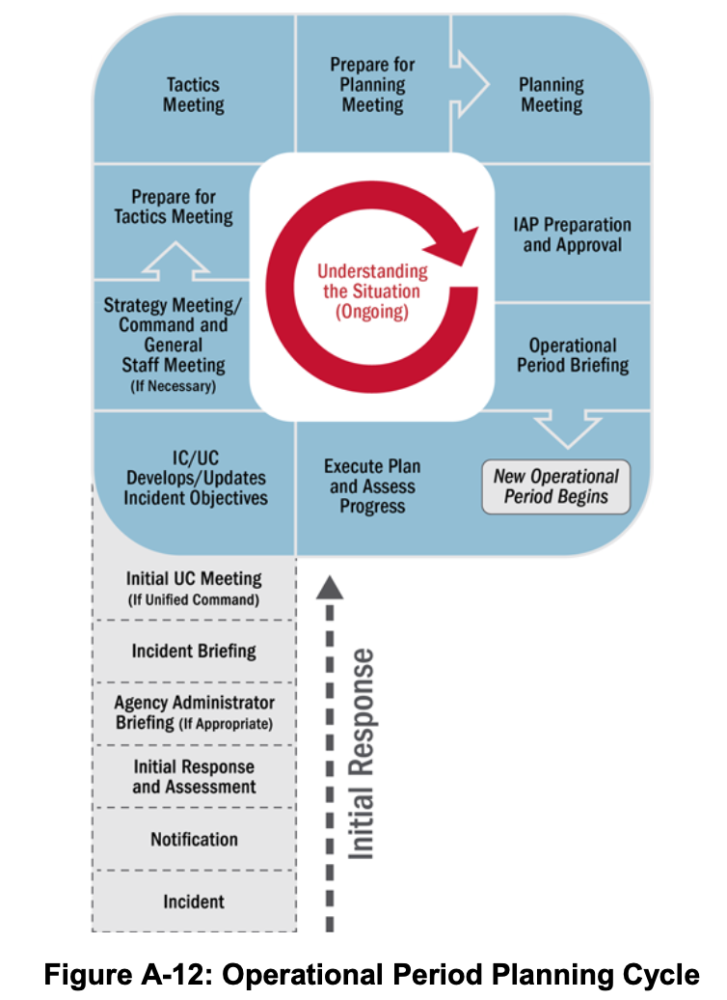
*Figure A-12: Operational Period Planning Cycle*

The leg of the “P” describes the initial stages of an incident, when personnel work to gain awareness of the situation and establish the organization for incident management. Incident personnel perform the steps in the leg of the “P” only one time. Once they are accomplished, incident management shifts into a cycle of planning and operations, informed by ongoing situational awareness and repeated each operational period.

#### Initial Response and Assessment

The responder(s) who is first to arrive at the incident scene conducts the initial assessment and takes whatever immediate response actions are appropriate and possible. The initial or rapid assessment is essential to gaining and maintaining situational awareness. It enables the Incident Commander to request additional resources and/or support, develop, and implement initial tactics. Jurisdiction officials might decide to activate an EOC based on the initial assessment.

#### Agency Administrator Briefing

The Agency Administrator Briefing is a presentation to the personnel who will be managing or supporting the incident by the administrator or other senior official of the jurisdiction, agency, or organization affected by the incident. This briefing occurs when the Incident Commander or Unified Command are assuming duties outside their normal responsibilities or are from an entity or jurisdictional area that does not possess authority to the manage the incident they are being assigned. In such cases, the briefing provides supporting details to the delegation of authority or other document that the jurisdiction, agency, or organization typically provides to the Incident Commander or Unified Command.

During the briefing, the agency administrator or a designee provides information, guidance, and direction—including priorities and constraints—necessary for the successful management of the incident. The briefing is intended to ensure a common understanding between the jurisdiction, agency, or organization and the incident personnel regarding such things as the environmental, social, political, economic, and cultural issues relevant to the incident and its location.

#### Incident Briefing

The incident briefing marks the transition from reactive to proactive incident management. The initial responder(s) typically delivers the briefing to the incoming Incident Commander or Unified Command. This meeting enables the incoming Incident Commander or Unified Command to initiate planning for the next operational period.

#### Initial Unified Command Meeting

If a Unified Command is managing the incident, the Initial Unified Command Meeting allows members of the Unified Command to meet in private to discuss each jurisdiction or organization’s priorities and objectives as well as any limitations, concerns, and restrictions. During the Initial Unified Command Meeting, members of the Unified Command generally accomplish the next step by developing the initial joint incident objectives.

#### Objectives Development/Update

The Incident Commander or Unified Command establishes the incident objectives for the initial operational period. After the initial operational period, the Incident Commander or Unified Command reviews the incident objectives and may validate them, modify them, or develop new objectives.

Incident objectives are based on incident priorities and other requirements. Clearly communicated priorities and objectives support unity of effort among incident personnel and enable the development of appropriate strategies and tactics. When the members of the team clearly understand the intent behind their instructions, they are better equipped to act decisively and make good decisions.

#### Strategy Meeting/Command and General Staff Meeting

After developing or revising the incident objectives, the Incident Commander or Unified Command typically meets with the Command and General Staff, and sometimes others, to discuss the incident objectives and provide direction. This meeting may be called the Strategy Meeting or the Command and General Staff Meeting and is held as needed to determine how best to meet the incident objectives.

The initial Strategy Meeting, which is held the first time through the planning cycle, is particularly important, because it allows team members to share information and jointly determine the initial approach to response operations. The initial Strategy Meeting may include the initial Incident Commander and a representative from the Agency Administrator.

#### Preparing for the Tactics Meeting

Once the approach to achieving or working toward achieving the incident objectives is determined, the Operations Section Chief and staff prepare for the Tactics Meeting by developing tactics and determining the resources that will be applied during the operational period.

#### Tactics Meeting

The Tactics Meeting is a forum for key players to review the proposed tactics developed by the Operations Section staff and to conduct planning for resource assignments. The Operations Section Chief leads the Tactics Meeting, and key participants include the Logistics Section Chief, Safety Officer, a representative from the Planning Section—typically, the Resources Unit Leader—and other technical specialists or team members invited by the Operations Section Chief, Logistics Section Chief, or Safety Officer. The team uses ICS Forms 215 and 215A, the Operational Planning Worksheet and the Incident Action Plan Safety Analysis, to facilitate and document decisions they make during the meeting.

#### Preparing for the Planning Meeting

Following the Tactics Meeting, preparations begin for the Planning Meeting. Team members collaborate between the Tactics Meeting and the Planning Meeting to identify support needs and assign specific operational resources to accomplish the operational plan.

#### Planning Meeting

The Planning Meeting serves as a final review and approval of operational plans and resource assignments developed during and after the Tactics Meeting. Ideally, the Planning Meeting involves no surprises and simply serves as a review of a plan that the Command and General Staff have collaboratively developed and agreed upon. At the end of the Planning Meeting, Command and General Staff, and any agency officials involved, confirm that they can support the plan.

Table A-2 lists the elements responsible for completing each form for inclusion in the IAP.

**Table A-2: The IAP and Typical Attachments**

| Component | Normally Prepared By ICS |
| :--- | :--- |
| **Incident Objectives (ICS Form 202)** | Incident Commander or Unified Command |
| **Organization Assignment List or Chart (ICS Forms 203, 207)** | Resources Unit |
| **Assignment List (ICS Form 204)** | Resources Unit |
| **Incident Radio Communications Plan (ICS Form 205) Or Communications List (ICS Form 205A)** | Communications Unit |
| **Medical Plan (ICS Form 206)** | Medical Unit |
| **Incident Maps** | Situation Unit |
| **General Safety Message/Site Safety Plan (ICS Form 208)** | Safety Officer |
| **Other Potential Components (Incident Dependent)** | |
| **Air Operations Summary** | Air Operations |
| **Traffic Plan** | Ground Support Unit |
| **Decontamination Plan** | Technical Specialist |
| **Waste Management or Disposal Plan** | Technical Specialist |
| **Demobilization/Deactivation Plan** | Demobilization Unit |
| **Site Security Plan** | Law Enforcement, Technical Specialist, or Security Manager |
| **Investigative Plan** | Intelligence/Investigations Function |
| **Evacuation Plan** | As needed |
| **Meeting Schedule (ICS Form 230)** | Situation Unit |
| **Sheltering/Mass Care Plan** | As needed |
| **Other (as needed)** | As needed |

#### IAP Preparation and Approval

Based on concurrence from all elements at the end of the Planning Meeting, the Incident Commander or Unified Command approves the plan. After this final approval, the Planning Section staff assemble the plan and ensure that it is ready for use during the Operational Period Briefing.

A written IAP is composed of a series of standard forms and supporting documents that convey the intent of the Incident Commander or Unified Command, as well as the Operations Section Chief for the operational period. The Incident Commander or Unified Command determines which ICS forms and attachments to include in the IAP; the Planning Section Chief ensures that staff in the appropriate sections, branches, or units prepare the forms and attachments. The Incident Commander or Unified Command gives final approval of the written IAP before Planning Section staff reproduce and disseminate it. IAPs may be distributed electronically, in hard copy, or both.

#### Operational Period Briefing

Each operational period starts with an Operational Period Briefing. Incident supervisory and tactical personnel receive the IAP during the briefing. During this briefing, various members of the Command and General Staff present the incident objectives, review the current situation, and share information related to communications or safety. Following the Operational Period Briefing, supervisors brief their assigned personnel on their respective assignments as documented in the IAP. During longer operational periods, shift change briefings may be conducted within an operational period.

---

## ICS Tab 9—ICS Forms

This section describes common ICS forms. While the format and content are flexible, the form number and purpose (e.g., Assignment List, ICS Form 204, that defines the assignments for a division or group) should remain intact to maintain consistency, facilitate immediate identification and interoperability, and simplify their use.[^22]

Not all ICS forms are included in the IAP; some support the planning process or incident operations in other ways. The IAP normally consists of the Incident Objectives (ICS Form 202), Organization Assignment List (ICS Form 203), an Assignment List (ICS Form 204) for each division/group on the incident, and a map of the incident area. Larger incidents necessitate additional supporting attachments, such as a separate Incident Radio Communications Plan (ICS Form 205), a Medical Plan (ICS Form 206), a Meeting Schedule (ICS Form 230), and possibly a Traffic Plan.

The following section provides brief descriptions of selected ICS forms. This list is not all-inclusive; other forms are available online, commercially, and in a variety of formats.

- **ICS Form 201—Incident Briefing:** The initial Incident Commander typically uses this form to capture vital incident information before implementing the formal planning process. The use of this four-section document (often produced as four pages) allows a concise and complete transition-of-command briefing to an incoming new Incident Commander. In addition, this form may serve as the full extent of incident command and control documentation if the initial response resources and organization resolve the situation. This form simplifies and supports the transfer of situation information to the members of the Command and General Staffs as they arrive and begin work. It is not included as a part of a written IAP.
- **ICS Form 202—Incident Objectives:** Serves as the opening section of a written IAP and includes incident information, a listing of the objectives for the operational period, pertinent weather information, a general safety message, and a table of contents for the plan. This form contains the signature block in which the Incident Commander or Unified Command approves the IAP.
- **ICS Form 203—Organization Assignment List:** Is typically the second section of the IAP and provides a full accounting of incident management and supervisory staff for that operational period.
- **ICS Form 204—Assignment List:** The incident IAP typically includes multiple ICS Form 204s, based on the organizational structure of the Operations Section for the operational period. Each division/group has its own page, listing the supervisor for the division/group (including the Branch Director if assigned) and the specific assigned resources with the leader’s name and the number of personnel assigned to each resource. This document details the specific actions assigned to that division or group for the operational period, any special instructions, and pertinent elements of the Incident Radio Communications Plan (ICS Form 205).
- **ICS Form 205—Incident Radio Communications Plan:** Documents radio frequency assignments down to the division/group level.
- **ICS Form 205A—Communications List:** Documents non-radio contact information for incident personnel.
- **ICS Form 206—Medical Plan:** Presents the incident’s plan to care for responder medical emergencies.
- **ICS Form 207—Incident Organization Chart:** Depicts an organization chart of the major elements and key staff in the ICS organization.
- **ICS Form 208—Safety Message/Plan:** Typically contains the safety message, expanded safety message, safety plan, and site safety plan.
- **ICS Form 209—Incident Status Summary:** The primary form for reporting situation information to incident coordination and support organizations and agency administrators/executives.
- **ICS Form 210—Resource Status Change:** Documents changes in the status of resources assigned to the incident; it can also be used as a worksheet to track resource arrival and departure.
- **ICS Form 211—Incident Check-In List:** Documents resources that check in to the incident.
- **ICS Form 213—General Message Form:** A general use form to communicate information among incident personnel or with other echelons of incident management.
- **ICS Form 214—Activity Log:** Used to record notable activities or events.
- **ICS Form 215—Operational Planning Worksheet:** Used to develop tactical assignments and identify resource needs for the coming operational period.
- **ICS Form 215A—IAP Safety Analysis:** Communicates the safety and health issues identified by the Safety Officer; it also identifies mitigation measures to address safety issues.
- **ICS Form 221—Demobilization Check-Out:** Documents details regarding the demobilization of incident resources.
- **ICS Form 230—Meeting Schedule:** Records information regarding meetings and briefings scheduled for the operational period.

---

## ICS Tab 10—Primary Functions of Incident Commander or Unified Command, Command Staff, and General Staff Positions

Table A-3 lists the primary functions of each major ICS position.

**Table A-3: Summary Table of Major ICS Positions**

| Major ICS Position | Primary Functions |
| :--- | :--- |
| **Incident Commander or Unified Command** | • Have clear authority and know agency policy • Establish the ICS organization needed to manage the incident • Set incident objectives and determine incident priorities • Establish the ICP • Manage Command Staff and General Staff • Approve the IAP • Ensure incident safety • Approve resource requests and use of volunteers and auxiliary personnel • Authorize information release to the media • Order demobilization as needed • Ensure after-action reports are completed |
| **Public Information Officer** | • Develop accurate, accessible, and timely information for use in press/media briefings or dissemination via social media • Monitor information from traditional and social media that is useful for incident planning and forward it as appropriate • Understand any limits on information release • Obtain the Incident Commander’s approval of news releases • Conduct media briefings • Arrange for tours and other interviews or briefings • Make information about the incident available to incident personnel • Participate in Planning Meetings • Identify and implement rumor control methods |
| **Safety Officer** | • Identify and mitigate hazardous situations • Stop and prevent unsafe acts • Create and maintain the incident Safety Plan • Prepare and communicate safety messages and briefings • Review the IAP for safety implications • Assign assistants qualified to evaluate special hazards • Initiate preliminary investigation of accidents within the incident area • Review and approve the Medical Plan • Participate in Planning Meetings to address anticipated hazards associated with future operations |
| **Liaison Officer** | • Act as a point of contact for agency representatives • Monitor incident operations to identify current or potential inter-organizational issues • Maintain a list of assisting and cooperating agencies and agency representatives • Assist in setting up and coordinating interagency contacts • Participate in Planning Meetings and provide current resource status, including limitations and capabilities of agency resources • Provide agency-specific demobilization information and needs |
| **Operations Section Chief** | • Manage tactical operations • Determine strategies and tactics for incident operations • Ensure safety of tactical operations • Oversee the Operations Section’s central role in the incident action planning process • Supervise execution of the Operations Section’s assignments in the IAP • Request additional resources to support tactical operations • Approve release of resources from operational assignments • Make or approve expedient changes to the IAP • Maintain close contact with the Incident Commander, subordinate Operations personnel, and other agencies involved in the incident |
| **Planning Section Chief** | • Collect and manage incident-relevant operational data • Supervise/facilitate incident planning activities • Supervise preparation of the IAP • Provide resources input to the Incident Commander and Operations Section in preparing the IAP • Reassign out-of-service personnel within the ICS organization, as appropriate • Compile and display incident status information • Establish information needed and reporting schedules for units (e.g., Resources Unit, Situation Unit) • Determine need for specialized resources • Establish specialized data collection systems as necessary (e.g., weather) • Assemble information on alternative strategies • Provide periodic predictions on incident potential • Report significant changes in incident status • Oversee preparation of the Demobilization Plan |
| **Logistics Section Chief** | • Manage all incident logistics • Provide facilities, transportation, communications, supplies, equipment maintenance and fueling, food, and medical services for incident personnel and all off-incident resources • Identify known or anticipated incident service and support needs • Request additional resources as needed • Provide the Logistics Section’s input to the IAP • Ensure and oversee development of Traffic, Medical, and Communications Plans as needed • Oversee demobilization of Logistics Section and associated resources |
| **Finance/Administration Section Chief** | • Manage financial aspects of an incident • Provide financial and cost analysis information as requested • Ensure compensation and claims functions are addressed relative to the incident • Develop an operational plan for the Finance/Administration Section and submit requests for the section’s supply and support needs • Maintain daily contact with cooperating and assisting agencies on finance matters • Ensure that personnel time records are completed accurately and transmitted to the appropriate agency/organization • Ensure the accuracy of all obligation documents initiated at the incident • Brief agency administrative personnel on incident-related financial issues needing attention or follow-up • Provide input to the IAP |

---

# Appendix B. EOC Organizations

## Purpose

This appendix provides additional explanation and examples of Emergency Operations Center (EOC) organizational structures commonly used in EOCs in the United States. They are not intended to be mandatory, definitive, or exclusive. Jurisdictions or organizations may choose to use one of these structures, a combination of elements from different structures, or an entirely different structure.

The description of each organization includes information on when and why a jurisdiction or organization might wish to use it and a description of the typical functions the various elements in the organization perform.

While it is not depicted on the various organizational graphics, EOCs are guided by policy groups that typically include elected and appointed senior officials such as governors, mayors, city managers, and tribal leaders.

## Organization of This Appendix

This appendix contains the following tabs:

- Tab 1—Incident Command System (ICS) or ICS-like EOC Structure
- Tab 2—Incident Support Model (ISM) EOC Structure
- Tab 3—Departmental EOC Structure

---

## EOC Tab 1—Incident Command System (ICS) or ICS-like EOC Structure

Many jurisdictions/organizations opt to use an ICS or ICS-like structure in their EOCs. This is typically because people are familiar with the structure, and it aligns with what is used in the field. Additionally, it is a useful functional breakdown, particularly for EOCs that might take on operational missions. ICS and EOC personnel may agree to adjust responsibilities among the organizations to meet incident needs and fulfill resource and information requests.

When using this type of EOC organization, field and EOC personnel performing the same function (e.g., Public Information Officer [PIO]) should agree on how to divide their responsibilities to avoid gaps and/or duplication of effort. Ideally, this coordination will occur before an incident, and the result will be documented in the jurisdiction/organization’s emergency operations plan.

EOC leaders may opt for a standard ICS organization if:

- EOC staff are providing tactical direction to an incident;
- EOC management wishes to use ICS-trained personnel with no additional training requirements; or
- EOC managers want to mirror the organization of on-scene personnel.

> **Standard ICS Structure versus ICS-like Structure**
>
> If a jurisdiction/organization is using standard ICS, as practiced in the field, they will follow ICS procedures and processes as described in Appendix A. However, many EOC leaders find that modifying ICS slightly provides many of the benefits of the standard ICS structure while accommodating the differences between EOCs and Incident Command Posts (ICP).

An ICS-like EOC structure generally reflects the standard ICS organization but with varying nuances and possible title changes to emphasize the coordination and support mission of EOCs, as opposed to the tactical and logistics management role of on-scene responders. For example, EOC leaders often opt to adjust titles to differentiate between field and EOC functions/personnel by adding “Support” or “Coordination” to section titles (see Figure B-1). Additionally, some EOC leaders opt to modify certain ICS processes or functions to better reflect the activities and responsibilities of EOC personnel.
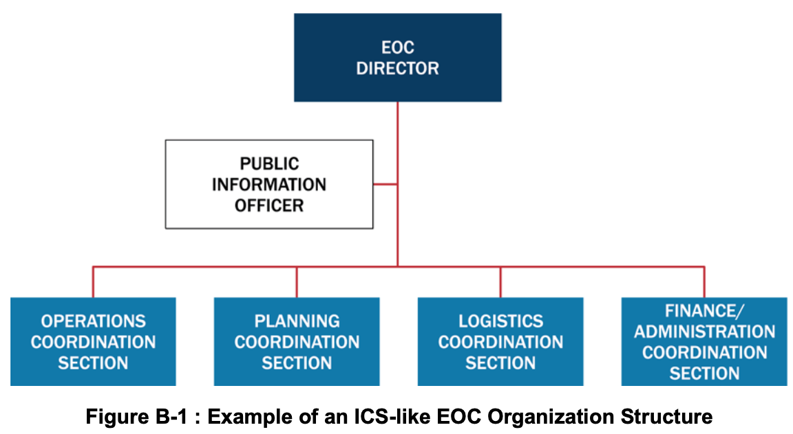
*Figure B-1: Example of an ICS-like EOC Organization Structure*

### EOC Command Staff

The EOC Command Staff (often called EOC Management Staff to clarify that they do not command on-scene operations) includes an EOC director who guides and oversees EOC staff and activities. The EOC Command Staff typically includes a PIO and may include others such as a Legal Advisor and a Safety Officer. The EOC director, possibly with the support of Command Staff, sets EOC objectives and tasks, integrates stakeholders, works with senior officials to facilitate the development of policy direction for incident support, and ensures the dissemination of timely, accurate, and accessible information to the public.

### Operations Coordination Section

Operations Coordination Section staff help ensure that on-scene incident personnel have the resources and operational support necessary to achieve incident objectives and address leadership priorities. The staff in this section are often organized functionally—by Emergency Support Function (ESF) or Recovery Support Function (RSF), for example—and are the primary points of contact for on-scene response personnel within their respective functions. They coordinate closely with incident personnel to identify and address unmet resource needs. When necessary for geographically widespread or complex incidents or when establishing a local ICP is not possible, staff in the section can also support operational activity directly from the EOC.

### Planning Coordination Section

The Planning Coordination Section has two primary functions: managing situational awareness efforts and developing activation-related plans. Staff in this section work closely with personnel in the ICS Planning Section to collect, analyze, and disseminate incident and incident-related information, including integrating geospatial and technical information and developing reports, briefings, and presentation products for a variety of stakeholders, including leadership, EOC personnel, and other internal and external stakeholders. Planning Coordination Section personnel also facilitate a standard planning process to achieve the EOC objectives and provide a range of current and future planning services to address current needs and anticipate and devise the means to deal with future needs.

### Logistics Coordination Section

Logistics Coordination Section staff provide advanced resource support to the incident. They work closely with Operations Coordination Section staff to source and procure resources by implementing contracts or mutual aid agreements or by requesting other government assistance (e.g., local or tribal to state, state or tribal to Federal). Staff in this section also provide resources and services to support the EOC staff. This includes information technology (IT) support, resource tracking and acquisition, and arranging for food, lodging, and other support services as needed.

> **Resource Management in an ICS-like EOC**
>
> EOC leaders often adjust ICS resource management processes to fit an EOC environment better. The various departments and agencies represented in the Operations Coordination Section may have access to internal departmental resources that they can order without going through the Logistics Coordination Section. The Logistics Coordination Section may have expertise in advanced resource ordering, such as (1) through mutual aid, (2) by leasing or purchasing, or (3) through a request for assistance from a governmental organization (e.g., state or Federal support). The personnel in the Operations Coordination Section may be better positioned to track incident resources than personnel in the Planning Coordination Section. Staff in each EOC establish protocols on how to coordinate and track the resource ordering functions at the EOC and with field personnel.

### Finance/Administration Coordination Section

Finance/Administration Coordination Section staff manage the activation’s financial, administrative, and cost analysis aspects. Finance/Administration Coordination Section staff track all expenditures associated with the activation, including monitoring funds from multiple sources. Reporting on costs as they accrue enables EOC leadership to estimate needs accurately and request additional funds if needed. Finance/Administration Coordination Section staff may provide administrative support to other EOC sections. In some cases, the EOC Finance/Administration Coordination Section staff assume responsibilities of their ICS counterparts and perform functions on their behalf.

---

## EOC Tab 2—Incident Support Model (ISM) EOC Structure

The ISM is a variation of the ICS structure that separates the information management/situational awareness function from the ICS Planning Section and combines the functions of the ICS Operations and Logistics Sections and comptroller/purchasing functions from the ICS Administration/Finance Section. EOC staff in jurisdictions or organizations that use an ISM structure typically focus exclusively on support functions rather than operations or managing actual response/recovery efforts.

As with the ICS/ICS-like model, the director of an ISM EOC is supported by personnel designated to key functions, subject matter experts, and technical specialists. Staff supporting the EOC director typically include a PIO and may include others such as a legal advisor. The General Staff sections consist of Situational Awareness, Planning Support, Resources Support, and Center Support. Figure B-2 shows a top-level management structure for an ISM EOC.
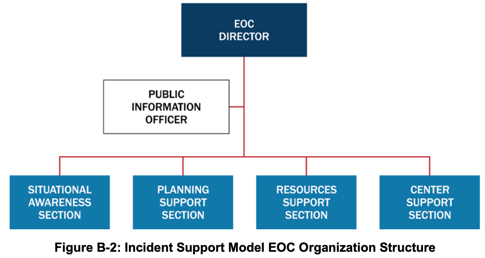
*Figure B-2: Incident Support Model EOC Organization Structure*

### ISM EOC Director’s Staff

As with the ICS/ICS-like EOC Command Staff, the ISM EOC director’s staff typically includes a PIO and may include others such as a Legal Advisor and a Safety Officer. The EOC director and director’s staff set EOC tasks, work with senior officials to facilitate the development of policy direction for incident support, and ensure the dissemination of timely, accurate, and accessible information to the public.

### Situational Awareness Section

Situational Awareness staff collect, analyze, and disseminate incident information. This section’s personnel typically create and provide a variety of products for EOC policy-level leadership, public affairs, and other internal and external stakeholders. The Situational Awareness Section essentially elevates the functions of the ICS Planning Section Situation Unit to a General Staff position in the EOC, reporting directly to the EOC director. The staff in this section also process requests for information; develop reports, briefings, and presentation products; integrate geospatial and technical information; and develop material to support public warning messages. Staff in the Situational Awareness Section may include representatives or liaisons from ESF #15 – External Affairs.

### Planning Support Section

The Planning Support Section staff provide a range of current and future planning services that may include developing contingency, deactivation, and recovery plans. Staff in the Planning Support Section assist in developing and executing the shared goals of multiple jurisdictions and organizations involved in managing the incident and coordinate a standard planning process to achieve the objectives of the EOC leadership and foster unity of effort among all organizations represented in the center. The Planning Support Section staff coordinate closely with the ICS Planning Section to ensure that both on-scene and EOC personnel have appropriate contingency plans in place.

### Resources Support Section

Staff in the Resources Support Section work to ensure that on-scene incident management personnel have the resources and operational support they need. Resource Support Section staff source, request/order, and track all resources. This includes supplies, equipment, and personnel acquired from departments and agencies represented in the EOC, other community organizations, mutual aid/Emergency Management Assistance Compact (EMAC) sources, or nongovernmental partners, as well as items purchased or leased. Staff in the Resources Support Section may be organized by department/agency or by ESF/RSF.

> **Resource Management in an ISM EOC**
>
> The departments and agencies represented in an EOC generally have access to a variety of resources that are specific to the department or agency’s responsibilities. A typical ICS Logistics Section has expertise in ordering resources through mutual aid, purchasing/contracting/leasing, or from external government organization via requests for assistance. Funding for purchases/contract/leases or reimbursement of expenses is usually handled in the ICS Administration/Finance Section. ISM EOCs combine all these functions in the Resources Support Section, which provides a one-stop shop for acquiring, deploying, and tracking resources and services.

### Center Support Section

EOCs require a variety of communications, IT, administrative, and general services, as well as staff support, such as food, to function most effectively. Staff in the Center Support Section support the needs of the facility and staff in the EOC and any associated facilities such as a Joint Information Center (JIC). In this role, staff in the Center Support Section communicate and gather requirements for supplies, equipment, administrative processes, security, maintenance, and other logistics to ensure the EOC staff have the resources and capabilities required to perform their roles.

---

## EOC Tab 3—Departmental EOC Structure

Jurisdictions or organizations may choose to retain the day-to-day relationships they have with the various departments and agencies that they also work with in responding to and recovering from incidents. These organizations or jurisdictions may configure the personnel who assemble in the EOC by the participants’ departments, agencies, or organizations. Such departmentally structured EOCs typically require less training and emphasize coordination and equal footing for all departments and agencies. In this model, a single individual, either the jurisdiction or organization’s emergency manager or another senior official, directly coordinates the jurisdiction’s support agencies, nongovernmental organizations (NGO), and other partners. This model can also be organized using ESFs instead of departments. Figure B-3 presents an example of a Departmental EOC structure.
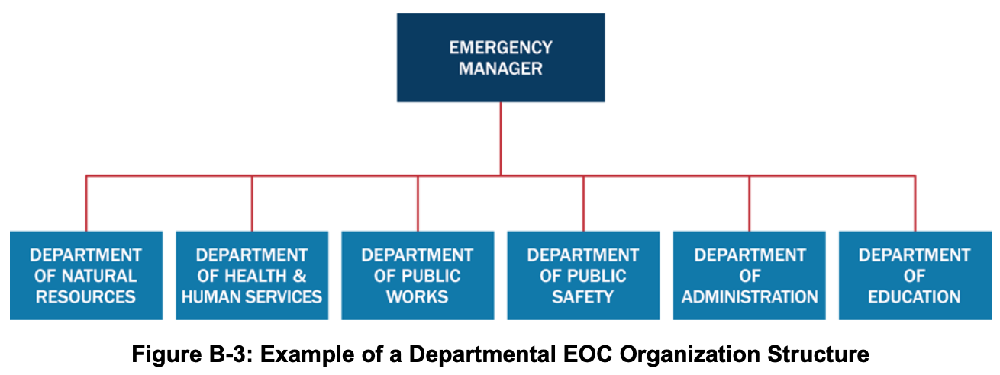
*Figure B-3: Example of a Departmental EOC Organization Structure*

In this example, the Emergency Manager, as EOC director, directly facilitates EOC planning and reporting. The EOC director may also be responsible for the office equipment, phones, radios, and/or computers in the EOC and ensuring food is available for the staff.

For the departments, representatives bring the various resources, expertise, and relationships that are associated with those organizations and functions. Decisions are made within the group to achieve mutually agreed-upon objectives, as in a Unified Command.

The roles and responsibilities of a departmental EOC reflect the day-to-day responsibilities of the represented departments and agencies. For example:

- EOC representatives from the department that deals with natural resources may be responsible, according to their normal authorities, for historic preservation, air and water quality, parks and recreation, game and wildlife, and wildfire suppression.
- Representatives in the EOC from the agencies that deal with public health, medical, and human services issues would be responsible for and provide resources associated with elder services; community hospitals, clinics, and medical services; sheltering and mass care; disease investigations; pharmacy services and mass dispensing sites; and liaison with humanitarian relief organizations.
- Representatives from public works are responsible for issues and resources in the EOC involving roads and grounds, sewers and sanitation, water purification, fuel, utilities, transportation, and solid waste.
- Police, sheriff, fire, and/or emergency medical services organizations all have representatives who coordinate their respective functions and resources in the EOC.
- EOC representatives from the jurisdiction or organization’s administrative department or agency coordinate public information, finance, training, private sector and tribal liaison, and social/cultural centers.
- The public schools’ officials assigned to the EOC are responsible for day care services, schools facilities (e.g., when used as emergency shelters), and school transportation.

These responsibilities would vary according to the jurisdiction’s day-to-day departmental organization and responsibilities. This enables jurisdictions or organizations to address incidents effectively while maintaining their normal authorities, responsibilities, and relationships.

---

[^20]: Resources, such as Urban Search and Rescue teams, may include their own Safety Officers; such Safety Officers retain their specific responsibilities and authorities and coordinate with the Safety Officer on the Command Staff as necessary.
[^21]: The National Incident Management System (NIMS) Intelligence and Investigations Function Guidance and Field Operations Guide describes the ICS intelligence/investigations function in more detail.
[^22]: Template ICS forms can be found at https://www.fema.gov/incident-command-system-resources.