## 👨‍🎓 연구자 인적사항 (Academic Affiliation)

| 항목 (Item) | 상세 정보 (Details) |
| :--- | :--- |
| **소속 (Department)** | **Department of Disaster and Emergency Management** |
| **학위과정 (Degree Program)** | **재난관리학박사 과정 (Doctor of Philosophy in Disaster and Emergency Management)** |
| **성명 (Name)** | **강석균 (Kang, Seokgyun)** |
| **학번 (Student ID)** | **2678125** |

> **📌 본 연구자료(SUB-NOTE)의 편찬 원칙 및 구성 특징**
> 1. **원문 100% 무결성 준수:** 미국 연방비상관리청(FEMA)의 『National Incident Management System (Third Edition, October 2017)』 본문 제1장~제8장 및 부록 A(ICS)·부록 B(EOC) 전권을 단 하나의 단락·각주·도표 누락 없이 한글로 정밀 번역·분석한 마스터 학술 자료입니다.
> 2. **원문 공식 다이어그램 27종 전수 수록:** 텍스트 기호로 인한 깨짐을 방지하기 위해 원문의 모든 조직도와 프로세스 도표(`Table 1~3`, `Figure 1~10`, `Figure A-1~A-12`, `Figure B-1~B-3`)를 고해상도 원본 이미지로 수록하고 상세 한글 해설을 병기하였습니다.
> 3. **연구자 해석 분리 및 한국적 시사점 도출:** 원문 내용과 연구자의 비교·해석을 엄격히 분리하고, 각 장 말미에 대한민국 재난대응 체계(긴급구조통제단·재난안전대책본부)와의 비교 및 성과지표(KPI)·주관성 연구(Q방법론) 연계 방안을 제시하였습니다.

```{=openxml}
<w:p><w:r><w:br w:type="page"/></w:r></w:p>
```

## ■ 전체 목차 (Table of Contents)

| 장(Chapter) 구분 | 수록 원문 페이지 | 핵심 수록 내용 및 주요 도표 |
| :--- | :---: | :--- |
| **제1장 NIMS의 기본 원리와 핵심 개념** | pp. 1–5 | • NIMS 목적·적용 범위, 3대 구성요소, 3대 지도 원칙(유연성·표준화·노력의 통일성)[[BR]]• `Table 1` NIMS 개요, 40년 발전사, 다계층 지휘·조정 비교 및 연구 연계 |
| **제2장 자원 관리 (Resource Management)** | pp. 6–18 | • 자원관리 대비태세 4대 활동(유형화·QCC·계획·인벤토리)[[BR]]• `Figure 1` 인력 자격·인증·크레덴셜링, `Figure 2` 사건 대응 중 6대 자원관리 순환도, 상호응원(EMAC) |
| **제3장 지휘 및 조정 (Command & Coordination)** | pp. 19–49 | • NIMS 14대 핵심 관리 특성, 현장지휘체계(ICS) 단일/통합지휘(`Figure 3~6`)[[BR]]• 긴급운영센터(EOC) 3대 모델(`Figure 7~9`, `Table 2`), MAC Group, 합동정보체계(JIS/JIC, `Table 3`), 연방 지원(`Figure 10`) |
| **제4장 통신 및 정보 관리** | pp. 50–59 | • 통신·정보 관리 4대 핵심 원칙(상호운용성·신뢰성·표준용어·데이터보안)[[BR]]• 통신 관리 5대 영역, 데이터 수집·처리 6대 프로세스(14대 EEI) |
| **제5장 결론 (Conclusion)** | p. 60 | • 통합적 역량 결집(Unity of Effort) 및 살아있는 문서(Living Document)로서의 4년 주기 진화 |
| **제6장 용어 해설 (Glossary)** | pp. 61–71 | • NIMS 원문 86개 공식 핵심 용어(가나다/알파벳 대조) 전수 정의 및 해설 |
| **제7장 약어 목록 (List of Abbreviations)** | p. 73 | • NIMS 원문 52개 공식 영문 약어 풀네임 및 한국어 표준 번역·기능 분류 |
| **제8장 참고자료 및 법적 리소스 (Resources)** | pp. 74–78 | • NIMS 5대 지원 문서, 5대 핵심 미 연방 법률(Stafford Act, PKEMRA 등), 14대 추가 자료·시스템 |
| **부록 A. 현장지휘체계 (Appendix A. ICS)** | pp. 79–111 | • ICS 10대 탭(Tabs 1–10) 전수 해설, 작전·기획·물류·재정·정보수사 부서 상세 구조(`Figure A-1~A-11`)[[BR]]• 플래닝 P(`Figure A-12`), ICS 표준 서식 18종(`Table A-2`) 및 직위별 핵심 임무(`Table A-3`) |
| **부록 B. 비상운영센터 조직 (Appendix B. EOC)** | pp. 112–118 | • 미국 EOC 3대 표준 조직 모델 상세 비교: ① ICS 유사형(`Figure B-1`), ② 사건지원모델 ISM(`Figure B-2`), ③ 부서별 모델(`Figure B-3`) |


```{=openxml}
<w:p><w:r><w:br w:type="page"/></w:r></w:p>
```

# 제1장 NIMS의 기본 원리와 핵심 개념 (I. Fundamentals and Concepts of NIMS)
> **참고 원문:** *National Incident Management System (Third Edition, October 2017) - Chapter I (pp. 1–5)*  
> **작성 원칙:** 『GEMINI.md』의 **연구자료(SUB-NOTE) 사용 10대 기본 원칙**에 입각하여 원문의 단락, 표(Table 1), 각주(Footnotes 1~5), 6대 핵심 용어를 **단 하나의 누락이나 임의 왜곡 없이 100% 충실하게 정리**하고 주요 학술·실무 개념에 영문을 병기함. 원문 연구 결과(제1절~제6절)와 연구자의 비교·해석(제7절~제9절)은 엄격히 분리함.

---

## 1. 개요 (Introduction) *(원문 pp. 1–2)*

### 1.1 배경 및 필요성 *(원문 p. 1)*
- **위협과 위험의 다양성:** 미국 전역의 지역사회(Communities across the Nation)는 자연재난, 사회재난, 테러, 대규모 기술적 사고 등 매우 다양한 위협(Threats), 위험(Hazards), 사건/행사(Events)를 경험함.
- **사건(Incident)의 특성과 3대 우선순위:** 사건의 규모(Size), 빈도(Frequency), 복잡성(Complexity), 범위(Scope)는 다양하지만, 모든 사건은 공통적으로 **인명 구조(Save lives), 사건 안정화(Stabilize the incident), 재산 및 환경 보호(Protect property and the environment)**라는 목표를 달성하기 위해 다양한 인력과 조직의 협력을 필요로 함. *(각주 1 참조)*
- **상호운용성(Interoperability)의 핵심성:** 관할구역(Jurisdictions)과 조직들은 일상적으로 자원을 공유하고, 전술을 통합하며, 협력적으로 행동함. 인접한 조직들이든 미 전역에서 원거리 지원을 오는 조직들이든 관계없이, 이들의 성공은 **자원 공유(Sharing resources), 사건 조정 및 관리(Coordinating and managing incidents), 정보 소통(Communicating information)에 대한 공통적이고 상호운용 가능한 접근법(Common, interoperable approach)**에 달려 있음.
- **NIMS의 정의:** 국가사건관리시스템(National Incident Management System, NIMS)은 이러한 포괄적인 접근법을 정의함.

### 1.2 NIMS의 목적과 적용 범위 *(원문 p. 1)*
- **범정부 및 민관 협력 지침:** NIMS는 모든 계층의 정부(All levels of government), 비정부기구(Nongovernmental organizations, NGO), 민간 부문(Private sector)이 사건을 **예방(Prevent), 보호(Protect against), 완화(Mitigate), 대응(Respond to), 복구(Recover from)**하기 위해 함께 협력하도록 안내함.
- **전체 공동체(Whole Community) 접근법:** NIMS는 이해관계자들에게 공유된 어휘(Shared vocabulary), 시스템(Systems), 프로세스(Processes)를 제공하여, 전체 공동체(Whole community)가 협력하고 **국가대비체계(National Preparedness System, NPS)**에서 규정한 역량(Capabilities)을 성공적으로 전달하도록 지원함. *(각주 2, 3 참조)*
- **운영 시스템 규정:** NIMS는 현장지휘체계(Incident Command System, ICS), 긴급운영센터(Emergency Operations Center, EOC) 구조, 다기관조정그룹(Multiagency Coordination Groups, MAC Groups)을 포함하여, 사건 관리 인력들이 함께 일하도록 돕는 운영 시스템(Operational systems)을 정의함.
- **모든 사건에의 적용:** NIMS는 일상적인 사건(Day-to-day incidents)부터 대규모 재난(Major disasters)에 이르기까지 모든 사건에 적용됨.
- **다양한 역량의 통합과 경험의 결집 *(원문 p. 1 제3문단 원문 보완)*:** 사건 관리에 참여하는 관할구역과 조직들은 법적 권한(Authorities), 관리 구조(Management structures), 통신 역량 및 프로토콜(Communication capabilities and protocols) 등 여러 요소에서 차이가 남. NIMS는 이러한 다양한 역량을 통합하고 공통의 목표(Common goals)를 달성하기 위한 **공통 프레임워크(Common framework)**를 제공함. 본 문서에 담긴 지침은 미 전역의 사건 관리 인력들이 **수십 년간의 경험(Decades of experience)을 통해 발전시킨 해결책**을 통합한 것임.

### 1.3 NIMS의 3대 핵심 구성요소 (The Three Major Components) *(원문 pp. 1–2)*
NIMS는 다음의 **3대 주요 구성요소(Three major components)**로 이루어져 있으며, 이 세 가지 구성요소는 함께 작동하는 **빌딩 블록 접근법(Building-block approach)**을 나타내므로, 그중 어느 하나라도 결여되면 NIMS의 성공적인 구현이 저해됨.

| NIMS 3대 주요 구성요소 | 주요 세부 기능 및 포괄 영역 |
| :--- | :--- |
| **1. 자원 관리 (Resource Management)** | • 자원 식별 및 유형화 (Resource Typing)[[BR]]• 인력 자격인증 및 크레덴셜링 (Credentialing)[[BR]]• 사전 대비, 동원 및 해제 관리 |
| **2. 지휘 및 조정 (Command & Coordination)** | • 현장지휘체계 (ICS)[[BR]]• 긴급운영센터 (EOC)[[BR]]• 다기관조정그룹 (MAC Groups)[[BR]]• 합동정보시스템 (JIS) 및 합동정보센터 (JIC) |
| **3. 통신 및 정보 관리 (Communications & Info)** | • 표준 통신 및 상호운용성 (Interoperability)[[BR]]• 정보 관리 프레임워크 및 공유 프로토콜[[BR]]• 합동정보시스템 (JIS) 연계 상황인식 유지 |

1. **자원 관리 (Resource Management):**
   - 사건 발생 전(Prior to an incident)과 사건 진행 중(During an incident) 모두에 걸쳐 인력(Personnel), 주요 장비(Major equipment), 보급품(Supplies), 팀(Teams), 시설(Facilities)을 포함한 자원을 체계적으로 관리하기 위한 표준 메커니즘을 기술함.
   - 이를 통해 필요할 때 조직들이 자원을 효과적으로 공유하고 통합할 수 있도록 보장함.
2. **지휘 및 조정 (Command and Coordination):**
   - 운영적 현장 수준(Operational on-scene level)과 사건 지원 수준(Incident support level)에서의 리더십 역할(Leadership roles), 프로세스(Processes), 권장 조직 구조(Recommended organizational structures)를 기술함.
   - ICS, EOC, MAC Group, 합동정보체계(Joint Information System, JIS) 등 다양한 구조가 사건을 효과적이고 효율적으로 관리하기 위해 어떻게 함께 작동하는지 설명함.
3. **통신 및 정보 관리 (Communications and Information Management):**
   - 사건 관리 인력과 기타 의사결정자들이 핵심적인 결정을 내리고 소통하는 데 필요한 수단과 정보를 갖출 수 있도록 보장하는 통신 및 정보 시스템을 위한 시스템과 방법을 기술함.

---

> ### 📌 [원문 각주 1~3 전수 번역 및 해설 (Footnotes 1–3, pp. 1–2)]
> - **각주 1 (사건[Incident]의 정의, p. 1):** NIMS에서 사용하는 "사건(Incident)"이란 자연적 현상이든 인위적 현상이든 관계없이, 인명 손실이나 재산·환경 피해를 예방하거나 최소화하기 위해 대응 조치를 필요로 하는 실제 발생했거나 임박한 발생 사건(Actual or impending occurrence)—비상사태(Emergencies)나 재난(Disasters)뿐 아니라 사전에 계획된 행사(Planned events)까지 포함—을 의미함.
> - **각주 2 (전체 공동체[Whole Community]의 정의, p. 1):** 본 문서에서 정의하는 "전체 공동체(Whole community)"란 비상관리에 대한 접근법으로서, 더 나은 조정과 협력 관계를 조성하기 위해 모든 계층의 정부 참여와 더불어 비정부기구(NGO) 및 일반 대중을 포함한 민간 및 비영리 부문의 폭넓은 주체들이 사건 관리 활동에 참여할 수 있도록 하는 데 초점을 맞추는 것을 의미함. 이는 정부만으로는 지역사회가 직면한 모든 과제를 해결할 수 없다는 사실을 인식하기 위해 전국적인 비상관리 공동체가 공동으로 개발한 프레임워크에서 유래함.
> - **각주 3 (국가대비체계[National Preparedness System, NPS], p. 2):** 2011년 3월 발표된 대통령 정책지침 제8호(Presidential Policy Directive 8, PPD-8) 「국가 대비(National Preparedness)」에 의해 확립된 국가대비체계(NPS)는 국가대비목표(National Preparedness Goal)를 달성하기 위해 미국이 채택하는 접근법을 기술함. 국가대비체계는 예방(Prevention), 보호(Protection), 완화(Mitigation), 대응(Response), 복구(Recovery)의 5대 임무 영역(Five mission areas)에 걸친 도구, 프로그램, 지침을 포함함. 국가대비체계는 **국가계획프레임워크(National Planning Frameworks), 연방기관간작전계획(Federal Interagency Operational Plans, FIOPs), 국가대비보고서(National Preparedness Report, NPR)**를 포함한 기존의 정책, 프로그램, 지침들로 구성되며 그 기반 위에 구축됨.

---

## 2. 적용 대상 및 범위 (Applicability and Scope) *(원문 pp. 2–3)*

### 2.1 적용 대상 (Audience) *(원문 p. 2)*
- **모든 사건 관리 및 지원 이해관계자:** NIMS의 대상 독자는 사건 관리 또는 지원 책임을 지는 모든 개인과 조직임. 여기에는 모든 계층의 정부, 비정부기구(NGO), 민간 부문의 응급 대응요원(Emergency responders) 및 기타 사건 인력뿐 아니라, 사건 시 주요 결정을 내리는 **선출직 및 임명직 공직자(Elected and appointed officials)**가 포함됨.
- **접근 및 기능적 필요(Access and Functional Needs)의 완전한 통합:** NIMS는 전체 공동체를 포괄하며, 그 계획과 운영에는 아동(Children), 노인(Older adults), 장애인(Individuals with disabilities), 비영어권 인력 및 주민(Non-English speaking personnel and residents)을 포함하여 **접근 및 기능적 필요가 있는 개인들(Individuals with access and functional needs)**이 완전히 통합되어야 함. *(각주 4 참조)*

### 2.2 적용 범위 (Scope) *(원문 p. 2)*
- **규모·유형·위험과 무관한 전면적 적용:** NIMS는 원거리의 사건을 지원하는 활동을 포함하여, 규모(Size), 범위(Scope), 발생 원인(Cause)과 관계없이 모든 사건과 모든 유형의 위험(All types of hazards)에 적용됨.

---

### 2.3 표 1 상세 분석: NIMS의 개요 (Table 1: Overview of NIMS) *(원문 p. 2)*

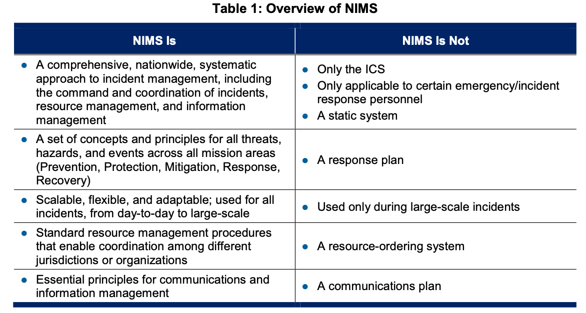

원문의 `Table 1: Overview of NIMS`는 NIMS의 본질을 **"NIMS인 것(NIMS Is)"**과 **"NIMS가 아닌 것(NIMS Is Not)"**으로 명확히 대비하여 제시함.

| NIMS Is (NIMS인 것) | NIMS Is Not (NIMS가 아닌 것) |
| :--- | :--- |
| **1. 종합적·전국적·체계적인 사건 관리 접근법**[[BR]]*(A comprehensive, nationwide, systematic approach to incident management, including the command and coordination of incidents, resource management, and information management)* | **● 단지 현장지휘체계(ICS)에 불과한 것**[[BR]]*(Only the Incident Command System)*[[BR]]**● 특정 응급/사건 대응 인력에게만 적용 가능한 시스템**[[BR]]*(Only applicable to certain emergency/incident response personnel)* |
| **2. 5대 임무 영역 전반에 관련된 일련의 개념 및 원칙**[[BR]]*(A set of concepts and principles for all threats, hazards, and events across all five mission areas: Prevention, Protection, Mitigation, Response, and Recovery)* | **● 고정된(정적인) 시스템**[[BR]]*(A static system)*[[BR]]**● 하나의 대응 계획서**[[BR]]*(A response plan)* |
| **3. 확장 가능하고 유연하며 적응성 있는 체계**[[BR]]*(Scalable, flexible, and adaptable for all incidents, from day-to-day to large-scale)* | **● 대규모 사건 중에만 사용되는 시스템**[[BR]]*(Used only during large-scale incidents)* |
| **4. 관할구역 및 조직 간 조정을 가능케 하는 표준 자원 관리 절차**[[BR]]*(Standard resource management procedures that enable coordination among different jurisdictions or organizations)* | **● 자원 주문 시스템**[[BR]]*(A resource-ordering system)* |
| **5. 통신 및 정보 관리를 위한 필수 원칙**[[BR]]*(Essential principles for communications and information management)* | **● 통신 계획서**[[BR]]*(A communications plan)* |

| 구분 | 핵심 성격 및 역할 |
| :--- | :--- |
| **NIMS (국가 표준 교리 / 프레임워크)** | • 표준 언어, 조직 원리(통제 범위), 자격 기준, 의사결정 프로세스 정의[[BR]]• 모든 재난 대응의 공통 운영 원리(Doctrine) 제공 |
| **EOP (비상운영계획) / IAP (사건활동계획)** | • NIMS 교리를 구체화(Operationalization)한 현장 실행 계획[[BR]]• "누가, 언제, 어디서, 무엇을, 어떤 통신망으로 실행할 것인가" 규정 |

> ### 💡 [연구자 주석 — 표 1 심층 해설: NIMS에 대한 대표적 오해 3가지]
> 1. **"NIMS = 소방관의 ICS다?" (X)**  
>    가장 흔한 오해임. ICS는 현장에서 발전했으나 NIMS는 이를 행정지원(EOC), 정책결정(MAC Group), 공보(JIS), 자격검증(NQS)까지 아우르는 국가적 거버넌스 체계로 확장했음.
> 2. **"NIMS는 비상대응계획서(EOP)나 매뉴얼이다?" (X)**  
>    NIMS는 구체적 계획서(Plan)가 아님. 재난이 발생했을 때 다양한 기관들이 어떻게 모여서 단일한 사건활동계획(IAP)을 수립하고 협력할 것인가를 규정하는 **메타 시스템(Meta-system)**이자 **행동 교리(Doctrine)**임.
> 3. **"평상시 작은 사고에는 필요 없고 국가비상사태에만 쓴다?" (X)**  
>    평소 소규모 일상 사고에서 NIMS 원리(단일지휘, 통제범위 유지, 평문 통신)를 사용하지 않는 조직은 대형 참사가 발생했을 때 절대로 NIMS 체계로 전환할 수 없음.

---

> ### 📌 [원문 각주 4 전수 번역 및 해설 (Footnote 4, p. 2)]
> - **각주 4 (접근 및 기능적 필요가 있는 개인[Individuals with Access and Functional Needs], p. 2):** 접근 및 기능적 필요가 있는 개인에는 장애인(Individuals with disabilities), 제한된 영어 구사력(Limited English proficiency)을 가진 사람, 교통수단에의 접근성이 제한된 사람, 만성 의료 질환자(Chronic medical disorders), 의사소통·건강 유지·자립 유지·보조 서비스 이용 또는 교통수단 이용에 있어 추가적인 지원이 필요한 일시적 또는 영구적 제한(Temporary or permanent limitations)을 가진 사람들이 포함됨.

---

## 3. NIMS 지도 원칙 (NIMS Guiding Principles) *(원문 p. 3)*

사건 관리 인력은 **인명 구조(Saving lives), 사건 안정화(Stabilizing the incident), 재산 및 환경 보호(Protecting property and the environment)**라는 우선순위(Priorities)를 반드시 달성해야 함. 이러한 목표를 달성하기 위해 사건 관리 인력은 다음의 **3대 NIMS 지도 원칙(NIMS guiding principles)**을 적용함.

| NIMS 3대 지도 원칙 (Guiding Principles) | 핵심 개념 및 작동 메커니즘 |
| :--- | :--- |
| **1. 유연성 (Flexibility)** | • 사건의 규모·빈도·복잡성에 맞춘 모듈식 확장 및 축소[[BR]]• 일상적 사건부터 국가적 대형 재난까지 모든 위험(All-Hazards)에 탄력적 적용 |
| **2. 표준화 (Standardization)** | • 표준 조직 구조(ICS, EOC, MAC Group)[[BR]]• 표준 직책·시설 명칭 및 공통 용어(Common Terminology) 사용[[BR]]• 자원 유형화(Resource Typing)를 통한 다기관 혼선 방지 |
| **3. 노력의 통일성 (Unity of Effort)** | • 참여 기관의 고유 관할권과 법적 권한을 침해하지 않고 존중함[[BR]]• 공통의 사건 목표(Common Objectives) 달성을 위해 다기관 역량을 하나로 결집 |

### 3.1 유연성 (Flexibility) *(원문 p. 3)*
- NIMS 구성요소는 정기적인 지역 사건(Routine, local incidents) 및 사전 계획된 특별 행사(Scheduled events)부터 주 간 상호응원(Interstate mutual aid)이나 연방 정부의 지원이 수반되는 사건에 이르기까지 모든 상황(Any situation)에 적응할 수 있음(Adaptable).
- 또한 NIMS는 위험 요소(Hazard), 지리(Geography), 인구통계(Demographics), 기후(Climate), 문화적 규범(Cultural norms), 당국/권한(Authorities)에 관계없이 다양한 사건에 적용 가능함.

### 3.2 표준화 (Standardization) *(원문 p. 3)*
- 표준화는 사건 중 다수의 관할구역과 조직이 통합되는 것을 지원하므로 상호운용성(Interoperability)에 필수적임.
- NIMS는 다음 3가지를 정의함:
  1. **표준 조직 구조 (Standard organizational structures):** 사건 관리 중 통합과 연결성(Integration and connectivity)을 향상시킴.
  2. **표준 실무 관행 (Standard practices):** 서로 다른 관할구역과 기관의 인력들이 효과적으로 함께 일할 수 있게 함.
  3. **공통 용어 (Common terminology):** 사건에 참여하는 다양한 주체들이 효과적으로 소통하고 서로를 명확히 이해할 수 있게 함.

### 3.3 노력의 통일성 (Unity of Effort) *(원문 p. 3)*
- **노력의 통일성(Unity of effort)**이란 명확한 목표(Clear objectives)를 달성하기 위해 다수의 조직들이 활동을 조정(Coordinating activities among various organizations)하는 것을 의미함.
- 노력의 통일성은 참여하는 각 조직이 **자체적인 법적 권한과 책임을 그대로 유지(Maintain its own authority and accountability)**하면서도 공동의 목표를 달성할 수 있게 해줌.

---

## 4. 발전 배경 및 연혁 (Background) *(원문 pp. 3–4)*

NIMS는 40년 이상에 걸쳐 발전해 온 사건 관리 개념과 구조의 총집합체임.

| 시기 | 발전 단계 | 핵심 배경 및 주요 진화 내용 |
| :---: | :--- | :--- |
| **1970년대** | **FIRESCOPE** | • 캘리포니아 대형 산불 계기 소방 자원 조정 체계 고안[[BR]]• 현대적 현장지휘체계(ICS) 및 다기관조정체계(MACS)의 원형 탄생 |
| **1982년** | **NIIMS** | • 산불 대응에서 모든 위험(All-Hazards) 대응 체계로 확장[[BR]]• 전국사건관리체계(NIIMS)로 전미 확산 시도 |
| **2001년** | **9·11 테러** | • 복합 테러 대응 과정에서 다기관 통합지휘 필요성 절감[[BR]]• 미국 국토안보부(DHS) 설립 및 국가 단일 표준 교리화 추진 |
| **2004 / 2008년** | **NIMS 초판 및 2판** | • 대통령 지침(HSPD-5)에 의거 FEMA가 NIMS 초판(2004) 및 개정판(2008) 발행[[BR]]• 전 연방·주·지방정부에 NIMS 채택 의무화 |
| **2017년 (현행)** | **NIMS 제3판** | • 현장(ICS)과 후방 지원(EOC)·정책 조정(MAC Group)의 유기적 결합 대폭 보강[[BR]]• 국가자격체계(NQS) 및 인력 크레덴셜링 연계 고도화 |

### 4.1 1970년대: FIRESCOPE 프로젝트와 ICS·MACS의 탄생 *(원문 p. 3)*
- 1970년대 남부 캘리포니아에서 발생한 파괴적인 산불(Devastating wildfires) 이후, 지방·주·연방 산림 및 화재 관리 인력들은 남부 캘리포니아 7개 카운티의 잠재적 비상사태에 대비하여 자원을 획득·배분·조정하기 위한 지역 시스템을 구축하고자 **FIRESCOPE(Firefighting Resources of California Organized for Potential Emergencies)**를 결성함.
- 이 노력의 결과로 최초의 **현장지휘체계(ICS)**와 **다기관조정시스템(Multiagency Coordination System, MACS)** 개념이 탄생함.

### 4.2 1982년: NIIMS의 창설과 확산 *(원문 p. 3)*
- 1982년, 많은 수의 소규모 사건들이 다수의 관할구역에 영향을 미쳤고, 이러한 사건들의 상당수가 산불 이외의 사건이었음을 인식한 FIRESCOPE와 전국다기관산불조정그룹(National Wildfire Coordinating Group, NWCG)은 ICS 및 MACS의 일상적 사용을 촉진하기 위해 **전국기관간사건관리시스템(National Interagency Incident Management System, NIIMS)**을 창설함.
- 이후 수십 년에 걸쳐 미 전역의 지역사회들은 ICS와 MACS를 포함한 NIIMS의 구성요소들을 채택함.

### 4.3 2001년 9.11 테러와 NIMS의 제정 *(원문 pp. 3–4)*
- **2001년 9월 11일 테러 공격:** 뉴욕시 세계무역센터와 버지니아주 알링턴의 펜타곤에 대한 테러 공격은 사건 관리를 위한 통합된 국가적 접근법(Integrated national approach to incident management)의 필요성을 입증함.
- **2003년 국토안보대통령지침 제5호(HSPD-5):** 조지 W. 부시 대통령은 국토안보부(Department of Homeland Security, DHS)에 모든 계층의 정부, 비정부기구(NGO), 민간 부문이 모든 유형의 사건을 관리하기 위해 함께 일할 수 있게 하는 국가사건관리시스템(NIMS)을 개발하도록 지시함.
- **2004년 초판 및 2008년 개정판:** DHS는 **2004년 3월** 초판 NIMS 문서를 발행했으며, 연방재난관리청(Federal Emergency Management Agency, FEMA)은 이해관계자들의 피드백과 최근 사건의 교훈을 통합하기 위해 **2008년 12월** NIMS를 개정함.

### 4.4 2017년 제3판 개정판 (본 문서)의 주요 변화 *(원문 p. 4)*
2017년 제3판(This third edition of NIMS)은 2008년 이후의 사건들로부터 얻은 교훈과 업데이트된 국가대비체계(NPS)를 반영하여 다음과 같이 개선됨:
1. **지휘 및 조정 구성요소 간의 관계 명확화:** 현장지휘체계(ICS)부터 고위급 정책 의사결정 그룹(MAC Groups)에 이르기까지 지휘 및 조정 구성요소의 프로세스와 구조가 어떻게 상호 연결되는지 명확히 설명함.
2. **긴급운영센터(EOC) 지침 확대 및 신설:** 기존의 긴급운영센터(EOC) 지침을 확장하고 새로운 지침을 추가함.
3. **국가자격체계(National Qualification System, NQS) 설명:** 직무 자격 및 크레덴셜링에 관한 국가자격체계(NQS)를 설명함.
4. **전국 이해관계자 의견 반영:** 이번 개정은 지방, 주(State) *(각주 5 참조)*, 부족, 준주, 도서 지역 및 연방 정부와 비정부기구(NGO), 민간 부문을 대표하는 미 전역 이해관계자들의 의견을 반영함.

---

> ### 📌 [원문 각주 5 전수 번역 및 해설 (Footnote 5, p. 4)]
> - **각주 5 (주[State]의 법적 정의, p. 4):** 2002년 국토안보법(Homeland Security Act of 2002, Public Law 107-296, 116 Stat. 2135)에 정의된 바와 같이, 본 문서에서 사용되는 "주(State)"라는 용어는 미국의 모든 주(Any state of the United States), 컬럼비아 특별구(District of Columbia, 워싱턴 D.C.), 푸에르토리코 자치령(Commonwealth of Puerto Rico), 미국령 버진아일랜드(Virgin Islands), 괌(Guam), 아메리칸 사모아(American Samoa), 북마리아나 제도 자치령(Commonwealth of the Northern Mariana Islands), 그리고 미국의 모든 기타 영토 또는 속령(Any other territory or possession of the United States)을 의미함.

---

## 5. 핵심 용어 사전 정의 (Key Terms) *(원문 pp. 4–5)*

원문 제1장 말미(pp. 4–5)에서 후속 장들의 이해를 돕기 위해 사전 정의한 6대 핵심 용어의 원문 직역 및 해설임.

| 계층 구분 | 핵심 기구 | 주요 구성원 및 핵심 임무 |
| :--- | :--- | :--- |
| **전략·정책 계층** | **MAC Group (다기관조정그룹)** | • 지자체장, 기관장, 고위 행정가(CEO) 참여[[BR]]• 거시적 정책 지침 결정 및 희소 자원 우선순위 배분 |
| **자격·인증 거버넌스** | **AHJ (관할권한보유기관)** | • 자격 기준 수립, 대원 교육·훈련 및 공식 자격 인증·크레덴셜링 수행 |
| **사건 지원 계층** | **EOC (긴급운영센터)** | • 다기관 상황 종합 분석 및 전략적 자원 조달·추적[[BR]]• 현장지휘소(ICP)에 대한 전폭적 후방 자원·정보 지원 |
| **현장 지휘 계층 (광역)** | **Area Command / Unified Area Command** | • 다수 현장 또는 광역 관할 사건 발생 시 현장지휘부 간 자원 배분 및 감독 |
| **현장 지휘 계층 (전술)** | **Incident Commander (단일지휘) / Unified Command (통합지휘)** | • 단일 관할 시 단일 지휘관(IC), 다기관·다관할 교차 시 통합지휘부(UC) 운영[[BR]]• 현장 전술 작전 직접 지휘 및 단일 사건활동계획(IAP) 실행 |

### 5.1 구역지휘 (Area Command) *(원문 p. 4)*
- **원문 정의:** 복수의 ICS 조직 설치를 필요로 하는 매우 복잡한 사건 또는 다수의 동시 발생 사건(Multiple concurrent incidents)의 관리를 감독(Oversee)하고 희소 자원을 배분(Allocate scarce resources)하는 조직.
- **통합구역지휘(Unified Area Command):** 구역지휘는 흔히 통합지휘(Unified Command)와 동일한 원칙에 따라 작동하는 **통합구역지휘(Unified Area Command)**로 설치됨.

### 5.2 관할권한보유기관 (Authority Having Jurisdiction, AHJ) *(원문 p. 4)*
- **원문 정의:** 사건 관리 직책/보직에 대해 인력을 **자격부여(Qualify), 인증(Certify), 신임장 발급(Credential)**하는 프로세스를 개발, 이행, 유지할 권한과 책임을 가진 실체(Entity).
- **범위:** AHJ는 연방, 주, 부족 또는 지방 정부의 부처나 기관, 훈련 위원회(Training commissions), 비정부기구(NGO), 또는 민간 부문 기업일 수 있음.

### 5.3 긴급운영센터 (Emergency Operations Center, EOC) *(원문 p. 4)*
- **원문 정의:** 정보 및 자원을 관리하여 현장 인력, 다른 EOC의 인력, 또는 기타 다기관조정시스템(MACS) 요소 내의 인력을 지원하는 물리적 또는 가상적 위치(Physical or virtual location).

### 5.4 현장지휘관 (Incident Commander, IC) *(원문 p. 4)*
- **원문 정의:** 사건 목표(Incident objectives) 설정, 전략(Strategies) 수립, 전술(Tactics) 실행, 그리고 사건을 위한 자원 요청 및 해제(Ordering and releasing resources)를 포함하여 **모든 사건 활동(All incident activities)에 대해 책임을 지는 개인(Individual)**.

### 5.5 다기관조정그룹 (Multiagency Coordination Group, MAC Group) *(원문 p. 5)*
- **원문 정의:** 정책 그룹(Policy group)이라고도 불리며, 일반적으로 기관 행정책임자(Agency administrators), 임원(Executives) 또는 그 지명자(Designees)로 구성되는 그룹.
- **주요 역할:** 사건에 필요한 자원의 우선순위 결정 및 배분(Resource prioritization and allocation), 정책 지침(Policy guidance) 제공, 그리고 선출직 및 임명직 공직자와 사건 관리 책임자 간의 의사결정 지원.

### 5.6 통합지휘 (Unified Command, UC) *(원문 p. 5)*
- **원문 정의:** 사건 관리에 대한 법적 권한이나 기능적 책임을 가진 다수의 관할구역 및/또는 기관들이 **개별 기관의 권한, 책임, 또는 책무성(Individual agency authority, responsibility, or accountability)에 영향을 주지 않으면서**, 공통의 사건 목표와 전략(Common set of incident objectives and strategies) 및 단일 사건활동계획(Single Incident Action Plan, IAP) 수립을 통해 사건 활동을 공동으로 관리하고 지시(Jointly manage and direct incident activities)할 수 있게 하는 ICS 적용 방식.

---

## 6. 대체 및 효력 (Supersession) *(원문 p. 5)*

- **공식 대체 문서:** 본 문서는 2008년 12월에 발간된 「국가사건관리시스템(National Incident Management System)」 문서를 공식적으로 대체(Supersedes)함.
- **폐지 및 통합 문서:** 또한 2006년 3월에 발간된 **NIMS Guide 0001(주 및 지방정부를 위한 국가사건관리시스템 준수 지표[National Incident Management System Compliance Metrics for States and Local Governments])** 및 **NIMS Guide 0002(부족 정부를 위한 국가사건관리시스템 지침[National Incident Management System Guidance for Tribal Governments])**을 공식 대체함.

---

> **[원칙 3 준수 고지]**  
> 위 **제1절~제6절**까지는 FEMA NIMS(2017) 제1장 원문(pp. 1–5)의 직접적인 내용과 각주(1~5), 표(Table 1)를 원문에 충실하게 번역·정리한 것이며, 아래 **제7절~제9절**은 원문 내용을 바탕으로 대한민국 재난안전관리체계와의 비교 및 학술적·정책적 시사점을 도출한 **연구자의 독립적 해석 및 응용 영역**입니다.

---

## 7. 한미 재난관리체계 비교 분석 (Comparative Analysis)

NIMS 제1장이 규정하는 핵심 철학과 개념을 대한민국 「재난 및 안전관리 기본법」(이하 재난안전법) 체계와 1:1로 비교하면 다음과 같은 구조적 차이가 드러남.

### 7.1 제도적 구조 대비표

| 구분 | 미국 NIMS (2017) | 대한민국 재난안전법 체계 |
| :--- | :--- | :--- |
| **기본 법률 및 교리** | • 법률 기반 연방 교리(National Doctrine)[[BR]]• 시스템과 원리 중심의 유연한 프레임워크 | • 헌법 및 「재난안전법」 중심의 성문법 체계[[BR]]• 법률-시행령-표준·실무·행동매뉴얼의 경직된 체계 |
| **현장 지휘 (On-Scene)** | • **Incident Commander (IC) / Unified Command (UC)**[[BR]]• 자격과 전문성을 갖춘 자가 현장 전권 행사[[BR]]• 다관할 시 단일 지휘소에서 '통합지휘(UC)' | • **긴급구조통제단장**(소방서장/소방본부장)[[BR]]• **재난현장통합지원본부장**(시·군·구 부단체장)[[BR]]• 초기 소방 지휘 후 지자체로 인계되는 이원적 구조 |
| **현장 지원 (Support)** | • **EOC (긴급운영센터)**[[BR]]• 상설 또는 비상설 전문 상황실[[BR]]• 현장 자원 지원, 다기관 정보 수렴에 집중 | • **재난안전상황실 / 재난현장통합지원본부**[[BR]]• 지자체 공무원 중심 운영, 자원 동원력 한계[[BR]]• 현장 지원보다는 상부 보고용 자료 취합 경향 |
| **최고 정책 결정 (Policy)** | • **MAC Group (다기관조정그룹)**[[BR]]• 수평적 협의체, 자원 우선순위 갈등 조정[[BR]]• 현장 전술에 직접 개입하지 않음 | • **중대본(행안부/총리) / 지대본(시·도지사, 시장·군수·구청장)**[[BR]]• 위계적·관료제적 통제 본부[[BR]]• 지자체장의 정무적 판단과 상명하복식 지시 하달 |
| **자원 및 자격인증** | • **AHJ & NQS (국가자격체계)**[[BR]]• 직무별 자격 표준화(Type 1~4)[[BR]]• 평시 전국 표준 크레덴셜링으로 상호운용성 보장 | • **공무원 직급 체계 및 순환보직**[[BR]]• 재난 직무별 전문 자격 인증 체계 미흡[[BR]]• 지자체 담당 공무원의 잦은 교체로 전문성 단절 |
| **운영 철학** | • **기능 중심(Role-based), 상향식(Bottom-up)**[[BR]]• 로컬 현장이 주도하고 주·연방은 후방 지원 | • **직급 중심(Rank-based), 하향식(Top-down)**[[BR]]• 중앙 및 상급 기관의 통제와 간섭이 강함 |

### 7.2 핵심 차이점 심층 분석

| 비교 구분 | 미국 NIMS 모델 (단일화된 현장 통합지휘) | 한국 재난안전법 모델 (이원화된 현장 지휘·수습 구조) |
| :--- | :--- | :--- |
| **현장 지휘 구조** | **Unified Command (통합지휘부)**[[BR]]• 소방 + 경찰 + 지자체 + 보건 등 합동 지휘[[BR]]• 공동 목표 설정 및 **단일 IAP** 수립·실행 | **소방 긴급구조통제단 vs 지자체 통합지원본부**[[BR]]• 인명구조(소방서장)와 수습·복구(부단체장)의 기계적 분리[[BR]]• 지휘권 인계 시점 논란 및 현장 권한 갈등 소지 |
| **후방 지원 및 상부** | **EOC (자원·정보 지원) + MAC Group (정책 조정)**[[BR]]• 현장의 자원 요청을 전폭 지원하는 수평적 조력 체계 | **지역재난안전대책본부(지대본) / 중앙재난안전대책본부(중대본)**[[BR]]• 상급 기관 보고 위주 행정으로 현장 의사결정 지연 우려 |

1. **현장지휘권의 이원화 vs 통합지휘(UC)의 부재:**
   - **한국:** 재난 초기 인명구조 단계에서는 소방서장이 '긴급구조통제단장'으로서 통제권을 갖지만, 수습·복구 단계로 넘어가면 시·군·구 부단체장이 이끄는 '재난현장통합지원본부'로 지휘권이 이양됨. 이 과정에서 **"언제, 어떻게 인계되는가", "경찰관이나 군 병력에 대해 소방통제단장이나 부구청장이 실질적 지휘권을 행사할 수 있는가"**에 대한 현장 마찰이 끊이지 않음 (이태원 참사, 오송 지하차도 참사 등에서 반복 확인).
   - **미국:** 지휘권을 인계하거나 이원화하지 않고, 처음부터 관할 기관들이 하나의 텐트(ICP)에 모여 동등한 권한을 유지한 채 **통합지휘(Unified Command)**를 결성함. 명령라인의 단절 없이 단일작전계획(IAP)으로 현장이 통제됨.

2. **교리(Doctrine) vs 매뉴얼(Manual) 중심주의:**
   - **미국:** NIMS는 현장의 자율성과 상황 적응력을 존중하는 원칙적 '교리(Doctrine)'임. 재난의 세부 양상이 예상과 달라도 융통성(Flexibility)을 발휘해 편제를 바꾸고(Modular organization) 작전을 전개함.
   - **한국:** 수천 쪽에 달하는 '위기관리 표준매뉴얼 - 실무매뉴얼 - 현장조치 행동매뉴얼' 체계에 의존함. 매뉴얼에 적히지 않은 돌발 상황이 발생하면 공무원들이 감사(Audit)나 형사처벌을 두려워하여 능동적으로 판단하지 못하고 **상부의 승인이나 법적 근거를 찾느라 골든타임을 허비**하는 치명적 약점을 지님.

3. **전문 자격(AHJ/Credentialing) vs 일반직 순환보직제:**
   - **미국:** 소방서장이든 민간 자원봉사자든 NIMS 사양에 따라 '작전과장(Operations Section Chief) Type 2' 자격을 검증받아야 해당 직무를 수행함.
   - **한국:** 지자체 재난안전대책본부나 통합지원본부의 핵심 보직(총괄지원반, 상황분석 등)에 투입되는 공무원은 1~2년 주기로 자리를 옮기는 일반 행정직 공무원임. 재난 발생 시 본인이 무슨 역할을 해야 하는지조차 모른 채 매뉴얼을 뒤적거리게 되는 구조적 한계가 존재함.

---

## 8. 미국의 NIMS 제도는 한국에서 작동할 수 있는가? (비판적 고찰)

미국의 NIMS가 체계적이고 우수하다고 해서 이를 한국에 직수입(Copy & Paste)할 경우 성공할 수 있는가? **결론부터 말하면, 현재 한국의 법률·행정·문화적 토양에서는 온전히 작동하기 극히 어렵다.** 그 이유와 극복 방안을 비판적으로 고찰한다.

### 8.1 한국에서 NIMS가 제대로 작동하지 않는 구조적 이유

#### ① 직급(계급) 중심의 관료 문화 vs 직무(역할) 중심 시스템의 충돌
- **NIMS의 기본 전제:** 계급이 낮더라도 해당 분야의 전문 자격을 갖춘 자가 Incident Commander(현장지휘관)가 되며, 계급이 높은 자(시장, 국장 등)는 현장 밖 MAC Group이나 EOC에서 후방 지원을 담당함.
- **한국의 현실:** 한국 공직사회는 철저한 **계급제(Rank-based)** 관료주의임.
  - 소방정(소방서장, 4급 상당)이 현장을 지휘하고 있는데, 3급 부구청장이나 1급 시 부시장, 나아가 선출직 구청장/시장이 현장에 도착하는 순간, 실질적 지휘권은 직급이 높은 행정직 단체장에게 쏠리게 됨.
  - 경찰(경찰서장, 총경)과 소방(소방서장, 소방정)은 법적으로 상호 독립된 기관으로, 직급 서열 의식 때문에 어느 한쪽의 지휘 아래 편입되는 것을 조직 생리상 거부함. 따라서 NIMS식의 유기적인 기능적 편제(Operations Section 아래 경찰·소방이 대등하게 분대 편성)가 성립하기 어려움.

#### ② 가혹한 형사책임 추궁 문화와 면책 부재 (감사 리스크)
- **미국의 거버넌스:** 중대한 과실이 없는 한, 재난 현장의 판단 실패는 시스템과 교리의 개선(Lessons Learned)으로 승화시키며, 지휘관 개인에게 사법적 살인·과실치사 혐의를 씌우는 일은 극히 드묾.
- **한국의 현실:** 대형 참사가 발생하면 수사기관이 즉각 투입되어 **업무상과실치사상죄, 중대재해처벌법** 등을 적용해 현장 지휘관(소방서장, 경찰서장, 구청장)을 압수수색하고 구속영장을 청구함.
  - 이러한 징벌적 환경에서 현장 지휘관은 "내 권한으로 유연하게 결단"하기보다는 **"매뉴얼대로 했는가", "상급자에게 서면/유선으로 보고했는가"**라는 법적 알리바이를 만드는 데 몰두하게 됨.
  - 통합지휘(UC)를 결성하여 공동 결정을 내렸다가 사고가 나면, "책임 소재가 불명확해져 모든 기관장이 공범으로 엮인다"는 공포 때문에 기관장들이 공동 지휘본부 구축을 회피하고 각자도생식 지휘소를 운영함.

#### ③ 상향식(Bottom-up) 연방 자치 모델 vs 중앙집권적 하향식(Top-down) 기대 심리
- **미국:** 소방서와 경찰서는 철저히 시·카운티(Local)의 조직이며, 주정부나 연방정부는 지방의 요청이 없으면 법적으로 개입할 수 없는 상향식 구조(Mutual Aid)임. NIMS는 이 분산된 지방 권력을 엮기 위해 고안된 것임.
- **한국:** 국토가 좁고 교통·통신이 고도화되어 있어, 사고 발생 즉시 대통령실, 행정안전부 장관, 소방청장이 실시간 CCTV를 보고 직접 지시를 내리는 **중앙집권적 하향식 구조**임.
  - 국민과 언론 역시 국지적 사고조차 "중앙정부와 대통령이 무한 책임을 져야 한다"고 요구함.
  - 결과적으로 현장의 Incident Commander에게 자율권을 주는 NIMS 철학은 상부의 실시간 개입 욕구와 언론의 중앙 책임론 앞에서 순식간에 무력화됨.

#### ④ 순환보직제로 인한 전문 역량의 부재 (AHJ 무력화)
- NIMS가 굴러가려면 전국적으로 인정받는 직무별 자격 기준(FEMA NQS)과 이를 인증하는 기관(AHJ)이 필수적임.
- 그러나 한국 지자체의 재난안전 부서는 공무원들이 기피하는 대표적 격무 부서로, 1~2년마다 담당자가 바뀌어 EOC 운영이나 IAP 작성법을 훈련받은 전문가가 조직 내에 축적되지 않음. 매번 초보자가 상황실에 앉아 있으니 시스템이 작동할 리 만무함.

---

### 8.2 한국적 재난 환경에서의 수용 및 제도 개선 방향

미국의 제도를 맹목적으로 추종할 수는 없지만, NIMS가 지닌 합리적 공학 원리는 한국 재난 체계의 고질병을 고치는 강력한 처방전이 될 수 있음. 다음과 같은 조건부 도입 및 제도 개선이 선행되어야 함.

| 4대 개혁 과제 | 세부 핵심 추진 내용 |
| :--- | :--- |
| **1. 현장지휘 일원화** | • 소방 중심의 실질적 통합지휘(Unified Command) 확립[[BR]]• '긴급구조'와 '수습·복구'의 기계적 분리 철폐 |
| **2. 자격 기반 전문성** | • 방재안전직렬 권한 강화 및 보직 안정성 확보[[BR]]• 직무별 국가자격인증(K-NQS) 도입 및 순환보직 제한·인센티브 부여 |
| **3. 현장 지휘관 면책 보장** | • 긴급 현장 판단에 대한 적극행정 면책의 법제화[[BR]]• 불확실성 하의 선의의 지휘 결정에 대한 형사처벌 남용 제한 |
| **4. 공통 언어 및 정보공유** | • 경찰-소방-지자체-군 간 공통 무전 프로토콜 및 데이터 표준 확립[[BR]]• 다기관 공유 표준 사건활동계획(IAP) 템플릿 의무화 |

1. **지휘권 인계 모델에서 '통합지휘협의체(K-Unified Command)'로의 전환:**
   - 소방의 긴급구조통제단과 지자체의 통합지원본부를 물리적으로 합쳐 하나의 '현장통합지휘소(ICP)'를 의무화해야 함.
   - 단, 계급 갈등을 방지하기 위해 **"현장 전술(인명구조, 화재진압, 구급)은 소방이 총괄하고, 경찰은 교통·질서유지 전담, 지자체는 주민대피 및 자원조달 후방지원"**을 담당하도록 법률(재난안전법)에 명확한 기능별 분담을 못 박아야 함.
2. **현장 지휘관에 대한 실질적 형사 면책(Safe Harbor) 부여:**
   - 고의나 중대한 배임이 아닌 한, 급박한 재난 현장에서 취한 전술적 결정에 대해 업무상과실치사상죄의 책임을 묻지 않는 면책 조항을 재난안전법에 신설해야 지휘관들이 소신 있게 결단을 내릴 수 있음.
3. **방재안전직렬 육성 및 자격인증제도(한국형 NQS) 도입:**
   - 지자체 재난상황실과 통합지원본부 인력을 순환보직 일반직에서 방재안전 전문직으로 전면 교체하고, 승진과 보수를 보장해야 함.
   - 행정안전부 주관으로 '재난관리관 자격인증제'를 만들어 일정 수준 이상의 교육과 훈련(IAP 작성, EOC 운영)을 이수한 자만이 지휘·지원 보직을 맡도록 제도화해야 함.
4. **용어와 통신의 표준화(Plain Language 원칙 도입):**
   - 현재도 재난안전통신망(PS-LTE)이 구축되어 있으나, 이태원 참사 등에서 보듯 각 기관이 서로 다른 용어와 채널을 사용하여 무용지물이 되었음. NIMS의 '공통 어휘(Common Terminology)' 원칙을 의무화하여 은어 사용을 금지하고 합동 도상훈련(Tabletop Exercise)을 정례화해야 함.

---

## 9. 요약 및 핵심 시사점 (Key Takeaways)

1. **NIMS는 단순한 소방 지휘(ICS)나 계획서(Plan)가 아니다:**  
   NIMS는 모든 위험(All-Hazards), 전 주기(예방~복구), 전 공동체(정부·민간·NGO)를 아우르는 **전국 공통의 행동 교리(Doctrine)**이며, 자원 관리, 지휘·조정, 통신·정보 관리의 3대 빌딩 블록으로 구성된다.
2. **지휘의 본질은 명령통일이 아닌 '노력의 통일성(Unity of Effort)'이다:**  
   복합 재난에서 각 기관의 고유 권한을 억누를 수 없으므로, 통합지휘(Unified Command)와 MAC Group을 통해 단일한 목표(IAP) 아래 협력하는 거버넌스가 핵심이다.
3. **한국적 맹목적 도입은 실패할 수밖에 없다:**  
   계급주의 관료제, 순환보직에 따른 비전문성, 가혹한 형사처벌 및 감사 리스크, 중앙집권적 정치 문화라는 한국의 토양을 직시해야 한다.
4. **미국 제도의 본질을 한국적 법제화로 재해석해야 한다:**  
   미국의 '자율과 책임에 기반한 상향식 NIMS'를 그대로 모방하기보다, **현장지휘권의 기능적 단일화, 현장 지휘관 형사 면책, 방재안전직 자격인증제, 공통 언어와 합동 훈련**이라는 핵심 가치를 추출하여 한국의 재난안전법 체계를 실질적으로 수술하는 것이 본질적 과제이다.


```{=openxml}
<w:p><w:r><w:br w:type="page"/></w:r></w:p>
```

# 제2장 자원 관리 (II. Resource Management)
> **참고 원문:** *National Incident Management System (Third Edition, October 2017) - Chapter II (pp. 6–18)*  
> **작성 원칙:** 『GEMINI.md』의 **연구자료(SUB-NOTE) 사용 10대 기본 원칙**에 입각하여 원문의 단락, 도표(Figure 1, Figure 2), 인셋 박스, 각주(Footnotes 6~8)를 **단 하나의 누락이나 임의 왜곡 없이 100% 충실하게 정리**하고 주요 학술·실무 개념에 영문을 병기함. 원문 연구 결과(제1절~제4절)와 연구자의 비교·해석(제5절~제7절)은 엄격히 분리함.

---

## 1. 개요 (Introduction to Resource Management) *(원문 p. 6)*

### 1.1 기본 개념 및 배경 *(원문 p. 6)*
- **협력과 조정의 프레임워크:** 자원 관리(Resource management) 지침은 다수의 조직에 속한 인력들이 함께 협력하여 인력(Personnel), 팀(Teams), 시설(Facilities), 장비(Equipment), 보급품(Supplies)과 같은 사건 자원을 조정하고 관리할 수 있게 하는 메커니즘을 제공함.
- **자원 보유의 한계:** 대부분의 관할구역이나 조직은 잠재적인 모든 위협과 위험(All potential threats and hazards)에 대응할 만큼 충분한 자원을 단독으로 보유하고 유지할 수 없음.
- **효과적 자원 관리의 핵심 축:** 따라서 효과적인 자원 관리에는 다음 4가지가 포함됨:
  1. 각 관할구역의 자체 자원 활용(Leveraging each jurisdiction's resources)
  2. 민간 부문 자원 참여 유도(Engaging private sector resources)
  3. 자원봉사 조직 참여(Involving volunteer organizations)
  4. 효과적인 **상호응원 협약(Mutual aid agreements)**의 개발을 장려하는 것

### 1.2 제2장의 3대 구성 체계 *(원문 p. 6)*
본 장은 다음의 3대 핵심 절로 구성됨:
1. **A. 자원관리 대비태세 (Resource Management Preparedness):** 자원을 식별 및 유형화(Typing)하고, 인력을 자격부여·인증·크레덴셜링하며, 자원을 계획하고, 자원을 획득·저장·목록화(Inventorying)하는 사전 준비 활동.
2. **B. 사건 진행 중 자원관리 (Resource Management During an Incident):** 사건에 대응하여 자원을 활성화, 파견, 추적, 동원 해제, 재보충하는 방법.
3. **C. 상호응원 (Mutual Aid):** 관할구역들이 사건 시 상호 지원을 위해 협약을 체결하고 함께 협력하는 방법.

---

## 2. A. 자원관리 대비태세 (Resource Management Preparedness) *(원문 pp. 6–11)*

자원관리 대비태세는 다음의 4가지 핵심 활동으로 구성됨: **자원 식별 및 유형화(Identifying and typing resources)**; **인력 자격부여, 인증 및 크레덴셜링(Qualifying, certifying, and credentialing personnel)**; **자원 계획 수립(Planning for resources)**; **자원 획득, 저장 및 목록화(Acquiring, storing, and inventorying resources)**.

| 자원관리 대비태세 4대 핵심 활동 | 주요 세부 내용 및 실행 메커니즘 |
| :--- | :--- |
| **1. 자원 식별 및 유형화 (Identifying & Typing)** | • 자원의 4대 속성(역량, 카테고리, 종류, 유형) 정의[[BR]]• 핵심 역량(Core capabilities) 기반 성능 등급(Type 1~4) 분류[[BR]]• 자원유형화 라이브러리 도구(RTLT) 카탈로그 활용 |
| **2. 인력 자격·인증·신원증명 (Qualify / Certify / Credential)** | • 관할권한보유기관(AHJ) 중심의 거버넌스 운영[[BR]]• 직무수행서(PTB: Position Task Book) 완수 및 검증[[BR]]• 계급이 아닌 성능·역량 기반 평가 체계 확립 |
| **3. 자원 소요 계획 (Planning for Resources)** | • 위협·취약성 평가(THIRA) 기반 자원 소요 산출[[BR]]• 역량 추정(Capability estimation) 실시[[BR]]• 자체 비축(Stockpiling) vs 적시 조달·상호응원 전략 수립 |
| **4. 획득·저장·목록화 (Acquiring, Storing & Inventorying)** | • 13개 필수 인벤토리 데이터 필드 표준화[[BR]]• IT 시스템(IRIS 등) 기반 실시간 가용 상태 관리[[BR]]• 다기관 중복 계상(Double-counting) 오차 방지 |

---

### 2.1 자원 식별 및 유형화 (Identifying and Typing Resources) *(원문 pp. 6–7)*

#### (1) 자원 유형화(Resource Typing)의 정의와 목적 *(원문 p. 6)*
- **정의:** 사건 자원을 **역량(Capability)**에 따라 표준적으로 정의하고 범주화(Defining and categorizing)하는 작업.
- **목적:**
  - 사건 시 자원 동원을 위한 **공통 언어(Common language)**를 확립함.
  - 인력, 팀, 시설, 장비, 보급품에 대한 기본 역량(Baseline capabilities)을 정의함.
  - 자원을 요청하는 지역사회가 요청한 역량을 제공하는 자원을 식별하고 수령하며, 그 자원을 효과적으로 통합할 수 있도록 지원함.

#### (2) FEMA의 역할 및 전국 표준 자원 선정 기준 *(원문 pp. 6–7)*
연방재난관리청(FEMA)은 지방, 주, 부족, 준주, 도서 지역 및 연방 차원에서 공유되는 자원에 대한 자원 유형화 정의(Resource typing definitions)의 개발 및 유지를 선도함. 전국적 차원에서 다음 기준을 충족하는 자원이 유형화 대상으로 선정됨:
- 널리 사용되고 공유 가능한 자원(Widely used and sharable);
- 상호응원 협약을 통해 관할구역 간 공유될 수 있는 자원;
- **다음 4가지 특성(Characteristics)으로 식별 가능한 자원:**
  1. **역량 (Capability):** 해당 자원이 가장 유용하게 기여하는 **핵심 역량(Core capability)** *(각주 6 참조)*;
  2. **범주 (Category):** 자원이 가장 유용하게 사용되는 기능 또는 임무 영역(예: 소방, 법집행, 보건의료, 수색구조 등);
  3. **종류 (Kind):** 장비, 인력, 팀, 시설, 보급품 등 자원에 대한 넓은 의미의 분류(Broad characterization);
  4. **유형 (Type):** 자원의 **최소 역량 수준(Level of minimum capability)**.
- 가용성 판단을 위해 식별, 목록화, 추적이 가능한 자원;
- ICS 및/또는 EOC에서 지휘, 지원 또는 조정을 위해 사용되는 자원;
- 공통의 주문, 관리, 추적 시스템을 통해 배치될 수 있을 만큼 충분히 상호운용 가능한(Sufficiently interoperable) 자원.

> #### 📌 [원문 인셋 박스] 자원의 유형(Type) 등급 체계 및 측정 지표 *(원문 p. 7)*
> - **역량의 서열:** 자원 유형화 정의는 **Type 1(최고 역량, Highest capability)부터 Type 4(최저 역량, Lowest capability)**까지 자원의 역량을 범주화함 (**Type 1 > Type 2 > Type 3 > Type 4**).
> - **역량 측정 기준:**
>   - **장비(Equipment):** 크기(Size), 동력(Power), 용량(Capacity) 등의 측정치 (예: 이동식 조리 트레일러의 시간당 급식 생산량 또는 덤프트럭의 적재 용량).
>   - **인력 및 팀(Personnel and Teams):** 경험(Experience), 훈련(Training), 자격(Qualifications) 수준.
> - **로컬 자원 유형화:** 관할구역은 지역 내에서의 자원 공유를 용이하게 하기 위해 자체 자원에 대한 유형화 정의를 개발하거나 수정할 수 있으나, 이러한 지역적 유형화 정의는 NIMS 자원 유형화 개념 및 프로세스와 일관성을 유지해야 함.

#### (3) 자원 유형화 라이브러리 도구 (Resource Typing Library Tool, RTLT) *(원문 p. 7)*
- FEMA가 운영하는 온라인 카탈로그 시스템 (`http://www.fema.gov/resource-management-mutual-aid`).
- 모든 NIMS 자원 유형화 정의 및 직무 명칭/보직 자격(Job titles/position qualifications)에 대한 권위 있는 최신 정보를 제공하며, 자원 유형, 전문 분야(Discipline), 핵심 역량, 또는 키워드로 검색 가능함.

---

> ### 📌 [원문 각주 6 전수 번역 및 해설 (Footnote 6, p. 6)]
> - **각주 6 (핵심 역량[Core Capabilities], p. 6):** 국가대비목표(National Preparedness Goal)에서 식별된 핵심 역량(Core capabilities)은 미국이 가장 큰 국가적 위험으로 인해 발생하는 구체적인 과제를 다루기 위해 사용하는 5대 임무 영역(예방, 보호, 완화, 대응, 복구) 전반에 걸친 구별되고 핵심적인 요소들임.

---

### 2.2 인력의 자격부여, 인증, 크레덴셜링 (Qualifying, Certifying, and Credentialing Personnel) *(원문 pp. 7–8)*

관할권한보유기관(AHJ)이 주도하는 인력의 자격부여, 인증, 크레덴셜링은 전국의 인력이 사건 중 자신의 직무를 성공적으로 수행할 수 있는 지식, 경험, 훈련, 역량을 보유하도록 보장하는 필수적인 3단계 프로세스임.

| 단계 | 프로세스 명칭 | 핵심 검증 활동 및 결과물 |
| :---: | :--- | :--- |
| **1단계** | **자격부여 (Qualification)** | • 사전 필수요건(선수 교육과목, 훈련, 신체검사 등) 이수[[BR]]• 직무수행서(PTB) 과업 완수를 통한 직무 수행 역량 입증 |
| **2단계** | **인증 / 재인증 (Certification)** | • 관할권한보유기관(AHJ)의 공식 심사 및 직위 적격성 인정[[BR]]• 자격 유지를 위한 주기적 재인증(Recertification) 갱신 |
| **3단계** | **크레덴셜링 (Credentialing)** | • 공식 신분증·배지(ID Card/Badge) 발급 및 직위·자격 명시[[BR]]• 타 관할 현장 파견 시 전국 상호인정 및 현장 출입의 법적 근거 |

1. **자격부여 (Qualification):**
   - 개인이 직위의 최소 기준을 충족하는 프로세스. 이 기준에는 훈련, 경험, 신체적·의학적 적합성(Physical and medical fitness), 그리고 역량이 포함됨.
2. **인증 / 재인증 (Certification / Recertification):**
   - AHJ 또는 제3자 기관 *(각주 7 참조)*을 통해 개인이 수립된 직위 기준을 충족하고 직무를 수행할 자격이 있음을 인정하는 과정.
3. **크레덴셜링 (Credentialing):**
   - AHJ가 개인의 신원을 확인하고 지정된 사건 관리 역할에서 일할 수 있는 자격을 보유하고 있음을 검증하는 문서—일반적으로 **신분증 카드(Identification card) 또는 배지(Badge)**—를 제공하는 경우에 발생함.
   - ⚠️ **중요 구별 (크레덴셜링 vs 사건별 현장 출입 배징):** 크레덴셜링은 사건 현장에서 자격을 검증하고 사건 구역 출입 및 특정 역할 배정을 승인하는 **사건별 현장 배지 발급 프로세스(Incident-specific badging process)와는 구별**됨.

#### Figure 1 상세 분석: 직무수행서(PTB) 기반 자격 검증 체계 *(원문 p. 8)*

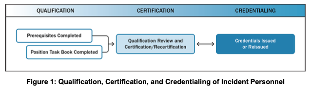

원문의 `Figure 1: Qualification, Certification, and Credentialing of Incident Personnel`은 인력 자격부여에 대한 **성능 기반 접근법(Performance-based approach)**을 제시함.

- **직무수행서 (Position Task Book, PTB):**
  - 이 접근법에서 후보자는 해당 보직에 대한 모든 선수 요건(Prerequisites)을 이수한 후, 표준화된 **직무수행서(PTB)**에 명시된 최소한의 과업과 행동을 실제로 시연해야 함.
  - PTB는 후보자가 해당 보직을 인증받기 위해 반드시 실증해야 하는 역량, 행동, 과업들을 기술함.
- **AHJ의 절대적 권한과 유연성:**
  - FEMA는 미 전역에서 공유되는 주요 보직에 대해 최소 자격 요건과 권장 PTB를 개발하지만, 실제 직위 자격 요건을 수립·집행하고 인력을 자격부여·인증·크레덴셜링할 권한과 책임은 **관할권한보유기관(AHJ)**에 있음.
  - AHJ는 NIMS가 제시하는 기준보다 더 높은 수준의 추가 요건을 채택할 수 있음.

---

> ### 📌 [원문 각주 7 전수 번역 및 해설 (Footnote 7, p. 7)]
> - **각주 7 (제3자 인증[Third-Party Certification], p. 7):** 제3자 인증은 특히 공중보건 및 의료 인력(Public health and medical personnel)에게 관련성이 높으며, 여기에는 주 면허위원회(State licensing boards) 또는 전문 인증 기관(Board certification entities)에 의한 면허 부여가 포함될 수 있음.

---

### 2.3 자원 소요 계획 (Planning for Resources) *(원문 pp. 8–9)*

관할구역과 조직은 예방, 보호, 완화, 대응, 복구 등 모든 임무 영역 *(각주 8 참조)*에서 위협과 취약성에 기반하여 자원 소요를 추정하기 위해 협력해야 함.

#### (1) 자원 확보의 4대 전략과 유의점 *(원문 p. 8)*
관할구역과 조직은 다음을 포함한 다양한 전략을 고려해야 함:
1. **자원 비축 (Stockpiling resources):** 사건 전 자원을 비축하는 것은 필요 시 가용성을 보장하지만, 유효기간(Shelf life)과 유지보수 비용 등 추가적인 부담을 수반함.
2. **상호응원 협약 수립 (Establishing mutual aid agreements):** 인접 또는 타 관할구역으로부터 자원을 획득함.
3. **비필수 활동에 배정된 자원의 재배치 결정 (Determining how and where to reassign resources assigned to non-essential activities):** 일상 업무 자원을 비상 업무로 전환함.
4. **벤더와의 사전 계약 개발 (Developing contracts with vendors):** 비축하지 않는 품목이나 추가 공급이 필요한 품목을 사건 발생 시 신속히 납품받기 위해 공급업체와 계약을 체결함.
   - ⚠️ **주의 (동일 벤더 중복 의존의 함정):** 다수의 조직이 동일한 자원 공급업체(Vendor)와 계약을 맺을 때 문제가 발생할 수 있음(예: 한 도시의 모든 병원이 대유행 시 개인보호장구[PPE] 부족분을 메우기 위해 동일한 공급업체와 계약하는 경우).
   - **기부 물품 및 현금 관리:** 계획 수립 시에는 요청 여부와 무관하게 답지하는 기부 물품 및 기부금(Solicited and unsolicited donations)을 관리하기 위한 프로토콜도 포함해야 함.

#### (2) 역량 추정 (Capability Estimation) 및 사전배치 *(원문 pp. 8–9)*
- **역량 추정(Capability estimation):** 관할구역의 역량과 자원 배치의 잠재적 효과를 평가하는 핵심 계획 프로세스로, 다음 3가지 질문에 답함:
  1. *우리는 무엇에 대비해야 하는가? (What do we need to prepare for?)*
  2. *목표를 달성하기 위해 우리는 어떤 자원을 보유하고 있는가? (What resources do we have that allow us to achieve our targets?)*
  3. *어떠한 격차(Gaps)를 해소하기 위해 상호응원을 통해 어떤 자원을 획득할 수 있는가? (What resources can we obtain through mutual aid to address any gaps?)*
- **사전배치(Pre-positioning) 및 급증 수요(Surge Needs) 관리:** 계획가들은 비축 위치, 사전배치 자원, 재고 보충 트리거(Triggers for reordering), 급증 수요, 비축 불가능 품목의 조달 절차 등을 사전에 통합해야 함.

---

> ### 📌 [원문 각주 8 전수 번역 및 해설 (Footnote 8, p. 8)]
> - **각주 8 (5대 임무 영역[Five Mission Areas], p. 8):** 예방(Prevention), 보호(Protection), 완화(Mitigation), 대응(Response), 복구(Recovery).

---

### 2.4 자원 획득, 저장, 목록화 (Acquiring, Storing, and Inventorying Resources) *(원문 pp. 9–11)*

#### (1) 자원 획득·저장 관리 요소 및 인벤토리 vs 자원 추적의 구분 *(원문 p. 9)*
- **자원 비축 및 유지보수 관리 *(원문 p. 9 제1~2문단 보완)*:** 조직은 평상시 운영을 지원하고 비축분(Stockpiles)을 구축하기 위해 자원을 획득, 저장, 목록화함. 효과적인 자원 관리 절차는 **주기적인 보충(Periodic replenishments), 예방 정비(Preventive maintenance), 자본 개선(Capital improvements)**을 반영하고, 조달 리드타임과 유효기간(Shelf life)을 고려하며, 최소 재고 기준선 도달 시 재주문을 실행하는 트리거를 설정해야 함. 또한 계획가들은 **대형 또는 복합 자원(Large or complex resources)을 운용하는 데 필요한 부수적 지원, 보급품, 공간(Ancillary support, supplies, or space)**도 반드시 고려해야 함.
- **인벤토리(Inventorying) vs 자원 추적(Resource Tracking):**
  - **자원 목록화(Resource inventorying):** 사건 대응 **외부(평시)**에서 자원 가용성을 파악하고 관리하는 대비 활동.
  - **자원 추적(Resource tracking):** 사건 발생 **중(비상시)**에 배치된 자원의 위치와 상태를 관리하는 운영 활동.
  - **평시 행정 지원:** 효과적인 자원 목록화는 상호응원을 촉진할 뿐만 아니라 **일상적인 대사(Reconciliation), 회계(Accounting), 감사(Auditing)** 업무를 지원함.

#### (2) 효과적인 자원 인벤토리의 13대 필수 정보 항목 *(원문 pp. 9–11)*
NIMS는 자원 인벤토리에 단순 수량뿐 아니라 다음의 **13가지 항목(Fields)**을 포함할 것을 규정함:

| 번호 | 필수 정보 필드 | 세부 설명 및 NIMS 기준 *(원문 pp. 9–10)* |
| :---: | :--- | :--- |
| **1** | **이름 (Name)** | 자원의 고유 명칭 또는 인간 식별자(Unique name or human identifier) |
| **2** | **별칭 (Aliases)** | 무전 호출부호(Radio call sign)나 대안 명칭 등 원래 이름으로 알려지지 않았을 때 사용할 수 있는 식별자 |
| **3** | **상태 (Status)** | 자원의 현재 상태 (예: 정비 중 등 가용성에 영향을 주는 상태) |
| **4** | **유형 정의 또는 직무 명칭 (Resource Typing Definition or Job Title)** | 자원을 가장 잘 설명하는 NIMS 자원 유형화 정의 또는 직무 명칭(비유형화 자원은 로컬 설명 사용) |
| **5** | **상호응원 준비도 (Mutual Aid Readiness)** | 상호응원을 통한 파견 준비 상태 및 가용 여부 |
| **6** | **본적지 (Home Location)** | 자원의 상시 보관 위치(시설 명칭, 주소, **위도/경도 및 미국국가지리격자[USNG] 좌표** 포함) |
| **7** | **현재 위치 (Present Location)** | 자원의 현재 위치(주소, 위도/경도 및 USNG 좌표 포함; GIS 연동 가능) |
| **8** | **담당 연락책 (Point of Contact)** | 자원의 파견 가능 여부와 상태를 알고 있는 담당자의 연락처 |
| **9** | **소유자 (Owner)** | 자원을 소유한 기관 또는 개인 |
| **10** | **제조사/모델 (Manufacturer/Model)** | 제조사, 모델명, 공식 일련번호(Serial number) |
| **11** | **계약 (Contracts)** | 구매, 리스, 대여, 유지보수 계약 및 관련 재무 약정 |
| **12** | **인증 (Certifications)** | 관련 인증서 및 자격 증명서 |
| **13** | **파견 정보 (Deployment Information)** | • **최소 리드타임(Minimum Lead Time):** 자원이 파견 준비를 갖추는 데 필요한 최소 시간(시간 단위)[[BR]]• **최대 파견 기간(Maximum Deployment Time):** 자원이 파견될 수 있는 최대 기간(일 단위)[[BR]]• **제한 및 제약사항(Restrictions/Limitations):** 자원 사용에 영향을 미치는 제한 사항[[BR]]• **비용 상환(Reimbursement):** 적용 가능한 비용 상환 프로세스[[BR]]• **해제 및 복귀 지침(Release and Return Instructions):** 해제 및 반환 절차[[BR]]• **지속유지 소요(Sustainability Needs):** 자원을 계속 가동하기 위해 필요한 조건[[BR]]• **맞춤형 속성(Custom Attributes):** 기타 자원 고유 속성 |

- ⚠️ **중복 계상(Double-Counting) 방지 *(원문 p. 11)*:** 인력을 목록화할 때 다수의 직위에 자격을 갖춘 개인이나 여러 조직(예: 소방서와 자원봉사단)에 동시에 소속된 개인이 중복 계상되어 가용 인력이 과대평가되지 않도록 철저히 관리해야 함.

---

## 3. B. 사건 진행 중 자원관리 (Resource Management During an Incident) *(원문 pp. 11–16)*

사건 중 자원관리 프로세스(`Figure 2: Resource Management Process`)는 **6단계 순환 구조**로 이루어짐: ① 요구사항 식별(Identify Requirements) → ② 주문 및 획득(Order and Acquire) → ③ 동원(Mobilize) → ④ 추적 및 보고(Track and Report) → ⑤ 동원 해제(Demobilize) → ⑥ 비용상환 및 재보충(Reimburse and Restock).

| 순환 단계 | 프로세스 명칭 (원문 Figure 2, p. 11) | 핵심 수행 내용 |
| :---: | :--- | :--- |
| **1단계** | **요구사항 식별 (Identify Requirements)** | 사건 상황과 목표에 따라 필요한 자원의 종류·유형·수량·시점·위치를 정확히 파악 |
| **2단계** | **주문 및 획득 (Order and Acquire)** | 표준 자원 요청 절차를 통해 내부 보유분 또는 외부 상호응원 자원을 공식 발주 |
| **3단계** | **동원 (Mobilize)** | 출동 통보를 받은 자원이 지정된 시간·장소(현장, 자원대기소, 기지)로 이동 및 체크인 |
| **4단계** | **추적 및 보고 (Track and Report)** | 투입 자원의 위치와 상태(배정·가용·운용불가)를 실시간 모니터링하여 대원 안전 보장 |
| **5단계** | **동원 해제 (Demobilize)** | 임무 완수 자원을 계획에 따라 질서 있게 점검 후 원 소속 기관으로 안전하게 복귀 |
| **6단계** | **비용상환 및 재보충 (Reimburse and Restock)** | 자원 사용 비용을 정산·상환하고 소모된 장비를 재보충하여 차기 사건 대비태세 회복 (1단계로 순환) |

### 3.1 단계별 핵심 과업 심층 분석 *(원문 pp. 11–16)*

#### (1) 제1단계: 요구사항 식별 (Identify Requirements) *(원문 pp. 11–12)*
- 사건 관리 인력은 필요한 자원의 종류와 수량, 자원이 필요한 위치, 자원을 수령하고 배치할 책임자를 식별하고 지속적으로 정교화함.
- 자원 가용성과 소요는 사건이 진전됨에 따라 끊임없이 변하므로, 지휘 조직과 지원 조직은 사건 초기부터 가능한 한 긴밀하게 조율해야 함.

#### (2) 제2단계: 주문 및 획득 (Order and Acquire) *(원문 pp. 12–13)*
- **발주 주체 및 경로:** 현장지휘체계(ICS) 조직과 긴급운영센터(EOC) 인력이 모두 자원을 주문할 수 있으며, 정책·절차·상호응원 협약에 따라 발주함. 자체 보유분으로 충족할 수 없는 경우 인접 관할구역, 상위 정부, 민간 벤더 등에 요청함.
- **자원 요청서(Resource Requests)의 4대 필수 기재 항목 *(원문 p. 12)*:**
  1. 필요한 품목과 수량, 종류(Kind), 유형(Type)에 대한 상세 설명(NIMS 자원 유형화 정의나 직무 명칭이 없는 경우 상세 사양 및 적합한 대체재[Substitutes] 명시);
  2. 요구 도착 일시(Required arrival date and time) 및 보고 위치(Reporting location);
  3. 자원이 보고해야 할 직위의 명칭(Position title to which the resource should report);
  4. 사건 특유의 보건 또는 안전 우려사항(예: 이동식 주택의 오염, 예방접종 요건 등).
- **관할권 밖 활동 시 법적 제한 검토:** 법집행관(Law enforcement officers)이나 응급의료 인력(Emergency medical personnel)과 같이 관할구역 밖에서 법적 권한이나 면허 제한을 받는 인력을 요청할 때는 사전에 관련 법률·정책·상호응원 협약을 검토해야 함.

> #### ⛔ [원문 인셋 박스] 요청되지 않은 자원 / 자진 출동 (Unrequested Resources / Self-Dispatching) *(원문 p. 13)*
> 사건 중에는 대응요원들이 때때로 독자적으로 사건 현장으로 몰려들기도 함(Self-dispatching). 공식적인 요청과 파견 없이 현장에 도착하는 이러한 자원들은 사건 관리 노력을 방해하며 다음과 같은 심각한 문제를 야기함:
> 1. 추가적인 감독(Supervisory) 및 군수 지원(Logistical support) 부담 창출;
> 2. 자진 출동한 대원의 본래 소속 지역사회(Home community)의 자원 고갈;
> 3. 자원 추적 및 대원 안전·책무성(Accountability) 확보의 복잡성 가중;
> 4. 사건 현장 접근로 차단(Interfering with access to the incident site).
> ➜ **원칙:** 대응요원들은 관할 당국이 확립된 자원 관리 시스템을 통해 공식적으로 요청하고 파견할 때까지 기다려야 함.

#### (3) 제3단계: 동원 (Mobilize) *(원문 pp. 14–15)*
- **동원 통보 시 대원에게 전달해야 할 9대 핵심 정보 *(원문 p. 14)*:**
  인력과 기타 자원은 권한 있는 당국으로부터 동원 통보를 받는 즉시 동원을 시작하며, 통보 시에는 다음 정보가 포함되어야 함:
  ① 출발 일시 및 장소(Date, time, and place of departure); ② 이동 수단(Mode of transportation to the incident); ③ 사건 현장 도착 예정 일시(Estimated date and time of arrival); ④ 보고 장소(Reporting location: 주소, 보직 명칭, 전화번호 또는 무전 주파수); ⑤ 예상 사건 보직/임무(Anticipated incident assignment); ⑥ 예상 파견 기간(Anticipated duration of deployment); ⑦ **자원 주문 번호(Resource order number)**; ⑧ **사건 번호(Incident number)**; ⑨ **적용 가능한 비용 코드(Applicable cost or funding code)**.
- **동원 프로세스의 5대 핵심 요소 *(원문 p. 15 제1문단 원문 보완)*:**
  동원 프로세스에는 다음 5가지 과업이 포함됨:
  1. **사건 맞춤형 파견 계획 수립 (Conducting incident-specific deployment planning)**;
  2. **장비 지급 및 무장 (Equipping)**;
  3. **적시 교육·훈련 제공 (Providing just-in-time training)**;
  4. **집결지 지정 (Designating assembly points)**;
  5. **일정, 우선순위 및 예산에 맞추어 사건 현장에 자원 전달 (Delivering resources to the incident on schedule and in line with priorities and budgets)**.
- **고정 시설 자원:** 긴급 대피소, 병원, 중증외상센터, 검사실 등 고정 시설 자원의 경우 동원이 아닌 **활성화(Activation)** 프로세스를 거침.
- **동원 해제 계획의 동시 착수:** 관리자는 자원의 효율적인 회수·책무성·원상복구를 보장하기 위해 **동원 프로세스와 동시에 동원 해제(Demobilization)를 계획하고 준비**해야 함.
- **비전통적 자원(생존자 및 민간·NGO)의 통합 *(원문 p. 15)*:**
  - **자원으로서의 생존자(Survivors as Resources):** 사건 발생 직후(Immediate aftermath)에는 생존자들과 이웃들이 구조 활동을 주도하게 됨. 사건 관리 계획가들은 이러한 즉흥적 자원봉사자(Spontaneous volunteers)들의 노력을 예상하고 위험을 최소화하면서 사건 관리 구조 내에 안전하게 통합할 계획을 수립해야 함.
  - **비정부기구(NGO):** 미국적십자사(American Red Cross), 구호봉사단체연합(VOAD), 의료예비군(Medical Reserve Corps) 등 확립된 NGO를 통해 자원봉사자를 통합하는 것이 가장 효과적임.

#### (4) 제4단계: 추적 및 보고 (Track and Report) *(원문 pp. 13–15)*
- 사건 관리 인력은 동원 시점부터 동원 해제 및 복귀 시점까지 자원의 위치와 상태를 지속적으로 추적하여 대원의 안전을 보호하고 작전 효율성을 유지함.

> #### 🚨 [원문 인셋 박스] 출동 통보 시 6대 개인 조치 및 현장 4대 책무성 절차 *(원문 p. 13 원문 완전 보완)*
> **1) 출동 통보 시 개인이 취해야 할 6대 사전 조치 (Upon notification of deployment, individuals should):**
> - **① 최신 상황보고서 검토:** 가장 최근의 상황보고서(Most recent situation report)를 검토함;
> - **② 임무·위치·이동편 확인:** 자신의 보직(Assignment), 파견 위치(Deployment location), 이동 편(Travel arrangements)을 확인함;
> - **③ 감독자 및 연락처 확인:** 자신이 배속된 감독자(Assigned supervisor)와 관련 연락처 정보를 확인함;
> - **④ 보직 명령서 사본 확보:** 자신의 임무/보직 배정 서류(Assignment paperwork) 사본을 확보함;
> - **⑤ 보안·출입 절차 및 보건·환경 위험 브리핑 검토:** 파견 지역의 작업장 보안/출입 절차(Worksite security/access procedures)와 특수한 환경적 또는 보건상 우려사항(Special environmental or health concerns)에 관한 브리핑을 검토함;
> - **⑥ 평시 고유 업무 대행 확인:** 자신의 평시 일상 업무(Day-to-day job responsibilities)에 대한 대리 수행 체계(Coverage)를 확인·보장함.
>
> **2) 현장 도착 및 활동 중 4대 책무성 절차 (On-Scene Accountability Procedures):**
> - **① 체크인 (Check-In):** 파견된 인력은 소속 기관과 관계없이 확립된 현장 절차에 따라 지정된 장소에서 도착 보고(Check in)를 수행함.
> - **② 기록 유지 (Recordkeeping):** 파견 인력은 사건을 지원하는 모든 활동을 문서화하기 위해 일상적인 기록 유지 절차를 따름(비용 상환 및 사후 검토의 필수 근거).
> - **③ 통신 (Communication):** 파견 인력은 통신 시스템과 프로토콜(예: 은어/코드 배제 및 **평문[Plain language]** 사용)을 준수함.
> - **④ 체크아웃 (Checkout):** 파견 해제 통보를 받은 인력은 진행 중인 업무를 정리하고, 후임자에게 브리핑하며, 지급받은 장비를 반납하고 공식 퇴소 절차(Check out)를 밟음.

#### (5) 제5단계: 동원 해제 (Demobilize) *(원문 pp. 15–16)*
- 동원 해제의 목표는 더 이상 필요하지 않은 자원을 질서 있고 안전하며 효율적이고 비용 효과적인 방식으로 원래의 위치와 상태로 복귀시키는 것임.
- 소진된 자원의 재구축(Reconstituting)을 위해 재보급, 정비, 수리, 폐기물 처리 등을 수행한 뒤 원 소속처로 복귀시키거나 다른 사건으로 재배치(Reassign)함.

#### (6) 제6단계: 비용상환 및 재보충 (Reimburse and Restock) *(원문 p. 16)*
- 사건 비용을 수거·지불하고 자원을 재보충하는 프로세스를 포함함.
- 비용 상환 절차는 사전 체결된 상호응원 협약이나 벤더 계약에 명시된 조건과 기준에 따라 집행됨.

---

## 4. C. 상호응원 (Mutual Aid) *(원문 pp. 16–18)*

상호응원은 관할구역 간에 자원 및/또는 서비스를 공유하기 위한 협약을 체결하는 것을 의미함.

| 상호응원 계층 구분 | 공식 명칭 | 작동 범위 및 핵심 특징 |
| :--- | :--- | :--- |
| **1. 로컬 / 인접 단위** | **인접 지자체 간 상호응원 (Day-to-day Dispatch)** | • 경찰·소방의 일상적 관할 경계 지원 및 자동 출동 협정[[BR]]• 분초를 다투는 초기 대응 시 즉각 가동되는 지역 협정 기반 |
| **2. 주 / 광역 단위** | **주(State) 내 광역 협약 (Intrastate Mutual Aid)** | • 주(State) 내 모든 시·군 지자체가 참여하는 광역 상호지원 체계[[BR]]• 주 EOC가 총괄 조정하며 중·대규모 광역 재난에 대응 |
| **3. 전국 주간(Interstate) 단위** | **비상관리지원협약 (EMAC: Interstate Compact)** | • 미 의회가 비준한 연방 법률(Pub. L. 104-321)에 기반한 전국 협약[[BR]]• 미 50개 주 전원 가입, 주지사 비상사태 선포 시 타 주 자원 법적 동원·면책·비용상환 보장 |

### 4.1 상호응원 협약과 비상관리 지원 콤팩트 (Mutual Aid Agreements and Compacts) *(원문 pp. 16–17)*

#### (1) 상호응원 협약의 수준과 필수 포함 조항 *(원문 pp. 16–17)*
- 상호응원은 인접 관할구역 간의 일상적인 협조 파견부터 주 내(Intrastate), 주 간(Interstate), 부족 간, 나아가 국제 협약까지 다양한 형태로 존재함.
- 건전한 상호응원 협약 및 콤팩트에는 다음 **5대 핵심 조항**이 포함됨:
  1. **비용 상환 (Reimbursement):** 상호응원이 유상인 경우, 정산 가능한 비용의 기준과 청구 절차를 명시함.
  2. **면허 및 인증의 상호 인정 (Recognition of Licensure and Certification):** 한 관할구역의 인력이 가진 면허, 인증, 허가, 크레덴셜이 지원받는 관할구역에서도 완전한 효력을 갖도록 보장함.
  3. **동원 및 동원 해제 절차 (Procedures for Mobilization):** 요청, 파견, 지휘·감독 관계, 동원 해제 절차를 규정함.
  4. **음성 및 데이터 상호운용성 프로토콜 (Protocols for Voice and Data Interoperability):** 파견 자원이 현장의 통신 체계에 통합될 수 있는 방법을 명시함.
  5. **자원 관리 프로토콜 (Protocols for Resource Management):** 자원 식별·유형화·추적 등을 위해 표준 템플릿과 NIMS 체계를 활용하도록 규정함.

#### (2) 비상관리 지원 콤팩트 (EMAC, Emergency Management Assistance Compact) *(원문 p. 17)*
- **정의:** 연방의회가 비준한(Congressionally ratified) **주-대-주(State-to-state) 상호응원 콤팩트**로, 미국 50개 주 전체, 컬럼비아 특별구(워싱턴 D.C.), 푸에르토리코, 괌, 미국령 버진아일랜드가 모두 가입되어 있음.
- **작동 메커니즘:** 주지사가 비상사태를 선포한 재난 시부터 일상적 대비 활동에 이르기까지, 주방위군(National Guard)을 포함한 주 정부 자원을 주 대 주로 직접 공유할 수 있게 하며, 연방 지원(FEMA 등)을 대체하는 것이 아니라 보완(Complements)하는 역할을 수행함.

### 4.2 상호응원 프로세스 (Mutual Aid Process) *(원문 pp. 17–18)*
- **자체 역량 평가 (Evaluating Capacity):** 상호응원 요청을 받은 관할구역(Providing jurisdiction)은 자원을 파견한 후에도 **자체 지역사회를 보호할 수 있는 역량이 유지되는지(Capacity to continue protecting its own community)**를 최우선으로 평가함.
- **거절 권한 및 대안 조달:** 자체 안전 유지가 불가능하다고 판단하면 요청을 거절할 수 있으며, 이 경우 요청 관할구역은 다른 상호응원 파트너나 상위 정부로 요청을 전환함.
- **수신 관할구역의 인수 거부권:** 파견된 자원이 요청된 역량 사양(Type)이나 기준을 충족하지 못할 경우, 수신 관할구역(Receiving jurisdiction)은 해당 자원의 인수를 거부할 권리를 가짐.

---

> **[원칙 3 준수 고지]**  
> 위 **제1절~제4절**까지는 FEMA NIMS(2017) 제2장 원문(pp. 6–18)의 직접적인 내용과 도표(Figure 1, Figure 2), 인셋 박스, 각주(6~8)를 원문에 충실하게 번역·정리한 것이며, 아래 **제5절~제7절**은 원문 내용을 바탕으로 대한민국 재난관리자원 체계와의 비교 및 학술적·정책적 시사점을 도출한 **연구자의 독립적 해석 및 응용 영역**입니다.

---

## 5. 한미 자원관리체계 비교 분석 (Comparative Analysis)

미국의 NIMS 제2장(자원관리) 체계와 대한민국 「재난 및 안전관리 기본법」 및 관련 법령의 자원관리 체계를 비교 분석함.

### 5.1 제도적 구조 대비표

| 비교 항목 | 미국 NIMS 자원관리 체계 | 대한민국 재난관리자원 체계 |
| :--- | :--- | :--- |
| **법적·제도적 근거** | • NIMS 자원관리 교리[[BR]]• 주간 협약(EMAC) 및 연방 Stafford Act | • 「재난 및 안전관리 기본법」 제34조 (자원 비축·관리)[[BR]]• 「재난관리자원의 관리 등에 관한 법률」 (2024년 시행) |
| **자원 유형화 (Typing)** | • **능력 기반(Capability-based) 정밀 분류**[[BR]]• Type 1~4 등급제 (규격, 출력, 인력숙련도)[[BR]]• FEMA 전국 통합 RTLT 온라인 카탈로그 운영 | • **품목 번호(물품목록화) 중심 분류**[[BR]]• 조달청 물품분류코드 중심 관리[[BR]]• 장비의 실제 '작전 성능(Capacity)'별 세부 등급 미흡 |
| **인력 자격인증 (Credentialing)** | • **성능 기반 실무 검증 (AHJ & PTB)**[[BR]]• 직무수행서(PTB)를 현장에서 통과해야 자격 취득[[BR]]• 전국 공통 자격(NQS)으로 타 관할 즉시 투입 | • **임용 계급 및 형식적 법정교육 이수**[[BR]]• 방재 직무별 실기 자격평가서 부재[[BR]]• 일반직 순환보직으로 직무 전문성 축적 단절 |
| **자원 관리 IT 시스템** | • GIS 기반 실시간 위치·상태 추적 연동[[BR]]• 인벤토리와 현장 IAP/EOC 시스템 직접 결합 | • **행안부 재난관리자원 통합관리시스템 (DP-리소스)**[[BR]]• 재난관리물류창고 중심의 정적 비축·재고 관리 치중[[BR]]• 현장 실시간 추적(Resource Tracking) 연동 한계 |
| **상호응원 및 동원 방식** | • **수평적 계약 기반 (Mutual Aid & EMAC)**[[BR]]• 지자체/주정부 간 대등한 요청과 수락[[BR]]• 철저한 사전 비용상환(Reimbursement) 계약 | • **수직적·중앙집권적 동원 명령**[[BR]]• 소방청장의 '소방동원령' 발령에 따른 강제 차출[[BR]]• 지자체 간 자발적·수평적 장비 공유 협약 취약 |
| **자진출동 (Self-Dispatch)** | • **철저한 금지 및 현장 진입 불허**[[BR]]• 미요청 자원은 병참 교란 요인으로 규정 | • **온정주의적 현장 진입 방치**[[BR]]• 통제되지 않는 봉사단체, 의용소방대, 유튜버 난입으로 지휘선 혼선 초래 |

### 5.2 심층 차이점 분석

| 비교 국가 | 자원관리 핵심 패러다임 및 작동 흐름 |
| :--- | :--- |
| **미국 (NIMS 모델)** | **[성능 기반 민관 협력 네트워크]**[[BR]]자원 성능 유형화(RTLT: Type 1~4) ➔ PTB 자격 검증(AHJ) ➔ 수평적 상호응원(EMAC) ➔ 실시간 현장 추적 & 100% 법정 비용 정산 |
| **한국 (현행 모델)** | **[물품 재고 기반 중앙 명령 동원]**[[BR]]조달청 물품 코드 등록 ➔ 공무원 순환보직 ➔ 소방동원령 / 중앙 강제 지정 ➔ 사후 행정 정산 지연 및 지자체 간 비용 갈등 |

1. **'품목(Item)' 관리 vs '역량(Capability)' 관리의 차이:**
   - **한국:** 재난관리자원 시스템을 보면 "굴착기 10대, 펌프 20대, 마스크 10만 장"처럼 **물리적 수량** 파악에 집중됨. 현장에서 필요한 "수심 2m에서 시간당 500톤을 배수할 수 있는 대용량 방사포(Type 1)"와 같은 구체적 성능 스펙으로 관리되지 않아, 막상 현장에 장비가 도착해도 호환성 부족이나 성능 미달로 무용지물이 되는 사례가 잦음.
   - **미국:** 철저하게 **최소 성능 역량(Minimum Capability)**으로 Type 1~4를 나누어 규격화(Typing)하므로, 현장지휘관이 "Type 2 도저 2대"를 주문하면 어떤 주에서 오더라도 정확히 필요한 규격의 장비가 도착함.

2. **직무수행서(PTB)의 유무:**
   - **미국:** 자격부여 과정에서 PTB를 통해 "실제 재난 현장에서 분대장 역할을 5회 이상 성공적으로 수행했는가"를 공인 평가관이 평가하여 자격을 줌.
   - **한국:** 공무원이나 대원이 연간 몇 시간의 사이버 교육이나 집합 강의를 들었는지만 체크하는 '이수증' 중심 문화로, 실제 비상 상황에서 EOC나 현장 자원지원반에 투입되었을 때 자원 조달 및 배분 역량을 발휘하지 못함.

---

## 6. 미국의 NIMS 자원관리 제도는 한국에서 작동할 수 있는가? (비판적 고찰)

미국의 NIMS 자원관리 체계는 매우 논리적이고 정교하지만, **대한민국의 법적 제도, 관료제 구조, 재난 환경에 그대로 적용할 경우 치명적인 작동 불능(Failure)에 직면**하게 됨.

### 6.1 한국에서 작동하기 어려운 4가지 구조적 요인

#### ① 지자체 간 재정 격차와 "소방 국가직화"의 역설
- **미국의 전제:** 모든 소방·경찰이 로컬(지방) 자산이므로, 대형 재난 시 수평적인 상호응원 협약(Mutual Aid)과 정산 메커니즘(EMAC)이 없으면 한 발자국도 움직일 수 없음.
- **한국의 현실:** 2020년 소방공무원이 **국가직으로 전환**되면서, 전국 소방력의 이동은 소방청장의 **'소방동원령'** 하나로 단 몇 시간 만에 전국 펌프차 수백 대가 일사불란하게 집결함.
  - 즉, 화재·구조 분야에서는 미국식의 복잡한 수평적 상호응원 협약보다 한국의 중앙 통제식 동원령이 훨씬 빠르고 강력하게 작동함.
  - **반면 지자체 일반 자원의 모순:** 소방을 제외한 지자체 소유의 방재 자원(굴착기, 살수차, 제설제, 이재민 구호텐트 등)은 재정이 열악한 시·군·구와 서울 강남구 간의 격차가 극심함에도 불구하고, 지자체 간 상호응원 협약 문화가 전무하여 인접 지자체에 수해가 나도 지원하지 않고 방관하는 이기주의가 팽배함.

#### ② 순환보직제 하에서 PTB(직무수행서) 운영의 불가능성
- NIMS의 인력 자격제도는 한 직무에서 수년간 경험을 쌓으며 PTB의 과업을 하나씩 완수해 나가는 전문가(Career-path)를 전제로 함.
- 그러나 한국의 지자체 재난관리 공무원은 **1~2년마다 부서를 이동하는 일반 행정직**임.
  - 1년 후면 세무과나 주민센터로 떠날 공무원에게 "NIMS 자원관리관 PTB를 작성하라"고 요구하는 것은 행정 낭비이며, 인증을 받을 즈음에는 이미 다른 부서로 전출을 가버려 자격 축적이 구조적으로 불가능함.

#### ③ 지자체 간 사후 비용 정산(Reimbursement)의 행정적 공포
- 미국 EMAC의 핵심은 "지원받은 주가 파견된 인력의 초과근무수당, 유류비, 장비 마모 비용을 100% 현금으로 정산"해 주는 법적 보장임.
- 한국의 현실:
  - 타 지자체에 굴착기나 인력을 지원해 주었을 때 발생하는 **기름값, 장비 파손, 인건비를 상대 지자체에 청구할 법적·회계적 기준이 모호함**.
  - 자치단체장이 "우리 세금으로 산 장비를 남의 동네에 보냈다가 고장 냈다"며 지방의회의 질타를 받거나 감사원 감사를 받을 위험 때문에, 단체장들은 관할 밖 자원 지원을 극도로 꺼림.

#### ④ 자진 출동(Self-Dispatching)을 미화하는 온정주의 문화
- 미국 NIMS는 비요청 자진 출동을 "병참 시스템을 파괴하는 행위"로 엄단함.
- 한국에서는 재난이 나면 유력 인사, 의용소방대, 자원봉사단체, 심지어 유튜버와 인플루언서들이 통제선(Police Line)을 무시하고 현장에 난입함.
  - 언론은 이들을 "온정의 손길"로 미화하므로, 현장지휘관이 NIMS 원칙대로 "명령받지 않은 자는 현장에서 나가라"고 강제 퇴거시킬 경우 엄청난 여론의 역풍을 맞게 됨. 결국 현장 집결지가 난민촌처럼 변질되어 물류가 마비됨.

---

### 6.2 한국적 현실에서의 수용 및 제도 개선 방안

미국 제도를 무비판적으로 복제하는 대신, NIMS의 과학적 공학 원리를 추출하여 한국 시스템을 다음과 같이 개편해야 함.

| 4대 혁신 과제 | 세부 실천 방안 |
| :--- | :--- |
| **1. 자원 유형화(Typing) 도입** | • 단순 조달청 물품 분류 코드를 탈피하여 실제 '방재 성능(Type 1~4)' 기반의 인력·장비 패키지 규격화 |
| **2. 방재안전직 자격인증(PTB)** | • 방재안전직렬 보직 순환 최소 5년 보장 및 한국형 직무수행서(K-PTB) 실무 자격제 도입 |
| **3. 지자체 상호응원 재정 보장** | • 지자체 간 상호응원 출동 시 중앙정부 100% 재정 지원 및 현장 장비 파손에 대한 감사 면책 제도화 |
| **4. 자진출동 통제 및 배징(Badging)** | • 긴급구조구역 통제선 무단 진입(Self-dispatching) 법적 제재 및 사전 등록·인증된 자원봉사단 운영 |

1. **국가 조달 품목 코드의 '방재 성능(Type) 등급화' 개편:**
   - 조달청 물품 분류에 NIMS식 'Core Capability & Type 1~4' 개념을 접목해야 함.
   - 예: 배수펌프 등록 시 마력뿐 아니라 "토출량, 관경, 흡입양정"에 따른 Type 1, 2, 3 등급을 부여하고, 행안부 재난관리자원 통합관리시스템(DP-리소스)에 의무 등록하도록 법제화.
2. **지자체 간 상호응원 비용의 '국비 전액 보전제' 신설:**
   - 지자체 간 자원 공유를 활성화하기 위해, 인접 지자체에 자원을 파견하여 발생한 모든 유류비, 수리비, 수당을 **행정안전부의 재난안전특별교부세에서 전액 사후 보전**하도록 법제화해야 단체장들이 안심하고 자원을 파견할 수 있음.
3. **방재안전직렬 전문관제와 한국형 PTB 도입:**
   - 일반 행정직이 아닌 방재안전직 공무원을 대상으로 최소 5년 이상의 동일 보직을 보장하고, '자원관리관', '상황분석관' 등의 전문 자격을 부여하는 실무 과업 평가서(한국형 PTB)를 도입해야 함.
4. **자진 출동 차단 및 현장 출입 배징(Badging) 법제화:**
   - 「재난안전법」에 긴급구조구역 내 '미등록 자원 및 인력의 무단 진입 금지 및 과태료 부과' 조항을 신설해야 함.
   - 자원봉사 희망자는 현장 지휘소 밖 사전 집결지(Staging Area)에서 등록 및 신원확인을 거쳐 공식 배지를 발급받은 자에 한해서만 질서 있게 투입되도록 시스템을 엄격화해야 함.

---

## 7. 요약 및 결론 (Summary & Conclusion)

1. **자원관리는 재난 당일 시작하는 것이 아니다:**  
   자원관리는 평시의 **식별·유형화(Typing) → 자격인증(Credentialing) → 소요계획(Planning) → 인벤토리 구축(Inventorying)**이라는 철저한 준비태세(Preparedness)가 갖추어져 있어야만 비상시에 작동한다.
2. **자원의 생명은 '규격화(Typing)'와 '추적(Tracking)'이다:**  
   막연한 덤프트럭이 아니라 성능이 검증된 Type별 자원을 요청하고, 동원부터 해제까지 실시간으로 추적·관리하는 것이 자원 낭비와 병참 마비를 막는 유일한 방법이다.
3. **선의의 자진 출동(Self-Dispatching)은 독이다:**  
   공식 명령 없는 현장 난입은 지휘체계를 마비시키고 안전을 위협하므로 철저한 등록(Check-in)과 배징(Badging) 통제가 필수적이다.
4. **한국은 제도적 특수성을 반영한 '실용적 융합'이 필요하다:**  
   한국은 강력한 중앙 소방동원 체계를 보유하고 있으므로, 이를 파괴하고 미국식 수평 협약만 좇을 것이 아니라, **지자체 방재자원의 성능 기반 유형화(Typing), 국비 보전을 통한 지자체 간 상호응원 활성화, 전문직 중심의 자격체계(PTB)**를 결합하는 한국형 자원관리 모델을 구축해야 한다.


```{=openxml}
<w:p><w:r><w:br w:type="page"/></w:r></w:p>
```

# 제3장 지휘 및 조정 (III. Command and Coordination)
> **참고 원문:** *National Incident Management System (Third Edition, October 2017) - Chapter III (pp. 19–49)*  
> **작성 원칙:** 『GEMINI.md』의 **연구자료(SUB-NOTE) 사용 10대 기본 원칙**에 입각하여 원문의 단락, 도표(Figure 3–10, Table 2–3), 인셋 박스, 각주(Footnotes 9–18)를 **단 하나의 누락이나 임의 왜곡 없이 100% 충실하게 정리**하고 주요 학술·실무 개념에 영문을 병기함. 원문 연구 결과(제1절~제7절)와 연구자의 비교·해석(제8절~제10절)은 엄격히 분리함.

---

## 1. 개요 (Introduction to Command and Coordination) *(원문 p. 19)*

### 1.1 배경 및 4대 핵심 책임 영역 *(원문 p. 19)*
- **단일 관할에서 다관할·다학제로의 확장:** 지방 당국은 대부분의 사건을 단일 관할구역(Single jurisdiction) 내의 통신 시스템, 지령센터(Dispatch centers), 사건 관리 인력을 사용하여 처리함. 그러나 더 크고 복잡한 사건은 단일 관할구역에서 시작되더라도 외부 자원과 지원을 필요로 하는 **다관할(Multijurisdictional) 및/또는 다학제(Multidisciplinary)** 노력으로 급격히 확장될 수 있음.
- **표준 지휘·조정 시스템의 역할:** 표준 사건 지휘 및 조정 시스템은 이러한 외부 자원의 효율적인 통합을 가능하게 하며, 미 전역 어디에서 온 지원 인력이라도 사건 관리 구조에 참여할 수 있게 해줌. NIMS의 지휘 및 조정 구성요소는 사건 관리를 위한 표준 국가 프레임워크를 제공하는 시스템, 원칙, 구조를 기술함.
- **사건 지휘 및 조정의 4대 책임 영역 (Four Areas of Responsibility) *(원문 p. 19)*:**
  사건의 규모, 복잡성, 범위와 관계없이 효과적인 지휘와 조정은 인명을 구조하고 상황을 안정화하는 데 기여하며, 다음 **4가지 책임 영역**으로 구성됨:
  1. **현장에서 자원을 적용하기 위한 전술적 활동 (Tactical activities to apply resources on scene)**;
  2. **일반적으로 긴급운영센터(EOC) *(각주 9 참조)*에서 운영적·전략적 조정, 자원 획득, 정보 수집·분석·공유를 통해 수행되는 사건 지원 (Incident support)**;
  3. **정책 지침 및 고위급 의사결정 (Policy guidance and senior-level decision making)**;
  4. **언론 및 대중에게 사건에 관한 정보를 지속적으로 알리기 위한 대외 소통 및 커뮤니케이션 (Outreach and communication with the media and public)**.

| 4대 핵심 책임 영역 (원문 p. 19) | 담당 기구 및 세부 기능 |
| :--- | :--- |
| **1. 전술적 활동 (Tactical Activities on Scene)** | • 현장 자원 직접 투입 및 전술 작전 실행 — **현장지휘체계 (ICS)** |
| **2. 사건 지원 (Incident Support)** | • 운영·전략적 조정, 자원 획득·보급, 광역 정보 수집·분석 — **긴급운영센터 (EOC)** |
| **3. 정책 지침 및 고위 의사결정 (Policy Guidance)** | • 선출직·임명직 기관장 중심의 정책 방향 및 희소 자원 우선순위 결정 — **다기관조정그룹 (MAC Group)** |
| **4. 대외 소통 및 대국민 공보 (Outreach & Communication)** | • 언론 및 대국민 신뢰성 있는 정보 제공, 루머 차단 — **합동정보체계 (JIS) / 합동정보센터 (JIC)** |

### 1.2 다기관조정시스템 (MACS)과 통일된 교리 *(원문 p. 19)*
- **다기관조정시스템 (Multiagency Coordination Systems, MACS):** 위 4대 책임 영역을 NIMS의 서로 다른 기능 그룹들—**현장지휘체계(ICS), 긴급운영센터(EOCs), 다기관조정그룹(MAC Groups), 합동정보체계(Joint Information Systems, JIS)**—간에 조정하기 위해 존재함.
- **통일된 교리 (Unified Doctrine):** 지휘 및 조정 구성요소는 이러한 MACS 구조들을 기술하고 서로 다른 사건 관리 계층에서 작동하는 다양한 요소들이 어떻게 상호 인터페이스하는지 설명함. 공통 용어, 조직 구조, 운영 프로토콜을 갖춘 **통일된 교리(Unified doctrine)**를 기술함으로써, NIMS는 현장의 현장지휘관(Incident Commander)부터 대규모 재난 시 국가 지도자들에 이르기까지 사건에 관련된 모든 주체들이 노력을 조화시키고 효과를 극대화할 수 있게 함.

---

> ### 📌 [원문 각주 9 전수 번역 및 해설 (Footnote 9, p. 19)]
> - **각주 9 (EOC 용어의 포괄적 사용, p. 19):** 사건 지원은 가상 구조(Virtual structures)뿐만 아니라 매우 다양한 시설에서 수행되기 때문에, NIMS는 긴급조정센터(Emergency coordination centers)를 포함한 그러한 모든 시설을 지칭하기 위해 "EOC"라는 용어를 사용함.

---

## 2. A. NIMS 14대 관리 특성 (NIMS Management Characteristics) *(원문 pp. 20–23)*

다음의 **14가지 관리 특성(Management characteristics)**은 NIMS 하에서 사건 지휘 및 조정의 토대(Foundation)를 이루며 전체 시스템의 강점과 효율성에 기여함.

| 범주 구분 | NIMS 14대 핵심 관리 특성 (14 Management Characteristics) |
| :--- | :--- |
| **1. 조직 및 지휘 체계 (6개)** | • ① 공통 용어 (Common Terminology)[[BR]]• ② 모듈식 조직 (Modular Organization)[[BR]]• ⑨ 지휘권 확립 및 인계 (Establishment and Transfer of Command)[[BR]]• ⑩ 통합지휘 (Unified Command)[[BR]]• ⑪ 지휘계통과 명령통일 (Chain of Command and Unity of Command)[[BR]]• ⑫ 책무성 (Accountability) |
| **2. 작전 및 목표 관리 (4개)** | • ③ 목표에 의한 관리 (Management by Objectives)[[BR]]• ④ 사건활동계획 수립 (Incident Action Planning — IAP)[[BR]]• ⑤ 관리 가능한 통제 범위 (Manageable Span of Control — 1:3~7, 적정 1:5)[[BR]]• ⑥ 사건 시설 및 위치 (Incident Facilities and Locations — ICP, Staging Area 등) |
| **3. 자원 및 통신·정보 관리 (4개)** | • ⑦ 포괄적 자원관리 (Comprehensive Resource Management)[[BR]]• ⑧ 통합 통신 (Integrated Communications)[[BR]]• ⑬ 파견/배치 통제 (Dispatch/Deployment — 자진출동 금지)[[BR]]• ⑭ 정보 및 첩보 관리 (Information and Intelligence Management) |

### 2.1 조직 및 지휘 체계 관련 특성 *(원문 pp. 20–23)*
1. **공통 용어 (Common Terminology) *(원문 p. 20)*:**
   - NIMS는 다양한 사건 관리 및 지원 조직들이 광범위한 기능과 위험 시나리오에 걸쳐 함께 일할 수 있도록 공통 용어를 확립함. 이 공통 용어는 다음 3가지를 포괄함:
     - **조직 기능 (Organizational Functions):** 사건 책임을 가진 주요 기능 및 기능 단위들이 명명되고 정의됨(사건 조직 요소의 용어는 표준적이고 일관됨).
     - **자원 기술 (Resource Descriptions):** 인력, 장비, 팀, 시설을 포함한 주요 자원에 공통 명칭이 부여되고 혼란 방지 및 상호운용성 향상을 위해 유형화(Typed)됨.
     - **사건 시설 (Incident Facilities):** 사건 관리 시설은 공통 용어를 사용하여 지정됨.
2. **모듈식 조직 (Modular Organization) *(원문 pp. 20–21)*:**
   - ICS 및 EOC 조직 구조는 사건의 규모, 복잡성, 위험 환경에 기반하여 모듈식(Modular fashion)으로 발전함.
   - ICS 조직과 EOC 팀을 수립하고 확장할 궁극적인 책임은 현장지휘관(또는 통합지휘)과 EOC 본부장(EOC director) *(각주 11 참조)*에게 있음.
   - **기본 책임 귀속 원칙:** 부하가 수행하는 기능에 대한 책임은 감독자가 그 책임을 위임할 때까지 **차상위 감독 직위(Next higher supervisory position)에 자동으로 귀속(Defaults)**됨. 사건 복잡성이 증가함에 따라 지휘관과 감독자들이 추가적인 기능적 책임을 위임하면서 조직이 확장됨.
3. **지휘권 확립 및 인계 (Establishment and Transfer of Command) *(원문 p. 22)*:**
   - 현장지휘관 또는 통합지휘는 사건 초기부터 지휘 기능을 명확히 확립해야 함. 사건에 대해 일차적 책임(Primary responsibility)을 가진 관할구역이나 조직은 지휘권을 확립할 현장 책임자와 지휘권 인계 프로토콜을 지정함.
   - 지휘권이 인계될 때, 인계 프로세스에는 안전하고 효과적인 작전을 지속하기 위한 필수 정보를 담은 **브리핑(Briefing)**과 사건에 참여하는 **모든 인력에 대한 통지(Notifying all personnel)**가 포함됨.
4. **통합지휘 (Unified Command, UC) *(원문 pp. 22–23)*:**
   - 단일 관할구역, 기관 또는 조직이 독자적으로 사건을 관리할 일차적 권한 및/또는 자원을 갖지 못할 때 통합지휘가 수립될 수 있음. 통합지휘에는 단일 "지휘관(Commander)"이 존재하지 않으며, 대신 **공동으로 승인된 목표(Jointly approved objectives)**에 의해 사건을 관리함.
   - 통합지휘는 참여 조직들이 중첩·경쟁하는 권한, 관할구역 경계, 자원 소유권과 같은 문제를 제쳐두고 사건을 위한 명확한 우선순위와 목표 설정에 집중할 수 있게 함. 그 결과 달성되는 노력의 통일성(Unity of effort)을 통해 소유권이나 위치에 관계없이 자원을 배분할 수 있으며, 통합지휘는 **개별 기관의 고유 권한, 책임, 책무성(Individual agency authority, responsibility, or accountability)에 영향을 주지 않음**.
5. **지휘 계통 및 명령 통일 (Chain of Command and Unity of Command) *(원문 pp. 20, 23)*:**
   - **지휘 계통(Chain of command):** 사건 관리 조직의 계층 내에서 질서 있는 권한의 라인(Orderly line of authority)을 의미함 *(각주 10 참조)*.
   - **명령 통일(Unity of command):** **각 개인이 오직 한 사람에게만 보고(Each individual only reports to one person)**하는 것을 의미함. 이는 보고 관계를 명확히 하고 복수의 상충되는 지시(Multiple, conflicting directives)로 인한 혼란을 줄여 모든 계층의 리더십이 부하 인력을 효과적으로 지휘할 수 있게 함.
6. **책무성 (Accountability) *(원문 p. 23)*:**
   - 사건 중 자원에 대한 효과적인 책무성은 필수적임. 사건 인력은 **체크인/체크아웃(Check-in/check-out), 사건활동계획 수립(Incident action planning), 명령 통일(Unity of command), 개인적 책임(Personal responsibility), 통제 범위(Span of control), 자원 추적(Resource tracking)**을 포함한 책무성 원칙을 준수해야 함.

### 2.2 작전 및 목표 관리 관련 특성 *(원문 pp. 20–21)*
7. **목표에 의한 관리 (Management by Objectives) *(원문 p. 20)*:**
   - 현장지휘관 또는 통합지휘 *(각주 12 참조)*는 사건 작전을 이끄는 목표(Objectives)를 수립함. 목표에 의한 관리에는 다음 **4가지 요소**가 포함됨:
     - ① **구체적이고 측정 가능한 목표 수립 (Establishing specific, measurable objectives)**;
     - ② **목표 달성을 위한 전략, 전술, 과업 및 활동 식별 (Identifying strategies, tactics, tasks, and activities to achieve the objectives)**;
     - ③ **식별된 과업을 완수하기 위해 다양한 사건 관리 기능 요소들에 대한 임무(Assignments), 계획, 절차, 프로토콜 개발 및 하달 (Developing and issuing assignments, plans, procedures, and protocols)**;
     - ④ **성과를 측정하고 시정 조치(Corrective actions)를 촉진하며 다음 작전 기간(Subsequent operational period)의 사건 목표 수립에 반영하기 위해 목표 대비 결과를 문서화 (Documenting results against the objectives)**.
8. **사건활동계획 수립 (Incident Action Planning) *(원문 p. 20)*:**
   - 조정된 사건활동계획 수립은 사건 관리 활동을 안내함. **사건활동계획(IAP)**은 운영 및 지원 활동을 위한 사건 목표, 전술, 임무 배정을 포착하고 전달하는 간결하고 일관된 수단임.
   - 모든 사건은 활동 계획(Action plan)을 가져야 하지만, 모든 사건에 서면 계획(Written plans)이 필요한 것은 아님. 서면 계획의 필요성은 사건 복잡성, 지휘관의 결정, 법적 요구사항에 따라 달라짐. 무예고 돌발 사건(No-notice incidents)의 초기 작전 기간에는 공식 서면 IAP가 항상 작성되지는 않으나, 사건이 **하나의 작전 기간을 넘어 연장될 가능성이 있거나, 더 복잡해지거나, 복수의 관할구역 및/또는 기관이 참여하는 경우**, 노력의 통일성과 효과적·효율적·안전한 작전을 유지하기 위해 서면 IAP 작성이 점점 더 중요해짐.
   - EOC 인력 또한 지정된 기간 동안 자신들의 활동을 안내하기 위해 반복적 계획 수립(Iterative planning)을 수행하고 계획을 생산하지만, 이는 일반적으로 IAP보다 더 전략적(Strategic)임.
9. **관리 가능한 통제 범위 (Manageable Span of Control) *(원문 pp. 20–21 원문 완전 보완)*:**
   - 적절한 통제 범위를 유지하는 것은 효과적이고 효율적인 사건 관리 작전을 보장함. 이는 관리자가 부하를 지시·감독하고 통제 하의 모든 자원과 소통·관리할 수 있게 함.
   - **통제 범위에 영향을 미치는 5대 요인 *(원문 p. 20)*:**
     ① 사건의 유형(Type of incident), ② 과업의 성격(Nature of the task), ③ 위험 및 안전 요인(Hazards and safety factors), ④ 감독자와 부하의 경험(Experience of the supervisor and subordinates), ⑤ 부하와 감독자 간의 통신 접근성(Communication access between the subordinates and the supervisor).

> #### 📌 [원문 인셋 박스] 관리 가능한 통제 범위 (Manageable Span of Control) *(원문 p. 21)*
> 사건 관리를 위한 **최적의 통제 범위(Optimal span of control)는 감독자 1명당 부하 5명(One supervisor to five subordinates, 1:5)**임. 그러나 효과적인 사건 관리는 이 비율과 상당히 다른 비율을 필요로 하는 경우가 빈번함. **1:5 비율은 가이드라인(Guideline)**이며, 사건 관리 인력은 주어진 사건이나 EOC 가동 상황에 대해 감독자 대 부하의 실제 배분을 결정할 때 **최선의 판단(Best judgment)**을 사용함.

10. **사건 시설 및 위치 (Incident Facilities and Locations) *(원문 p. 21)*:**
    - 사건 규모와 복잡성에 따라 현장지휘관, 통합지휘 및/또는 EOC 본부장은 다양한 목적을 위한 지원 시설을 설치하고 사건에 기반하여 그 식별과 위치를 지시함. 대표적인 시설로는 **현장지휘소(ICP), 사건기지(Incident base), 자원대기소(Staging areas), 캠프(Camps), 대량사상자 중증도분류 구역(Mass casualty triage areas), 구호물자 배분소(Points-of-distribution, POD), 긴급 대피소(Emergency shelters)**가 있음.

### 2.3 자원 및 통신 관련 특성 *(원문 pp. 21–23)*
11. **포괄적 자원 관리 (Comprehensive Resource Management) *(원문 p. 21)*:**
    - 자원에는 배정 가능하거나 잠재적으로 가용한 인력, 장비, 팀, 보급품, 시설이 포함됨. 정확하고 최신화된 자원 인벤토리를 유지하는 것은 사건 관리의 필수 요소임(제2장 참조).
12. **통합 통신 (Integrated Communications) *(원문 p. 21)*:**
    - 현장 수준과 EOC의 리더십은 공통 통신 계획(Common communications plan)의 개발·사용 및 음성·데이터 링크를 포함하는 상호운용 가능한 통신 프로세스와 시스템을 통해 통신을 촉진함. 통합 통신은 사건 자원 간의 연락을 유지하고, 다양한 정부 계층 간의 연결성을 가능하게 하며, 상황인식(Situational awareness)을 달성하고 정보 공유를 촉진함(제4장 참조).
13. **파견/배치 (Dispatch/Deployment) *(원문 p. 23)*:**
    - 자원은 오직 권한 있는 당국이 확립된 자원 관리 시스템을 통해 요청하고 파견할 때만 배치되어야 함. 당국이 요청하지 않은 자원은 수령 측에 과부하를 주고 책무성 문제를 악화시키지 않도록 **자발적/즉흥적 파견(Spontaneous deployment)을 자제**해야 함.
14. **정보 및 첩보 관리 (Information and Intelligence Management) *(원문 p. 23)*:**
    - 사건 관리 조직은 사건 관련 정보와 첩보(Intelligence) *(각주 13 참조)*를 수집, 분석, 평가, 공유, 관리하기 위한 프로세스를 수립함. 정보 및 첩보 관리에는 인력이 가장 정확하고 적절한 데이터를 수집하여 유용한 정보로 변환하고 적절한 인력과 소통하도록 보장하기 위해 **필수정보요소(Essential Elements of Information, EEI)**를 식별하는 것이 포함됨(제4장 참조).

---

> ### 📌 [원문 각주 10~13 전수 번역 및 해설 (Footnotes 10–13, pp. 20–23)]
> - **각주 10 (군대의 지휘 및 명령통일 개념과의 법적 구별, p. 20):** "지휘(Command)"와 "명령 통일(Unity of command)"이라는 개념은 군대(Military forces) 및 군사 작전에 있어 별개의 법적 의미를 가짐. 군대에서 지휘권은 대통령(President)으로부터 국방장관(Secretary of Defense), 전투사령관(Commander of the combatant command), 부대 지휘관(Commander of the forces)으로 이어짐.
> - **각주 11 (EOC 본부장[EOC Director] 용어의 정의, p. 20):** "EOC 본부장(EOC director)"이라는 용어는 NIMS 전반에 걸쳐 EOC가 가동될 때 EOC에서 일하는 팀을 이끄는 개인을 지칭하기 위해 사용됨. 실제 실무에서 이 직위는 관할구역/조직의 계획과 절차에 따라 EOC 매니저(EOC Manager) 또는 EOC 조정관(EOC Coordinator) 등 다양한 직함을 가질 수 있음.
> - **각주 12 (구역지휘[Area Command] 설치 시 책임 적용, p. 20):** 구역지휘(Area Command)가 설치될 때, 현장지휘관이나 통합지휘의 많은 책임들은 구역지휘관(Area Commander)이나 통합구역지휘(Unified Area Command)에도 동일하게 적용됨(제3장 B절 구역지휘 파트 및 부록 A 탭 7 참조).
> - **각주 13 (첩보[Intelligence]의 배타적 정의, p. 23):** NIMS에서 "첩보(Intelligence)"란 오직 법집행(Law enforcement), 의료 감시(Medical surveillance), 기타 수사 조직들에 의해 개발된 **위협 관련 정보(Threat-related information)**만을 배타적으로 지칭함.

---

## 3. B. 현장지휘체계 (Incident Command System, ICS) *(원문 pp. 23–34)*

- **ICS의 정의와 5대 주요 기능 영역 *(원문 p. 23)*:** ICS는 복수 조직의 인력이 효과적으로 활동할 수 있는 공통의 위계 구조(Common hierarchy)를 제공하는 현장 사건 관리(On-scene incident management)의 지휘, 통제, 조정에 관한 표준화된 접근법임. 모든 사건에 ICS를 사용하는 것은 노력을 효과적으로 조정하는 데 필요한 기술을 연마하고 유지하는 데 도움이 됨. ICS는 모든 계층의 정부뿐 아니라 많은 NGO와 민간 부문 조직에서 사용되며, 필요에 따라 인력이 배치되는 *(각주 14 참조)* **5대 주요 기능 영역(Five major functional areas)**을 포함함: **지휘(Command), 작전(Operations), 기획(Planning), 군수(Logistics), 재정/행정(Finance/Administration)**.

> ### 📌 [원문 각주 14 전수 번역 및 해설 (Footnote 14, p. 23)]
> - **각주 14 ("필요에 따라[As Needed]"의 의미, p. 23):** ICS 및 EOC 인력은 사건 상황, 감독자 선호도, 자원 가용성, 적용 가능한 법률·정책·표준운영절차(SOP) 등 고유한 기준에 기반하여 많은 결정을 내림. 본 문서는 이러한 유연성을 인정하기 위해 "필요에 따라(As needed)"라는 표현을 사용함.

---

### 3.1 사건 지휘 및 통합지휘 (Incident Command and Unified Command) *(원문 pp. 23–26)*

#### (1) 단일 현장지휘관 (Single Incident Commander - Figure 3) *(원문 pp. 23–24)*
- 사건이 단일 관할구역 내에서 발생하고 관할권이나 기능적 기관의 중첩이 없을 때, 권한 있는 당국은 전반적인 사건 관리 책임을 지는 **단일 현장지휘관(Single Incident Commander)**을 지정함. 사건 관리가 관할구역 및/또는 기능적 기관 경계를 넘나드는 일부 경우에도 다양한 관할구역과 조직들이 단일 현장지휘관을 지정하는 데 합의할 수 있음.

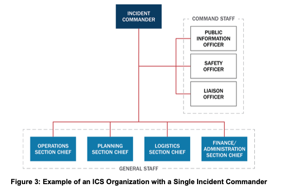

#### (2) 통합지휘 (Unified Command - Figure 4) *(원문 pp. 24–25)*
- 통합지휘는 다관할 또는 다기관 사건 관리에서 노력의 통일성을 향상시킴. 통합지휘의 사용은 사건에 대한 법적 권한이나 기능적 책임을 가진 관할구역 및 주체들이 공통의 사건 목표와 전략 및 단일 IAP 수립을 통해 사건 활동을 공동으로 관리하고 지시할 수 있게 함. 단, 각 참여 파트너는 자사 인력과 자원에 대한 권한·책임·책무성을 그대로 유지하며, 각 통합지휘 구성원은 다른 통합지휘 구성원들에게 정보를 공유할 책임이 있음.

#### (3) 현장지휘관 및 통합지휘의 7대 공통 책임 *(원문 pp. 24–25)*
단일 현장지휘관을 사용하든 통합지휘를 사용하든 지휘 기능(Command function)은 다음 **7가지 책임**을 수행함:
1. 사건을 위한 **단일 현장지휘소(Single ICP)** 설치;
2. 통합된 사건 목표, 우선순위, 전략적 지침을 수립하고 매 작전 기간(Operational period)마다 갱신;
3. 현재 사건 우선순위에 기반하여 필요한 일반참모(General Staff) 각 직위에 대해 **단일 부서장(Single section chief)** 선임;
4. 자원 주문을 위한 **단일 시스템(Single system for ordering resources)** 확립;
5. 매 작전 기간마다 **통합된 단일 사건활동계획(Consolidated IAP)** 승인;
6. 공동 의사결정 및 문서화를 위한 절차 확립;
7. 교훈(Lessons learned) 및 모범 사례(Best practices) 포착·기록.

#### (4) 통합지휘의 구성 및 협력/지원 기관 대표의 책임 *(원문 pp. 25–26)*
- 통합지휘의 정확한 구성은 사건 위치(어떤 관할구역/조직이 관련되었는가)와 사건의 성격(어떤 기관이 필요한가) 등의 요인에 따라 결정됨.

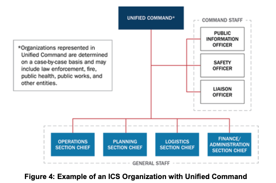

> #### 📌 [원문 인셋 박스] 단일 현장지휘관 vs 통합지휘 (Single Incident Commander and Unified Command) *(원문 p. 25)*
> - **단일 현장지휘관 (Single Incident Commander):** 현장지휘관은 (자신의 권한 범위 내에서) 사건 목표 수립에 대해 단독으로 책임을 지며, 사건 활동이 목표를 달성하도록 보장할 책임이 있음.
> - **통합지휘 (Unified Command):** 관할구역 또는 조직 당국(또는 단일 관할구역 내 부서들)에 의해 지정된 개인들이 공동으로 우선순위와 목표를 결정하고, 자원을 배분하며, 통합된 사건 작전의 실행을 보장하고 배정된 자원의 활용을 극대화하기 위해 함께 협력함.

- **협력 및 지원 기관(Cooperating and/or Assisting Agencies)과 4대 소통 사항 *(원문 p. 25)*:**
  사건에 참여하지만 관할권 책임이나 법적 권한이 없는 기관이나 조직은 **협력 기관(Cooperating agencies) 및/또는 지원 기관(Assisting agencies)**이라 불림. 통합지휘에 대표로 참여하든 연락관(Liaison Officer)을 통해 소통하든, 모든 관할구역·조직·기관 대표는 다음 **4가지 기관 고유 정보**를 전달할 책임이 있음:
  1. 법정 권한 및 책임 (Statutory authorities and responsibilities);
  2. 자원 가용성 및 역량 (Resource availability and capabilities);
  3. 제약사항, 한계, 우려사항 (Constraints, limitations, concerns);
  4. 기관 관계자들 간의 합의 영역 및 이견 영역 (Areas of agreement and disagreement between agency officials).

---

### 3.2 지휘참모 (Command Staff) *(원문 pp. 26–27)*
현장지휘관 또는 통합지휘는 지휘 기능을 지원하기 위해 필요에 따라 지휘참모(Command Staff)를 배정함. 지휘참모는 일반적으로 **공보관(PIO), 안전관(Safety Officer), 연락관(Liaison Officer)**을 포함하며, 이들은 현장지휘관 또는 통합지휘에게 직접 보고하고 필요시 보좌관(Assistants)을 둘 수 있음.

| 직책 | 주요 임무 및 법적·실무적 권한 *(원문 pp. 26–27)* |
| :--- | :--- |
| **공보관**[[BR]](Public Information Officer, PIO) | • 대중, 언론 및 사건 관련 정보 필요가 있는 타 기관과 소통함.[[BR]]• 내부 및 외부 청중 모두를 위해 접근 가능하고 *(각주 15 참조)* 의미 있으며 시의적절한 사건 정보를 수집, 검증, 조정, 배포함.[[BR]]• 언론 및 기타 공개 정보원을 모니터링하여 관련 정보를 수집하고 사건 관리 조직의 적절한 구성요소에 전달함.[[BR]]• 서로 다른 기관의 PIO들이 참여하는 사건에서는 지휘관(IC/UC)이 1명을 **선임 공보관(Lead PIO)**으로 지정하며, 모든 PIO는 통일된 방식으로 **단일 목소리(Speaking with one voice)**를 내야 함.[[BR]]• 사건 관련 정보의 외부 배포는 **현장지휘관 또는 통합지휘가 최종 승인**하며, 대규모 사건 시 PIO는 **합동정보센터(JIC)**에 참여하거나 이를 주도함. |
| **안전관**[[BR]](Safety Officer) | • 사건 작전을 모니터링하고 사건 인력의 건강 및 안전에 관한 사항에 대해 지휘관(IC/UC)에게 자문함(단, 안전한 사건 관리 수행에 대한 궁극적인 책임은 IC/UC와 모든 계층의 감독자들에게 있음).[[BR]]• 위험 환경을 평가·소통·완화하기 위한 시스템과 절차를 수립하며, 여기에는 **사건 안전계획(Incident Safety Plan)** 개발·유지, 다기관 안전 노력 조정, 사건 인력 및 현장 안전 증진 조치 이행이 포함됨.[[BR]]• ⚠️ **즉각 중지 권한:** 안전관은 **사건 중 불안전한 행위(Unsafe acts)를 중지(Stops)시키고 예방(Prevents)**함. 합동 안전 관리에 기여하는 기관들은 자체 프로그램·정책·인력에 대한 개별 책임이나 권한을 잃지 않고 전체 인력 보호에 기여함. |
| **연락관**[[BR]](Liaison Officer) | • 통합지휘(UC)에 포함되지 않은 정부 기관, 관할구역, NGO, 민간 부문 조직 대표들을 위한 사건 지휘부의 **단일 접촉 창구(Point of contact)**임.[[BR]]• 단일 지휘관 또는 통합지휘 구조 모두에서 지원/협력 기관(Assisting or cooperating agencies) 대표들은 연락관을 통해 정책, 자원 가용성, 사건 관련 사항을 조율하며, 연락관은 보좌관(Assistants)을 둘 수 있음. |
| **추가 지휘참모 직위**[[BR]](Additional Command Staff Positions) | • 사건지휘관 또는 통합지휘는 기술 전문가(Technical specialists)를 **지휘 자문역(Command advisors)**으로 임명할 수 있음.[[BR]]• **장교(Officers)와 자문역(Advisors)의 구별:** 지휘참모 자문역은 자문 역할만 수행하며 사건 활동을 직접 지시할 권한(Authority to direct incident activities)이 없다는 점에서 장교(PIO, 안전관, 연락관)와 구별됨. |

> ### 📌 [원문 각주 15 전수 번역 및 해설 (Footnote 15, p. 26)]
> - **각주 15 (접근 가능한 정보[Accessible Information]의 정의, p. 26):** 제한된 영어 구사력(Limited English proficiency)을 가진 개인 및 장애인(Individuals with disabilities)을 포함한 모든 개인이 접근할 수 있어, 그러한 정보와 데이터에 대한 접근 및 이용이 장애인이 아닌 일반 대중의 정보·데이터 접근 및 이용과 동등한(Comparable) 수준이 되도록 보장하는 것을 의미함.

---

### 3.3 일반참모 4대 부서 및 정보/수사 기능 (General Staff) *(원문 pp. 27–30 원문 완전 보완)*

일반참모(General Staff)는 **작전부(Operations), 기획부(Planning), 군수부(Logistics), 재정/행정부(Finance/Administration) 부서장(Section Chiefs)**으로 구성됨. 부서장이 임명될 때까지 이 기능들은 현장지휘관 또는 통합지휘에게 기본 귀속되며, 각 부서장은 필요에 따라 1명 이상의 **부부서장(Deputies)**을 둘 수 있음.

| ICS 일반참모 4대 부서 | 핵심 수행 역할 및 책임 |
| :--- | :--- |
| **1. 작전부 (Operations Section)** | • 현장 전술 작전 총괄 지휘[[BR]]• 인명 구조, 즉각적 위험 감소, 재산·환경 보호[[BR]]• 자원대기소(Staging Area) 관리 및 전술 자원 통제 |
| **2. 기획부 (Planning Section)** | • 상황 정보 수집·평가 및 미래 전개 예측[[BR]]• 사건활동계획(IAP) 작성 프로세스 총괄[[BR]]• 현장 배정 자원 현황 추적 및 안전한 동원해제 계획 수립 |
| **3. 물류부/군수부 (Logistics Section)** | • 외부 자원 주문 및 조달[[BR]]• 사건기지(Base) 및 캠프(Camp) 시설 설치·관리[[BR]]• 현장 통신망 운영, 대원 급식 및 대원 응급의료 지원 |
| **4. 재정/행정부 (Finance/Admin Section)** | • 투입 인력·장비 근무시간(Time) 기록 관리[[BR]]• 민간 장비 임대·구매 계약(Procurement) 관리[[BR]]• 산재 보상·손해배상 청구(Claims) 처리 및 전체 비용 정산 |

#### (1) 작전부 (Operations Section) *(원문 p. 27)*
- 현장지휘관 또는 통합지휘는 현재의 사건 우선순위에 기반하여 작전부장(Operations Section Chief)을 선발하며 사건이 전개됨에 따라 주기적으로 그 선발을 재검토해야 함.
- 작전부 인력은 인명 구조, 즉각적 위험 감소, 재산 및 환경 보호, 상황 통제 확립, 정상 운영 복구에 초점을 맞춘 사건 목표를 달성하기 위해 전술적 활동을 계획하고 수행함.
- **작전부 인력의 4대 핵심 기능 *(원문 p. 27)*:**
  1. 현장지휘관 또는 통합지휘를 대신하여 전술적 활동의 관리를 지휘 (Directing the management of tactical activities);
  2. 사건 목표 달성을 위한 전략 및 전술 개발·이행 (Developing and implementing strategies and tactics);
  3. 사건의 요구를 가장 잘 충족하고 관리 가능한 통제 범위를 유지하며 자원 사용을 최적화하도록 작전부를 조직화 (Organizing the Operations Section);
  4. 매 작전 기간의 사건활동계획(IAP) 개발 지원 (Supporting IAP development).

#### (2) 기획부 (Planning Section) *(원문 pp. 27–28)*
- 기획부 인력은 사건 상황 정보를 수집·평가·배포하며, 상태 보고서(Status reports) 작성, 상황 정보 게시(Display), 배정된 자원의 상태 유지, 사건활동계획 수립 프로세스 촉진, 그리고 타 부서·지휘참모의 의견과 지휘관의 지침에 기반한 **IAP 작성**을 수행함.
- **기획부 인력의 5대 추가 핵심 기능 *(원문 p. 28)*:**
  1. 사건 기획 회의(Incident planning meetings) 진행 및 촉진;
  2. 자원 상태 및 예상 자원 소요 기록;
  3. 사건 상태 정보의 수집·조직화·게시·배포 및 변화하는 상황 분석;
  4. 사건 자원의 질서 있고 안전하며 효율적인 **동원 해제 계획 수립(Planning for demobilization)**;
  5. 모든 사건 문서의 수집, 기록 및 안전 보관(Safeguarding all incident documents).

#### (3) 군수부 (Logistics Section) *(원문 p. 28)*
- 군수부 인력은 자원 주문을 포함하여 효과적이고 효율적인 사건 관리를 위한 서비스와 지원을 제공함(시설, 사건 지휘 시설 및 인력 보안, 교통, 보급품, 장비 정비 및 연료, 급식 서비스, 통신 및 IT 지원, 사건 인력을 위한 의료 서비스).
- **군수부 인력의 6대 핵심 기능 *(원문 p. 28)*:**
  1. 사건 관련 자원의 주문, 수령, 보관/수용 및 처리 (Ordering, receiving, storing/housing, and processing);
  2. 사건 중 지상 교통수단 제공, 차량 유지보수 및 보급, 차량 운행 기록 유지, **사건 교통 계획(Incident traffic plans)** 개발;
  3. 사건 시설의 설치, 유지보수, 보안 유지 및 철수/동원 해제;
  4. 음식 및 식수 소요 판단(음식 주문, 조리 시설 제공, 급식 구역 유지, 그리고 **안전관[Safety Officer]과 협력하여 식품 보안 및 안전 관리** 포함);
  5. **사건 통신 계획(Incident Communications Plan)** 유지 및 통신·IT 장비의 획득, 설치, 지급, 유지보수, 회계 관리;
  6. **사건 인력에 대한 의료 서비스(Medical services to incident personnel)** 제공 *(일반 시민 피해자 치료가 아닌 투입 대원 대상 의료 지원임)*.

#### (4) 재정/행정부 (Finance/Administration Section) *(원문 pp. 28–29)*
- 현장 또는 사건 특유의 재정 및 행정 지원 서비스가 수반될 때 설치되며, 기획부 및 군수부와 긴밀히 조율하여 작전 기록과 재무 문서를 대사(Reconcile)해야 함. 복수의 재원(Multiple sources of funds)이 투입되는 대규모 복합 사건에서 누적 비용(Accrued costs)을 추적·보고하여 지휘관이 자금 소요를 예측하고 추가 자금을 요청할 수 있게 함.
- **재정/행정부 인력의 5대 핵심 기능 *(원문 p. 29)*:**
  1. 비용 추적, 비용 데이터 분석, 비용 추정 및 비용 절감 조치 권고;
  2. 사건 현장에서의 재산 피해, 대응요원 부상 또는 사망으로 인해 발생하는 재정적 사안의 분석, 보고 및 기록;
  3. 리스(Leases) 및 벤더 계약(Vendor contracts)에 관한 재무 사항 관리;
  4. 분석 및 의사결정을 위한 행정 데이터베이스 및 스프레드시트 관리;
  5. 사건 인력 및 임대 장비에 대한 시간 기록(Recording time).

#### (5) 정보/수사 기능 (Intelligence/Investigations Function) *(원문 pp. 29–30 원문 완전 보완)*
- 일반적으로 운영 정보 수집·분석은 기획부가, 전술 실행은 작전부가 담당하지만, 범죄나 테러 행위 및/또는 **역학조사(Epidemiological investigations)**와 같은 비법집행 정보/수사 노력이 수반되어 집중적인 첩보 수집 및 수사 활동이 필요한 사건의 경우, 지휘관(IC/UC)은 정보/수사 책임을 재구성할 수 있음.
- **정보/수사 기능의 7대 목적 *(원문 pp. 29–30)*:**
  1. 잠재적 불법 활동, 사건 및/또는 공격의 예방 및/또는 억제 (Prevent and/or deter);
  2. 정보, 첩보 및 상황인식의 수집, 처리, 분석, 보안 유지 및 배포;
  3. **증거물 또는 검체(Evidence or specimens)의 식별, 문서화, 처리, 수집, 관리연속성(Chain of custody) 확립, 안전 보관, 검사·분석 및 저장**;
  4. 가해자(Perpetrators)의 신원 확인 및 체포로 이어지는 철저하고 포괄적인 수사 수행;
  5. **실종자 및 대량 사망자/사망 수사 (Missing persons and mass fatality/death investigations)** 수행;
  6. 향후 공격이나 파급 영향 확대를 방지함으로써 모든 대응 인력의 안전과 보안을 포함한 인명 안전 작전에 정보를 제공하고 지원;
  7. 진행 중인 사건(예: **질병 창궐[Disease outbreak], 화재, 복합 조정 공격[Complex coordinated attack], 사이버 사건[Cyber incident]**)의 영향을 통제하거나 유사 사건 재발을 방지하기 위해 그 근원이나 원인(Source or cause)을 규명.
- 지휘 구조 내 정보/수사 기능의 범위와 배치 위치(지휘참모, 일반참모 제5부서, 기획부/작전부 산하 등)는 지휘관(IC/UC)이 최종 결정함(부록 A 탭 6 참조).

---

### 3.4 주요 ICS 현장 시설 (Common Types of ICS Facilities - Figure 5) *(원문 pp. 30–31)*

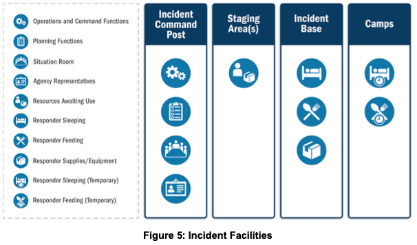

원문의 `Figure 5: Incident Facilities`에 제시된 4대 주요 ICS 시설은 다음과 같음:
1. **현장지휘소 (Incident Command Post, ICP) *(원문 p. 30)*:** 전술 수준의 현장 사건 지휘 조직이 위치하는 장소로, 일반적으로 현장지휘관(또는 통합지휘)과 지휘참모·일반참모를 수용함. 통상 사건 현장 인근에 위치하며 현장 전술 지휘 기능과 사건 기획이 수행되고 사건 통신 센터가 설치될 수 있음.
2. **자원대기소 (Staging Areas) *(원문 p. 30)*:** 작전부장(Operations Section Chief)이 자원을 배치하고 추적하기 위해 설치함. 인력, 보급품, 장비가 임무 배정을 기다리는 모든 장소가 될 수 있으며 임시 급식, 급유, 위생 서비스를 포함할 수 있음. 작전부장은 각 대기소마다 **대기소 관리자(Staging Area Manager)**를 배정하며, 관리자는 도착하는 모든 자원을 등록(Logs in)하고 부서장의 요청에 따라 자원을 파견하며 필요시 군수부 지원을 요청함.
3. **사건기지 (Incident Base) *(원문 p. 30)*:** 일차적인 지원 활동(Primary support activities)을 수용하는 부지로, 장비와 인력 지원 작전을 수용하기 위해 지휘관(IC/UC)이 설치함. 사건기지는 ICP와 동일 위치에 배치(Co-located)될 수 있음.
4. **캠프 (Camps) *(원문 p. 31)*:** 사건기지의 위성 시설(Satellites to an incident base)로서 사건 작전을 가장 잘 지원할 수 있는 곳에 설치됨. 음식, 수면 구역, 위생 등 지원을 제공하며 장비의 경미한 정비·서비스도 제공할 수 있음. 변화하는 작전 요구에 맞추어 필요시 재배치됨.

---

### 3.5 사건관리팀 (IMT), 권한 위임장 및 사건관리지원팀 (IMAT) *(원문 pp. 31–32)*

#### (1) 사건관리팀 (Incident Management Teams, IMT) *(원문 p. 31)*
- IMT는 현장지휘관, 기타 사건 리더십, 주요 ICS 보직 유자격 인력으로 구성된 ICS 자격 인증 인력의 명부화된 그룹(Rostered groups)임. 지방, 지역, 주, 부족, 국가 차원에 존재하며 공식 통지·파견·운영 절차를 갖추고 팀원 자격에 따라 유형화(Typed)됨. 사건 관리나 지원 과업에 배정될 때 일반적으로 피해 관할구역이나 조직을 대신하여 행동할 권한을 위임받음.

> #### 📌 [원문 인셋 박스] 권한 위임장 (Delegation of Authority) *(원문 p. 31)*
> 권한 위임장(Delegation of authority)은 권한 있는 관할구역/조직 공직자가 현장지휘관에게 그러한 위임을 부여하기 위해 제공하는 공식 성명서(Statement)임. 이는 현장지휘관에게 구체적인 책임과 권한을 부여하며, 일반적으로 **우선순위(Priorities), 기대치(Expectations), 제약사항(Constraints) 및 기타 고려사항이나 가이드라인**을 기술함. 많은 기관들은 현장지휘관이 지휘권을 인수하기 전에 위임 당국이 **서면 권한 위임장(Written delegation of authority)**을 제공할 것을 요구함.

#### (2) 사건관리지원팀 (Incident Management Assistance Teams, IMAT) *(원문 p. 32)*
- 일부 IMT는 현장 인력 및/또는 피해 관할구역을 지원한다는 점을 명확히 하기 위해 **사건관리지원팀(IMAT)**이라 불림. IMAT는 대응 및 복구 노력의 특정 측면(예: 주/연방 자산의 사용)에 대한 지휘 및 통제권을 가질 수 있으며, 지방·주·부족 정부 대표들과 함께 통합지휘(UC) 또는 **통합조정그룹(Unified Coordination Group)** *(각주 16 참조)*에 참여하여 활동이 지역 우선순위에 부합하도록 보장함.
- **FEMA IMAT:** 예를 들어 FEMA IMAT는 사건 현장이나 위협 예상 지역에 파견되어 연방 지원을 식별·제공하고 피해 주나 부족을 지원하여 관할 간 대응을 조정·통합하며 연방 정부의 조기 현장 임석(Early presence)을 제공함.

> ### 📌 [원문 각주 16 전수 번역 및 해설 (Footnote 16, p. 32)]
> - **각주 16 (통합조정그룹[Unified Coordination Group], p. 32):** 통합조정그룹은 주, 부족 및 연방의 이해관계를 대표하는 고위 리더들과(특정 상황에서는 지방 관할구역 및 민간 부문 포함)로 구성됨. 국가대응프레임워크(National Response Framework, NRF)가 통합조정그룹을 더 상세히 기술함.

---

### 3.6 복합 사건(Incident Complex) 및 구역지휘(Area Command) *(원문 pp. 32–34)*

#### (1) 복합 사건: 단일 ICS 조직 내 다수 사건 관리 (Incident Complex) *(원문 p. 32)*
- **정의:** 동일한 일반 구역 내에 위치하고 단일 현장지휘관 또는 통합지휘에 배정된 **2개 이상의 개별 사건(Two or more individual incidents)**을 지칭함. 복합 사건이 설정되면 개별 사건들은 복합 사건 작전부(Operations Section) 내의 **지대(Branches) 또는 지역대(Divisions)**가 됨(근접 거리에서 다수의 산불이 발생할 때 주로 활용). 단, 복합 사건 내의 어느 한 사건이 대규모 사건으로 발전할 가능성이 있으면 별도의 자체 ICS 조직을 갖춘 독립 사건으로 분리해야 함.
- **복합 사건 적용의 2대 지표 (Indicators) *(원문 p. 32)*:**
  1. 단일 지휘참모 및 일반참모가 작전, 기획, 군수, 재정/행정 활동을 적절히 제공할 수 있는 경우;
  2. 결합된 관리 접근법이 인력 또는 군수 지원의 경제성(Economies)을 달성할 가능성이 높은 경우.

#### (2) 구역지휘 (Area Command - Figure 6) *(원문 pp. 32–34 원문 완전 보완)*
- **정의 및 목적:** 다수의 동시 발생 사건(Multiple concurrent incidents) 또는 복수의 ICS 조직 설치를 필요로 하는 매우 복잡한 사건을 감독(Oversee)하기 위해 설치됨. 사건의 복잡성과 통제 범위 고려사항에 기반하여 **복수의 현장지휘소(ICPs) 간의 자원 경쟁(Competition for resources)**을 해결하기 위해 활성화되며, 관할 간 작전 가능성으로 인해 흔히 **통합구역지휘(Unified Area Command)**로 설치됨.
- **구역지휘의 8대 핵심 책임 (Responsibilities of an Area Command) *(원문 p. 33)*:**
  1. 피해 구역을 위한 포괄적 목표(Broad objectives) 개발;
  2. 각 사건에 대한 사건 목표 및 전략 개발 조정;
  3. 우선순위 변화에 따른 자원 배분 또는 재배분(Allocating or reallocating resources);
  4. 현장지휘관 및/또는 통합지휘가 사건을 적절히 관리하도록 보장;
  5. 효과적인 통신 및 데이터 조정 보장;
  6. 사건 목표가 달성되고 상호 간 또는 기관 정책과 충돌하지 않도록 보장;
  7. 희소 자원(Scarce resources)에 대한 소요를 식별하고 이를 기관 행정책임자(Agency Administrators)에게 직접 또는 MAC Group이나 EOC를 통해 보고;
  8. **복구 차원(Recovery dimension)이 있는 사건의 경우, 장기 복구 작전으로의 전환을 지원하기 위해 단기 복구(Short-term recovery)가 EOC 인력과 조정되도록 보장**.

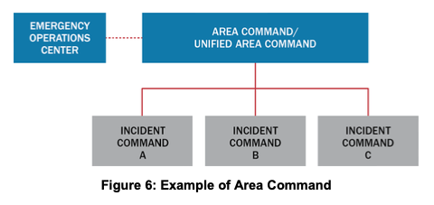

> #### 📌 [원문 인셋 박스] 구역지휘, EOC 및 MAC Group 간의 관계 *(원문 p. 34)*
> 구역지휘(Area Command)는 복수 사건의 관리를 감독(Oversees)하는 반면, EOC는 지원을 조정(Coordinate support)함. MAC Group은 구역지휘와 EOC에 정책 지침(Policy guidance)과 전략적 방향(Strategic direction)을 제공함.

---

## 4. C. 긴급운영센터 (Emergency Operations Centers, EOC) *(원문 pp. 34–38)*

### 4.1 EOC의 목적, 주요 기능 및 부서운영센터(DOC)와의 구별 *(원문 pp. 34–35)*
- **EOC의 정의 및 형태:** 다수 기관의 인력이 임박한 위협과 위험에 대처하고 사건 지휘부, 현장 인력 및/또는 다른 EOC에 조정된 지원을 제공하기 위해 모이는 장소로, 고정 시설(Fixed locations), 임시 시설(Temporary facilities), 또는 원격 참여하는 가상 구조(Virtual structures)일 수 있음.
- **EOC의 다양한 운영 양태 *(원문 p. 34)*:** EOC 인력은 ICP 인력, ICP에 소속되지 않은 현장 인력(예: 잔해 제거 또는 대피소 관리 인력), 또는 다른 EOC 인력을 지원함. 또한 긴급 대피소나 구호물자 배분소(POD) 관리 등 특정 작전을 직접 수행하여 현장 인력의 부담을 분담할 수 있으며, 폭설 비상사태(Snow emergency)처럼 현장 지휘부가 설치되지 않은 경우 EOC 인력이 전술 작전을 지시할 수도 있음. 일부 경우에는 사건 지휘나 구역지휘가 EOC 내부에서 수행되기도 하며, 예방·보호 활동 지원이나 이미 파견된 자원의 결원 보충(Backfill) 자원을 찾기 위해 가동될 수도 있음.
- **EOC 인력의 4대 일차적 기능 (Primary Functions) *(원문 p. 34)*:**
  1. 정보 수집, 분석 및 공유 (Collecting, analyzing, and sharing information);
  2. 배분 및 추적을 포함한 자원 소요 및 요청 지원 (Supporting resource needs and requests);
  3. 계획 조정 및 현재·미래 소요 판단 (Coordinating plans and determining current and future needs);
  4. 일부 경우, 조정 및 정책 방향 제공 (Providing coordination and policy direction).
- **부서운영센터(DOC)와 다학제적 EOC의 차이 *(원문 p. 34)*:**
  - **부서운영센터 (Departmental Operations Center, DOC):** 개별 기관이나 부서의 활동을 조정하며, 타 조직·EOC와 소통하고 연락관을 교환하기도 하지만 일차적으로 자기 기관의 자산과 작전을 지시하는 데 집중하는 **내향적(Inward looking)** 조직임.
  - **긴급운영센터 (EOC):** DOC와 달리 NIMS에서 다루는 EOC는 본질적으로 **다학제적(Multidisciplinary)** *(각주 17 참조)* 활동임.
- **선출직 및 임명직 공직자의 감독과 5대 주요 의사결정 영역 *(원문 p. 35)*:**
  모든 EOC 팀은 주지사, 부족 지도자, 시장, 시 매니저 등 선출직 및/또는 임명직 공직자로부터 감독(Oversight)을 받음. 이들은 주로 다음 이슈에 관한 우선순위와 결정을 내림:
  ① 비상사태 선포(Emergency declarations), ② 대규모 대피(Large-scale evacuations), ③ 특별 비상 자금 접근(Access to extraordinary emergency funding), ④ 조례 및 규제 유예/면제(Waivers to ordinances and regulations), ⑤ 희소 자원의 조정·판정(Adjudication of scarce resources).

> ### 📌 [원문 각주 17 전수 번역 및 해설 (Footnote 17, p. 34)]
> - **각주 17 (다학제적[Multidisciplinary]의 정의, p. 34):** "다학제적(Multidisciplinary)"이란 사건, 위협 또는 위험의 성격에 기반하여 화재 예방 및 진압, 법집행, 응급의료(EMS), 공공사업(Public works) 등 비상관리에 참여하는 **둘 이상의 기능(자원 및 조직)의 결합(Assemblage of more than one function)**을 지칭함.

---

### 4.2 EOC 조직 구성 3대 모델 (EOC Staff Organizations - Figures 7, 8, 9) *(원문 pp. 35–37)*

> #### 📌 [원문 인셋 박스] 모듈식 EOC 조직 (Modular EOC Organizations) *(원문 p. 35)*
> 모듈식 조직이라는 NIMS 관리 특성은 리더가 인력이 배치되지 않은 하위 보직의 기능에 대해 책임을 진다는 것을 의미하며, 이는 EOC에도 동일하게 적용됨. 인력과 공간이 제한된 EOC에서는 책임자가 EOC 본부장(EOC director)의 임무뿐만 아니라 다른 직위에 인력이 충원될 때까지 다른 EOC 팀원들의 임무까지 함께 수행할 수 있음.

#### (1) 모델 1: ICS 또는 ICS 유사 구조 (ICS or ICS-like Structure - Figure 7) *(원문 pp. 35–36)*
- 많은 관할구역/조직이 표준 ICS 조직 구조를 사용하여 EOC를 구성함. 사람들에게 친숙하고 현장 사건 조직과 정합성이 높으며, 현장 기능과 EOC 기능을 구별하기 위해 명칭을 일부 수정(예: Operations Coordination 등)한 ICS 유사 구조를 사용하기도 함.

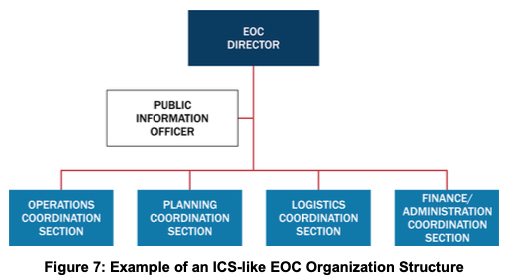

#### (2) 모델 2: 사건지원모델 구조 (Incident Support Model [ISM] Structure - Figure 8) *(원문 p. 36)*
- 정보, 기획, 자원 지원에 EOC 노력을 집중하는 관할구역/조직은 **상황인식(Situational awareness) 기능을 기획(Planning)에서 분리**하고, **작전(Operations)과 군수(Logistics) 기능을 사건 지원(Incident support / Resources Support) 구조로 결합**하는 ISM 구조를 선택할 수 있음. 이는 EOC 본부장을 상황인식/정보관리 담당자와 직접 연결하고 자원 소싱·주문·추적을 간소화함.

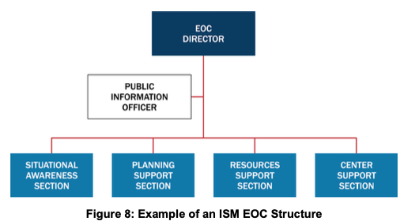

#### (3) 모델 3: 부서별 구조 (Departmental Structure - Figure 9) *(원문 pp. 36–37)*
- 일상적인 부서/기관 구조와 관계를 EOC에서 그대로 활용하는 방식으로, 최소한의 준비나 가동 시간만으로 즉시 기능할 수 있음. 일반적으로 비상관리자(Emergency manager)나 고위 공직자가 부서 간 EOC 노력을 조정함.

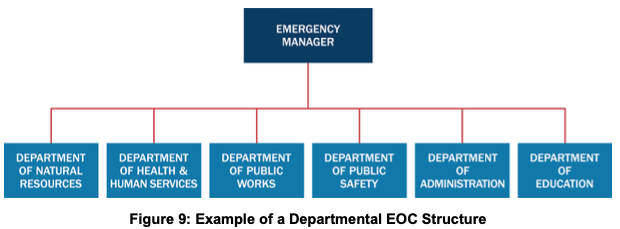

---

### 4.3 EOC 활성화 및 비활성화 (EOC Activation and Deactivation) *(원문 pp. 37–38 원문 완전 보완)*

#### (1) EOC 활성화를 유발하는 7가지 상황 (Circumstances Triggering Activation) *(원문 p. 37)*
1. 둘 이상의 관할구역이 사건에 관련되거나 사건에 다수의 기관이 참여하는 경우;
2. 현장지휘관 또는 통합지휘가 사건이 급격히 확장되거나, 연쇄적 영향(Cascading effects)을 수반하거나, 추가 자원을 필요로 할 수 있음을 시사하는 경우;
3. 과거 유사한 사건이 EOC 활성화로 이어졌던 경우;
4. EOC 본부장 또는 임명직·선출직 공직자가 EOC 활성화를 지시하는 경우;
5. 사건이 임박한 경우(예: 허리케인 경보, 완만한 하천 범람, 위험 기상 예보, 위협 수준 격상);
6. 비상운영계획(EOP)에 기술된 기준점 사건(Threshold events)이 발생한 경우; 및/또는
7. 주민에 대한 중대한 영향(Significant impacts to the population)이 예상되는 경우.

#### (2) EOC 가동 단계 (Table 2: EOC Activation Levels) *(원문 pp. 37–38)*
외부와의 소통 시에는 Table 2의 표준 NIMS 가동 단계 명칭을 사용해야 하며, 숫자를 사용할 때는 **숫자가 낮을수록 더 높은 가동 수준(Descending numbers meaning higher levels of activation, 즉 Level 1이 전면 가동)**을 의미하는 표준 NIMS 접근법을 반영해야 함. 모든 단계는 대면 인력과 원격 가상 조정 인력을 모두 포함할 수 있음.

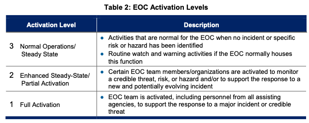

| 가동 단계 | 명칭 (Activation Level) | 설명 및 기준 *(원문 p. 38)* |
| :---: | :--- | :--- |
| **3** | **정상 운영 / 평시 상태**[[BR]](Normal Operations / Steady State) | ● 사건이나 특정 위험·위해요소가 식별되지 않았을 때 EOC에 정상적인 활동[[BR]]● EOC가 평시 상시감시 및 경보(Watch and warning) 기능을 수용하는 경우 일상적 감시·경보 활동 수행 (위협 모니터링, 일상 부서 간 조율, 계획·훈련·연습 개발·실행, 시설·장비 유지보수) |
| **2** | **강화된 평시 / 부분 가동**[[BR]](Enhanced Steady-State / Partial Activation) | ● 신뢰할 만한 위협, 리스크 또는 위험을 모니터링하거나 및/또는 새롭고 잠재적으로 진화하는 사건에 대한 대응을 지원하기 위해 특정 EOC 팀원/조직들이 가동됨 |
| **1** | **전면 가동**[[BR]](Full Activation) | ● 대규모 사건 또는 신뢰할 만한 위협에 대한 대응을 지원하기 위해 모든 지원 기관의 인력을 포함한 EOC 팀 전체가 가동됨 |

#### (3) EOC 비활성화 (Deactivation) *(원문 p. 38)*
- EOC 본부장은 상황이 허락함에 따라 EOC 인력을 비활성화하고 정상 운영/평시 상태로 복귀시킴. 비활성화는 사건이 더 이상 EOC의 지원·조정 기능을 필요로 하지 않거나 개별 조직 또는 평시 조정 메커니즘으로 관리될 수 있을 때 이루어지며, 임무 필요에 따라 **단계적 비활성화(Phase deactivation)**를 수행할 수 있음.
- EOC 인력은 비활성화 전에 **자원 동원 해제를 완료(Complete resource demobilization)**하고 진행 중인 사건 지원/복구 활동을 이관하며, 기획가들은 비활성화 계획 프로세스의 일환으로 **사후검토(After-action review) 및 개선 계획 수립(Improvement planning)**을 포함함.

---

## 5. D. 다기관조정그룹 (Multiagency Coordination Group, MAC Group) *(원문 pp. 39–40)*

### 5.1 정의, 역할 및 통합지휘(UC)와의 구별 *(원문 p. 39)*
- **정의:** 정책 그룹(Policy groups)이라고도 불리는 MAC Group은 NIMS의 현장 외(Off-site) 사건 관리 구조의 일부임. 이해관계 기관이나 조직의 대표들(일반적으로 **기관 행정책임자[Agency administrators], 임원[Executives] 또는 그 지명자[Designees]**)로 구성되어 협력적인 다기관 결정을 내림.
- **핵심 기능:** 사건 중 정책 수준 기구(Policy-level bodies)로서 **자원 우선순위 결정 및 배분(Resource prioritization and allocation)**을 지원하고, 선출직·임명직 공직자와 사건 관리 책임자(예: 현장지휘관) 간의 의사결정을 가능하게 함(일부 경우 EOC 인력이 이 활동을 수행하기도 함).
- **통합지휘(UC)와의 엄격한 구별:** MAC Group은 통합지휘(UC)와 달리 **사건 지휘 기능을 수행하지 않으며(Do not perform incident command functions)**, 작전·조정·지령 조직의 일차적 기능을 대체하지도 않음. 자원 경쟁이 심각할 때 조정·지령 조직의 우선순위 결정 및 배분 책임 부담을 덜어줄 수 있음.

### 5.2 구성원 자격, 비전통적 파트너 및 합의제 의사결정 *(원문 pp. 39–40)*
- **구성원의 다양성:** 직접 영향을 받고 자원을 투입한 조직뿐만 아니라, **지역 상공회의소(Local chambers of commerce)와 같은 경제 단체, 미국적십자사와 같은 자원봉사 조직, 또는 특수한 전문성·지식을 가진 기타 조직**도 포함될 수 있음. 이들은 유형의 자원이나 자금을 직접 기부하지 않더라도 그 **관계망(Relationships), 정치적 영향력(Political influence), 또는 기술적 전문성(Technical expertise)**이 사건 대응 및 복구 지원 성공의 핵심이 될 수 있음.
- **전결 권한 및 합의제(Consensus) 운영:** MAC Group 지명자는 사건 활동을 위해 소속 기관의 자원과 자금을 대표하거나 투입(Commit)할 수 있는 공식 위임을 받아야 하며, MAC Group은 일반적으로 **구성원 간의 합의(Member consensus)**에 기반하여 결정을 내리고 많은 경우 가상(Virtually)으로 기능할 수 있음.
- **행정·군수 지원:** MAC Group에 필요한 행정·군수·문서화·의사결정 지원 정보(핵심 자원 추적, 상황 상태, 수사 정보) 및 대국민 공보 지원은 EOC 인력이 제공하거나 별도의 지원 조직을 설치하여 수행함.

---

## 6. E. 합동정보체계 (Joint Information System, JIS) *(원문 pp. 41–45 원문 완전 보완)*

### 6.1 JIS의 정의, 4대 임무 및 4대 핵심 요소 *(원문 p. 41)*
- **정의:** JIS는 사건 관리의 모든 단계에서 대중, 사건 인력, 언론 및 기타 이해관계자들에게 시의적절하고 정확하며 접근 가능하고 실행 가능한(Timely, accurate, accessible, and actionable) 정보를 전달하기 위해 사건 정보와 공보(Public affairs)를 하나의 응집력 있는 조직으로 통합하는 프로세스, 절차 및 도구들로 구성됨.
- **JIS의 4대 핵심 임무 (The JIS Mission) *(원문 p. 41)*:**
  1. 조정된 기관 간 메시지 개발 및 전달 (Developing and delivering coordinated interagency messages);
  2. 현장지휘관/통합지휘, EOC 본부장 또는 MAC Group을 대신하여 공보 계획 및 전략을 개발, 권고 및 실행;
  3. 사건 관리 노력에 영향을 미칠 수 있는 공보 이슈에 관하여 현장지휘관/통합지휘, MAC Group, EOC 본부장에게 자문;
  4. 대중의 신뢰를 훼손할 수 있는 **루머 및 부정확한 정보의 대처 및 관리 (Addressing and managing rumors and inaccurate information)**.
- **3대 계층 횡단 및 JIS의 4대 핵심 요소 (Key Elements of the JIS) *(원문 p. 41)*:**
  JIS는 사건 관리의 3대 계층(현장/전술[On-scene/tactical], 센터/조정[Center/coordination], 정책/전략[Policy/strategic])을 모두 가로질러 작동하며 다음 4대 핵심 요소를 포함함:
  ① 기관 간 조정 및 통합(Interagency coordination and integration); ② 일관된 메시지의 수집, 검증, 조정 및 배포; ③ 의사결정자를 위한 공보 지원(Public affairs support for decision makers); ④ 유연성, 모듈성 및 적응성(Flexibility, modularity, and adaptability).

### 6.2 공보관(PIO)의 5대 협업 과업 및 합동정보센터(JIC) *(원문 pp. 41–43)*
- **일관된 메시지 작성을 위한 PIO의 5대 협업 과업 *(원문 p. 42)*:**
  1. 대중에게 전달할 핵심 정보 식별;
  2. 제한된 영어 구사력(LEP)을 가진 개인, 장애인 및 기타 접근·기능적 필요가 있는 사람들 *(각주 18 참조)*을 포함하여 모두가 이해할 수 있는 명확한 메시지 작성;
  3. 청중을 압도하지 않으면서 적시에 정보가 전달되도록 메시지 우선순위 지정;
  4. 정보의 정확성 검증;
  5. 가장 효과적인 수단을 사용한 메시지 배포.

> ### 📌 [원문 각주 18 전수 번역 및 해설 (Footnote 18, p. 42)]
> - **각주 18 (다중 포맷 메시지 제공 의무, p. 42):** 메시지는 청각장애인 또는 난청인(Deaf or hard of hearing), 제한된 영어 구사력을 가진 개인, 다양한 문화적 배경을 가진 개인, 인지적 제한(Cognitive limitations)을 가진 개인, 그리고 전통적 미디어를 사용하지 않는 개인들의 접근 및 기능적 필요를 반영하기 위해 **다중 포맷(Multiple formats)**으로 제공되어야 함.

- **합동정보센터 (Joint Information Center, JIC) 및 Table 3 *(원문 pp. 42–43)*:**
  JIC는 JIS 작전을 수용하는 시설로서, 독립형 조정 기구, 사건 현장, 또는 EOC의 구성요소로 설치될 수 있음. 원칙적으로 단일 JIC가 바람직하나, 광역 복합 사건의 경우 복수의 물리적 또는 가상 JIC(Virtual JIC)를 수용할 수 있으며 이 경우 최종 배포 승인 권한(Final release authority)을 정하기 위해 상호 조율함.

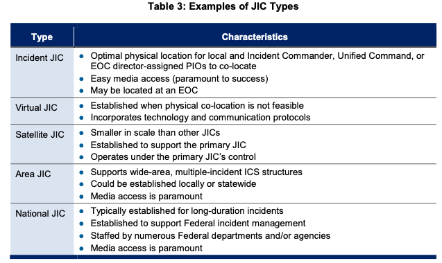

| JIC 유형 (Type) | 주요 특성 (Characteristics) *(원문 p. 43)* |
| :--- | :--- |
| **사건 JIC (Incident JIC)** | ● 지방 및 현장지휘관, 통합지휘 또는 EOC 본부장이 배정한 PIO들이 공동 위치(Co-locate)하기에 최적의 물리적 장소[[BR]]● 손쉬운 언론 접근성 (성공에 가장 중요함[Paramount to success])[[BR]]● EOC에 위치할 수 있음 |
| **가상 JIC (Virtual JIC)** | ● 물리적 공동 배치가 불가능할 때 설치 (공보 담당자들이 분산된 다수 위치에서 전자적으로 연결)[[BR]]● 기술 및 통신 프로토콜을 결합함 |
| **위성 JIC (Satellite JIC)** | ● 다른 JIC보다 규모가 작음[[BR]]● 주 JIC(Primary JIC)를 지원하기 위해 설치되며 주 JIC의 통제 하에 운영됨 |
| **구역 JIC (Area JIC)** | ● 광역, 다수 사건 ICS 구조를 지원함[[BR]]● 지역 차원 또는 주 전역 차원(Locally or statewide)에서 설치될 수 있으며 언론 접근성이 가장 중요함 |
| **국가 JIC (National JIC)** | ● 일반적으로 장기 지속 사건(예: 수주 또는 수개월)을 위해 설치됨[[BR]]● 연방 사건 관리를 지원하기 위해 설치되며 다수의 연방 부처/기관 인력이 배치됨 (언론 접근성 최우선) |

#### 조직적 독립성 (Organizational Independence) *(원문 p. 43 원문 보완)*
- 사건 관리에 참여하는 조직들은 공통의 대국민 정보를 생성하기 위해 JIS를 통해 협력하는 동안에도 **자체적인 조직적 독립성(Organizational independence)**을 유지함. JIC 내에서 각 부처, 기관, 조직 또는 관할구역은 자체 프로그램이나 정책에 관한 정보를 계속 통제하면서 전체적인 통일된 메시지(Overall unified message)에 기여함.

---

### 6.3 대중 및 이해관계자에게 정보 전달하기: 4단계 순환 프로세스 *(원문 pp. 43–45 원문 완전 보완)*

| 순환 단계 | 프로세스 명칭 (원문 pp. 43–45) | 핵심 공보 활동 내용 |
| :---: | :--- | :--- |
| **1단계** | **정보 수집 (Gathering)** | 현장지휘소(ICP), EOC, 유관기관, 언론 보도, 소셜 미디어 등 5대 정보원에서 사건 관련 정보 수집 |
| **2단계** | **정보 검증 (Verifying)** | 수집된 정보의 정확성을 JIC 내 참여 기관 상호 대조 및 현장 확인을 통해 교차 검증(루머 배제) |
| **3단계** | **정보 조정 (Coordinating)** | 유관 기관 간 모순 없는 단일 핵심 메시지(Key messages) 수립 및 사건지휘관(IC/UC) 공식 배포 승인 획득 |
| **4단계** | **정보 배포 (Disseminating)** | 경보 시스템(IPAWS/EAS/NTAS), 언론 브리핑, 공식 SNS, 다국어 안내문 등을 통해 대중에게 신속 전파 |

1. **제1단계: 정보 수집 (Gathering Information) — 5대 수집 출처 *(원문 pp. 43–44)*:**
   - ① **현장 지휘부 (On-scene command):** IAP와 상황보고서(SITREPs)에 포착된 사건 관리 노력에 관한 지속적·공식적 정보 제공;
   - ② **현장 PIO (On-scene PIO):** 뉴스 미디어, 선출직 공직자 및 보좌진, 대중으로부터 직접 관찰하고 들은 내용을 JIC에 보고;
   - ③ **미디어 모니터링 (Media monitoring):** 뉴스 및 소셜 미디어 보도의 정확성과 내용을 평가하고 돌발 이슈와 트렌드를 식별;
   - ④ **선출직·임명직 공직자 및 일반 대중의 문의 (Inquiries):** 피해 지역 주민들의 구체적인 우려사항을 파악하게 해줌;
   - ⑤ **EOC 인력 (Staff in EOCs):** 상황 상태 및/또는 대중이 이용할 수 있는 대규모 구호(Mass care), 복구, 기타 지원에 관한 정보 생성.
2. **제2단계: 정보 검증 (Verifying Information) *(원문 p. 44)*:**
   - 수집된 정보의 정확성을 검증함. 서로 다른 기관을 대표하는 PIO들은 JIC 참여를 통해 각자 다양한 출처에서 수집한 기록을 비교(Compare notes)하고 상충되는 정보를 해소(Deconflict)함.
3. **제3단계: 정보 조정 (Coordinating Information) *(원문 p. 44)*:**
   - JIC 내부 및 외부의 다른 JIS 공보 인력과 조율하며 다음 2가지를 수행함:
     - **핵심 메시지 수립 (Establishing key message[s]):** 지방·주·부족·준주·연방 사건 관리 우선순위와 전략에 따라 우선순위가 매겨진 통일된 메시지를 작성함;
     - **권한 있는 당국으로부터의 승인 또는 허가 획득 (Obtaining approval or clearance):** 정보의 일관성과 정확성을 보장하되, 시의적절한 배포를 위해 승인 절차는 간소화(Streamlined)되어야 함.
4. **제4단계: 정보 배포 (Disseminating Information) *(원문 pp. 44–45)*:**
   - 보도자료, 전화 통화, 인터뷰 등 전통적 수단뿐 아니라 직접 방문(Personal visits)이나 주민 회의(Town meetings)가 활용될 수 있음.
   - **국가 경보 시스템 활용:** **통합대국민경보시스템(Integrated Public Alert and Warning System, IPAWS), 비상경보시스템(Emergency Alert System, EAS), 국가테러경보시스템(National Terrorism Advisory System, NTAS)** 등 지방·주·부족·연방 시스템을 통해 대국민 소통을 촉진함.
   - **소셜 미디어 및 루머 대응:** 정전 등으로 전통 미디어가 불능일 때나 특정 계층 타겟팅에 소셜 미디어가 중요하며, PIO와 지역사회 리더들에게 발언 요지(Talking points)와 전단(Fliers)을 제공하여 지원함. 뉴스 및 소셜 미디어 모니터링을 통해 루머, 부정확성, 정보 격차를 식별하고, **중요한 오류는 언론이 두 번째로 잘못 보도하기 전에 즉각 바로잡아야 함**.

### 6.4 대국민 공보 통신 계획 수립 (Public Information Communications Planning) *(원문 p. 45 원문 완전 보완)*
- 잘 개발되고 조정된 공보, 교육 및 통신 계획과 전략은 위협 및 경보 시스템을 통해 인명 구조 조치나 대피 경로를 포함한 공공 안전 정보를 시의적절하고 일관되며 정확하고 접근 가능한 방식으로 공유할 수 있게 함.
- 계획에는 **보도자료 초안(Draft news releases), 미디어 명단(Media lists), 선출직/임명직 공직자·지역사회 리더·민간 부문 조직·공공 서비스 조직의 연락처 정보**를 개발하기 위한 프로세스, 프로토콜, 절차가 포함되어야 하며, 대국민 공보 통신은 **교육·훈련 및 연습(Training and exercises)**에도 반드시 포함되어야 함.

---

## 7. F. NIMS 지휘·조정 구조의 상호연결성 및 연방 지원 (Interconnectivity of NIMS Command and Coordination Structures) *(원문 pp. 46–48)*

### 7.1 NIMS 구조의 전국적 상호연결성 *(원문 p. 46)*
- NIMS 구조는 현장의 현장지휘관(IC/UC)부터 **FEMA 국가대응조정센터(National Response Coordination Center, NRCC)**의 리더십에 이르기까지 전국의 사건 관리자들이 통일되고 일관된 방식으로 사건을 관리할 수 있게 함.
- 현장 대응 → 대규모/복잡화 시 EOC 활성화 및 MAC Group 고위 지침 수령 → JIC 설치를 통한 대국민 메시지 조율 → 지역 자원 부족 시 상호응원 협약 및 주 EOC 활성화 → 표준 어휘(자원 유형화·자격)로 요청된 자원이 현장에 도착하면 ICS·JIS 등 공통 시스템에 매끄럽게 통합됨.

### 7.2 연방 정부의 대응 활동 지원 (Federal Support to Response Activities - Figure 10) *(원문 pp. 46–48)*
- **연방 정부 개입의 3대 요건 *(원문 p. 46)*:**
  1. 주지사(State governors) 또는 부족 지도자(Tribal leaders)가 연방 지원을 요청하고 그 요청이 승인된 경우;
  2. 연방의 이해관계(Federal interests)가 걸려 있는 경우; 또는
  3. 법률(Statute)이 권한을 부여하거나 요구하는 경우.
- **연방 정부의 지원 역할 (Supporting Role - Figure 10) *(원문 pp. 46–47)*:**
  예를 들어 대통령이 **로버트 T. 스태포드 재난구호 및 비상지원법(Robert T. Stafford Disaster Relief and Emergency Assistance Act, Stafford Act)**에 따라 비상사태 또는 주요 재난을 선포할 때 연방 정부는 지방·주·부족·준주 정부를 지원하는 역할을 수행함.

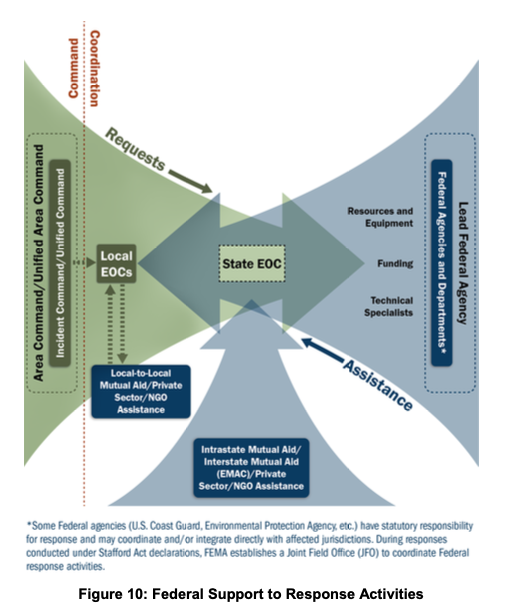

- **연방 정부의 주도 역할 (Leading Role) 및 사건별 선도 연방 기관(Lead Federal Agencies) 4대 사례 *(원문 pp. 47–48)*:**
  사건이 연방 사유지(예: 국립공원)에서 발생하거나 연방 정부가 일차적 관할권(예: 진행 중인 테러 위협·공격 또는 대규모 기름 유출)을 가지는 경우 연방 정부가 대응을 주도하며, 사건에 따라 서로 다른 연방 부처나 기관이 연방 대응 조정을 선도함:
  1. **연방재난관리청 (FEMA):** 대통령이 스태포드법(Stafford Act)에 따라 주요 재난이나 비상사태를 선포할 때 연방 대응 및 지원을 선도·조정함;
  2. **보건복지부 (Department of Health and Human Services, HHS):** 공중보건 비상사태 및 사건에 대한 연방 공중보건 및 의료 대응을 선도함;
  3. **환경보호청 (EPA) 또는 미국 해안경비대 (United States Coast Guard, USCG):** 대규모 유해물질 유출(Major hazardous material spill)의 발생 위치(내륙 vs 해양/연안)에 따라 어느 기관이 선도 연방 기관 역할을 할지 결정됨;
  4. **법무장관 (Attorney General) 및 연방수사국장 (Director of the FBI):** 테러 위협 또는 사건에 대한 법집행 대응 및 범죄 수사에 관한 선도 책임을 수행함.

---

> **[원칙 3 준수 고지]**  
> 위 **제1절~제7절**까지는 FEMA NIMS(2017) 제3장 원문(pp. 19–49)의 직접적인 내용과 도표(Figure 3–10, Table 2–3), 인셋 박스, 각주(9–18)를 원문에 충실하게 번역·정리한 것이며, 아래 **제8절~제10절**은 원문 내용을 바탕으로 대한민국 재난안전관리체계와의 비교 및 학술적·정책적 시사점을 도출한 **연구자의 독립적 해석 및 응용 영역**입니다.

---

## 8. 한미 지휘·조정 체계 비교 분석 (Comparative Analysis)

미국의 NIMS 제3장 체계와 대한민국 「재난 및 안전관리 기본법」 상의 지휘·대책기구 체계를 비교 분석함.

### 8.1 제도적 구조 대비표

| 비교 항목 | 미국 NIMS 체계 (MACS) | 대한민국 재난관리 체계 (재난안전법) |
| :--- | :--- | :--- |
| **현장 전술 지휘[[BR]](On-Scene Command)** | • **Incident Commander (IC)**[[BR]]• **Unified Command (UC)**[[BR]]• 단일 지휘소(ICP), 단일 IAP 수립[[BR]]• 참모진(작전, 기획, 물류, 재무) 일원화 | • **긴급구조통제단**(소방 중심)[[BR]]• **재난현장통합지원본부**(지자체 부단체장)[[BR]]• 현장지휘권의 시점별 분립 및 갈등[[BR]]• 경찰·군·지자체 간 지휘선 분절 |
| **후방 전략 지원[[BR]](Support / EOC)** | • **EOC (긴급운영센터)**[[BR]]• 현장 지원(ISM, 자원 조달) 전담[[BR]]• 현장 전술에 불개입 원칙 확립 | • **지자체 재난안전상황실 / 지대본 실무반**[[BR]]• 현장 지원보다는 상부 보고서 작성 치중[[BR]]• 지자체장의 현장 간섭 통로로 변질 |
| **최고 정책 결정[[BR]](Policy / MAC)** | • **MAC Group (다기관조정그룹)**[[BR]]• 수평적 협의체, 자원 우선순위 조정[[BR]]• 선출직 공무원과 민간 전문가의 조화 | • **중대본(행안부장관/총리) / 지대본(단체장)**[[BR]]• 관료제적·위계적 하향 통제 본부[[BR]]• 정치적 고려 및 상명하복식 지시 하달 |
| **대국민 공보[[BR]](Public Info)** | • **JIS 및 합동정보센터 (JIC)**[[BR]]• 단일 목소리(One Voice) 강제[[BR]]• 모든 기관의 정보 사전 교차검증 | • **기관별 개별 브리핑 (각자도생)**[[BR]]• 소방 브리핑, 경찰 발표, 구청 보도자료 제각각[[BR]]• 사상자 집계 불일치 등 혼란 다발 |
| **권한 위임 체계[[BR]](Delegation)** | • **서면 권한 위임장 (Delegation of Authority)**[[BR]]• 단체장이 지휘관에게 한도와 전권을 공식 위임 | • **위임장 문화 부재**[[BR]]• 단체장이나 VIP 방문 시 현장 지휘선 왜곡 |

---

## 9. 미국의 NIMS 지휘·조정 제도는 한국에서 작동할 수 있는가? (비판적 고찰)

NIMS 제3장의 핵심인 ICS, 통합지휘(UC), EOC, JIC 체계는 세계에서 가장 진보된 재난관리 거버넌스로 평가받지만, **대한민국의 현행 행정 문화와 법률 체계에서는 그대로 이식될 경우 심각한 기능 부전을 초래**함.

### 9.1 한국에서 NIMS 지휘·조정 체계가 작동하지 않는 4대 구조적 이유

#### ① '조정(Coordination)'과 '지휘(Command)'를 구분하지 못하는 권위주의 문화
- **NIMS의 철학:** 지휘(Command)는 현장 전술에 한정되며, 상급 기관(EOC, 주정부, 연방)은 지원과 조정(Coordination)을 담당함. 즉, 후방 본부는 현장의 상전(上典)이 아니라 '지원자'임.
- **한국의 현실:** 한국 관료제에서 **"조정 = 상급자가 하급자를 통제·검열하는 것"**으로 인식됨.
  - 재난이 발생하면 중앙부처(행안부)와 지대본(시·도)은 현장을 어떻게 지원할 것인가를 고민하기보다, 현장 지휘관에게 끊임없이 전화하여 "사상자 몇 명인가", "VIP 동선 어떻게 할 것인가"를 보고하라고 닥달함.
  - 결국 EOC와 대책본부가 현장의 짐(Burden)이 되어 현장 지휘관의 전술적 집중력을 완전히 파괴함.

#### ② "누가 대장인가(Who is the boss)?"에 갇힌 통합지휘(UC)의 불가능성
- **NIMS의 통합지휘(UC):** 동등한 권한을 가진 복수 기관장들이 지휘관 자리를 다투지 않고, 단일 텐트(ICP)에서 원탁 테이블에 둘러앉아 **합의에 의해 단일 IAP**를 작성함.
- **한국의 현실:** 한국의 행정·치안 조직은 철저한 **서열과 의전(Protocol) 중심**임.
  - 소방서장(총경급), 경찰서장(총경), 구청장(3~4급 고위공무원)이 한자리에 모였을 때, "누가 상석에 앉아 회의를 주재하는가"부터 갈등이 시작됨.
  - 경찰은 소방의 지휘를 받는 것을 조직의 자존심상 용납하지 못하고, 지자체는 소방과 경찰을 하위 집행기관 취급함.
  - 따라서 미국식의 수평적 통합지휘(UC)를 구성하려 하면, 합의가 도출되기는커녕 **지휘권 쟁탈전과 책임 회피의 난상판**으로 변질됨.

#### ③ 공보 이기주의와 부처별 '성과 홍보' 경쟁 (JIC의 무력화)
- **NIMS의 원칙:** 모든 기관의 공보관은 JIC에 파견되어 단일 브리핑문(Single Release)을 승인받아야 마이크 앞에 설 수 있음.
- **한국의 현실:** 재난 현장은 각 기관(경찰, 소방, 해경, 지자체)이 언론에 조직의 존재감을 과시하거나 책임을 떠넘기는 정쟁의 장이 됨.
  - 이태원 참사나 과거 대형 화재 참사에서 보듯, 소방은 소방대로 브리핑하고, 경찰은 따로 수사 브리핑을 열며, 구청은 자기들에게 유리한 보도자료를 배포함.
  - JIC와 같은 강력한 통합 공보 통제 기구가 법제화되어 있지 않기 때문에, 언론에 서로 상충되는 사상자 수치와 대응 과정이 여과 없이 노출되어 국민 불신과 패닉을 극대화함.

#### ④ EOC(상황실) 인력의 전문성 부재와 '보고용 상황판'의 함정
- 미국 NIMS의 EOC는 ISM(사건지원모델) 등을 통해 자원 조달(Logistics)과 미래 예측(Planning)을 훈련받은 전문 인력이 주도함.
- 한국 지자체의 재난안전상황실은 **순환보직을 거치는 비전문 행정직 공무원들의 집합소**임.
  - 자원 동원 절차나 GIS 분석 도구를 다룰 줄 아는 전문성이 없어, 대형 재난이 터지면 그저 TV 뉴스를 보고 받아 적거나 윗선 보고용 PPT를 만드는 '문서 생산 공장'으로 전락함.

---

### 9.2 한국적 현실에서의 대안 및 법제화 개혁 방안

미국 제도의 장점을 살리되, 한국의 관료적 특성을 고려한 **강제적 법제화 모델**로의 보완이 필요함.

| 4대 개혁 과제 | 세부 입법 및 제도 개선 방향 |
| :--- | :--- |
| **1. 현장지휘 단일법 제정** | • 소방 주도의 한국형 통합지휘(K-UC) 법제화 및 경찰·지자체의 현장 전술 지휘 협력 의무화 |
| **2. 법정 EOC 지원 전담화** | • 상급 상황실의 무분별한 현장 보고 요구 원천 금지 및 지자체 재대본(EOC)의 '자원 보급 센터' 전담화 |
| **3. 합동공보관(K-JIC) 강제** | • 부처별 단독 브리핑으로 인한 혼선 금지, 행안부·소방·경찰 합동 단일 대변인제(K-JIC) 의무 가동 |
| **4. 단체장 권한 위임 법제화** | • 선출직 단체장·VIP의 비전문적 현장 전술 개입 금지 행동강령 및 서면 권한위임(Delegation of Authority) 의무화 |

1. **소방 중심의 강제적 통합지휘체계(K-Unified Command) 법제화:**
   - 한국적 문화에서 '자율적 합의'는 불가능하므로 법률(재난안전법)로 강제해야 함.
   - **"재난 현장(On-scene)의 전술 지휘권은 소방통제단장이 절대적으로 행사하며, 파견된 경찰관과 지자체 공무원은 소방지휘관의 기능적 명령에 복종해야 한다"**는 단일 지휘체계를 법적으로 확립하고, 경찰과 지자체는 각각 질서유지와 후방지원을 담당하는 분과장으로 편제시켜야 함.
2. **EOC의 현장 보고 요구 금지 및 '자원 보급 기지'로의 전환:**
   - 지자체 재난상황실이 현장 지휘관에게 수시로 전화를 걸어 보고를 요구하는 행위를 법령으로 엄격히 금지해야 함.
   - 현장 상황 파악은 소방 무전 청취와 드론/CCTV 영상 공유로 갈음하고, EOC는 **"현장에서 요청한 크레인, 구호물자, 이재민 쉘터를 외부에서 조달하는 병참 기능"**에만 전념하도록 직무를 재설계해야 함.
3. **합동공보(K-JIC)의 단일 브리핑 법적 의무화:**
   - 대형 재난 시 지자체·소방·경찰의 개별 언론 접촉을 법적으로 금지하고, 현장지휘소 옆에 의무적으로 '합동공보실(K-JIC)'을 설치하여 **3개 기관 합동 단일 대변인이 합의된 브리핑문만을 발표**하도록 일원화해야 함.
4. **선출직 단체장의 현장 전술 개입 차단 (권한위임 법제화):**
   - 구청장이나 시장이 재난 현장에 와서 즉흥적인 전술 지시를 내리지 못하도록, 미국의 'Delegation of Authority(권한 위임장)' 제도를 도입해야 함. 단체장은 정책적 지원과 비상사태 선포, 예산 승인만을 담당하고, 현장 작전은 소방 지휘관에게 전권을 공식 위임하도록 행정 규범을 정립해야 함.

---

## 10. 요약 및 핵심 시사점 (Key Takeaways)

1. **지휘(Command)와 조정(Coordination)의 명확한 역할 분담:**  
   현장 전술 지휘(ICS)는 소수의 전문가에게 전권을 부여하고, 후방 조직(EOC, MAC Group)은 현장의 자원과 정책을 뒷받침하는 것이 NIMS 성공의 열쇠이다.
2. **14대 관리 특성의 통합적 실천:**  
   모듈식 조직, 관리범위(1:5), 단일작전계획(IAP), 공통 용어, 지휘권 인계 등 14가지 특성은 재난 현장의 무질서를 과학적 질서로 바꾸는 공학적 도구이다.
3. **통합지휘(UC)와 합동공보(JIC)는 거버넌스의 꽃이다:**  
   다기관이 얽힌 복합 재난에서는 기관 이기주의를 버리고 단일한 ICP에서 공동 IAP를 수립하며, JIC를 통해 대국민 단일 목소리(One Voice)를 내야만 사회적 혼란을 수습할 수 있다.
4. **한국적 현실을 직시한 제도적 재설계가 필수적이다:**  
   수평적 합의가 어려운 한국의 관료제적 특성을 감안할 때, 미국의 제도를 무조건 찬양할 것이 아니라 **소방 중심의 현장지휘 단일화, EOC의 보고 기능 폐지 및 자원지원 전담화, 합동공보(JIC) 법제화**라는 강력한 제도적 수술을 단행해야만 비로소 NIMS의 공학적 장점이 한국 땅에서 구현될 수 있다.


```{=openxml}
<w:p><w:r><w:br w:type="page"/></w:r></w:p>
```

# 제4장 통신 및 정보 관리 (IV. Communications and Information Management)
> **참고 원문:** *National Incident Management System (Third Edition, October 2017) - Chapter IV. Communications and Information Management (pp. 50–59)*  
> **작성 원칙:**  
> 1. 원문(pp. 50–59)의 모든 문장, 세부 항목, 각주(Footnote 19), 삽입 박스(Inset Box 3종)를 **단 하나의 누락이나 임의 변형 없이** 100% 충실하게 반영함.  
> 2. 번역 과정에서 다의적이거나 학술적·실무적 의미가 중요한 용어는 **영문을 병기(English in parentheses)**하여 개념적 정확성을 유지함.  
> 3. **[연구자료(SUB-NOTE) 사용 원칙 준수]** 원문의 직접적인 기술 내용(제1절~제4절)과 연구자의 비교·해석(제5절~제6절)을 엄격히 분리하여 표기함.

---

## 1. 개요 및 4대 핵심 원칙 (Overview and Key Principles) `[원문 pp. 50–51]`

### 1.1 통신 및 정보 관리의 목적과 기본 원리 `(p. 50)`
- **통신 및 정보 시스템에 대한 의존:** 사건 대응 인력(Incident personnel)은 정확하고(Accurate), 시의적절하며(Timely), 관련성 있는(Relevant) 정보를 획득(Obtain)하고 제공(Provide)하기 위해 유연한 통신 및 정보 시스템(Flexible communications and information systems)에 의존함.
- **3대 핵심 목표 (Principal Goals):** 통신 및 정보 관리 구성요소(Communications and Information Management component)의 주요 목표는 다음과 같음:
  1. **상황인식의 확립 및 유지 (Establishing and maintaining situational awareness)**
  2. **접근성 보장 (Ensuring accessibility)**
  3. **음성 및 데이터 상호운용성 보장 (Ensuring voice and data interoperability)**
- **정보 전파의 촉진:** 적절하게 계획(Planned), 수립(Established), 적용(Applied)된 통신은 지휘 및 지원 요소(Command and support elements)와 협력 관할구역 및 조직(Cooperating jurisdictions and organizations) 간의 **정보 전파(Information dissemination)**를 촉진함.

### 1.2 정보 공유와 통신 시스템의 책임 소재 및 작동 메커니즘 `(p. 50)`
본 장(Section)은 다음 두 가지 영역을 모두 다룸:
1. **정보 공유 (Information Sharing):** **모든 인력의 책임(Responsibility of all personnel)**임.
2. **정보 공유를 지원하는 통신 시스템 (Communications Systems that Support Information Sharing):** 통상적으로 **현장지휘체계(ICS)의 물류부(Logistics Section) 인력**과 **긴급운영센터(EOC)의 물류 또는 센터 지원 인력(Logistics or center support staff)**이 담당함.

| 구분 | 정보 공유 (Information Sharing) | 통신 시스템 (Communications Systems) |
| :--- | :--- | :--- |
| **책임 주체** | **모든 사건 관리 인력 (All Incident Personnel)** | **ICS 물류부(Logistics) 및 EOC 물류·센터 지원 인력** |
| **핵심 과업 및 기반** | • 수집(Gathering) → 대조/취합(Collating) → 종합(Synthesizing) → 전파(Disseminating)의 지속적 갱신 | • 공통 통신 계획(Common plans), 상호운용 가능한 장비·프로세스·표준·아키텍처 구축 및 운영 |
| **공동 달성 목표** | **현장(On scene) + EOC 내부 + 기타 지원 위치의 전 인력 연결 ➔ 통신 연결성(Connectivity) 및 상황인식(Situational Awareness) 유지** | ← 좌동 |

- **상황인식 유지를 위한 정보 순환 과정:** 상황인식(Situational awareness)을 유지하기 위해, 사건 인력은 모든 적절한 관계자/당사자(All appropriate parties)들과 사건 정보를 주고받으며 **① 수집(Gathering) → ② 대조/취합(Collating) → ③ 종합/합성(Synthesizing) → ④ 전파(Disseminating)**함으로써 사건 정보를 지속적으로 갱신(Update incident information continually)함.
- **정보 흐름의 촉진 수단:** 이러한 정보 흐름(Information flow)은 **공통 계획(Common plans)**과 **상호운용 가능한 장비(Interoperable equipment), 프로세스(Processes), 표준(Standards), 아키텍처(Architectures)**를 개발하고 사용함으로써 촉진됨.
- **전 인력의 연결:** 사건 발생 중, 이러한 통합되고 친숙한 접근법(Integrated, familiar approach)은 현장에 있든(On scene), EOC에 있든(In an EOC), 또는 다른 지원 위치(Another support location)에 있든 모든 사건 인력을 연결하여 **통신 연결성/접속성(Communications connectivity)**과 **상황인식(Situational awareness)**을 유지하게 함.
- **계획 수립의 포괄 범위:** 통신 및 정보 관리 계획 수립(Communications and information management planning)은 상호운용 가능한 통신(Interoperable communications)을 달성하는 데 필요한 사건 관련 **정책(Policies), 장비(Equipment), 데이터 아키텍처(Data architecture), 시스템(Systems), 표준(Standards), 교육·훈련(Training)**을 다룸.

---

### 1.3 통신 및 정보 관리의 4대 핵심 원칙 (Key Principles) `(pp. 50–51)`
다음의 통신 및 정보 관리 원칙들은 사건 관리자(Incident managers)가 사건 발생 중 지속적인 정보 흐름(Constant flow of information)을 유지하도록 지원함:
1. **상호운용성 (Interoperability)**
2. **신뢰성, 확장성 및 이동성/휴대성 (Reliability, Scalability, and Portability)**
3. **회복력/복원력 및 다중성/이중화 (Resilience and Redundancy)**
4. **보안 (Security)**

| 핵심 원칙 | 원문 정의 및 세부 구성 내용 `[pp. 50–51]` |
| :--- | :--- |
| **① 상호운용성**[[BR]]*(Interoperability)*[[BR]]`[p. 50]` | • **실시간 다매체 소통:** 상호운용 가능한 통신 시스템(Interoperable communications systems)은 인력과 조직이 **실시간으로(In real time)** 음성(Voice), 데이터(Data), 영상 시스템(Video systems)을 통해 관할구역 및 조직 내부와 상호 간에(Within and across jurisdictions and organizations) 소통할 수 있도록 해줌.[[BR]]• **상호운용성 계획(Interoperability plans)의 5대 구성요소:**[[BR]]1) 거버넌스/관리체계 (Governance)[[BR]]2) 표준운영절차 (Standard Operating Procedures, SOP)[[BR]]3) 기술 (Technology)[[BR]]4) 교육훈련 및 연습 (Training and exercises)[[BR]]5) 주요 사건(Major incidents)뿐만 아니라 **일상적 작전 중의 사용/활용(Usage during routine operations)** |
| **② 신뢰성, 확장성 및 이동성/휴대성**[[BR]]*(Reliability, Scalability, and Portability)*[[BR]]`[pp. 50–51]` | • **신뢰성(Reliability) 및 적용 범위:** 통신 및 정보 시스템은 모든 유형의 사건(Any type of incident)에서 기능할 수 있도록 신뢰할 수 있고 확장 가능해야 함. 즉, 다음 3가지 환경 모두에서 사용하기에 적합해야 함:[[BR]]1) 단일 관할구역 또는 단일 기관 내부 (Within a single jurisdiction or agency)[[BR]]2) 다수 기관이 참여하는 단일 관할구역 (A single jurisdiction with multiagency involvement)[[BR]]3) 다수 기관이 참여하는 복수 관할구역 (Multiple jurisdictions with multiagency involvement)[[BR]]• **정기적/일상적 사용(Regular use)의 효과:** 통신 및 정보 시스템을 평시에 정기적으로 사용하면 시스템이 사용자에게 친숙하고(Familiar), 적용 가능하며(Applicable), 수용 가능(Acceptable)하도록 보장하고, 새로운 기술에 쉽게 적응(Readily adaptable to new technology)하며, 어떤 상황에서도 신뢰성(Reliable in any situation)을 유지하도록 돕는다.[[BR]]• **확장성(Scalability):** 다수의 관할구역과 조직에서 온 수많은 대응 요원 및 지원 인력(Numerous responders and support personnel)이 참여하는 주요 대형 사건(Major incident)이나 여러 건의 동시 사건(Several incidents)을 포함한 **어떠한 상황도 지원할 수 있도록 시스템이 확장될 수 있음**을 의미하며, **시스템상의 사용자 수(Number of users on a system)를 용이하게 늘릴 수 있음**을 뜻함.[[BR]]• **이동성/휴대성(Portability):** 이동 가능한 기술과 장비(Portable technologies and equipment)는 통신 시스템의 효과적인 **통합(Integration), 운송(Transport), 배치/전개(Deployment)**를 보장함. 이동성(Portability)에는 **관할구역 간 무선/무전 채널의 표준화된 할당(Standardized assignment of radio channels across jurisdictions)**이 포함되며, 이는 사건 인력이 자신의 관할구역 밖의 사건에 참여하더라도 여전히 친숙한 장비(Familiar equipment)를 사용할 수 있게 해줌. |
| **③ 회복력/복원력 및 다중성/이중화**[[BR]]*(Resilience and Redundancy)*[[BR]]`[p. 51]` | • **목적:** 통신에서의 회복력과 다중성은 **중단 없는 정보의 흐름(Uninterrupted flow of information)**을 보장하도록 돕는다.[[BR]]• **회복력/복원력(Resilience):** 기반시설의 손상이나 상실 이후에도 시스템이 견뎌내고 계속해서 기능을 수행할 수 있는 능력(The ability of systems to withstand and continue to perform after damage or loss of infrastructure).[[BR]]• **다중성/이중화(Redundancy):** **서비스의 복제/중복 구성(Duplication of services)**을 통해 달성됨. 주 통신 역량이 손상을 입었을 때(When primary communications capabilities suffer damage), **다양한 대체 수단(Diverse alternative methods)**을 통해 **통신의 연속성(Continuity of communication)**을 가능하게 함. |
| **④ 보안**[[BR]]*(Security)*[[BR]]`[p. 51]` | • **민감 정보 및 핵심 자산 보호:** 사건 인력으로부터, 인력들 간에, 그리고 인력에게 전달되는 일부 정보는 **민감함(Sensitive)**. 또한 EOC 및 사건 인력은 침해될 경우 광범위한 영향을 초래할 수 있는(Could cause widespread impacts if compromised) **산업제어시스템(Industrial control systems)**과 같은 **핵심 자산(Critical assets)**에 접근할 수 있음.[[BR]]• **IT·보안 전문가와의 협력:** 사건 인력은 사건 통신 및 데이터 공유에 **데이터, 네트워크, 시스템 보호 모범 실무(Data, network, and systems protection best practices)**를 통합하기 위해 IT 및 보안 전문가(IT and security experts)와 협력해야 함.[[BR]]• **정보/수사 기능 및 법령 준수:** 예를 들어, **정보/수사 기능 인력(Intelligence/investigations function staff)**은 민감 정보(Sensitive), **개인식별정보(Personally identifiable information)**, 또는 **기밀 정보(Classified information)**를 논의할 수 있으며, 관련 법률(Applicable law)에 따라 이러한 정보를 **보호/차단(Shield)**해야 함. 사건 통신 및 정보 공유는 **데이터 보호법 및 개인정보보호법(Data protection and privacy laws)**을 준수해야 함. |

---

## 2. 통신 관리 (Communications Management) `[원문 pp. 52–53]`

아래에 기술된 통신 관리 관행/실무(Practices)와 고려사항(Considerations)은 서로 다른 전문 분야(Disciplines), 관할구역(Jurisdictions), 조직(Organizations), 기관(Agencies)의 사건 인력들이 사건 발생 중에 서로 효과적으로 소통하도록 지원함.

| 통신 관리 5대 영역 | 핵심 구성 요소 및 실무 지침 |
| :--- | :--- |
| **1. 표준 통신유형 (Standard Types)** | • 전략적 통신 (Strategic) / 전술적 통신 (Tactical) / 지원 통신 (Support) / 대국민 경보·통보 통신 (Public Address) |
| **2. 정책 및 계획 (Policy & Planning)** | • 사용 장비·플랫폼·권한 규정, 민·관·NGO·핵심인프라 소유주 참여, 비상운영계획(EOP) 내 6대 통신 요소 필수 반영 |
| **3. 협약 체결 (Agreements)** | • EOP 참여 당사자 간 사전 통신 협약 체결, 네트워크 연결·주파수 공유·데이터 포맷 표준 및 사이버보안 협약 확립 |
| **4. 장비 표준 및 구축 (Equipment)** | • 공통 인터페이스 연결 보장, 민간 기간 통신망 의존성 고려 및 노후 장비 갱신, 장비 도입 시 4대 고려사항 준수 |
| **5. 교육 및 훈련 (Training)** | • 상호운용 통신 시스템 실습 훈련 정례화 및 평시 통신 장비의 역량과 물리적 한계 숙지 |

### 2.1 표준화된 통신 유형 (Standardized Communication Types) `(p. 52)`
사건 인력과 그 소속 조직(Affiliated organizations)은 다음 4가지를 포함하는 표준 통신 유형(Standard communications types)을 사용해야 함:

| 통신 유형 | 원문 정의 및 구체적 내용 `[p. 52]` |
| :--- | :--- |
| **1. 전략적 통신**[[BR]]*(Strategic)* | • **고위급 지침/방향 설정(High-level directions):** 자원 우선순위 결정(Resource priority decisions), 역할 및 책임 결정(Roles and responsibilities determinations), 전반적인 사건 관리 행동방침/방책(Overall incident management courses of action)을 포함함. |
| **2. 전술적 통신**[[BR]]*(Tactical)* | • **현장 작전 지휘·협조 통신:** 현장 지휘부 및 전술 인력(On-scene command and tactical personnel)과 협력 기관 및 조직(Cooperating agencies and organizations) 간의 통신. |
| **3. 지원 통신**[[BR]]*(Support)* | • **전략적·전술적 통신을 뒷받침하는 조정(Coordination in support of strategic and tactical communications):**[[BR]]- *예시 1:* 자원 주문(Resource ordering), 파견/배치(Dispatching), 추적(Tracking)에 관한 병원 간 통신(Communications among hospitals)[[BR]]- *예시 2:* 교통 및 공공사업/토목 통신(Traffic and public works communications) |
| **4. 대국민/공공 통신**[[BR]]*(Public)* | • **경보 및 경고(Alerts and warnings), 기자회견(Press conferences).** |

---

### 2.2 정책 및 계획 수립 (Policy and Planning) `(pp. 52–53)`
- **조정된 통신 정책 및 계획의 역할:** 조정된 통신 정책 및 계획 수립(Coordinated communications policy and planning)은 효과적인 통신 및 정보 관리의 기반(Basis)을 제공함.
- **면밀한 계획 수립(Careful planning)이 결정하는 5가지 사항:**
  1. 인력이 어떤 통신 시스템과 플랫폼을 사용할 것인지 (What communications systems and platforms personnel will use)
  2. 누가 그것들을 사용할 수 있는지 (Who can use them)
  3. 서로 다른 환경에서 어떤 정보가 필수적인지 (What information is essential in different environments)
  4. 모든 장비와 시스템의 기술적 매개변수/사양 (The technical parameters of all equipment and systems)
  5. 기타 관련 고려사항 (Other relevant considerations)
- **계획과 절차의 진화:** 기술이 변화하고 정보 교환 방식이 개선됨에 따라(As technologies change and information exchange methods improve), 통신 관리 계획과 절차 또한 진화/발전해야 함(Should also evolve).
- **포괄적 이해관계자 참여:** **비정부기구(NGOs), 민간 부문(Private sector), 핵심 기반시설 소유주(Critical infrastructure owners)**를 포함한 **모든 이해관계자(All stakeholders)**가 철저하고(Thorough), 통합적이며(Integrated), 상호운용 가능한(Interoperable) 통신 계획 및 전략을 수립하는 데 참여해야 함. 상호운용성을 향상시키기 위해 기술 및 장비 표준(Technology and equipment standards) 또한 이해관계자들과 공유됨.
- **비상운영계획(EOP) 등에의 반영:** 계획 수립자(Planners)는 건전한 통신 관리 정책과 계획을 **비상운영계획(Emergency Operations Plans, EOPs)** 및 기타 적절한 계획들에 통합해야 함.

#### 📌 계획(Plans)에 반드시 포함되어야 할 통신 및 정보 관리의 6대 측면 `(pp. 52–53)`
1. **정보 수요 및 출처:** 정보 요구사항/수요(Information needs)와 이러한 정보의 잠재적 출처(Potential sources for this information).
2. **파트너 조직과의 정보 통합:** 파트너/협력 조직과 정보를 통합하기 위한 지침(Guidance), 표준(Standards), 도구(Tools).
3. **경보 및 중요 정보 배포 체계:** 경고(Warnings), 사건 통지/알림(Incident notifications), 대국민 소통(Public communications), 기타 중요 정보(Other critical information)를 배포/발표하기 위한 절차(Procedures), 프로토콜(Protocols), 네트워크(Networks).
4. **정부 계층 및 파트너 통지 체계:** 다른 계층의 정부(Other levels of government) 및 파트너 조직에 통지하기 위한 메커니즘과 프로토콜(Mechanisms and protocols).
5. **지휘·조정·지원 통합을 위한 IT 활용 프로토콜:** 모든 지휘(Command), 조정(Coordination), 지원 기능(Support functions)을 통합하기 위해 정보 관리 기술(Information management technologies; 예: 컴퓨터[Computers], 네트워크[Networks], 정보 공유 메커니즘[Information-sharing mechanisms])을 효과적이고 효율적으로 사용하기 위한 프로토콜.
6. **취약계층을 포괄하는 동시 접근성 보장:** **영어 구사 능력이 제한적인 사람(Those who have limited proficiency in English), 장애인(Disabilities), 기타 접근 및 기능적 필요가 있는 사람들(Others who have access and functional needs)**을 포함하여 모든 사람이 사건 메시지에 **동시에 접근할 수 있도록(Simultaneously accessible to all people)** 보장하는 지침 및 메커니즘.

---

### 2.3 협약 (Agreements) `(p. 53)`
- **사전 협약 체결의 의무:** 관할구역의 비상운영계획(EOP)에 명시된 모든 당사자(All parties)는 계획과 절차에 기술된 통신 요소들이 사건 발생 시점에 유효하게 작동하도록(Are in effect at the time of an incident) 보장하기 위해 **사전에 협약을 체결해 두어야 함(Should have agreements in place)**.
- **협약의 명시 사항:** 협약은 통상적으로 당사자들이 사용하기로 합의하거나 정보를 공유하고자 하는 **통신 시스템과 플랫폼(Communications systems and platforms)**을 명시함.
- **협약에 통상 포함되는 3대 세부 내용:**
  1. **네트워크 연결/접속 (Connection of networks)**
  2. **데이터 포맷/형식 표준 (Data format standards)**
  3. **사이버보안 협약 (Cybersecurity agreements)**

---

### 2.4 장비 표준 (Equipment Standards) `(p. 53)`
- **공통 인터페이스와 민간 기간망 의존성:** 사건 관리 중 인력이 사용하는 통신 장비는 종종 **공통 인터페이스(Common interfaces)**를 통해 연결된 구성요소 및 시스템들로 이루어지며, 그중 상당수는 **운영 기간망/백본(Operational backbone)을 제공하는 데 있어 민간 부문(Private sector)에 의존**함.
- **정기적 개선 및 업데이트:** 공공/민간 통신 시스템 및 관련 장비(Public/private communications systems and associated equipment)의 유지관리는 효과적인 사건 관리에 필수적이므로, 정기적으로 강화/개선되고 업데이트되어야 함(Regularly enhanced and updated).
- **통신 시스템 및 장비 표준 개발 시 4대 고려사항:**
  1. 인력이 시스템을 사용하게 될 **조건/환경의 범위 (The range of conditions under which personnel will use the systems)**
  2. 잠재적으로 시스템을 사용할 가능성이 있는 **인력의 범위 (The range of personnel who might potentially use them)**
  3. **현재 국가적으로 공인된 통신 표준 (Current nationally recognized communications standards)** *(각주 19 참조)*
  4. **내구성 있는 장비의 필요성 (The need for durable equipment)**

> ### 📌 [원문 각주 심층 해설 (Footnote 19)] `[p. 53]`
> - **각주 19 (표준 개발 기구):** **미국국가표준협회(American National Standards Institute, ANSI)** 및 **미국방화협회(National Fire Protection Association, NFPA)**와 같은 표준 개발 기구(Standards-developing organizations)들은 통신 표준을 정기적으로 업데이트하고 발간함.

---

### 2.5 교육 및 훈련 (Training) `(p. 53)`
- 상호운용 가능한 시스템과 장비를 활용하는 교육훈련 및 연습(Training and exercises that employ interoperable systems and equipment)은 인력들이 **사건이 발생하기 전에(Before an incident) 자신들의 역량(Capabilities)과 한계(Limitations)를 이해**할 수 있게 해줌.

---

## 3. 사건 정보 (Incident Information) `[원문 pp. 54–56]`

### 3.1 사건 정보의 6대 주요 활용 기능 `(p. 54)`
사건 발생 중, 인력은 의사결정을 내리기 위해 시의적절하고 정확한 정보(Timely and accurate information)를 필요로 함. 정보는 **ICS, EOC, MAC Group, JIS** 내에서 다음 6가지를 포함한 많은 기능에 활용됨:
1. **계획 수립 지원 (Aiding in planning)**
2. **비상 보호 조치를 포함한 대국민 소통 (Communicating with the public, including emergency protective measures)**
3. **사건 비용 산정/결정 (Determining incident cost)**
4. **NGO 또는 민간 부문 자원의 추가 참여 필요성 결정 (Determining the need for additional involvement of NGO or private sector resources)**
5. **안전 문제/이슈 식별 (Identifying safety issues)**
6. **정보 요청 해결/처리 (Resolving information requests)**

---

### 3.2 사건 보고서 (Incident Reports) 및 사건작전계획 (IAPs) `(p. 54)`

#### (1) 사건 보고서 (Incident Reports)의 유형 비교 `(p. 54)`
사건 보고서는 상황인식을 제고하고(Enhance situational awareness), 인력이 필수 정보에 더 쉽게 접근할 수 있도록 보장함. 사건에 관한 필수 정보를 제공하는 보고서 유형은 다음과 같음:

| 구분 | 상황보고서 (Situation Reports, SITREP) | 상태보고서 / 현황보고서 (Status Reports) |
| :--- | :--- | :--- |
| **작성 주기 및 시점** | • 통상 **정기적이고 반복적인 주기(Regular and recurring basis)**로 작성 및 배포됨.[[BR]]• **지난 작전기간(Past operational period)** 동안의 사건 상태에 대한 스냅샷(Snapshot, 단면 요약)을 제공함. | • 정기적으로 예정된 상황보고서(SITREP) **외에(Outside regularly scheduled situation reports)** 수시로 작성됨.[[BR]]• *대표 예시:* **즉시/현장 약식 보고서(Spot reports)** |
| **포함 정보의 성격** | • 사건 세부사항(Incident details)을 포함.[[BR]]• 사건과 관련된 명확한 세부사항(**누가[Who], 무엇을[What], 언제[When], 어디서[Where], 어떻게[How]**)에 관한 **확인되거나 검증된 정보(Confirmed or verified information)**를 담음. | • **중요하거나 및/또는 시급한(시간에 민감한) 정보(Vital and/or time-sensitive information)**를 포함함. |
| **범위 및 격식성** | • 사건 전반을 포괄하는 공식 보고서. | • 통상적으로 **특정 기능에 국한/특화(Function-specific)**되며, **SITREP보다 덜 공식적(Less formal than SITREPs)**임. |

- **보고서 표준화와 조직 고유 정보의 조화 `(p. 54)`:**
  - 관할구역 및 조직 내부와 상호 간에 사건 통지(Incident notification), 상황보고서(Situation reports), 상태보고서(Status reports)에 포함되는 정보를 표준화(Standardizing)하는 것은 정보 처리(Information processing)를 촉진함.
  - ⚠️ **단서 조항 (유연성 보장):** 그러나 이러한 표준화가 **보고 조직에 고유한 정보(Information unique to a reporting organization)의 수집이나 전파를 방해해서는 안 됨**.
  - **공통 포맷 전송의 이점:** 공통 포맷/형식으로 데이터를 전송(Transmitting data in a common format)하면 다른 관할구역과 조직이 특정 사건 정보를 **예측(Anticipate)하고, 신속하게 찾아내어(Rapidly find), 그에 따라 조치를 취할 수(Act on)** 있게 됨.

#### (2) 사건작전계획 (Incident Action Plans, IAPs) `(p. 54)`
- 사건 보고서 외에도, 인력은 **사건작전계획(IAPs)**을 참조함으로써 상황인식을 개선하고 사건 목표와 전술(Incident objectives and tactics)을 더 잘 이해할 수 있음.
- IAP는 **현장지휘관(Incident Commander) 또는 통합지휘부(Unified Command)**가 수립한 사건 목표(Incident objectives)를 담고 있으며, 계획된 작전기간(Planned operational period, **통상 12~24시간[Generally 12 to 24 hours]**) 동안의 전술(Tactics)을 다룸.
- *(원문 참조 안내: 사건작전계획 수립 프로세스에 관한 세부사항은 부록 A, ICS 탭 8 [Appendix A, ICS Tab 8] 참조).*

---

### 3.3 데이터 수집 및 처리 (Data Collection and Processing) `(pp. 54–56)`

- **표준 기법 준수의 효과:** 인력은 표준 데이터 수집 기법과 정의(Standard data collection techniques and definitions)를 준수하는 방식으로 데이터를 수집하고, 데이터를 분석하며, 적절한 채널을 통해 공유해야 함. **표준화된 표본추출 및 데이터 수집(Standardized sampling and data collection)**은 신뢰할 수 있는 분석(Reliable analysis)을 가능하게 하고 평가 품질(Assessment quality)을 향상시킴.
- **수요 주체:** ICS 조직, EOC, MAC Group의 리더들과 공보 인력(Public affairs personnel) 모두 정확하고 시의적절한 정보에 의존함.
- **데이터 수집 및 처리의 6대 표준 요소 (Standard Elements):**

| 단계 | 프로세스 명칭 | 핵심 수행 활동 |
| :---: | :--- | :--- |
| **1단계** | **초기 상황판단 / 신속 평가 (Initial Size-Up)** | 선착대응요원이 인명·재산 위험과 사건 성격을 즉각 파악하여 초동 전술 및 추가 자원 요청 결정 |
| **2단계** | **데이터 수집계획 수립 (Data Collection Plan)** | 14대 필수사건정보(EEI) 항목을 중심으로 수집 대상·방법(8대 수집원)·주기를 명시한 계획 수립 |
| **3단계** | **검증 (Validation)** | 수집된 원시 데이터의 불완전성, 부정확성, 과장, 구식 여부, 오도 가능성을 철저히 교차 검증 |
| **4단계** | **분석 (Analysis)** | 검증된 원시 데이터를 지휘관의 의사결정과 미래 예측에 유용한 실행 가능한 정보(Actionable Info)로 전환 |
| **5단계** | **전파 (Dissemination)** | 관련 법령·보안 정책을 준수하여 필요한 의사결정자와 대중에게 시의적절하게 정보 배포 |
| **6단계** | **갱신 (Updating)** | 사건 전개에 따라 지속적 모니터링·확인·통합·분석을 반복하여 상황인식(Situational Awareness) 최신화 |

#### ① 초기 상황판단 / 신속 평가 (Initial Size-Up/Rapid Assessment) `(p. 55)`
- 사건 현장에 **가장 먼저 도착한 공직자/담당관(The official who is the first to arrive at the scene of an incident)**이 상황을 평가하고, 그 결과(Findings)를 지령실(Dispatch) 또는 기타 사건 지원 조직(Other incident support organizations)에 제공함.
- 이후 이러한 조직의 참모/인력들은 이 정보를 사용하여 자원을 배정(Assign resources)하고 기타 사건 관련 의사결정을 내림.

#### ② 데이터 수집 계획 (Data Collection Plan) 및 필수정보요소 (EEI) `(pp. 55–56)`
- **수립 주체 및 목적:** 현장지휘관(IC), 통합지휘부(UC), 또는 EOC 센터장(EOC director)은 사건 정보를 수집하는 반복적 프로세스를 표준화하기 위해 데이터 수집 계획을 수립할 수 있음.
- **정의 및 구성:** 데이터 수집 계획은 통상 인력이 수집할 **필수정보요소(Essential Elements of Information, EEI)**—즉, **정보에 입각한 의사결정에 필요한 정보 항목들(Information items required for informed decision making)**—이 무엇인지 기술하는 **매트릭스(Matrix, 행렬표)** 형태임. 데이터 수집 계획은 다양한 항목을 수집하기 위한 다음 4가지를 나열함:
  1. **출처 (Sources)**
  2. **수집 방법 (Methods)**
  3. **측정 단위 (Units of measure)**
  4. **수집 일정/주기 (Schedules)**
- **선행 조건:** **EEI는 데이터 수집 계획을 개발하기 전에 먼저 정의되어야 함(The EEI should be defined prior to developing a data collection plan).**

##### 📋 [표] 전형적인 필수정보요소(EEI) 14개 항목 및 데이터 수집 8대 방법 `(pp. 55–56)`

| 전형적인 EEI 14개 항목 (Typical EEI Items) `[p. 55]` | 데이터 수집 8대 방법 (Methods for Data Gathering) `[p. 56]` |
| :--- | :--- |
| 1. **사건 구역 경계 / 진입 지점** *(Incident area boundaries/access points)*[[BR]]2. **관할구역 경계** *(Jurisdictional boundaries)*[[BR]]3. **사회적/경제적/정치적 영향** *(Social/economic/political impacts)*[[BR]]4. **인구/주민 건강에 미치는 영향** *(Impact to health of the population)*[[BR]]5. **교통/운송 시스템 상태** *(Transportation system status)*[[BR]]6. **통신 시스템 상태** *(Communications system status)*[[BR]]7. **위험요인별 특화 정보** *(Hazard-specific information)*[[BR]]8. **중요 기상 상황** *(Significant weather)*[[BR]]9. **지진 또는 기타 지구물리학적 데이터** *(Seismic or other geophysical data)*[[BR]]10. **핵심 시설 상태** *(Critical facility status)*[[BR]]11. **항공 정찰 활동 상태** *(Aerial reconnaissance activity status)*[[BR]]12. **재난/비상사태 선포 상태** *(Disaster/emergency declaration status)*[[BR]]13. **계획된 또는 예정된 활동** *(Planned or upcoming activities)*[[BR]]14. **기부금품/기부 현황** *(Donations)* | 1. **911 신고 및 지령 시스템:** 공공안전 통신요원(Public safety telecommunicators)의 911 신고 전화 또는 지령 시스템(Dispatch systems)으로부터 데이터 입수[[BR]]2. **통신 모니터링:** 대응 요원들 간의 무선/무전(Radio), 영상(Video), 및/또는 데이터 통신(Data communications) 모니터링[[BR]]3. **보고서 열람:** 상황보고서(SITREPs) 열람/독해[[BR]]4. **기술전문가 활용:** 미국 기상청 대표 파견관(National Weather Service representatives)과 같은 기술전문가(Technical specialists) 활용[[BR]]5. **현장 및 유관 조직 보고 수신:** 현장 관측자(Field observers), 현장지휘소(ICPs), 구역지휘부(Area Commands), 다기관조정그룹(MAC Groups), 부서운영센터(DOCs), 기타 EOC들로부터 보고 수신[[BR]]6. **정보 전문가 파견:** EOC, 기타 시설, 현장 운영 사무소(Operational field offices)에 정보 전문가(Information specialists) 배치/파견[[BR]]7. **공간정보 분석:** 관련 공간정보 산출물(Relevant geospatial products) 분석[[BR]]8. **미디어 모니터링:** 인쇄 매체(Print), 온라인(Online), 방송(Broadcast), 소셜 미디어(Social media) 모니터링 |

#### ③ 검증 / 타당성 확인 (Validation) `(p. 56)`
- 상황인식 담당 인력(Staff responsible for situational awareness)은 데이터가 다음 5가지 상태에 해당하는지 판별하기 위해 데이터를 검토함:
  1. **불완전한지 (Incomplete)**
  2. **부정확한지 (Inaccurate)**
  3. **과장/윤색되었는지 (Embellished)**
  4. **구식/시기가 지났는지 (Outdated)**
  5. **오도의 소지가 있는지 (Misleading)**
- 인력은 데이터를 검증하기 위해 **다양한 출처(A variety of sources)**를 활용해야 함.

#### ④ 분석 (Analysis) `(p. 56)`
- **원시 데이터에서 의사결정 정보로의 전환:** 상황인식 인력은 사건 관리에 대한 함의(Implications for incident management)를 파악하고, **원시 데이터(Raw data)를 의사결정에 유용한 정보(Information that is useful for decision making)로 전환**하기 위해 검증된 데이터를 분석함.
- **분해 접근법:** 분석은 사건의 정보 요구사항을 **더 작고 관리 가능한 요소들로 분해(Breaking those information needs into smaller, more manageable elements)**한 뒤 그 요소들을 해결함으로써 정보 요구사항을 충족함.
- **분석가의 자세:** 인력은 문제와 상황에 대한 철저한 이해(Thorough understanding of the problems and the situation)에 기반하여 분석해야 하며, **시의적절하고 객관적인 분석(Timely and objective analysis)**을 제공하고 **누락되었거나 알려지지 않은 데이터(Missing or unknown data)를 인지(Cognizant)**하고 있어야 함.

#### ⑤ 전파 / 보급 (Dissemination) `(p. 56)`
- 인력이 사건 데이터를 수집하고 검증한 후에는, **관련 데이터 전파 법률 및 정책(Applicable data dissemination laws and policies)**에 부합하게 이를 타인과 공유함.
- 인력은 **상황인식 제고(Enhancing situational awareness)**와 **효과적인 조정 장려(Encouraging effective coordination)**라는 목표를 가지고 시의적절하고 정확한 방식(Timely and accurate way)으로 사건 정보를 전파해야 함.

#### ⑥ 갱신 / 업데이트 (Updating) `(p. 56)`
- 정보의 정확성과 완전성(Informational accuracy and completeness)은 사건 관리자가 건전하고 합리적인 의사결정(Sound decisions)을 내리는 데 도움을 줌.
- 인력은 데이터와 정보의 관련 요소들을 **지속적으로 모니터링(Monitoring), 확인/검증(Verifying), 통합(Integrating), 분석(Analyzing)**함으로써 상황인식을 발전시킬 수 있음.

---

## 4. 통신 표준 및 포맷 (Communications Standards and Formats) `[원문 pp. 57–59]`

### 4.1 공통 용어, 평문, 데이터 상호운용성 (Common Terminology, Plain Language, Compatibility) `(pp. 57–58)`

#### (1) 공통 용어 (Common Terminology) `(p. 57)`
- 공통 용어의 사용은 서로 다른 전문 분야, 관할구역, 조직, 기관의 사건 인력들이 소통하고 활동을 효과적으로 조정하도록 돕는다.

#### (2) 평문 / 일상 용어 (Plain Language) `(p. 57)`
- **공공 및 대원 안전과 직결:** 사건 관리에서 **암호나 코드가 아닌 평문과 명확한 텍스트(Plain language and clear text, not codes)**를 사용하는 것은 **공공 안전의 문제(A matter of public safety)**이며, 특히 사건 대응 인력과 사건으로 영향을 받는 사람들의 안전에 직결됨.
- **구두·서면 전 영역 적용:** 인력은 시의적절하고 명확한 방식으로 정보를 전파하고 모든 의도된 수신자가 이해할 수 있도록 보장하기 위해, 사건 중 **구두이든 서면이든(Whether oral or written)** 모든 조직 요소 간의 통신에서 평문을 사용해야 함.
- **기관 고유 약어·은어 금지:** 다수의 관할구역이나 조직이 참여하는 사건 중에는 **특정 기관, 조직, 관할구역에만 고유한 두문자어/약어(Acronyms)나 은어/전문용어(Jargon)의 사용을 피해야 함**.

#### (3) 데이터 상호운용성 (Data Interoperability) `(p. 57)`
인력은 관리(Management), 지휘(Command), 지원 요소(Support elements) 및 협력 관할구역·조직 간의 정보 전파를 가능하게 하기 위해 통신 프로토콜을 계획, 수립, 적용해야 함. **호환 가능한 정보 관리(Compatible information management)의 3대 요소**는 다음과 같음:

| 호환 정보 관리 3대 요소 | 원문 세부 내용 `[p. 57]` |
| :--- | :--- |
| **1. 데이터 통신 프로토콜**[[BR]]*(Data Communication Protocols)* | • 정보를 사용하거나 공유하기 위한 통신 절차 및 프로토콜 — **음성(Voice), 데이터(Data), 공간정보(Geospatial information), 인터넷 사용(Internet use), 데이터 암호화(Data encryption)**를 포함함.[[BR]]• 여기에는 **국가정보교환모델(National Information Exchange Model, NIEM)** (`http://www.niem.gov`)과 일관되게 정보를 구조화하고 공유하는 것(Structuring and sharing information consistently with NIEM)이 포함됨. |
| **2. 데이터 수집 프로토콜**[[BR]]*(Data Collection Protocols)* | • 사건 발생 전에 **미국국가지리격자(United States National Grid, USNG)**의 사용과 같은 다학제적 및/또는 다관할 절차와 프로토콜(Multidisciplinary and/or multijurisdictional procedures and protocols)을 수립해 두면 표준화된 데이터 수집 및 분석이 가능해짐. |
| **3. 암호화 또는 전술 용어**[[BR]]*(Encryption or Tactical Language)* | • 필요한 경우, 사건 관리 인력과 소속 조직은 보안을 유지하기 위해 정보를 암호화하는 방법론과 시스템(Methodology and systems to encrypt information)을 갖추고 있어야 함.[[BR]]• 대부분의 사건에서는 평문(Plain language)이 적절하지만, **사건의 특성으로 인해 간혹 전술 용어/암호어(Tactical language)가 정당화/요구되는 경우가 있음(예: 진행 중인 테러 사건[During an ongoing terrorist event])**.[[BR]]• 이러한 경우, 특수 암호화 및 전술 용어의 적절한 사용에 관한 지침이 **사건별 통신 계획(Incident-specific communications plan)**에 통합되어야 함. |

> ### 🗺️ [원문 삽입 박스 1: 미국국가지리격자 (United States National Grid, USNG)] `[p. 58]`
> - **정의:** 미국국가지리격자(USNG)는 FEMA 및 기타 사건 관리 조직이 **위도/경도(Latitude/longitude)의 대안(Alternative)**으로 사용하는 **점 및 면(구역) 위치 참조 시스템(Point and area location reference system)**임.
> - **적용 용이성:** USNG는 **위험 평가(Risk assessment), 계획 수립(Planning), 대응(Response), 복구 작전(Recovery operations)**을 지원하기 위해 적용하기가 간단함(Simple to apply).
> - **사용 주체:** 개인(Individuals), 공공기관(Public agencies), 자원봉사 조직(Voluntary organizations), 상업적 기업(Commercial enterprises)이 다양한 지리적 구역 및 전문 분야 내부와 상호 간에(Within and across diverse geographic areas and disciplines) USNG를 사용할 수 있음.
> - **핵심 효과:** USNG의 사용은 개인이나 프로그램의 역할과 무관하게 모든 정부 계층, 전문 분야, 위협 및 위험 전반에 걸쳐 **일관된 상황인식(Consistent situational awareness)**을 촉진함.

---

### 4.2 기술 활용 및 절차 (Technology Use and Procedures) `(pp. 58–59)`

#### (1) 기술 도구의 활용 시기 및 4대 예시 `(p. 58)`
인력은 사건에 참여하는 관할구역/조직 및/또는 대중에게 향상된 상황인식을 제공하는 메커니즘으로서 **사건 전, 중, 후에(Before, during, and after incidents)** 기술적 도구(Technological tools)를 사용함. 이러한 기술의 예시는 다음과 같음:
1. **무선/무전 및 전화 시스템 (Radio and telephone systems)**
2. **대국민 경보 및 통지 시스템 (Public warning and notification systems)**
3. **하드웨어, 소프트웨어 및 인터넷 기반 시스템과 애플리케이션 (Hardware, software, and internet-based systems and applications)** — **지리/공간정보시스템(Geographic/Geospatial Information Systems, GIS)** 및 **사건 관리 소프트웨어(Incident management software)** 포함
4. **소셜 미디어 (Social media)**

- **표준 절차 준수:** 사건 인력은 이러한 귀중한 통신 자원으로부터 혜택을 얻기 위해 기술 및 기타 도구 사용 절차를 수립해야 함. 이러한 애플리케이션을 통해 사건 중에 획득하거나 공유하는 정보는 계획되고 표준화된 방법(Planned and standardized methods)을 따라야 하며, 전반적인 정보 공유 표준, 절차, 프로토콜에 일반적으로 부합(Generally conform)해야 함.

#### (2) 소셜 미디어 (Social Media)의 4대 촉진 기능 및 양대 활용 영역 `(pp. 58–59)`
소셜 미디어는 모든 수준의 사건 관리에 고유한 고려사항(Unique considerations)을 제시하며, 다음 **4가지 활동을 촉진할 수 있는 도구 세트**를 제공함:
1. 사건 영향에 관한 정보 및 **현장의 직접 목격담/생생한 증언(Firsthand accounts of incident impacts)**의 모니터링 및 수집
2. **대국민 정보 및 경보(Public information and warning)** 배포
3. **지도 및 사건 시각화 자료(Maps and incident visualizations)** 제작
4. 가용한 정보, 서비스, 자원을 **식별된 필요/수요(Identified needs)와 매칭/연결(Matching)**

> ### 📱 [원문 삽입 박스 2 & 3: 소셜 미디어의 양대 활용 지침] `[pp. 58–59]`
>
> #### ① 상황인식을 위한 소셜 미디어 활용 *(Using Social Media for Situational Awareness)* `[p. 58]`
> - **혁신적 데이터 수집:** 소셜 미디어는 상황인식을 달성하기 위해 데이터를 수집하는 혁신적인 방법(Innovative ways)을 제공함.
> - **급증 및 트렌드 모니터링:** **정보융합센터(Fusion centers), 법집행기관(Law enforcement), 공중보건기관(Public health), 또는 기타 정보 모니터링 시스템**에 의한 **소셜 미디어상의 급증(Spikes)이나 추세/트렌드(Trends) 모니터링**은 상황인식을 강화하거나 **새롭게 부상하는 문제에 대한 조기 징후(Early indication of emerging issues)**를 제공할 수 있음.
> - **데이터 검증 필수:** 모든 데이터와 마찬가지로, 사건 인력은 소셜 미디어를 통해 얻은 정보를 필터링하고 정확성을 판별하기 위해 **데이터 검증 프로세스(Data validation processes)**를 사용함.
>
> #### ② 정보 전파를 위한 소셜 미디어 활용 *(Using Social Media for Disseminating Information)* `[p. 59]`
> - **대중의 기대 증가:** 대중은 사건 관리 인력이 필요한 정보를 소통하기 위해 소셜 미디어를 사용하기를 점점 더 기대함.
> - **사건 관리자의 3대 핵심 고려사항 (Considerations for Incident Managers):**
>   1. **의도된 대상 독자/청중(Intended audiences)**과 공유할 **정보의 유형(Types of information)** 식별
>   2. **피드백이나 응답을 요청/수렴(Solicit feedback or responses)**할 것인지 여부 결정
>   3. **생존자/이재민(Survivors)이 메시지를 수신하기 전까지의 잠재적 시간 지연(Potential time delay)** 고려
> - **의사결정의 영향:** 이러한 결정들은 사건 관리자가 ① **어떤 소셜 미디어 플랫폼**을 사용할지, ② **메시지의 빈도와 구성/형태(Frequency and configuration of messages)**, ③ **업무 배정 및 인력 배치 수요(Assignments and staffing needs)**를 결정하는 데 도움을 줌.
> - **표준 프로토콜 및 접근성:** 다른 대국민 정보와 마찬가지로, 인력은 **표준 배포 프로토콜(Standard release protocols)**을 따르고 **접근성(Accessibility)**을 보장해야 함.

---

### 4.3 정보 보안 / 작전 보안 (Information Security/Operational Security) `(p. 59)`
- **기밀성과 정보 공유의 긴장 관계:** **기밀성/비밀유지(Confidentiality)의 필요성**은 때때로 정보 공유를 복잡하게 만듦(Complicates sharing information).
- **기관 간 첩보 공유 시의 두드러짐:** 이는 특히 **법집행 공동체 내부에서(Within the law enforcement community)**, 그리고 **비상관리(Emergency management), 소방(Fire), 공중보건(Public health) 및 기타 공동체와 첩보/정보(Intelligence)를 공유할 때** 두드러질 수 있음(Particularly pronounced).
- **제한·기밀 정보 접근의 3대 결정 요건:** 특정 제한 정보(Restricted information) 또는 기밀 정보(Classified information)에 대한 접근은 다음 3가지 요건에 따라 결정됨:
  1. **관련 법률 (Applicable law)**
  2. **개인의 보안 인가 등급 (An individual’s security clearance)**
  3. **알 필요성 (Need to know)**

---
---

## 5. [연구자 분석] 한미 재난 통신 및 정보 관리 체계 비교 분석
> **[원칙 3 준수 고지]** 이하 제5절 및 제6절은 위 NIMS 제4장 원문(pp. 50–59)의 분석 결과를 토대로 대한민국 「재난 및 안전관리 기본법」 및 재난안전통신망(PS-LTE) 운영 실태와 비교·해석한 연구자 고찰 영역임.

### 5.1 한미 통신 및 정보 관리 제도 대비표

| 비교 영역 | 미국 NIMS 제4장 체계 (Communications & Info Mgmt) | 대한민국 재난 통신·정보 관리 체계 |
| :--- | :--- | :--- |
| **상호운용성 및 휴대성**[[BR]]*(Interoperability & Portability)* | • **관할 간 무선 채널의 표준 할당**으로 타 지역 출동 시에도 기존 장비 그대로 교신 가능.[[BR]]• 기술뿐만 아니라 거버넌스·SOP·훈련·**일상 작전 활용(Routine use)**의 5대 요소 통합 관리. | • 전국 단일 **재난안전통신망(PS-LTE)** 인프라 구축 완료.[[BR]]• 그러나 기관별(소방·경찰·지자체·해경) 평시 공통 통화그룹 교신 훈련 부족으로 대형 재난 시 채널 통합 지연 발생. |
| **통신 언어 및 용어 표준**[[BR]]*(Plain Language)* | • **암호·음어(10-Code) 및 기관 고유 은어 사용 엄격 금지**, 전 기관 **평문(Plain Language)** 의무화.[[BR]]• 단, 진행 중인 테러 등 특수 상황에서만 사건별 통신계획에 의거 전술 용어(Tactical Language)·암호화 예외 허용. | • 경찰·소방·군·행정기관 간 사용하는 실무 약어와 무전 은어가 상이하여 합동 작전 시 의사소통 오해 빈발.[[BR]]• 평문 교신 원칙에 대한 법적·교리적 강제 규정 미흡. |
| **데이터 수집 및 보고 표준**[[BR]]*(EEI & SITREP vs Status Report)* | • 사전에 정의된 **14대 필수정보요소(EEI)** 매트릭스 기반 체계적 수집.[[BR]]• 공식·검증된 주기적 **SITREP**과 시급한 기능별 **Status/Spot Report**의 엄격한 이원화.[[BR]]• **NIEM(국가정보교환모델)** 및 **USNG(국가지리격자)**로 데이터 구조·위치 좌표 통일. | • 사전 정의된 EEI 매트릭스보다는 상급 기관(중대본·대통령실 등)의 수시·비정형 자료 요구에 대응하는 **하향식 보고서** 위주.[[BR]]• 미확인 속보(Spot)와 검증된 공식 상황보고(SITREP)가 혼재되어 초기 사상자 수 혼선 등 발생.[[BR]]• 국가지점번호 제도가 있으나 다기관 실무 활용도 낮음. |
| **정보 검증(Validation) 및 소셜 미디어 활용** | • 상황인식 전담 인력이 데이터의 **불완전·부정확·과장(Embellished)·구식·오도 여부**를 다중 출처로 검증.[[BR]]• SNS 급증(Spikes) 모니터링을 통한 조기 징후 포착 및 이재민 수신 지연(Time delay)·장애인/외국인 **동시 접근성(Simultaneous accessibility)** 보장. | • SNS 모니터링 시스템은 일부 도입되었으나, 가짜뉴스/과장 정보 필터링(Validation)을 위한 상황실 내 전문 분석관(Information Specialist) 편제 부족.[[BR]]• 재난문자(CBS) 발송 시 다국어·시청각 장애인 동시 접근성 보장이 제한적임. |

---

## 6. [연구자 고찰] NIMS 제4장 원리의 국내 적용 한계와 개선 시사점

### 6.1 국내 적용 시의 3대 구조적 한계
1. **하드웨어(PS-LTE) 중심주의와 소프트웨어(SOP·일상 사용)의 괴리:**
   - NIMS 제4장(p. 50)은 상호운용성이 단순한 기계 장비가 아니라 **거버넌스, SOP, 기술, 훈련, 일상적 사용(Usage during routine operations)**의 결합임을 명시함.
   - 한국은 세계 최초 전국 단일망인 PS-LTE(기술)를 구축했으나, 평시 일상 출동에서 소방·경찰·지자체가 공통 채널로 교신하는 '일상적 사용(Routine use)'이 이루어지지 않아 대형 재난 시 기기를 들고도 카카오톡이나 개인 휴대전화에 의존하는 역설이 발생함.
2. **'상황인식(Situational Awareness)을 위한 정보 공유'가 아닌 '의전·면피용 보고' 문화:**
   - NIMS에서 정보 수집·검증·분석·전파의 목적은 현장과 지원 부서(ICS, EOC, MAC Group, JIS) 모두가 의사결정을 내릴 수 있도록 **수평적·통합적 상황인식**을 유지하는 것임(pp. 50, 54).
   - 반면 국내 현장에서는 초기 상황판단(Initial Size-Up) 인력이 현장 대응보다 상급 기관의 중복 보고 요구를 처리하느라 골든타임을 허비하는 구조적 문제가 존재함.
3. **데이터 검증(Validation)과 분석(Analysis) 기능의 미분화:**
   - 원문(p. 56)은 수집된 원시 데이터(Raw data)가 **과장(Embellished)되거나 오도(Misleading)**되지 않았는지 검증(Validation)한 후 의사결정에 유용한 정보(Information)로 분석(Analysis)하는 전문 과정을 강조함.
   - 국내 재난안전상황실은 단순 접수·전달 인력 위주로 구성되어, 다중 출처 교차검증 및 누락 데이터(Missing or unknown data)의 함의를 분석하는 전문 역량이 취약함.

### 6.2 핵심 요약 및 학술적·정책적 시사점 (Key Takeaways)
1. **정보 공유는 전 대원의 책무이며, 통신망 관리는 물류(Logistics)의 전문 영역이다 (`p. 50`):**  
   정보의 수집·갱신 책임(전 인력)과 통신 인프라 지원 책임(ICS 물류부 / EOC 지원팀)을 명확히 구분하여 현장의 부담을 줄여야 한다.
2. **4대 통신 원칙(상호운용성, 신뢰·확장·이동성, 회복력·다중성, 보안)의 균형 (`pp. 50–51`):**  
   특히 주 통신망 파괴 시 작동하는 다중성(Redundancy)과 산업제어시스템(ICS)·개인식별정보(PII)를 보호하는 사이버·정보 보안(Security)이 동시에 설계되어야 한다.
3. **EEI 사전 정의와 데이터 6단계 프로세스의 정착 (`pp. 55–56`):**  
   재난 발생 후 주먹구구식으로 정보를 찾는 것이 아니라, 평시에 14대 필수정보요소(EEI)와 수집 매트릭스(출처, 방법, 단위, 주기)를 정의하고 **초기평가 → 수집계획 → 검증 → 분석 → 전파 → 갱신**의 6단계를 표준화해야 한다.
4. **평문(Plain Language) 원칙과 취약계층 동시 접근성(Simultaneous Accessibility)의 법제화 (`pp. 52–53, 57`):**  
   다기관 합동 작전 시 기관 고유 은어·약어를 배제하고 평문을 강제하며, 모든 대국민 재난 메시지는 외국인·장애인 등 기능적 접근 필요 계층에게 동시에 도달하도록 설계해야 한다.


```{=openxml}
<w:p><w:r><w:br w:type="page"/></w:r></w:p>
```

# 제5장 결론 (V. Conclusion)
> **참고 원문:** *National Incident Management System (Third Edition, October 2017) - Chapter V. Conclusion (p. 60)*  
> **작성 원칙:**  
> 1. 원문(p. 60)의 3개 문단 전체 문장과 세부 개념을 **단 하나의 누락이나 왜곡 없이** 100% 충실하게 반영함.  
> 2. 번역 과정에서 다의적이거나 학술적·제도적 의미가 중요한 용어는 **영문을 병기(English in parentheses)**하여 개념적 정확성을 유지함.  
> 3. **[연구자료(SUB-NOTE) 사용 원칙 준수]** 원문의 직접적인 기술 내용(제1절~제3절)과 연구자의 비교·해석(제4절~제5절)을 엄격히 분리하여 표기함.

---

## 1. 국가적 위협 환경과 NIMS의 통합적 역할 `[원문 p. 60, 제1문단]`

| NIMS 결론의 2대 핵심 축 | 세부 내용 및 제도적 메커니즘 |
| :--- | :--- |
| **1. 통합적 역량 결집 (Unity of Effort)** | • 복잡하고 진화하는 현대적 위협·위험에 대응하기 위해 전국의 다양한 조직 자산과 역량을 조정된 방식으로 결집[[BR]]• 공유된 어휘·시스템·프로세스를 통해 국가대비체계(NPS) 역량을 전달함으로써 단일 관할의 수용능력 한계 극복 |
| **2. 살아있는 문서로서의 진화 (Living Document)** | • 이해관계자들과 협력하여 지원 도구·지침·교육·훈련 자원을 지속 개발[[BR]]• **FEMA의 3대 상시 피드백 경로:** ① 실제 사건·연습 사후강평보고서(AAR), ② 기술지원(TA) 상호작용, ③ 집중 데이터 수집[[BR]]• **정기 검토:** 경험과 교훈(Lessons Learned) 반영을 위해 **4년 주기 정기 검토(Quadrennial reviews)** 실시 |

### 1.1 복잡·진화하는 위협과 조정(Coordination)의 과제 `(p. 60)`
- **위협과 위험의 진화:** 국가(The Nation)는 복잡하고 진화하는 위협 및 위험(Complex and evolving threats and hazards)에 직면해 있음.
- **다양한 역량의 자산 가치와 조정의 어려움:** 전국에 걸친 다양한 조직들의 다채로운 역량과 자원(Varied capabilities and resources of diverse organizations across the Nation)은 **엄청난 자산(Tremendous asset)**이지만, 이러한 역량들을 **조정된 방식으로 적용하는 것(Applying these capabilities in a coordinated manner)**은 도전적/어려운 과제(Challenging)일 수 있음.

### 1.2 전국적인 노력의 통일성(Nationwide Unity of Effort) 구현 `(p. 60)`
- **국가준비체계(NPS) 역량 전달:** NIMS의 구성요소들(Components of NIMS: 자원 관리, 지휘 및 조정, 통신 및 정보 관리)은 함께 결합하여 **공유된 어휘(Shared vocabulary), 시스템(Systems), 프로세스(Processes)**를 통해 **전국적인 노력의 통일성(Nationwide unity of effort)**을 가능하게 함으로써, **국가준비체계(National Preparedness System, NPS)**에 기술된 역량들을 전달/제공(Deliver the capabilities)함.
- **단일 관할·조직의 한계 극복:** NIMS의 **5대 연결 기제**—① **개념(Concepts)**, ② **원칙(Principles)**, ③ **절차(Procedures)**, ④ **구조(Structures)**, ⑤ **프로세스(Processes)**—는 국가의 대응 요원들(The Nation’s responders)을 하나로 연결하여, **어떠한 단일 관할구역이나 조직의 역량/수용능력을 넘어서는 도전과제(Challenges beyond the capacity of any single jurisdiction or organization)**에 대처할 수 있게 해줌.

---

## 2. 살아있는 문서(Living Document)로서의 NIMS와 환류·검토 메커니즘 `[원문 p. 60, 제2문단]`

### 2.1 살아있는 문서(Living Document)와 이해관계자의 지속적 구축 `(p. 60)`
- **살아있는 문서(Living Document)의 정의:** NIMS는 **새로운 기회들을 활용(Capitalize on new opportunities)**하고 **새롭게 부상하는 도전과제에 부응(Meet emerging challenges)**하기 위해 진화하는 **살아있는 문서(A living document that evolves)**임.
- **이해관계자의 후속 개발 과업:** 사건 관리 이해관계자들(Incident management stakeholders)은 다음 5가지 요소를 개발함으로써 이 토대 위에 계속해서 발전시켜 나감(Continue to build on this foundation):
  1. **지원 도구 (Supporting tools)**
  2. **지침 (Guidance)**
  3. **교육 (Education)**
  4. **훈련 (Training)**
  5. **기타 자원 (Other resources)**

### 2.2 FEMA의 상시 피드백 수집 및 4년 주기 검토(Quadrennial Reviews) `(p. 60)`
FEMA는 NIMS의 개정(Revisions to NIMS)을 추진하는 동력으로 삼기 위해 상시적 피드백 수집과 정기적 검토라는 **이원적 환류(Feedback) 메커니즘**을 가동함:

| 구분 | 원문 정의 및 세부 검토 대상 `[p. 60]` |
| :--- | :--- |
| **1. 상시적 피드백 수집**[[BR]]*(Ongoing Feedback Collection)* | • **수집 항목:** FEMA는 NIMS 개정을 견인(Drive revisions to NIMS)하기 위해 ① **이해관계자 피드백(Stakeholder feedback)**, ② **모범 실무(Best practices)**, ③ **교훈(Lessons learned)**을 지속적으로 수집함.[[BR]]• **3대 구체적 검토 활동 (This includes reviewing):**[[BR]]1) 실제 사건 및 연습으로부터 도출된 **사후강평보고서 (After-action reports [AAR] from real-world incidents and exercises)**[[BR]]2) **기술 지원 상호작용 (Technical assistance interactions)**[[BR]]3) **집중적인 데이터 수집 노력 (Focused data collection efforts)** |
| **2. 4년 주기 정기 검토**[[BR]]*(Quadrennial Reviews)* | • **실시 주기:** 상시적 피드백(Ongoing feedback)에 더하여, FEMA는 **4년 주기 검토(Quadrennial reviews)**를 수행함.[[BR]]• **3대 일관성/부합성 평가 기준 (Evaluate NIMS’s consistency with):**[[BR]]1) **기존 및 신규 정책 (Existing and new policies)**[[BR]]2) **진화하는 환경/여건 (Evolving conditions)**[[BR]]3) **NIMS 사용으로부터 얻은 경험 (Experience gained from its use)** |

---

## 3. 지속적 대비태세와 전체 공동체(Whole Community)의 결집 `[원문 p. 60, 제3문단]`

- **끝나지 않는 대비 과업:** 미국의 대비/준비태세 구축 과업은 결코 끝나지 않음(**America’s preparedness work is never finished**).
- **확고부동한 국가 수호 결의:** 비록 국가가 **10년 전보다 더 안전하고(Safer), 더 강하며(Stronger), 더 잘 준비되어(Better prepared)** 있을지라도(※ 2008년 제2판 발간 이후 약 10년이 경과한 2017년 제3판 시점 반영), 지금 그리고 앞으로 다가올 수십 년 동안(Now and for decades to come) **국가를 최대의 위험(Greatest risks)으로부터 수호하겠다는 헌신/결의(Commitment to safeguard the Nation)는 여전히 확고부동함(Remains resolute)**.
- **전체 공동체(Whole Community) 결집을 통한 미래 대응:** 미래의 수요/필요(Future needs)를 해결하기 위해 **지금 전체 공동체를 하나로 결집함으로써(By bringing the whole community together now)**, 국가는 앞으로 **어떠한 도전과제가 펼쳐지더라도(Whatever challenges unfold)** 이에 맞설 수 있도록 준비태세(Preparedness)를 지속적으로 향상시켜 나갈 것임.

---
---

## 4. [연구자 분석] 한미 국가재난관리 교리·매뉴얼 환류(Feedback) 체계 비교
> **[원칙 3 준수 고지]** 이하 제4절 및 제5절은 위 NIMS 제5장 원문(p. 60)의 내용을 토대로 대한민국 「재난 및 안전관리 기본법」 상의 국가재난관리기준 및 위기관리 매뉴얼 개정·환류 체계와 비교·해석한 연구자 고찰 영역임.

### 4.1 한미 재난관리 교리 개정 및 사후강평(AAR) 환류 비교표

| 비교 영역 | 미국 NIMS 제5장 체계 (Conclusion) | 대한민국 국가재난관리기준 및 매뉴얼 체계 |
| :--- | :--- | :--- |
| **문서의 법적·제도적 위상**[[BR]]*(Document Status)* | • **살아있는 문서(Living Document)**로서의 단일 국가 교리(Doctrine).[[BR]]• 기본 골격(ICS, EOC, MAC Group, JIS)은 불변하되 세부 지침과 도구가 진화함. | • 「재난안전법」 제34조의4에 따른 **국가재난관리기준** 및 수천 종의 **위기관리 표준·실무·행동매뉴얼**.[[BR]]• 상위 교리(Doctrine)보다 개별 매뉴얼 문서 양산에 치중. |
| **사후강평보고서(AAR)의 환류**[[BR]]*(After-Action Reports)* | • 실제 사건 및 훈련에서 도출된 **AAR**, 기술 지원 상호작용, 집중 데이터 수집이 NIMS 개정의 직접적 동력(Driver)으로 작동.[[BR]]• 실패 원인을 개인 문책이 아닌 **시스템·교리 개선(Lessons Learned)**으로 연결. | • 대형 재난 후 감사원 감사·수사기관 수사 위주로 진행되어, 실무자의 솔직한 오류 보고나 AAR 작성이 **문책·처벌의 근거**로 작동.[[BR]]• 결과적으로 진정한 교훈 도출(Lessons Learned)이 은폐·형식화됨. |
| **정기 검토 주기 및 일관성 평가**[[BR]]*(Quadrennial Reviews)* | • FEMA가 **4년 주기 검토(Quadrennial review)**를 통해 기존·신규 정책, 진화하는 환경, 현장 사용 경험과의 **일관성(Consistency)**을 종합 평가. | • 참사 발생 시마다 대증적·단편적으로 매뉴얼 문구를 추가하여 매뉴얼 간 상충 및 비대화 발생. |

---

## 5. [연구자 고찰] NIMS 제5장 결론이 주는 핵심 시사점 (Key Takeaways)

1. **교리(Doctrine)의 일관성과 유연한 진화(Living Document)의 조화 (`p. 60`):**  
   NIMS는 2004년 초판, 2008년 2판, 2017년 3판으로 개정되면서도 3대 구성요소와 기본 원칙을 흔들림 없이 유지하면서, 현장 경험(EOC 모델 다변화, SNS 활용 등)을 흡수하여 진화했다. 한국 역시 참사 때마다 조직 명칭을 바꾸는 대증요법에서 벗어나 일관된 국가 재난관리 교리를 정립해야 한다.
2. **처벌 중심 감사가 아닌 사후강평보고서(AAR) 기반의 학습 조직화 (`p. 60`):**  
   FEMA가 실제 재난과 훈련의 사후강평보고서(AAR) 및 기술 지원 상호작용(Technical assistance interactions)을 체계적으로 수집해 교리 개정의 동력으로 삼듯, 국내에서도 면책 특권이 보장된 객관적 AAR 제도를 법제화해야 한다.
3. **4년 주기 검토(Quadrennial Review)와 전체 공동체(Whole Community) 거버넌스 (`p. 60`):**  
   재난 대비는 결코 완성되어 끝나는 과업이 아니므로(Never finished), 정부 단독이 아닌 민간·NGO·시민을 아우르는 전체 공동체(Whole Community)가 참여하는 정례적(4년 주기) 국가 재난관리체계 정합성 평가 제도를 도입해야 한다.


```{=openxml}
<w:p><w:r><w:br w:type="page"/></w:r></w:p>
```

# 제6장 용어 해설 (VI. Glossary)
> **참고 원문:** *National Incident Management System (Third Edition, October 2017) - Chapter VI. Glossary (pp. 61–71)*  
> **작성 원칙:**  
> 1. 원문(pp. 61–71)에 수록된 **총 142개 공식 정의어(Access and Functional Needs ~ Whole Community)**를 **단 하나의 항목이나 문장도 누락하지 않고** 원문 정의 그대로 100% 완역·수록함 (`For the purpose of NIMS, the following terms and definitions apply`).  
> 2. 모든 표제어와 핵심 개념어에 **영문을 병기(English in parentheses)**하고, 원문 수록 페이지(`p. 61` ~ `p. 71`)를 정확히 표기함.  
> 3. **[연구자료(SUB-NOTE) 사용 원칙 준수]** 원문의 직접적인 용어 정의(제1절~제8절)와 연구자의 핵심 개념 비교·해석(제9절)을 엄격히 분리하여 표기함.

---

## 1. 용어집(Glossary) 구조 개관 및 NIMS 핵심 직함·조직 체계도 `[원문 pp. 61–71 종합]`

원문 제6장 용어집(Glossary)에 정의된 142개 표준 용어는 크게 **① 국가준비체계 및 거버넌스, ② ICS/EOC 계층별 조직 및 직함(Title), ③ 자원 관리 및 유형화, ④ 통신·정보 및 작전계획**의 4대 축으로 구성됨. 특히 원문 용어집에 흩어져 정의된 **ICS 계층별 공식 직함(Organizational Title)**을 종합하면 아래와 같음:

| 조직 계층 (ICS Level) | 공식 리더 직함 (ICS Title) | 보조 직책 (Support Title) |
| :--- | :--- | :--- |
| **1. 사건지휘 (Incident Command)** | 사건지휘관 (Incident Commander — IC) | 부지휘관 (Deputy) |
| **2. 지휘참모 (Command Staff)** | 담당관/참모 (Officer — PIO, SO, LNO) | 보좌관 (Assistant) |
| **3. 부 (Section — 4대 일반참모)** | 부장 (Section Chief) | 차장 (Deputy) / 보좌관 (Assistant) |
| **4. 지대 / 분과 (Branch)** | 지대장 / 분과장 (Branch Director) | 부지대장 (Deputy) |
| **5. 지역대 / 기능대 (Division / Group)** | 감독관 (Supervisor) | 해당 없음 (—) |
| **6. 반 / 기동타격대 / 태스크포스 (Unit / ST / TF)** | 반장 / 팀장 / 대장 (Leader) | 보좌관 (Unit에 배속 가능) / 단일자원 반장 |
| **7. 사건 시설 (Incident Facilities)** | 매니저 (Manager — Staging Area, Camp 등) | 해당 없음 (—) |

---

## 2. [A ~ C] 공식 용어 정의 (Terms A–C: 번호 1~27) `[원문 pp. 61–63]`

| 번호 | 원문 표제어 (Term) 및 국문 명칭 | 원문 공식 정의 완역 및 영문 병기 `[pp. 61–63]` |
| :---: | :--- | :--- |
| **1** | **Access and Functional Needs**[[BR]]*(접근 및 기능적 필요)*[[BR]]`[p. 61]` | 비상사태(Emergency) 시 개인이 조치를 취할 수 있는 능력을 제한하는 일시적 또는 영구적 상황(Temporary or permanent situation)으로 인해 이동성(Mobility), 의사소통(Communication), 교통/운송(Transportation), 안전(Safety), 건강 유지(Health maintenance) 등에 대해 지원(Assistance), 편의 제공(Accommodation), 또는 변경/조정(Modification)을 필요로 하는 개별적 정황(Individual circumstances). |
| **2** | **Agency**[[BR]]*(기관)*[[BR]]`[p. 61]` | 특정한 종류의 지원(A particular kind of assistance)을 제공하는 특정 기능(Specific function)을 가진 정부 조직 요소(A government element). |
| **3** | **Agency Administrator/Executive**[[BR]]*(기관장 / 행정책임자)*[[BR]]`[p. 61]` | 기관 또는 관할구역(An agency or jurisdiction)의 정책을 집행·관리할 책임이 있는 공직자(The official responsible for administering policy). |
| **4** | **Agency Representative**[[BR]]*(기관 대표 파견관)*[[BR]]`[p. 61]` | 주관(Primary), 지원(Assisting), 또는 협력(Cooperating)하는 지방(Local), 주(State), 부족(Tribal), 자치령/준주(Territorial), 연방정부(Federal Government) 기관이나 비정부기구(Nongovernmental) 또는 민간 조직(Private organization)이 배정한 사람으로서, 해당 기관 지도부와의 적절한 협의(Appropriate consultation with that agency’s leadership)를 거쳐 사건 관리 활동에의 해당 기관·조직 참여에 영향을 미치는 의사결정을 내릴 권한(Authority to make decisions)을 가진 자. |
| **5** | **Area Command**[[BR]]*(구역지휘 / 구역지휘부)*[[BR]]`[p. 61]` | 다수의 사건(Multiple incidents) 관리를 감독하거나, 다수의 ICS 조직이 가동되는 매우 대규모이거나 진화하는 상황(A very large or evolving situation with multiple ICS organizations)의 관리를 감독하는 조직. *(통합구역지휘[Unified Area Command] 참조).* |
| **6** | **Assigned Resource**[[BR]]*(배정된 자원 / 임무부여 자원)*[[BR]]`[p. 61]` | 사건 현장에 체크인(Checked in)을 완료하고 작업 과업을 부여받은(Assigned work tasks on an incident) 자원. |
| **7** | **Assignment**[[BR]]*(임무 / 과업 배정)*[[BR]]`[p. 61]` | 사건작전계획(IAP)에 정의된 작전 목표(Operational objectives)에 기반하여 수행하도록 개인이나 팀에게 부여된 과업(A task given to a person or team to perform). |
| **8** | **Assistant**[[BR]]*(보좌관)*[[BR]]`[p. 61]` | 주요 지휘참모(Principal Command Staff) 및 EOC 센터장 참모 직위(EOC director’s staff positions)의 부하 직원(Subordinates)에 대한 직함(Title). 이 직함은 주 직위(Primary positions)에 종속되는(Subordinate) 수준의 기술적 역량(Technical capability), 자격(Qualification), 책임(Responsibility)을 나타냄. 보좌관(Assistants)은 반장(Unit leaders)에게도 배속될 수 있음. |
| **9** | **Assisting Agency**[[BR]]*(지원 기관)*[[BR]]`[p. 61]` | 사건 관리에 대한 직접적인 책임이 있는 기관(The agency with direct responsibility for incident management)에 인력(Personnel), 서비스(Services), 또는 기타 자원(Other resources)을 제공하는 기관이나 조직. |
| **10** | **Authority Having Jurisdiction**[[BR]]*(관할권한보유기관, AHJ)*[[BR]]`[p. 61]` | 자신의 조직이나 관할구역 내에서 자격부여 프로세스(Qualification process)를 개발(Developing), 이행(Implementing), 유지(Maintaining), 감독(Overseeing)할 권한과 책임을 가진 실체/기관(An entity). 이는 주 또는 연방 기관, 교육훈련위원회(Training commission), NGO, 민간 부문 기업, 또는 경찰·소방·공공사업부서(Police, fire, or public works department)와 같은 부족·지방 기관일 수 있음. 일부 경우, AHJ는 팀의 일원으로 협업하는 다수의 전문 분야(Multiple disciplines that collaborate as a part of a team, 예: 사건관리팀[IMT])에 지원을 제공할 수 있음. |
| **11** | **Available Resource**[[BR]]*(가용 자원)*[[BR]]`[p. 61]` | 사건에 배속되어(Assigned to an incident), 체크인을 마쳤고(Checked in), 임무 배정이 가능한 상태에 있는(Available for assignment) 자원. |
| **12** | **Badging**[[BR]]*(배징 / 현장 출입증 발급)*[[BR]]`[p. 61]` | 정당성/적법성을 확립(Establish legitimacy)하고 사건 현장 출입을 허가(Permit access to incident sites)하기 위해 물리적인 사건별 신분증(Physical incident-specific credentials)을 부여하는 것. *(크레덴셜링[Credentialing] 참조).* |
| **13** | **Base**[[BR]]*(기지)*[[BR]]`[p. 62]` | *사건 기지(Incident Base) 참조.* |
| **14** | **Branch**[[BR]]*(지대 / 분과)*[[BR]]`[p. 62]` | 사건 작전의 주요 측면들에 대해 기능적 또는 지리적 책임(Functional or geographical responsibility)을 가지는 조직 계층(Organizational level). 지대(Branch)는 작전부(Operations Section)에서는 부장(Section Chief)과 지역대(Division) 또는 기능대(Group) 사이에 위치하며, 물류부(Logistics Section)에서는 부(Section)와 반(Units) 사이에 위치함. 지대는 **로마 숫자(Roman numerals)** 또는 **기능 영역(Functional area)**으로 식별됨. |
| **15** | **Camp**[[BR]]*(캠프 / 숙영지)*[[BR]]`[p. 62]` | 사건 인력에게 수면(Sleeping), 식량(Food), 식수(Water), 위생 서비스(Sanitary services)를 제공하기 위해 장비와 인력이 갖춰진, 일반 사건 구역 내의 지리적 장소(A geographical site within the general incident area, **사건 기지[Incident Base]와는 분리됨[Separate from]**). |
| **16** | **Certification**[[BR]]*(인증)*[[BR]]`[p. 62]` | 개인이 핵심 사건 관리 기능에 대해 수립된 자격요건(Qualifications)을 충족하며, 따라서 특정 직위에 적격함(Qualified for specific positions)을 권위 있게/공식적으로 입증하는 프로세스(The process of authoritatively attesting). |
| **17** | **Chain of Command**[[BR]]*(지휘계통)*[[BR]]`[p. 62]` | 사건 관리 조직의 계급/직급 내부에 존재하는 질서 있는 권한의 라인(The orderly line of authority within the ranks of incident management organizations). |
| **18** | **Check-In**[[BR]]*(체크인 / 현장 도착신고)*[[BR]]`[p. 62]` | 자원이 사건 현장에 최초로 도착 신고를 하는 프로세스(The process through which resources first report to an incident). 모든 대응 요원은 소속 기관과 무관하게(Regardless of agency affiliation), 현장지휘관(IC) 또는 통합지휘부(UC)가 수립한 절차에 따라 임무(Assignment)를 부여받기 위해 도착 신고(Report in)를 함. |
| **19** | **Chief**[[BR]]*(부장 / 섹션 치프)*[[BR]]`[p. 62]` | 기능별 부서(Functional sections)—**작전부(Operations), 기획부(Planning), 물류부(Logistics), 재무/행정부(Finance/Administration)**—의 관리를 책임지는 개인에 대한 ICS 직함(The ICS title). |
| **20** | **Clear Text**[[BR]]*(명확한 텍스트 / 평문 교신)*[[BR]]`[p. 62]` | 암호나 코드(Codes)를 사용하지 않는 통신(Communication that does not use codes). *(평문[Plain Language] 참조).* |
| **21** | **Command**[[BR]]*(지휘)*[[BR]]`[p. 62]` | 명시적인 법령상(Statutory), 규정상(Regulatory), 또는 위임된 권한(Delegated authority)에 의거하여 지시(Directing), 명령(Ordering), 또는 통제(Controlling)하는 행위. |
| **22** | **Command Staff**[[BR]]*(지휘참모)*[[BR]]`[p. 62]` | 현장지휘소(ICP)에서 지휘 기능을 지원하기 위해 현장지휘관(IC) 또는 통합지휘부(UC)가 배정하는 사건 인력 그룹. 지휘참모에는 종종 **공보관(PIO), 안전관(Safety Officer), 연락관(Liaison Officer)**이 포함되며, 이들은 필요에 따라 보좌관(Assistants)을 둠. 사건에 따라 추가 직위가 필요할 수 있음. |
| **23** | **Cooperating Agency**[[BR]]*(협력 기관)*[[BR]]`[p. 62]` | 사건 관리 노력에 **직접적인 작전 또는 지원 기능이나 자원 이외의 지원(Assistance other than direct operational or support functions or resources)**을 제공하는 기관. |
| **24** | **Coordinate**[[BR]]*(조정하다)*[[BR]]`[p. 62]` | 특정 사건 관리 책임을 수행하기 위해 특정 정보를 알 필요가 있거나 있을 수 있는 주체들(Principals who have or may have a need to know certain information) 간에 체계적으로 정보를 교환하는 것(To exchange information systematically). |
| **25** | **Core Capability**[[BR]]*(핵심 역량)*[[BR]]`[p. 62]` | 최대의 위험을 초래하는 위협과 위험(Threats and hazards that pose the greatest risk)을 **예방(Prevent), 보호(Protect against), 완화(Mitigate), 대응(Respond to), 복구(Recover from)**하는 데 필수적인 것으로 **국가준비목표(National Preparedness Goal)**에서 정의한 요소. |
| **26** | **Credentialing**[[BR]]*(크레덴셜링 / 자격증명)*[[BR]]`[p. 62]` | 인력의 신원을 식별(Identifies personnel)하고 특정 직위에 대한 그들의 자격을 인증 및 검증(Authenticates and verifies their qualification)하는 문서를 제공하는 것. *(배징[Badging] 참조).* |
| **27** | **Critical Infrastructure**[[BR]]*(핵심 기반시설)*[[BR]]`[pp. 62–63]` | 물리적이든 가상이든(Whether physical or virtual), 미국에 너무나 중요하여 그러한 자산, 시스템, 네트워크의 무력화 또는 파괴(Incapacitation or destruction)가 안보(Security), 국가 경제 안보(National economic security), 국가 공중보건 또는 안전(National public health or safety), 또는 이들의 어떠한 조합에 심대한 타격/약화 영향(Debilitating impact)을 미치게 되는 자산(Assets), 시스템(Systems), 네트워크(Networks). |

---

## 3. [D ~ F] 공식 용어 정의 (Terms D–F: 번호 28~44) `[원문 pp. 63–64]`

| 번호 | 원문 표제어 (Term) 및 국문 명칭 | 원문 공식 정의 완역 및 영문 병기 `[pp. 63–64]` |
| :---: | :--- | :--- |
| **28** | **Delegation of Authority**[[BR]]*(권한 위임 / 권한위임장)*[[BR]]`[p. 63]` | 권한을 위임하고 책임을 부여하는 기관장(Agency executive)이 현장지휘관(Incident Commander)에게 제공하는 진술서/문서(A statement). 권한 위임에는 필요에 따라 **우선순위(Priorities), 기대치(Expectations), 제약사항(Constraints), 기타 고려사항이나 지침(Other considerations or guidelines)**이 포함될 수 있음. |
| **29** | **Demobilization**[[BR]]*(동원 해제 / 철수)*[[BR]]`[p. 63]` | 사건 자원이 원래의 위치와 상태로 질서 있고(Orderly), 안전하며(Safe), 효율적으로(Efficient) 복귀하는 것(Return of an incident resource to its original location and status). |
| **30** | **Departmental Operations Center**[[BR]]*(부서운영센터, DOC)*[[BR]]`[p. 63]` | 단일의 특정 부서나 기관(A single, specific department or agency)을 전담하는 작전 또는 조정 센터. DOC의 초점은 **기관 내부의 사건 관리 및 대응(Internal agency incident management and response)**에 맞춰져 있음. DOC는 종종 해당 부서나 기관의 권한을 위임받은 대리인(Authorized agent[s])을 통해 통합 기관 EOC(Combined agency EOC)에 연결되거나 물리적으로 파견 대표를 둠. |
| **31** | **Deputy**[[BR]]*(부책임자 / 차장 / 부지휘관)*[[BR]]`[p. 63]` | 상관의 부재 시(In the absence of a superior), 기능적 작전을 관리하거나 특정 과업을 수행할 권한을 위임받을 수 있는 **완전한 자격을 갖춘 개인(A fully qualified individual)**. 일부 경우 부책임자(Deputy)는 상관의 교대자(Relief for a superior) 역할을 할 수 있으며, 따라서 해당 직위에 대해 완전한 자격을 갖추어야 함. 부책임자는 일반적으로 **현장지휘관(IC), EOC 센터장(EOC director), 일반참모(General Staff), 지대장(Branch directors)**에게 배속될 수 있음. |
| **32** | **Director**[[BR]]*(지대장 / 센터장)*[[BR]]`[p. 63]` | 지대(Branch)의 감독을 책임지는 개인에 대한 ICS 직함(The ICS title for individuals responsible for supervision of a branch). 또한, EOC에서 팀을 관리하고 지휘할 책임이 있는 개인에 대한 조직 직함(Organizational title)이기도 함. |
| **33** | **Dispatch**[[BR]]*(파견 / 출동 지령)*[[BR]]`[p. 63]` | 부여된 작전 임무(Assigned operational mission)를 위해 자원(들)을 명령에 따라 이동시키는 것(Ordered movement), 또는 한 위치에서 다른 위치로의 행정적 이동(Administrative move). |
| **34** | **Division**[[BR]]*(지역대 / 구역 담당 조직)*[[BR]]`[p. 63]` | **획정된 지리적 구역 내부(Within a defined geographic area)**의 작전에 대해 책임을 가지는 조직 계층(Organizational level). 지역대(Divisions)는 자원의 수가 부장(Section Chief)의 통제 가능한 관리범위(Manageable span of control)를 초과할 때 설치됨. *(기능대[Group] 참조).* |
| **35** | **Emergency**[[BR]]*(비상사태 / 응급상황)*[[BR]]`[p. 63]` | 자연적(Natural), 기술적(Technological), 또는 인적 요인(Human-caused)에 의한 것이든 관계없이, 생명이나 재산을 보호하기 위해 대응 조치(Responsive action)를 필요로 하는 모든 사건(Any incident). |
| **36** | **Emergency Management Assistance Compact**[[BR]]*(주간 비상관리 상호지원협약, EMAC)*[[BR]]`[p. 63]` | 주(State) 간 상호응원(Interstate mutual aid)에 형식과 구조를 제공하는 **연방의회 비준 협약(A congressionally ratified agreement)**. EMAC을 통해 재난 피해 주(Disaster-affected state)는 다른 회원 주들로부터 신속하고 효율적으로 지원을 요청하고 수령할 수 있으며, 두 가지 핵심 쟁점인 **법적 책임(Liability)과 비용 상환(Reimbursement)을 사전에 해결(Resolving two key issues up front)**함. |
| **37** | **Emergency Operations Center**[[BR]]*(긴급운영센터, EOC)*[[BR]]`[p. 63]` | 사건 관리(현장 작전, On-scene operations) 활동을 지원하기 위한 정보와 자원의 조정(Coordination of information and resources)이 통상적으로 이루어지는 물리적 장소(The physical location). EOC는 임시 시설(Temporary facility)일 수도 있고, 관할구역 내 상위 조직 수준에 영구적으로 설치된 보다 중심적인 시설(More central or permanently established facility)에 위치할 수도 있음. |
| **38** | **Emergency Operations Plan**[[BR]]*(비상운영계획, EOP)*[[BR]]`[p. 63]` | 다양한 잠재적 위험요인(A variety of potential hazards)에 대응하기 위한 계획. |
| **39** | **Emergency Support Function**[[BR]]*(긴급지원기능, ESF)*[[BR]]`[p. 63]` | 국내 사건(Domestic incidents)을 관리하는 데 가장 필요할 것으로 예상되는 역량과 서비스를 제공하기 위해 정부 및 특정 민간 부문의 역량들을 하나의 조직 구조로 그룹화한 것(The grouping of governmental and certain private sector capabilities into an organizational structure). |
| **40** | **Essential Elements of Information**[[BR]]*(필수정보요소, EEI)*[[BR]]`[p. 64]` | 시의적절하고 정보에 입각한 의사결정(Timely and informed decisions)을 지원하는 중요하고 표준적인 정보 항목들(Important and standard information items). |
| **41** | **Evacuation**[[BR]]*(대피 / 소개)*[[BR]]`[p. 64]` | 위험하거나 잠재적으로 위험한 구역으로부터 사람들을 조직적(Organized), 단계적(Phased), 감독하에(Supervised) 철수(Withdrawal), 분산(Dispersal), 또는 이동(Removal)시키고, 안전한 구역에서 그들을 수용하고 돌보는 것(Reception and care in safe areas). |
| **42** | **Event**[[BR]]*(행사)*[[BR]]`[p. 64]` | *계획된 행사(Planned Event) 참조.* |
| **43** | **Federal**[[BR]]*(연방의)*[[BR]]`[p. 64]` | 미합중국 연방정부(Federal Government of the United States)의, 또는 그에 관한 것. |
| **44** | **Finance/Administration Section**[[BR]]*(재무/행정부)*[[BR]]`[p. 64]` | 사건의 행정적 및 재정적 고려사항(Administrative and financial considerations)을 책임지는 ICS 부서(Section). |

---

## 4. [G ~ I] 공식 용어 정의 (Terms G–I: 번호 45~63) `[원문 pp. 64–65]`

| 번호 | 원문 표제어 (Term) 및 국문 명칭 | 원문 공식 정의 완역 및 영문 병기 `[pp. 64–65]` |
| :---: | :--- | :--- |
| **45** | **General Staff**[[BR]]*(일반참모)*[[BR]]`[p. 64]` | 기능에 따라 조직되고 현장지휘관(IC) 또는 통합지휘부(UC)에게 보고하는 사건 인력 그룹. ICS 일반참모는 **작전부장(Operations Section Chief), 기획부장(Planning Section Chief), 물류부장(Logistics Section Chief), 재무/행정부장(Finance/Administration Section Chief)**으로 구성됨. |
| **46** | **Group**[[BR]]*(기능대 / 기능 집단)*[[BR]]`[p. 64]` | 사건 관리 구조를 **기능적 작전 영역(Functional areas of operation)**으로 분할하기 위해 설치되는 조직 하위 단위(Organizational subdivision). 기능대(Groups)는 **반드시 단일 지리적 구역 내부일 필요는 없는 특수 기능(A special function not necessarily within a single geographic area)**을 수행하기 위해 소집된 자원들로 구성됨. *(지역대[Division] 참조).* |
| **47** | **Hazard**[[BR]]*(위험요인 / 해저드)*[[BR]]`[p. 64]` | 잠재적으로 위험하거나 유해한 것(Something potentially dangerous or harmful)으로, 종종 원치 않는 결과의 근본 원인(Root cause of an unwanted outcome)이 됨. |
| **48** | **Incident**[[BR]]*(사건 / 재난·사고)*[[BR]]`[p. 64]` | 자연적 또는 인적 요인에 의한 발생 사안(An occurrence, natural or manmade)으로서 생명이나 재산을 보호하기 위해 대응을 필요로 하는 것. **본 문서에서 "사건(Incident)"이라는 단어는 모든 종류와 규모의 비상사태 및/또는 재난뿐만 아니라 계획된 행사(Planned events)를 포함함.** |
| **49** | **Incident Action Plan**[[BR]]*(사건작전계획, IAP)*[[BR]]`[p. 64]` | 현장지휘관(IC) 또는 통합지휘부(UC)가 수립한 목표를 담고 있으며, 계획된 작전기간(Planned operational period, **통상 12~24시간**) 동안의 전술 및 지원 활동(Tactics and support activities)을 다루는 **구두 또는 서면 계획(An oral or written plan)**. |
| **50** | **Incident Base**[[BR]]*(사건 기지)*[[BR]]`[p. 64]` | 인력이 사건을 위한 물류 기능을 조정하고 집행하는 장소(A location where personnel coordinate and administer logistics functions). 통상 **사건당 단 하나의 기지(Typically only one base per incident)**만 존재함. ('Base'라는 용어 앞에 사건 명칭이나 기타 식별자를 붙임.) 현장지휘소(ICP)는 사건 기지와 동일 장소에 병설(Co-located)될 수 있음. |
| **51** | **Incident Command**[[BR]]*(사건 지휘부)*[[BR]]`[p. 64]` | 사건의 전반적인 관리를 책임지며, 현장지휘관(IC) 또는 통합지휘부(UC)와 가동된 모든 추가 지휘참모(Any additional Command Staff activated)로 구성되는 ICS 조직 요소. |
| **52** | **Incident Command Post**[[BR]]*(현장지휘소, ICP)*[[BR]]`[p. 64]` | 사건 지휘의 주요 기능들이 수행되는 현장 위치(The field location where the primary functions of incident command are performed). ICP는 사건 기지(Incident Base)나 기타 사건 시설과 동일 장소에 병설(Co-located)될 수 있음. |
| **53** | **Incident Command System**[[BR]]*(현장지휘체계, ICS)*[[BR]]`[p. 64]` | 다수 조직의 인력들이 효과적으로 활동할 수 있는 공통의 위계 구조(Common hierarchy)를 제공하는, 현장 사건 관리의 지휘·통제·조정에 관한 표준화된 접근법(A standardized approach to the command, control, and coordination of on-scene incident management). ICS는 사건 중 현장 자원 관리를 돕기 위해 고안된, 공통 조직 구조 내에서 작동하는 **절차(Procedures), 인력(Personnel), 시설(Facilities), 장비(Equipment), 통신(Communications)의 결합체**임. 모든 종류의 사건에 사용되며, 계획된 행사를 포함하여 소규모 사건뿐만 아니라 대규모 복합 사건에도 적용 가능함. |
| **54** | **Incident Commander**[[BR]]*(현장지휘관, IC)*[[BR]]`[p. 65]` | 사건 목표 수립과 자원 주문 및 해제를 포함하여 현장 사건 활동을 책임지는 개인(The individual responsible for on-scene incident activities). 현장지휘관은 사건 작전을 수행하는 데 있어 전반적인 권한과 책임(Overall authority and responsibility)을 가짐. |
| **55** | **Incident Complex**[[BR]]*(복합 사건군 / 사건 복합체)*[[BR]]`[p. 65]` | 동일한 일반 구역 내에 위치하여 단일 현장지휘관(IC) 또는 통합지휘부(UC)에게 배정된 **두 개 이상의 개별 사건들(Two or more individual incidents)**. |
| **56** | **Incident Management**[[BR]]*(사건 관리)*[[BR]]`[p. 65]` | 원인, 규모, 복잡성과 무관하게 사건을 계획·대응·복구하기 위해 정부 및 비정부 자원을 모두 사용하여 모든 정부 계층에서 적용되는 작전, 조정, 지원을 제공하는 광범위한 활동 및 조직들의 스펙트럼(The broad spectrum of activities and organizations). |
| **57** | **Incident Management Assistance Team**[[BR]]*(사건관리지원팀, IMAT)*[[BR]]`[p. 65]` | 피해 관할구역 및/또는 현장 인력을 지원하기 위해 파견(Deploy)되는, ICS에 따라 편성되고 ICS 자격을 갖춘 인력들로 구성된 팀(A team of ICS-qualified personnel, configured according to ICS). |
| **58** | **Incident Management Team**[[BR]]*(사건관리팀, IMT)*[[BR]]`[p. 65]` | 현장지휘관(IC), 지휘참모 및 일반참모(Command and General Staff), 기타 핵심 ICS 직위에 배정된 인력으로 구성된, **명부에 등재된 ICS 유자격 인력 집단(A rostered group of ICS-qualified personnel)**. |
| **59** | **Incident Objective**[[BR]]*(사건 목표)*[[BR]]`[p. 65]` | 완수되거나 달성되어야 할 결과에 대한 진술(A statement of an outcome to be accomplished or achieved). 사건 목표는 전략과 전술을 선택하는 데 사용됨. 사건 목표는 **현실적(Realistic)이고, 달성 가능(Achievable)하며, 측정 가능(Measurable)해야 하면서도, 전략적·전술적 대안을 허용할 만큼 충분히 유연(Flexible enough)해야 함**. |
| **60** | **Incident Personnel**[[BR]]*(사건 인력)*[[BR]]`[p. 65]` | 현장에 있든(On scene), EOC에 있든(In an EOC), 또는 MAC Group에 참여하든 관계없이 사건 관리 또는 지원에서 역할을 맡고 있는 모든 개인(All individuals who have roles in incident management or support). |
| **61** | **Information Management**[[BR]]*(정보 관리)*[[BR]]`[p. 65]` | 하나 이상의 출처로부터 나오는 정보의 구조, 처리, 전달에 대한 수집, 조직화, 통제(Collection, organization, and control over the structure, processing, and delivery of information) 및 그 정보에 이해관계가 있는 하나 이상의 대상 청중에게 배포하는 것(Distribution to one or more audiences who have a stake in that information). |
| **62** | **Intelligence/Investigations Function**[[BR]]*(정보/수사 기능)*[[BR]]`[p. 65]` | 사건의 영향을 통제하고 및/또는 유사한 사건의 발생을 예방하는 데 도움을 주기 위해 **사건의 출처나 원인(Source or cause of the incident; 예: 질병 창궐[Disease outbreak], 화재[Fire], 복합 조정 공격[Complex coordinated attack], 사이버 사건[Cyber incident])을 규명하려는 노력**. ICS에서 이 기능은 **기획부(Planning Section), 작전부(Operations Section), 지휘참모(Command Staff), 별도의 일반참모 부서(Separate General Staff section), 또는 이 위치들의 조합**에서 수행될 수 있음. |
| **63** | **Interoperability**[[BR]]*(상호운용성)*[[BR]]`[p. 65]` | 공공 및 민간 기관, 부서, 기타 조직 간에 서로 효과적으로 함께 작동할 수 있게 하는 방식으로, 시스템·인력·장비가 다른 시스템·인력·장비에게 그리고 그들로부터 **기능(Functionality), 데이터(Data), 정보(Information), 및/또는 서비스(Services)를 제공하고 수령할 수 있는 능력**. |

---

## 5. [J ~ M] 공식 용어 정의 (Terms J–M: 번호 64~80) `[원문 pp. 65–67]`

| 번호 | 원문 표제어 (Term) 및 국문 명칭 | 원문 공식 정의 완역 및 영문 병기 `[pp. 65–67]` |
| :---: | :--- | :--- |
| **64** | **Joint Field Office**[[BR]]*(합동현장사무소, JFO)*[[BR]]`[p. 65]` | **주요 연방 사건 관리 현장 조직(The primary Federal incident management field structure).** JFO는 대응 및 복구에 일차적 책임이 있는 지방, 주, 부족, 연방정부 및 민간 부문과 NGO들의 조정을 위한 중심 장소를 제공하는 **임시 연방 시설(Temporary Federal facility)**임. |
| **65** | **Joint Information Center**[[BR]]*(합동정보센터, JIC)*[[BR]]`[p. 65]` | 인력이 사건 관련 대국민 정보 활동(Public information activities)을 조정하는 시설. JIC는 **모든 뉴스 미디어를 위한 중심 접촉 창구(Central point of contact for all news media)** 역할을 함. 모든 참여 기관의 공보 담당관들은 JIC에 함께 위치(Co-locate)하거나 가상으로 조정(Virtually coordinate)함. |
| **66** | **Joint Information System**[[BR]]*(합동정보시스템, JIS)*[[BR]]`[p. 66]` | 위기 또는 사건 작전 중에 일관되고(Consistent), 조정되며(Coordinated), 정확하고(Accurate), 접근 가능하며(Accessible), 시의적절하고(Timely), 완전한(Complete) 정보를 제공하기 위해 고안된 응집력 있는 조직으로 전반적인 사건 정보와 공보 업무를 통합하는 구조(A structure that integrates overarching incident information and public affairs into a cohesive organization). |
| **67** | **Jurisdiction**[[BR]]*(관할권 / 관할구역)*[[BR]]`[p. 66]` | 문맥에 따라 다음 두 가지 정의를 가짐:[[BR]]• **권한의 범위 또는 영역(A range or sphere of authority):** 공공기관은 자신의 법적 책임 및 권한과 관련하여 사건에서 관할권을 가짐. 사건에서의 관할 권한은 **정치적·지리적(Political or geographical; 예: 지방, 주, 부족, 자치령, 연방 경계선)**이거나 및/또는 **기능적(Functional; 예: 법집행, 공중보건)**일 수 있음.[[BR]]• **정치적 하위 행정구역(A political subdivision; 예: 기초자치단체[Municipality], 카운티[County], 패리시[Parish], 주[State], 연방[Federal]):** 자신의 법적 권한과 지리적 경계 내에서 공공 안전, 건강, 복지를 보장할 책임을 가진 행정구역. |
| **68** | **Kind**[[BR]]*(종류 / 자원 종류)*[[BR]]`[p. 66]` | 사건 자원에 적용될 때, 동일한 성질이나 성격을 지니거나 공통된 특성을 가지고 있어 함께 분류되는 물품이나 사람들의 부류 또는 집단(A class or group of items or people of the same nature or character). |
| **69** | **Leader**[[BR]]*(반장 / 팀장 / 리더)*[[BR]]`[p. 66]` | **반(Unit), 기동타격대(Strike team), 자원팀(Resource team), 또는 기동단(Task force)**의 감독을 책임지는 개인에 대한 ICS 직함(The ICS title). |
| **70** | **Liaison Officer**[[BR]]*(연락관, LNO)*[[BR]]`[p. 66]` | 협력 및 지원 기관이나 조직(Cooperating and assisting agencies or organizations)의 대표들과 조정할 책임이 있는 ICS 지휘참모(Command Staff)의 일원. |
| **71** | **Local Government**[[BR]]*(지방정부)*[[BR]]`[p. 66]` | 법률에 의해 확립된 지정 구역의 안전과 복지를 책임지는 공공 실체(Public entities). 카운티(County), 자치시(Municipality), 시(City), 타운(Town), 타운십(Township), 지방 공공청(Local public authority), 교육구(School district), 특별구(Special district), 주내 구역(Intrastate district), 지방정부협의회(Council of governments — 주법에 따라 비영리 법인으로 설립되었는지 여부와 무관), 광역 또는 주간 정부 실체(Regional or interstate government entity), 지방정부의 기관이나 대행기구(Agency or instrumentality); 부족 또는 공인된 부족 실체, 또는 알래스카의 원주민 마을(Native Village)이나 알래스카 지역 원주민 법인(Alaska Regional Native Corporation); 농촌 공동체(Rural community), 미법인 타운이나 마을(Unincorporated town or village), 또는 기타 공공 실체. |
| **72** | **Logistics**[[BR]]*(물류 / 병참)*[[BR]]`[p. 66]` | 사건 관리를 지원하기 위해 자원과 기타 서비스를 제공하는 프로세스 및 절차(The process and procedure for providing resources and other services). |
| **73** | **Logistics Section**[[BR]]*(물류부)*[[BR]]`[p. 66]` | 사건을 위한 시설(Facilities), 서비스(Services), 물자 지원(Material support) 제공을 책임지는 ICS 부서(Section). |
| **74** | **Management by Objectives**[[BR]]*(목표에 의한 관리, MBO)*[[BR]]`[p. 66]` | NIMS의 근간을 이루는 관리 접근법(A management approach, fundamental to NIMS)으로서 다음 4단계를 포함함:[[BR]]1) **목표 수립(Establishing objectives):** 달성해야 할 구체적이고, 측정 가능하며, 현실적인 결과(Specific, measurable and realistic outcomes) 설정[[BR]]2) **전략·전술·과업 식별(Identifying strategies, tactics, and tasks):** 목표 달성을 위한 전략, 전술, 과업 식별[[BR]]3) **수행 및 측정·문서화(Performing, measuring, and documenting):** 전술과 과업을 수행하고 목표 달성 결과를 측정 및 문서화[[BR]]4) **시정 조치(Taking corrective action):** 목표 달성을 위해 전략, 전술 및/또는 성과를 수정하는 시정 조치 수행 |
| **75** | **Manager**[[BR]]*(관리관 / 매니저)*[[BR]]`[p. 66]` | 특정 관리 책임이 부여된 ICS 조직 단위 내의 개인(예: **자원대기소 관리관[Staging Area Manager]** 또는 **캠프 관리관[Camp Manager]**). |
| **76** | **Mission Area**[[BR]]*(임무 분야)*[[BR]]`[p. 66]` | 핵심 역량(Core capabilities)들을 그룹화하기 위해 국가준비목표(National Preparedness Goal)에서 지정한 **5개 분야(예방[Prevention], 보호[Protection], 완화[Mitigation], 대응[Response], 복구[Recovery])** 중 하나. |
| **77** | **Mitigation**[[BR]]*(완화 / 경감)*[[BR]]`[p. 67]` | 재난의 영향을 줄임으로써(By lessening the impacts of disasters) 자연재난 및/또는 인적 재난으로 인한 인명과 재산의 손실을 감소시키는 데 필요한 역량(Capabilities necessary to reduce the loss of life and property). |
| **78** | **Mobilization**[[BR]]*(동원)*[[BR]]`[p. 67]` | 사건에 대응하거나 지원하기 위해 요청된 자원들을 가동(Activating), 소집(Assembling), 수송(Transporting)하기 위한 프로세스 및 절차. |
| **79** | **Multiagency Coordination Group**[[BR]]*(다기관조정그룹, MAC Group)*[[BR]]`[p. 67]` | 통상 조직들의 기관장이나 임원(Agency administrators or executives) 또는 그 지명자(Designees)로 구성되는 그룹으로서, 사건 인력에게 **정책 지침(Policy guidance)**을 제공하고, **자원 우선순위 설정 및 배분(Resource prioritization and allocation)**을 지원하며, 사건 관리에 직접적 책임이 있는 자들뿐만 아니라 선출직·임명직 공직자 및 타 조직 고위 임원들 간의 **의사결정을 가능하게 하는(Enables decision making)** 기구. |
| **80** | **Multiagency Coordination System**[[BR]]*(다기관조정시스템, MACS)*[[BR]]`[p. 67]` | NIMS 지휘 및 조정 시스템들—**ICS, EOC, MAC Group/정책 그룹, JIS**—을 포괄하여 일컫는 상위 용어(An overarching term). |
| **81** | **Mutual Aid Agreement or Assistance Agreement**[[BR]]*(상호응원 협약 또는 지원 협약)*[[BR]]`[p. 67]` | 인력, 장비, 물자 및 기타 관련 서비스 형태의 지원을 신속하게 획득할 수 있는 메커니즘을 제공하는, 기관/조직 및/또는 관할구역 상호 간의 서면 또는 구두 협약(A written or oral agreement). 주요 목적은 사건 전, 중 및/또는 후에 **신속하고 단기적인 지원 배치(Rapid, short-term deployment of support)를 촉진**하는 것임. |

---

## 6. [N ~ P] 공식 용어 정의 (Terms N–P: 번호 82~106) `[원문 pp. 67–69]`

| 번호 | 원문 표제어 (Term) 및 국문 명칭 | 원문 공식 정의 완역 및 영문 병기 `[pp. 67–69]` |
| :---: | :--- | :--- |
| **82** | **National**[[BR]]*(국가적 / 전국적)*[[BR]]`[p. 67]` | 거버넌스와 정책의 지방(Local), 주(State), 부족(Tribal), 자치령(Territorial), 연방(Federal) 측면을 모두 포함하는 전국적인 성격의 것(Of a nationwide character). |
| **83** | **National Incident Management System**[[BR]]*(국가사건관리시스템, NIMS)*[[BR]]`[p. 67]` | 모든 계층의 정부, NGO, 민간 부문이 사건의 영향을 예방, 보호, 완화, 대응, 복구하기 위해 함께 협력하도록 안내하는 체계적이고 선제적인 접근법(A systematic, proactive approach). NIMS는 국가준비체계(NPS)에 기술된 역량을 성공적으로 전달하기 위해 전체 공동체(Whole community)의 이해관계자들에게 공유된 어휘, 시스템, 프로세스를 제공함. 일상적 발생 사안부터 조정된 연방 대응을 요하는 사건에 이르기까지 모든 사건을 다루기 위한 일관된 토대를 제공함. |
| **84** | **National Planning Frameworks**[[BR]]*(국가계획프레임워크)*[[BR]]`[p. 67]` | 국가준비목표(National Preparedness Goal)를 달성하기 위해 전체 공동체가 어떻게 협력하는지 기술한 **5대 대비 임무 분야(Five preparedness mission areas) 각각의 지침 문서들**. 이 프레임워크들은 **일선 소방서부터 백악관에 이르기까지(From the firehouse to the White House)** 역할과 책임에 대한 공유된 이해를 함양하고, 국가가 어떻게 조정·정보공유·협업하는지 명확히 하여 궁극적으로 더 안전하고 회복력 있는 국가를 만듦. |
| **85** | **National Preparedness**[[BR]]*(국가 대비태세 / 국가 준비)*[[BR]]`[p. 67]` | 국가 안보에 최대의 위험을 초래하는 위협들을 예방, 보호, 영향 완화, 대응, 복구하는 데 필요한 역량을 구축하고 유지하기 위해 **계획(Plan), 조직화(Organize), 장비 구비(Equip), 훈련(Train), 연습(Exercise)**하기 위해 취하는 조치들(POETE). |
| **86** | **National Preparedness Goal**[[BR]]*(국가준비목표)*[[BR]]`[p. 67]` | 원인과 무관하게 테러 행위와 비상사태 및 재난을 포함하여 국가 안보에 최대 위협을 초래하는 유형의 사건들에 대해 전체 공동체가 준비되어 있다는 것이 무엇을 의미하는지 기술한 교리(Doctrine). 목표 그 자체는 다음과 같음: ***"최대의 위험을 초래하는 위협과 위험을 예방, 보호, 완화, 대응, 복구하기 위해 전체 공동체 전반에 걸쳐 요구되는 역량을 갖춘 안전하고 회복력 있는 국가(A secure and resilient Nation)."*** |
| **87** | **National Preparedness System**[[BR]]*(국가준비체계, NPS)*[[BR]]`[p. 68]` | 안전하고 회복력 있는 국가라는 국가준비목표(National Preparedness Goal)를 달성하기 위한 조직화된 프로세스(An organized process). |
| **88** | **National Response Coordination Center**[[BR]]*(국가대응조정센터, NRCC)*[[BR]]`[p. 68]` | **FEMA 본부(FEMA Headquarters)에 위치한 다기관조정센터.** NRCC 참모진은 대재앙적 사건(Catastrophic incidents)과 비상관리 프로그램 이행을 포함하여 주요 재난 및 비상사태에 대한 전반적인 연방 지원을 조정함. |
| **89** | **Nongovernmental Organization**[[BR]]*(비정부기구, NGO)*[[BR]]`[p. 68]` | 구성원, 개인 또는 기관의 이해관계에 기반한 집단. NGO는 정부에 의해 설립되지 않았으나 정부와 협력적으로 일할 수 있음. NGO의 예시로는 **종교 기반 단체(Faith-based groups), 구호 기관(Relief agencies), 접근 및 기능적 필요 계층을 지원하는 조직, 동물 복지 단체(Animal welfare organizations)** 등이 있음. |
| **90** | **Normal Operations/Steady State**[[BR]]*(평시 운영 / 정상 상태)*[[BR]]`[p. 68]` | 관할구역 상황의 일상적 모니터링(Routine monitoring of jurisdictional situation — 예상되는 행사나 사건이 없는 상태[No event or incident anticipated])을 기술하는 가동 수준(Activation level). |
| **91** | **Officer**[[BR]]*(담당관 / 참모관)*[[BR]]`[p. 68]` | 자신의 책임 영역과 관련하여 의사결정을 내리고 조치를 취할 권한이 부여된 **지휘참모(Command Staff) 구성원에 대한 ICS 직함(The ICS title)**. |
| **92** | **Operational Period**[[BR]]*(작전기간 / 운영주기)*[[BR]]`[p. 68]` | 사건작전계획(IAP)에 명시된 대로, 주어진 일련의 작전 행동을 실행하기 위해 예정된 시간(The time scheduled for executing a given set of operation actions). 작전기간은 다양한 길이일 수 있으나 **통상 12~24시간(Typically 12 to 24 hours)**임. |
| **93** | **Operational Security**[[BR]]*(작전 보안, OPSEC)*[[BR]]`[p. 68]` | 첩보 수집의 출처와 방법(Sources and methods of intelligence collection), 수사 기법(Investigative techniques), 전술적 행동(Tactical actions), 대감시 조치(Countersurveillance measures), 방첩 방법(Counterintelligence methods), 위장/잠복 요원(Undercover officers), 협조 증인(Cooperating witnesses), 정보원(Informants)을 수반하는 **민감하거나 기밀인 작전을 보호하기 위한 절차 및 활동의 이행**. |
| **94** | **Operations Section**[[BR]]*(작전부)*[[BR]]`[p. 68]` | IAP에 기술된 전술적 사건 작전(Tactical incident operations)을 이행할 책임이 있는 ICS 부서(Section). ICS에서 작전부는 산하에 지대(Branches), 지역대(Divisions), 및/또는 기능대(Groups)를 포함할 수 있음. |
| **95** | **Organization**[[BR]]*(조직)*[[BR]]`[p. 68]` | 유사한 목표를 가진 사람들의 모든 협회나 집단(Any association or group of persons with like objectives). 예시로는 정부 부처 및 기관, NGO, 민간 부문 실체 등이 있으나 이에 국한되지 않음. |
| **96** | **Plain Language**[[BR]]*(평문 / 일상 용어)*[[BR]]`[p. 68]` | 의도된 청중(Intended audience)이 이해할 수 있고 소통자의 목적을 충족하는 통신. NIMS의 목적상, 평문은 단일 기관 이상이 참여하는 사건 중에 적절하게 **암호/코드(Codes), 약어(Abbreviations), 은어/전문용어(Jargon)의 사용을 피하거나 제한하는 통신 스타일**을 가리킴. |
| **97** | **Planned Event (Event)**[[BR]]*(계획된 행사)*[[BR]]`[p. 68]` | 예정된 비응급 활동인 사건(An incident that is a scheduled non-emergency activity; 예: 스포츠 행사, 콘서트, 퍼레이드). |
| **98** | **Planning Meeting**[[BR]]*(계획 회의 / 작전계획 회의)*[[BR]]`[p. 68]` | 사건 통제 작전 및 서비스·지원 계획 수립을 위한 구체적인 전략과 전술을 선택하기 위해 사건 전과 사건 기간 내내 필요에 따라 개최되는 회의. |
| **99** | **Planning Section**[[BR]]*(기획부)*[[BR]]`[pp. 68–69]` | 사건과 관련된 작전 정보를 수집·평가·전파하고, IAP의 준비 및 문서화를 담당하는 ICS 부서(Section). 또한 현재 및 예측되는 상황(Current and forecasted situation)과 사건에 배속된 자원의 상태에 관한 정보를 유지·관리함. |
| **100** | **Position Qualifications**[[BR]]*(직위 자격요건)*[[BR]]`[p. 69]` | 개인이 특정 직위를 맡기 위해 필요한 최소 기준(The minimum criteria necessary for individuals to fill a specific position). |
| **101** | **Prevention**[[BR]]*(예방)*[[BR]]`[p. 69]` | 위협되거나 실제 발생하는 **테러 행위를 회피, 예방 또는 저지하는 데 필요한 역량(Capabilities necessary to avoid, prevent, or stop a threatened or actual act of terrorism)**. 국가 대비 지침에서 '예방(Prevention)'이라는 용어는 임박한 위협(Imminent threats)을 방지하는 것을 가리킴. |
| **102** | **Private Sector**[[BR]]*(민간 부문)*[[BR]]`[p. 69]` | 어떠한 정부 구조의 일부도 아닌 조직 및 개인(Organizations and individuals that are not part of any governmental structure). 민간 부문에는 영리 및 비영리 조직(For-profit and not-for-profit organizations), 공식 및 비공식 구조, 상업 및 산업이 포함됨. |
| **103** | **Protection**[[BR]]*(보호)*[[BR]]`[p. 69]` | 테러 행위와 인적 또는 자연재난으로부터 본토/국토를 안전하게 지키는 데 필요한 역량(Capabilities necessary to secure the homeland). |
| **104** | **Protocol**[[BR]]*(프로토콜 / 행동규약)*[[BR]]`[p. 69]` | 다양한 특정 조건하에서의 행동(개인, 팀, 기능 또는 역량에 의해 지정된)을 위해 수립된 일련의 지침(A set of established guidelines for actions). |
| **105** | **Public Information**[[BR]]*(대국민 정보 / 공공 정보)*[[BR]]`[p. 69]` | 사건의 원인, 규모, 현재 상황, 투입된 자원, 그리고 대중·대응요원·추가 이해관계자(직접 및 간접 영향자 모두)의 일반적 관심 사항에 관하여 시의적절하고, 정확하며, 접근 가능한 정보를 소통하기 위한 프로세스, 절차 및 시스템. |
| **106** | **Public Information Officer**[[BR]]*(공보관, PIO)*[[BR]]`[p. 69]` | 대중 및 미디어, 및/또는 사건 관련 정보 수요가 있는 타 기관과의 인터페이스/소통을 책임지는 ICS 지휘참모(Command Staff)의 일원. |

---

## 7. [R ~ S] 공식 용어 정의 (Terms R–S: 번호 107~128) `[원문 pp. 69–70]`

| 번호 | 원문 표제어 (Term) 및 국문 명칭 | 원문 공식 정의 완역 및 영문 병기 `[pp. 69–70]` |
| :---: | :--- | :--- |
| **107** | **Recovery**[[BR]]*(복구)*[[BR]]`[p. 69]` | 사건으로 영향을 받은 지역사회가 효과적으로 회복하도록 지원하는 데 필요한 역량(Capabilities necessary to assist communities affected by an incident to recover effectively). |
| **108** | **Recovery Plan**[[BR]]*(복구 계획)*[[BR]]`[p. 69]` | 사건 피해 구역이나 지역사회를 복원하기 위한 계획(A plan to restore an incident-affected area or community). |
| **109** | **Recovery Support Function**[[BR]]*(복구지원기능, RSF)*[[BR]]`[p. 69]` | 재난 발생 전후에 효과적인 재난 복구를 촉진하기 위해 다양한 정부 및 민간 부문 파트너 조직들의 역량을 그룹화한, **국가재난복구프레임워크(National Disaster Recovery Framework, NDRF)**에 개괄된 핵심 지원 기능 영역의 조직 구조. |
| **110** | **Reimbursement**[[BR]]*(비용 상환 / 변제)*[[BR]]`[p. 69]` | 사건별 활동(Incident-specific activities)을 위해 지출된 자금을 회수/보전하는 메커니즘(A mechanism to recoup funds expended). |
| **111** | **Resource Management**[[BR]]*(자원 관리)*[[BR]]`[p. 69]` | 사건을 대비, 대응 또는 복구하는 데 필요한 자원에 시의적절하고, 효율적이며, 방해받지 않는 접근(Unimpeded access)을 가능하게 하기 위해 모든 관할 수준에서 가용 자원을 식별하는 시스템. |
| **112** | **Resource Team**[[BR]]*(자원팀)*[[BR]]`[p. 69]` | *기동타격대(Strike Team) 참조.* (※ 법집행 공동체에서 Strike Team을 지칭하는 용어). |
| **113** | **Resource Tracking**[[BR]]*(자원 추적)*[[BR]]`[p. 69]` | 사건을 위해 주문되었거나, 배치되었거나, 배속된 자원의 위치와 상태(Location and status of resources)에 관한 정보를 유지·관리하기 위해 모든 사건 인력과 관련 조직 참모들이 사용하는 프로세스. |
| **114** | **Resources**[[BR]]*(자원)*[[BR]]`[pp. 69–70]` | 사건 작전에 배정될 수 있거나 잠재적으로 가용하며 그 상태가 유지·관리되는 **인력(Personnel), 장비(Equipment), 팀(Teams), 물자(Supplies), 시설(Facilities)**. 자원은 **종류(Kind)와 유형(Type)**으로 기술되며, 사건 현장이나 EOC에서 작전 지원 또는 감독 역량으로 사용될 수 있음. |
| **115** | **Response**[[BR]]*(대응)*[[BR]]`[p. 70]` | 사건이 발생한 후 **인명을 구조(Save lives)하고, 재산과 환경을 보호(Protect property and the environment)하며, 기본적인 인간의 필요를 충족(Meet basic human needs)**하는 데 필요한 역량. |
| **116** | **Safety Officer**[[BR]]*(안전관, SO)*[[BR]]`[p. 70]` | ICS에서, 사건 작전을 모니터링하고 사건 인력의 건강과 안전을 포함한 작전 안전에 관한 모든 사안에 대해 현장지휘관(IC) 또는 통합지휘부(UC)에 자문할 책임이 있는 지휘참모(Command Staff)의 일원. **안전관은 불안전한 행위(Unsafe acts)를 방지하기 위해 인력의 작업을 변경하거나 중지시킴(Modifies or stops the work of personnel).** |
| **117** | **Section**[[BR]]*(부 / 섹션)*[[BR]]`[p. 70]` | 사건 관리의 주요 기능 영역(예: **작전[Operations], 기획[Planning], 물류[Logistics], 재무/행정[Finance/Administration]**)에 대한 책임을 가지는 ICS 조직 요소. |
| **118** | **Single Resource**[[BR]]*(단일 자원)*[[BR]]`[p. 70]` | 사건에 투입될 수 있는 **개인 1명(An individual), 장비 1대와 그 운용 인력(A piece of equipment and its personnel complement), 또는 식별된 작업 감독관이 있는 개인들의 반/팀(A crew/team of individuals with an identified work supervisor)**. |
| **119** | **Situation Report**[[BR]]*(상황보고서, SITREP)*[[BR]]`[p. 70]` | 사건과 관련된 구체적인 세부사항에 관하여 **확인되거나 검증된 정보(Confirmed or verified information)**. |
| **120** | **Span of Control**[[BR]]*(통제범위 / 관리범위)*[[BR]]`[p. 70]` | 1명의 감독관이 책임지는 부하 직원의 수(The number of subordinates for which a supervisor is responsible)로, 통상 **감독관 대 개인의 비율(Ratio of supervisors to individuals)**로 표현됨. |
| **121** | **Staging Area**[[BR]]*(자원대기소)*[[BR]]`[p. 70]` | 인력, 물자, 장비가 **작전 임무 배정을 대기하는(Await operational assignment)** 가용 자원들을 위한 임시 장소(Temporary location). |
| **122** | **Standard Operating Procedure**[[BR]]*(표준운영절차, SOP)*[[BR]]`[p. 70]` | 단일 기능 또는 상호 연관된 여러 기능을 통일된 방식으로(In a uniform manner) 수행하는 선호되는 방법에 대해 목적(Purpose), 권한(Authorities), 기간(Duration), 세부사항(Details)을 제공하는 참조 문서 또는 운영 매뉴얼. |
| **123** | **State**[[BR]]*(주)*[[BR]]`[p. 70]` | 본 문서에서 미합중국의 모든 주(Any state of the United States), 컬럼비아 특별구(District of Columbia, 워싱턴 D.C.), 푸에르토리코 자치령(Commonwealth of Puerto Rico), 버진아일랜드(Virgin Islands), 괌(Guam), 아메리칸사모아(American Samoa), 북마리아나제도 자치령(Commonwealth of the Northern Mariana Islands), 그리고 미국의 모든 영토/속령(Any possession of the United States)을 포함하기 위해 사용됨. |
| **124** | **Status Report**[[BR]]*(상태보고서 / 현황보고서)*[[BR]]`[p. 70]` | 즉시 보고서(Spot reports)와 같이 중요하거나 및/또는 시급한 정보(Vital and/or time-sensitive information)를 포함하는 보고서. 상태보고서는 통상 특정 기능에 특화(Function-specific)되며, 상황보고서(SITREP)보다 덜 공식적이고, 항상 특정 일정에 맞춰 발행되지는 않음(Not always issued on a specific schedule). |
| **125** | **Strategy**[[BR]]*(전략)*[[BR]]`[p. 70]` | 사건 목표를 달성하기 위한 일반적인 행동방침이나 방향(The general course of action or direction to accomplish incident objectives). |
| **126** | **Strike Team**[[BR]]*(기동타격대 / 스트라이크 팀)*[[BR]]`[p. 70]` | 정해진 최소 인원수(Established minimum number of personnel), 공통 통신(Common communications), 그리고 1명의 리더(A leader)를 갖춘, **동일한 종류(Same kind)와 동일한 유형(Same type)의 정해진 수의 자원 집단**. **법집행 공동체(Law enforcement community)에서는 기동타격대(Strike teams)를 자원팀(Resource teams)이라고 부름.** |
| **127** | **Supervisor**[[BR]]*(감독관)*[[BR]]`[p. 70]` | **지역대(Division) 또는 기능대(Group)**를 책임지는 개인에 대한 ICS 직함(The ICS title). |
| **128** | **System**[[BR]]*(시스템 / 체계)*[[BR]]`[p. 70]` | 특정 목적을 위해 통합된 프로세스, 시설, 장비, 인력, 절차, 통신의 모든 조합(Any combination). |
| **129** | **Tactics**[[BR]]*(전술)*[[BR]]`[p. 70]` | 목표를 달성하기 위해 사건 현장에 자원을 배치하고 지휘하는 것(The deployment and directing of resources on an incident to accomplish the objectives). |

---

## 8. [T ~ W] 공식 용어 정의 (Terms T–W: 번호 130~142) `[원문 p. 71]`

| 번호 | 원문 표제어 (Term) 및 국문 명칭 | 원문 공식 정의 완역 및 영문 병기 `[p. 71]` |
| :---: | :--- | :--- |
| **130** | **Task Force**[[BR]]*(기동단 / 태스크포스)*[[BR]]`[p. 71]` | 특정 임무나 작전 소요를 지원하기 위해 소집된 **서로 다른 종류(Different kinds) 및/또는 서로 다른 유형(Different types)의 자원들의 모든 조합**. |
| **131** | **Terrorism**[[BR]]*(테러 / 테러리즘)*[[BR]]`[p. 71]` | 인간의 생명에 위험하거나 핵심 기반시설을 잠재적으로 파괴할 수 있는 행위를 수반하고 미합중국 또는 주·기타 하위 행정구역의 형법을 위반하며, 민간인 집단을 협박·강압(Intimidate or coerce a civilian population)하려 하거나, 협박·강압에 의해 정부의 정책에 영향을 미치려 하거나, 대량살상(Mass destruction)·암살(Assassination)·납치(Kidnapping)에 의해 정부의 행위에 영향을 미치려는 의도가 있는 것으로 보이는 모든 활동. |
| **132** | **Threat**[[BR]]*(위협)*[[BR]]`[p. 71]` | 생명, 정보, 작전, 환경 및/또는 재산에 해를 끼칠 잠재력(Potential to harm)을 가지거나 나타내는 자연적 또는 인적 발생 사안, 개인, 실체, 또는 행동. |
| **133** | **Tools**[[BR]]*(도구)*[[BR]]`[p. 71]` | 정보 시스템, 협약, 교리, 역량, 법적 권한과 같이 과업의 전문적인 수행을 가능하게 하는 수단 및 역량(Instruments and capabilities). |
| **134** | **Type**[[BR]]*(유형 / 자원 등급)*[[BR]]`[p. 71]` | 특정 번호가 매겨진 등급(Specific numbered class)으로 지정하기 위해 측정 지표(Metric)가 적용되는, 특정 종류(Kind) 자원의 역량(Capability)을 가리키는 NIMS 자원 분류. |
| **135** | **Unified Area Command**[[BR]]*(통합구역지휘 / 통합구역지휘부)*[[BR]]`[p. 71]` | 구역지휘(Area Command) 산하의 사건들이 다관할(Multijurisdictional)일 때 설치되는 지휘 형태. *(구역지휘[Area Command] 참조).* |
| **136** | **Unified Command**[[BR]]*(통합지휘 / 통합지휘부, UC)*[[BR]]`[p. 71]` | 두 개 이상의 기관이 사건 관할권을 가지거나(More than one agency has incident jurisdiction) 사건이 정치적 관할 경계를 가로지를 때(Cross political jurisdictions) 사용되는 ICS 적용 형태. |
| **137** | **Unit**[[BR]]*(반 / 유닛)*[[BR]]`[p. 71]` | ICS의 **기획부(Planning), 물류부(Logistics), 재무/행정부(Finance/Administration)** 내부에서 특정 활동에 대한 기능적 책임을 가지는 조직 요소. |
| **138** | **Unit Leader**[[BR]]*(반장 / 유닛 리더)*[[BR]]`[p. 71]` | ICS에서 반(Unit)을 책임지는 개인. |
| **139** | **United States National Grid**[[BR]]*(미국국가지리격자, USNG)*[[BR]]`[p. 71]` | FEMA 및 기타 사건 관리 조직이 위도/경도의 정확하고 신속한 대안(Accurate and expeditious alternative to latitude/longitude)으로 사용하는 점 및 면 위치 참조 시스템. |
| **140** | **Unity of Command**[[BR]]*(명령 통일 / 지휘 단일성)*[[BR]]`[p. 71]` | 사건 관리에 참여하는 각 개인은 **오직 한 사람에게만 보고하고 그로부터만 지시를 받는다(Reports to and takes direction from only one person)**고 규정하는 NIMS 지도 원칙. |
| **141** | **Unity of Effort**[[BR]]*(노력의 통일성)*[[BR]]`[p. 71]` | 연방 부처 및 기관의 감독, 지휘 또는 법정 권한을 침해하지 않으면서(Does not interfere with supervisory, command, or statutory authorities) 협력과 공동의 이익을 통해 조정을 제공하는 NIMS 지도 원칙. |
| **142** | **Whole Community**[[BR]]*(전체 공동체)*[[BR]]`[p. 71]` | 더 나은 조정과 협력 관계를 조성하기 위해 모든 계층의 정부 참여와 더불어 NGO 및 일반 대중을 포함한 민간 및 비영리 부문의 광범위한 주체들이 사건 관리 활동에 참여할 수 있도록 하는 데 초점을 맞추는 접근법. |

---
---

## 9. [연구자 분석] NIMS 제6장 용어집의 핵심 대립쌍(Pairs) 비교 및 국내 법령 시사점
> **[원칙 3 준수 고지]** 이하 제9절은 위 NIMS 제6장 원문(pp. 61–71)의 142개 공식 정의를 토대로 학술적·실무적으로 혼동하기 쉬운 핵심 개념 쌍을 구조화하고 한국 재난안전법 체계와 비교한 연구자 고찰 영역임.

### 9.1 NIMS 용어집 핵심 비교 쌍(Conceptual Pairs) 일람표

| 비교 구도 | 개념 A (원문 정의 핵심) | 개념 B (원문 정의 핵심) | 구분 실무 기준 |
| :--- | :--- | :--- | :--- |
| **1. 참여 기관의 성격** | **Assisting Agency (지원 기관, `p. 61`)**[[BR]]• 인력·서비스·자원을 **직접 제공**하는 기관 | **Cooperating Agency (협력 기관, `p. 62`)**[[BR]]• 직접적인 작전·지원 기능이나 자원 **이외의 지원**을 제공하는 기관 | 현장 작전 자원 직접 투입 여부 |
| **2. 작전부 하위 편제** | **Division (지역대, `p. 63`)**[[BR]]• **획정된 지리적 구역(Geographic area)** 내 작전 책임 | **Group (기능대, `p. 64`)**[[BR]]• 단일 지리적 구역에 국한되지 않는 **특수 기능(Functional area)** 수행 | 지리적(구역) 분할 vs 기능적 분할 |
| **3. 복합 자원 편성** | **Strike Team / Resource Team (`p. 70`)**[[BR]]• **동일한 종류(Same kind) + 동일한 유형(Same type)** 자원의 정해진 수 결합 | **Task Force (기동단, `p. 71`)**[[BR]]• 특정 임무를 위한 **상이한 종류(Different kinds) 및/또는 상이한 유형(Different types)** 자원의 조합 | 자원 구성의 동질성 vs 이질적 결합 |
| **4. 신원 및 출입 검증** | **Credentialing (크레덴셜링, `p. 62`)**[[BR]]• 평시 소속 기관(AHJ)이 신원·직위 자격을 인증·검증하는 공식 문서 발급 | **Badging (배징, `p. 61`)**[[BR]]• 특정 사건 현장의 적법성 확인 및 **현장 출입 허가**를 위한 물리적 사건별 출입증 부여 | 평시 자격 증명 vs 사건 현장 출입 통제 |
| **5. 지휘·협력의 원리** | **Unity of Command (명령 통일, `p. 71`)**[[BR]]• 모든 대원은 **오직 1명의 상관**에게만 보고하고 지시받음 | **Unity of Effort (노력의 통일성, `p. 71`)**[[BR]]• 각 기관의 법적·지휘 권한을 침해하지 않으면서 공동 목표를 향해 협력·조정함 | 수직적 개인 보고선 vs 수평적 기관 간 협력 |
| **6. 목표-전략-전술** | **Strategy (전략, `p. 70`)**[[BR]]• 사건 목표 달성을 위한 **일반적 행동방침/방향(General course of action)** | **Tactics (전술, `p. 70`)**[[BR]]• 목표 달성을 위해 현장에 **자원을 실제 배치·지휘(Deployment and directing)**하는 것 | 거시적 방향(Why/How) vs 구체적 자원 기동(Where/Who) |

### 9.2 한국 「재난 및 안전관리 기본법」 용어 정의와의 비교 시사점
- **직무·조직 용어의 정밀성 격차:** 대한민국 「재난 및 안전관리 기본법」 제3조(정의)는 '재난', '재난관리', '긴급구조' 등 거시적 행정 용어만 정의하고 있을 뿐, 현장에서 실제 작전을 수행하는 조직 계층(Section, Branch, Division, Group, Unit)이나 자원 결합 단위(Single Resource, Strike Team, Task Force), 직함(Chief, Director, Supervisor, Leader, Officer, Manager)에 대한 법정 표준 정의가 부재함.
- **공통 어휘(Shared Vocabulary)의 법제화 필요성:** NIMS 제1장 및 제5장에서 강조하듯 다기관 상호운용성의 출발점은 '공유된 어휘(Shared vocabulary)'이므로, 국내 긴급구조통제단 및 통합지원본부 운영 시 NIMS 제6장 수준으로 세분화된 현장 작전·직무 표준 용어 사전을 법령(훈령·고시)으로 제정할 필요가 있음.


```{=openxml}
<w:p><w:r><w:br w:type="page"/></w:r></w:p>
```

# 제7장 약어 목록 (VII. List of Abbreviations)
> **참고 원문:** *National Incident Management System (Third Edition, October 2017) - Chapter VII. List of Abbreviations (p. 73)*  
> **작성 원칙:**  
> 1. 원문(p. 73)에 수록된 **총 52개 공식 약어(AHJ ~ USCG)**와 영문 전체 명칭(Full Name)을 **단 하나의 누락이나 철자 변형 없이** 원문 순서(알파벳순) 그대로 100% 수록함.  
> 2. 각 약어의 국문 표준 번역명을 병기하고, 본문(제1장~제6장 및 부록) 내 출현 맥락을 함께 제시함.  
> 3. **[연구자료(SUB-NOTE) 사용 원칙 준수]** 원문의 직접적인 약어 목록(제1절)과 연구자의 기능별 분류·해설(제2절~제3절)을 엄격히 분리하여 표기함.

---

## 1. NIMS 2017 공식 약어 목록 전수 대조표 (52개 전체) `[원문 p. 73]`

| 번호 | 약어 (Abbreviation) | 원문 전체 명칭 (Full Term in Original Text) `[p. 73]` | 국문 표준 명칭 및 원문 출현 맥락 |
| :---: | :--- | :--- | :--- |
| **1** | **AHJ** | **Authority Having Jurisdiction** | **관할권한보유기관** (제1장 용어정의, 제2장 자격·인증·크레덴셜링 주관 기관) |
| **2** | **ANSI** | **American National Standards Institute** | **미국국가표준협회** (제4장 각주 19: 통신 표준 개발 기구) |
| **3** | **CFR** | **Code of Federal Regulations** | **미국 연방규정집** (부록 등 연방 행정법규 인용 시 사용) |
| **4** | **CPG** | **Comprehensive Preparedness Guide** | **포괄적 대비 가이드** (FEMA 발행 비상계획 수립 지침서, CPG 101 등) |
| **5** | **DHS** | **Department of Homeland Security** | **미국 국토안보부** (FEMA의 상위 연방 부처, HSPD-5 이행 주체) |
| **6** | **DOC** | **Departmental Operations Center** | **부서운영센터** (제3장·제4장·제6장: 단일 부서·기관 내부 전담 작전·조정 센터) |
| **7** | **EAS** | **Emergency Alert System** | **비상경보시스템** (대국민 방송·라디오 재난 경보 체계) |
| **8** | **EEI** | **Essential Elements of Information** | **필수정보요소** (제3장·제4장·제6장: 정보에 입각한 의사결정에 필요한 핵심 정보 항목) |
| **9** | **EMAC** | **Emergency Management Assistance Compact** | **주간 비상관리 상호지원협약** (제2장·제3장·제6장: 미 연방의회 비준 주[State] 간 상호응원 협약) |
| **10** | **EMS** | **Emergency Medical Services** | **응급의료서비스** (제1장·제2장·제3장: 현장 응급의료 대응 분야) |
| **11** | **EOC** | **Emergency Operations Center** | **긴급운영센터** (제1장~제6장 핵심 조직: 현장 작전 지원을 위한 다기관 정보·자원 조정 시설) |
| **12** | **ESF** | **Emergency Support Function** | **긴급지원기능** (제3장 EOC 조직 모델·제6장: 연방·주·지방의 기능별 재난 지원 그룹화 구조) |
| **13** | **FBI** | **Federal Bureau of Investigation** | **미국 연방수사국** (테러 등 연방 범죄 사건의 법집행·정보/수사 주도 기관) |
| **14** | **FEMA** | **Federal Emergency Management Agency** | **미국 연방재난관리청** (NIMS 제·개정, RTLT 운영, NRCC/JFO 연방 지원 총괄 기관) |
| **15** | **FIRESCOPE** | **Firefighting Resources of California Organized for Potential Emergencies** | **캘리포니아 잠재적 비상사태 대비 소방자원 조직** (제1장 배경: 1970년대 ICS 및 MACS의 모태) |
| **16** | **GIS** | **Geographic/Geospatial Information Systems** | **지리/공간정보시스템** (제2장 인벤토리·제4장 기술 활용: 위치 기반 시각화·분석 시스템) |
| **17** | **HazMat** | **Hazardous Material** | **유해화학물질 / 위험물질** (제2장 각주 7 등 특수 위험물 대응 분야) |
| **18** | **HHS** | **Health and Human Services** | **미국 보건복지부** (공중보건 및 의료 비상사태 관련 연방 주관 부처) |
| **19** | **IAP** | **Incident Action Plan** | **사건작전계획** (제3장·제4장·제6장: 통상 12~24시간 작전기간의 목표·전술을 담은 구두/서면 계획) |
| **20** | **ICP** | **Incident Command Post** | **현장지휘소** (제3장·제4장·제6장: 현장지휘관[IC] 또는 통합지휘부[UC]가 지휘 기능을 수행하는 현장 위치) |
| **21** | **ICS** | **Incident Command System** | **현장지휘체계** (제1장~제6장: 현장 사건 관리의 지휘·통제·조정을 위한 표준화된 위계 구조) |
| **22** | **IMAT** | **Incident Management Assistance Team** | **사건관리지원팀** (제3장·제6장: 피해 관할구역 및 현장 인력 지원을 위해 파견되는 ICS 유자격 팀) |
| **23** | **IMT** | **Incident Management Team** | **사건관리팀** (제2장·제3장·제6장: IC, 지휘·일반참모 등으로 구성된 명부 등재 ICS 유자격 인력 집단) |
| **24** | **IPAWS** | **Integrated Public Alert and Warning System** | **통합대국민경보시스템** (FEMA의 국가 통합 재난 경보·알림 발령 플랫폼) |
| **25** | **IRIS** | **Incident Resource Inventory System** | **사건자원인벤토리시스템** (FEMA가 배포하는 표준 자원 목록화·식별 소프트웨어 도구) |
| **26** | **ISM** | **Incident Support Model** | **사건지원모델** (제3장 Figure 8: 정보·계획·자원지원 중심의 EOC 조직 구성 3대 표준 모델 중 하나) |
| **27** | **IT** | **Information Technology** | **정보기술** (제2장·제4장: 통신·네트워크·데이터 보안 및 정보 관리 기술) |
| **28** | **JFO** | **Joint Field Office** | **합동현장사무소** (제3장·제6장: 연방·주·지방·민간·NGO의 대응·복구 조정을 위해 설치하는 임시 연방 현장 시설) |
| **29** | **JIC** | **Joint Information Center** | **합동정보센터** (제3장 Table 3·제6장: 참여 기관 공보관들이 사건 관련 대국민 공보를 조율하는 물리적/가상 중심 창구) |
| **30** | **JIS** | **Joint Information System** | **합동정보시스템** (제1장·제3장·제4장·제6장: 일관·정확·적시적인 위기 공보를 위해 사건 정보와 공보를 통합하는 구조) |
| **31** | **MAC Group** | **Multiagency Coordination Group** | **다기관조정그룹** (제1장·제3장·제4장·제6장: 기관장·임원·선출직 공직자로 구성되어 정책 지침과 자원 우선순위를 결정하는 기구) |
| **32** | **MACS** | **Multiagency Coordination System** | **다기관조정시스템** (제3장·제6장: ICS, EOC, MAC Group, JIS 등 NIMS 지휘·조정 시스템 전체를 포괄하는 상위 용어) |
| **33** | **NECP** | **National Emergency Communications Plan** | **국가비상통신계획** (미국 전역의 비상통신 상호운용성 전략 계획) |
| **34** | **NFPA** | **National Fire Protection Association** | **미국방화협회** (제4장 각주 19: 화재·재난·통신 관련 국가 표준 개발 기구) |
| **35** | **NGO** | **Nongovernmental Organization** | **비정부기구** (제1장~제6장: 종교 기반 단체, 구호 기관, 취약계층·동물복지 지원 단체 등 비정부 협력 주체) |
| **36** | **NIEM** | **National Information Exchange Model** | **국가정보교환모델** (제4장 p. 57: 기관 간 일관된 데이터 구조화 및 정보 공유 표준 모델, `www.niem.gov`) |
| **37** | **NIIMS** | **National Interagency Incident Management System** | **국가기관간사건관리시스템** (제1장 배경: 1982년 FIRESCOPE를 전 위험[All-Hazards]으로 확장한 NIMS의 전신) |
| **38** | **NIMS** | **National Incident Management System** | **국가사건관리시스템 / 국가재난관리시스템** (본 문서 전체의 핵심 교리) |
| **39** | **NRCC** | **National Response Coordination Center** | **국가대응조정센터** (제6장: FEMA 본부에 위치하여 주요 재난·비상사태의 범연방 지원을 총괄 조정하는 센터) |
| **40** | **NTAS** | **National Terrorism Advisory System** | **국가테러경보시스템** (국토안보부[DHS]가 운영하는 테러 위협 정보·경보 시스템) |
| **41** | **NWCG** | **National Wildfire Coordinating Group** | **국가산불조정그룹** (산불 대응 표준 및 ICS 직무 교육·자격 기준 발전에 기여한 범기관 협의체) |
| **42** | **PETS Act** | **Pet Evacuation and Transportation Standards Act of 2006** | **2006년 반려동물 대피 및 수송 표준법** (허리케인 카트리나 이후 비상계획에 반려동물·보조동물 대피 반영을 의무화한 연방법) |
| **43** | **PIO** | **Public Information Officer** | **공보관** (제3장·제6장: 대중·미디어 및 타 기관과의 정보 소통을 책임지는 ICS 지휘참모) |
| **44** | **PKEMRA** | **Post-Katrina Emergency Management Reform Act of 2006** | **2006년 포스트 카트리나 비상관리개혁법** (허리케인 카트리나 참사 이후 FEMA의 권한과 NIMS 기능을 대폭 강화한 핵심 연방법) |
| **45** | **PTB** | **Position Task Book** | **직무수행서** (제2장 Figure 1: 특정 직위 자격부여[Qualification]를 위해 완수·검증받아야 하는 핵심 역량·과업 기록 책자) |
| **46** | **Pub. L.** | **Public Law** | **공법 (미 연방 법률 표기 약어)** |
| **47** | **RSF** | **Recovery Support Function** | **복구지원기능** (제6장: 국가재난복구프레임워크[NDRF] 하의 정부·민간 파트너 복구 역량 그룹화 구조) |
| **48** | **RTLT** | **Resource Typing Library Tool** | **자원 유형화 라이브러리 도구** (제2장 p. 7: NIMS 자원 유형화 정의 및 직무 자격요건 온라인 카탈로그 시스템) |
| **49** | **SITREP** | **Situation Report** | **상황보고서** (제4장·제6장: 지난 작전기간의 확인·검증된 사건 세부사항을 정기 배포하는 공식 보고서) |
| **50** | **SOP** | **Standard Operating Procedure** | **표준운영절차** (제4장·제6장: 기능을 통일된 방식으로 수행하기 위한 목적·권한·절차를 규정한 운영 매뉴얼) |
| **51** | **THIRA** | **Threat and Hazard Identification and Risk Assessment** | **위협 및 위험요인 식별·위험성 평가** (관할구역의 위협 시나리오와 역량 목표를 산정하는 국가 표준 위험평가 프로세스) |
| **52** | **USCG** | **United States Coast Guard** | **미국 해안경비대** (해양 재난·오염·안보 사건에서 ICS 및 통합지휘[UC]를 선도적으로 적용하는 핵심 기관) |

---
---

## 2. [연구자 분석] NIMS 52대 공식 약어의 5대 기능 도메인 구조화
> **[원칙 3 준수 고지]** 이하 제2절 및 제3절은 위 NIMS 제7장 원문(p. 73)에 수록된 52개 공식 약어를 학술 연구 및 실무 암기 편의를 위해 5대 도메인으로 재분류하고 주요 법제·시스템 약어의 배경을 해설한 연구자 고찰 영역임.

| 기능별 분류 (총 52개 공식 약어) | 포함 약어 목록 |
| :--- | :--- |
| **1. 지휘·조정 기구 (14개)** | MACS, ICS, ICP, IAP, EOC, DOC, ISM, ESF, RSF, MAC Group, JIS, JIC, PIO, JFO, NRCC |
| **2. 자원·대비 도구 (7개)** | AHJ, PTB, RTLT, IRIS, EMAC, CPG, THIRA |
| **3. 통신·정보·경보 및 표준 (11개)** | EEI, SITREP, GIS, IT, NIEM, NECP, IPAWS, EAS, NTAS, ANSI, NFPA |
| **4. 연방·민간 기관 및 역사 (14개)** | DHS, FEMA, FBI, HHS, USCG, NGO, FIRESCOPE, NIIMS, NIMS, NWCG, IMT, IMAT |
| **5. 법령·행정·현장작전 분야 (6개)** | CFR, Pub. L., PKEMRA, PETS Act, SOP, EMS, HazMat |

## 3. [연구자 해설] 본문 외 부록 연계 주요 법령·시스템 약어 심층 해설
제7장 약어표(p. 73)에는 제1~4장 본문뿐만 아니라 부록(Appendix A, B)에서 상세히 다루어지는 핵심 법령 및 기술 시스템 약어가 포함되어 있음:
1. **PKEMRA (*Post-Katrina Emergency Management Reform Act of 2006*, 2006년 포스트 카트리나 비상관리개혁법):**
   - 2005년 허리케인 카트리나 대응 실패에 대한 미 의회 조사 결과 제정된 법률로, FEMA의 위상을 강화하고 국가자격시스템(NQS), 상호운용 통신(NECP), 취약계층(Access and Functional Needs) 보호를 법제화한 NIMS 발전의 분수령임.
2. **PETS Act (*Pet Evacuation and Transportation Standards Act of 2006*, 2006년 반려동물 대피 및 수송 표준법):**
   - 카트리나 당시 수많은 주민이 반려동물을 두고 떠날 수 없어 대피 명령을 거부했다가 희생된 교훈을 반영하여, 주·지방정부의 비상운영계획(EOP)에 반려동물 및 장애인 보조동물의 대피·수용 대책을 의무화한 법률임.
3. **IPAWS (*Integrated Public Alert and Warning System*) & EAS (*Emergency Alert System*):**
   - 미국 대국민 경보(Public Warning)의 핵심 인프라로, 무선긴급경보(WEA), 비상경보시스템(EAS), 기상라디오(NOAA)를 단일 공통경보프로토콜(CAP)로 통합한 국가 경보 아키텍처임.
4. **IRIS (*Incident Resource Inventory System*) & RTLT (*Resource Typing Library Tool*):**
   - 제2장 자원 관리에서 제시한 국가 표준 자원 유형화(RTLT)와 평시 13대 인벤토리 항목 관리(IRIS)를 일선 지자체에서 구현하도록 FEMA가 무상 보급하는 IT 도구임.


```{=openxml}
<w:p><w:r><w:br w:type="page"/></w:r></w:p>
```

# 제8장 참고자료 및 법적·제도적 리소스 (VIII. Resources)
> **참고 원문:** *National Incident Management System (Third Edition, October 2017) - Chapter VIII. Resources (pp. 74–78)*  
> **작성 원칙:**  
> 1. 원문(pp. 74–78)에 수록된 **3대 영역 총 24개 항목**(① NIMS 지원 문서 5종, ② 관련 법률 5종, ③ 추가 지원 자료 14종)의 모든 문장, 공법 번호(Pub. L.), 제정·발간 일자, 공식 URL을 **단 하나의 누락이나 왜곡 없이** 100% 충실하게 반영함.  
> 2. 번역 과정에서 다의적이거나 학술적·법제적 의미가 중요한 용어는 **영문을 병기(English in parentheses)**하여 개념적 정확성을 유지함.  
> 3. **[연구자료(SUB-NOTE) 사용 원칙 준수]** 원문의 직접적인 기술 내용(제1절~제3절)과 연구자의 비교·해석 및 KPI 판단근거 매핑(제4절~제5절)을 엄격히 분리하여 표기함.

---

## 0. 제8장 전체 아키텍처 조감도 (3대 영역 24개 핵심 리소스)

| NIMS 제8장 3대 리소스 영역 (총 24종) | 주요 수록 문헌 및 법적·제도적 근거 |
| :--- | :--- |
| **1. NIMS 공식 지원 문서 (5종)** | • ① 인력 크레덴셜링 지침 (Credentialing Guideline)[[BR]]• ② ICS 서식 책자 (FEMA 502-2)[[BR]]• ③ 정보·수사(I/I) 기능 지침 및 현장작전가이드[[BR]]• ④ NIMS 리소스 센터 온라인 허브[[BR]]• ⑤ NIMS 교육훈련 프로그램 (구 5개년 계획 대체, PKEMRA 근거) |
| **2. 관련 연방 법률 (5종)** | • ① 2002년 국토안보법 (Pub. L. 107-296 — DHS 설립)[[BR]]• ② 2006년 반려·보조동물 대피 및 수송 표준법 (PETS Act)[[BR]]• ③ 2006년 포스트 카트리나 비상관리개혁법 (PKEMRA)[[BR]]• ④ 로버트 T. 스태포드 재난구호 및 비상지원법 (Pub. L. 100-707)[[BR]]• ⑤ 2013년 샌디 복구 개선법 (SRIA — 스태포드법 개정, 4대 목표) |
| **3. 추가 지원 자료 및 시스템 (14종)** | • **[계획·평가]** CPG 101 v2.0 (EOP 수립), CPG 201 2nd Ed. (THIRA)[[BR]]• **[국가 교리]** 국가계획프레임워크(NPFs), 국가대비목표(NPG), 국가대비체계(NPS)[[BR]]• **[자원·상호지원]** EMAC(Pub.L.104-321), IRIS(인벤토리 SW), 자원관리·상호지원 지침, RTLT(자원유형화 카탈로그)[[BR]]• **[통신·정보·SNS]** 국가비상통신계획(NECP), 국가정보교환모델(NIEM), 소셜 미디어 활용 보고서(2014)[[BR]]• **[선도 기관]** 국가산불조정그룹(NWCG), 미국 해안경비대(USCG) |

---

## 1. NIMS 지원 문서 (NIMS Supporting Documents) `[원문 pp. 74–75]`

- **개요 및 통합 정보 허브 (`p. 74`):** FEMA는 NIMS 이행을 지원하기 위해 다양한 문서와 리소스(A variety of documents and resources to support NIMS implementation)를 개발해 왔거나 현재 개발 중임. 모든 정보의 중심 허브(The hub for all information)는 다음 웹사이트임:
  - 🔗 `http://www.fema.gov/national-incident-management-system`

### 1.1 5대 NIMS 핵심 지원 문서 상세 전수 분석 `(pp. 74–75)`

| 번호 | 지원 문서 명칭 (원문 제목) | 원문 상세 설명 (100% 직역 및 핵심 개념 병기) | 공식 URL (원문 표기) |
| :---: | :--- | :--- | :--- |
| **1** | **인력 크레덴셜링 지침**[[BR]]*(Guidelines for the Credentialing of Personnel)*[[BR]]`[p. 74]` | • 『NIMS 인력 크레덴셜링 지침(*The NIMS Guideline for the Credentialing of Personnel*)』은 **국가 크레덴셜링 표준(National credentialing standards)**을 설명하고 해당 표준의 사용에 관한 서면 지침(Written guidance)을 제공함.[[BR]]• 이 문서는 **크레덴셜링 및 자원 유형화 프로세스(Credentialing and typing processes)**를 설명하며, 모든 정부 계층의 비상관리 인력이 **일상적(Routinely)**으로나 **다관할 조정 대응을 촉진(Facilitate multijurisdictional coordinated responses)**하기 위해 사용하는 도구들(Tools)을 식별함. | `https://www.fema.gov/resource-management-mutual-aid` |
| **2** | **ICS 서식 책자**[[BR]]*(ICS Forms Booklet)*[[BR]]`[p. 74]` | • 『NIMS ICS 서식 책자(*The NIMS ICS Forms Booklet*)』(**FEMA 502-2**)는 사건 작전 중 **ICS의 사용 및 그에 상응하는 문서화(Use of ICS and corresponding documentation during incident operations)**에 있어 비상대응 인력(Emergency response personnel)을 지원함. | `https://www.fema.gov/incident-command-system-resources` |
| **3** | **NIMS 정보·수사 기능 지침서 및 현장운영 가이드**[[BR]]*(NIMS Intelligence and Investigations Function Guidance and Field Operations Guide)*[[BR]]`[p. 74]` | • 이 문서는 다양한 전문분야들(Various disciplines)이 NIMS 개념과 원칙을 준수하면서 어떻게 **정보/수사 기능(Intelligence/investigations function)을 활용하고 통합할 수 있는지**에 관한 지침을 포함함.[[BR]]• 여기에는 (현장지휘관[IC] 또는 통합지휘부[UC]를 포함한) **NIMS 실무자(NIMS practitioner)**를 위해 다음 3가지가 포함됨:[[BR]]1) 지휘 구조 내 **정보/수사 기능의 배치(Placement of the intelligence/investigations function within the command structure)**를 지원하는 정보[[BR]]2) 정보/수사 기능 **이행을 위한 지침(Guidance for implementing the intelligence/investigations function)**[[BR]]3) 부수되는 **『정보 및 수사 기능 지침서 및 현장운영 가이드(Accompanying Intelligence and Investigations Function Guidance and Field Operations Guide)』** | `https://www.fema.gov/nims-doctrine-supporting-guides-tools` |
| **4** | **NIMS 리소스 센터**[[BR]]*(NIMS Resource Center)*[[BR]]`[p. 74]` | • FEMA NIMS 웹사이트에는 NIMS 이행을 위한 다수의 **지원 가이드 및 도구(Supporting guides and tools for NIMS implementation)**에 대한 링크가 포함되어 있음.[[BR]]• FEMA가 새로운 항목들을 개발함에 따라 해당 웹사이트에 추가될 것임(As FEMA develops new items, they will be added to this website). | `https://www.fema.gov/national-incident-management-system` |
| **5** | **NIMS 교육훈련 프로그램**[[BR]]*(NIMS Training Program)*[[BR]]`[pp. 74–75]` | • 이전의 교육훈련 지침인 **『5개년 NIMS 교육훈련 프로그램(Five-Year NIMS Training Program)』을 대체(Supersedes)**함.[[BR]]• 『NIMS 교육훈련 프로그램』은 NIMS 교육훈련을 **개발·유지·지속(Developing, maintaining, and sustaining NIMS training)**하기 위한 **FEMA와 이해관계자의 책임 및 활동(FEMA and stakeholder responsibilities and activities)**을 명시함.[[BR]]• 이 프로그램은 **2006년 포스트 카트리나 비상관리개혁법(PKEMRA of 2006)**에 의해 의무화된(Mandated by) **국가교육훈련프로그램(National Training Program)**과 일관되는 책임과 활동들을 개괄함. | `https://www.fema.gov/training-0` |

---

## 2. 관련 법률 (Relevant Law) `[원문 pp. 75–76]`

NIMS의 법적 권원과 연방 재난 대응·복구·대비 체계를 뒷받침하는 **5대 핵심 미 연방 법률(Federal Statutes)**은 다음과 같음.

### 2.1 5대 관련 연방 법률 전수 분석 `(pp. 75–76)`

#### 1) 2002년 국토안보법 (*Homeland Security Act of 2002*) `(p. 75)`
- **제정일 및 공법 번호:** **2002년 11월 25일** 제정(Enacted November 25, 2002), **공법 제107-296호 (Pub. L. 107-296)**.
- **핵심 내용:** **미국 국토안보부(DHS)를 설립(Establishes DHS)**함.
- **공식 URL:** `http://www.dhs.gov/homeland-security-act-2002`

#### 2) 2006년 반려동물 대피 및 수송 표준법 (*Pet Evacuation and Transportation Standards Act [PETS Act] of 2006*) `(p. 75)`
- **법적 성격:** 『로버트 T. 스태포드 재난구호 및 비상지원법(*Robert T. Stafford Disaster Relief and Emergency Assistance Act*)』을 개정(Amends)한 법률.
- **2대 핵심 규정:**
  1. **주·지방 비상대비 운영계획 반영 의무화:** FEMA 청장(FEMA Administrator)으로 하여금 주 및 지방의 비상대비 운영계획(State and local emergency preparedness operational plans)이 주요 재난이나 비상사태 **이전, 도중 및 이후(Prior to, during, and following a major disaster or emergency)**에 **반려동물 및 보조동물을 동반한 개인들의 필요(Needs of individuals with household pets and service animals)**를 다루도록 보장할 것을 요구함(Require).
  2. **연방 기관의 구조·보호·수용 지원 권한 부여:** 연방 기관들로 하여금 주요 재난으로 인해 발생하는 생명과 재산에 대한 위협에 대처하는 데 필수적인 지원(As assistance essential to meeting threats to life and property resulting from a major disaster)으로서, **반려동물 및 보조동물을 동반한 개인들과 그러한 반려동물 및 동물들에게 구조(Rescue), 돌봄(Care), 수용/대피소(Shelter), 그리고 필수적 필요(Essential needs)를 제공할 권한을 부여(Authorizes)**함.
- **공식 URL:** `https://www.gpo.gov/fdsys/pkg/PLAW-109publ308/pdf/PLAW-109publ308.pdf`

#### 3) 2006년 포스트 카트리나 비상관리개혁법 (*Post-Katrina Emergency Management Reform Act [PKEMRA] of 2006*) `(p. 75)`
- **법적 성격:** FEMA를 국토안보부(DHS) 내에 유지(Keeping FEMA within DHS)하면서, 비상대응 조항들에 광범위한 개정(Extensive revisions to emergency response provisions)을 가하기 위해 **『2002년 국토안보법(Homeland Security Act of 2002)』을 개정(Amends)**한 법률.
- **핵심 내용:** PKEMRA는 **FEMA를 대대적으로 재조직(Significantly reorganizes FEMA)**하고, **대응의 격차/공백을 시정하기 위한 실질적인 새로운 권한(Substantial new authority to remedy gaps in response)**을 FEMA에 부여하며, FEMA를 위한 **보다 강력한 대비 임무(More robust preparedness mission for FEMA)**를 포함함.
- **공식 URL:** `https://www.gpo.gov/fdsys/pkg/PLAW-109publ295/pdf/PLAW-109publ295.pdf`

#### 4) 로버트 T. 스태포드 재난구호 및 비상지원법 (*Robert T. Stafford Disaster Relief and Emergency Assistance Act*) `(p. 75)`
- **제정일 및 공법 번호:** **1988년 11월 23일** 서명·제정(Signed into law November 23, 1988), **공법 제100-707호 (Public Law [Pub. L.] 100-707)**; 기존의 『1974년 재난구호법(*Disaster Relief Act of 1974*, **Pub. L. 93-288**)』을 개정(Amends)함.
- **핵심 내용:** 이 법은 특히 FEMA 및 FEMA 프로그램과 관련된 **대부분의 연방 재난 대응 활동에 대한 법정 권한(Statutory authority for most Federal disaster response activities)**을 구성함.
- **공식 URL:** `http://www.fema.gov/robert-t-stafford-disaster-relief-and-emergency-assistance-act-public-law-93-288-amended`

#### 5) 2013년 샌디 복구 개선법 (*Sandy Recovery Improvement Act of 2013*) `(pp. 75–76)`
- **제정일 및 법적 성격:** **2013년 1월 29일** 법률로 발효(Became law on January 29, 2013)되었으며, 『로버트 T. 스태포드 재난구호 및 비상지원법』을 개정(Amends)함.
- **4대 입법 목표 (4 Goals):** 이 법은 다음 4가지 목표를 가지고 **FEMA가 연방 재난 지원을 전달하는 방식에 대한 변경을 승인(Authorizes changes to the way FEMA delivers Federal disaster assistance)**함:
  1. **(1) 연방정부 비용 절감:** 그러한 지원을 제공하는 데 드는 연방정부의 비용 절감 (**Reducing the costs** to the Federal Government of providing such assistance);
  2. **(2) 지원 집행의 유연성 증대:** 지원 행정/집행에 있어서의 유연성 증대 (**Increasing flexibility** in the administration of assistance);
  3. **(3) 지원 제공의 신속화:** 주, 부족 또는 지방정부나 민간 비영리 시설의 소유자 또는 운영자에 대한 지원 제공의 신속화 (**Expediting the provision of assistance** to a state, tribal, or local government, or owner or operator of a private nonprofit facility); 그리고
  4. **(4) 재정적 인센티브 및 페널티 제공:** 사업(프로젝트)의 시의적절하고 비용 효과적인 완수를 위한 재정적 유인책(인센티브) 및 불이익(디스인센티브) 제공 (**Providing financial incentives and disincentives** for the timely and cost-effective completion of projects).
- **공식 URL:** `https://www.congress.gov/113/bills/hr219/BILLS-113hr219rds.pdf`

---

## 3. 추가 지원 자료 (Additional Supporting Materials) `[원문 pp. 76–78]`

원문(pp. 76–78)에 알파벳순으로 수록된 **총 14종의 추가 지원 가이드·협약·소프트웨어·프레임워크·기관 자료**를 전수 정리함.

| 번호 | 자료·시스템·기관 명칭 (원문 제목) | 원문 상세 설명 (발간 시점·법적 근거·핵심 기능 100% 반영) | 공식 URL (원문 표기) |
| :---: | :--- | :--- | :--- |
| **1** | **포괄적 대비 가이드(CPG) 101: 비상운영계획 수립 및 유지, 버전 2**[[BR]]*(Comprehensive Preparedness Guide [CPG] 101: Developing and Maintaining Emergency Operations Plans, Version 2)*[[BR]]`[p. 76]` | • **2010년 11월** 발간(Published in November 2010)된 FEMA의 『CPG 101, 버전 2.0』은 **비상운영계획(EOP)의 계획 수립 및 개발의 기본 원칙(Fundamentals of planning and development of emergency operations plans)**에 관한 지침을 제공함.[[BR]]• 『CPG 101, 버전 2.0』은 비상 및 국토안보 관리자들로 하여금 자신의 관할구역에 잠재적으로 영향을 미치는 위험(Risks)을 해결하는 데 **전체 공동체(Whole community)를 참여시키도록 장려**함. | `http://www.fema.gov/plan` |
| **2** | **CPG 201: 위협 및 위험요인 식별·위험성 평가 가이드, 제2판**[[BR]]*(CPG 201, Threat and Hazard Identification and Risk Assessment Guide, Second Edition)*[[BR]]`[p. 76]` | • **2013년 8월** 발간(Published in August 2013)된 『CPG 201, 제2판』은 공동체들에게 **위협 및 위험요인 식별·위험성 평가(THIRA)를 수행하기 위한 지침**을 제공함.[[BR]]• 이 가이드는 ① **공동체 특화 위협 및 위험요인 식별(Identifying community-specific threats and hazards)**, ② 국가대비목표(National Preparedness Goal)에서 식별된 각 핵심역량에 대한 **역량 목표 설정(Setting capability targets for each core capability)**, ③ **자원 소요 추산(Estimating resource requirements)**을 위한 표준 프로세스를 설명함. | `http://www.fema.gov/threat-and-hazard-identification-and-risk-assessment` |
| **3** | **주간 비상관리 상호지원협약 (EMAC)**[[BR]]*(Emergency Management Assistance Compact [EMAC])*[[BR]]`[p. 76]` | • EMAC은 **1996년 법률로 제정(Became law in 1996, Pub. L. 104-321)**되었으며, 주지사가 선포한 비상사태(Governor-declared states of emergency) 동안 주(States)들이 타 주의 재난 구호 노력을 돕기 위해 **인력, 장비 및 물자(Personnel, equipment, and commodities)를 보낼 수 있게 해주는 반응성 높고 직관적인 시스템(Responsive, straightforward system)**을 통해 지원을 제공함.[[BR]]• EMAC을 통해 주들은 재난 피해를 입은 연구실(Disaster-impacted lab)에서 타 주의 연구실로 **진단 검체(Diagnostic specimens)를 운송**하는 것과 같이 **서비스를 이전(Transfer services)**할 수도 있음. | `http://www.emacweb.org/` |
| **4** | **사건자원인벤토리시스템 (IRIS)**[[BR]]*(Incident Resource Inventory System [IRIS])*[[BR]]`[p. 76]` | • IRIS는 FEMA가 제공하는 **분산형 소프트웨어 도구(Distributed software tool provided by FEMA)**임.[[BR]]• 모든 기관, 관할구역 및 공동체는 사건 작전 및 상호지원 목적을 위해 자원을 **자체 데이터베이스에 목록화(Inventory resources into their own database)**하고 특정 자원을 **검색/식별(Search/identify their specific resources)**하는 일관된 도구로서 IRIS를 사용할 수 있음. | `https://www.fema.gov/resource-management-mutual-aid` |
| **5** | **국가비상통신계획 (NECP)**[[BR]]*(National Emergency Communications Plan [NECP])*[[BR]]`[p. 77]` | • NECP는 필요시 그리고 권한이 부여되었을 때(As needed and when authorized), 모든 위협과 위험에 대해 모든 정부 계층, 관할구역, 전문분야 및 조직 전반에 걸쳐 **의사소통과 정보 공유를 촉진하는 국가의 비상통신 전략 계획(The Nation’s strategic plan for emergency communications)**임. | `https://www.dhs.gov/national-emergency-communications-plan` |
| **6** | **국가정보교환모델 (NIEM)**[[BR]]*(National Information Exchange Model [NIEM])*[[BR]]`[p. 77]` | • NIEM은 정보 교환에 대한 **공동체 주도형, 표준 기반 접근법(Community-driven, standards-based approach to exchanging information)**임.[[BR]]• 다양한 공동체들이 효율성을 높이고 의사결정을 개선하기 위해 집합적으로 NIEM을 사용할 수 있음. | `https://www.niem.gov` |
| **7** | **국가계획프레임워크**[[BR]]*(National Planning Frameworks)*[[BR]]`[p. 77]` | • 각 임무 영역별로 하나씩 존재하는(One for each mission area: 예방·보호·완화·대응·복구) 『국가계획프레임워크』는 **전체 공동체(Whole community)가 국가대비목표(National Preparedness Goal)를 달성하기 위해 어떻게 함께 협력하는지**를 설명함. | `http://www.fema.gov/national-planning-frameworks` |
| **8** | **국가대비목표**[[BR]]*(National Preparedness Goal)*[[BR]]`[p. 77]` | • 『국가대비목표』는 전체 공동체가 모든 유형의 재난과 비상사태에 대비한다는 것이 무엇을 의미하는지 정의함.[[BR]]• 목표 그 자체는 간결함(Succinct): ***“최대의 위험을 초래하는 위협과 위험요인으로부터 예방, 보호, 완화, 대응 및 복구하기 위해 전체 공동체에 걸쳐 요구되는 역량을 갖춘 안전하고 회복력 있는 국가(A secure and resilient Nation with the capabilities required across the whole community to prevent, protect against, mitigate, respond to, and recover from the threats and hazards that pose the greatest risk).”*** | `http://www.fema.gov/national-preparedness-goal` |
| **9** | **국가준비체계**[[BR]]*(National Preparedness System)*[[BR]]`[p. 77]` | • 『국가준비체계』는 전체 공동체 내의 모든 주체가 각자의 대비 활동을 진전시키고 **국가대비목표를 달성하기 위한 체계화된 프로세스(An organized process)**를 개괄함. | `http://www.fema.gov/national-preparedness-system` |
| **10** | **국가산불조정그룹 (NWCG)**[[BR]]*(National Wildfire Coordinating Group [NWCG])*[[BR]]`[p. 77]` | • NWCG는 연방 및 비연방 주체들 간의 **상호운용 가능한 작전(Interoperable operations)**을 가능하게 하는 **기관 간 표준, 지침, 자격요건, 교육훈련 및 기타 역량(Interagency standards, guidelines, qualifications, training, and other capabilities)**을 개발·유지·전파하기 위한 국가적 리더십을 제공함.[[BR]]• NWCG 표준은 설계상 기관 간(Interagency by design) 표준임. 개별 회원 주체들은 이를 채택하고 사용할지 여부를 **독립적으로 결정(Independently decide)**하며, 각자의 지시 시스템(Directives systems)을 통해 이를 전파함. | `http://www.nwcg.gov/` |
| **11** | **자원 관리 및 상호지원 지침**[[BR]]*(Resource Management and Mutual Aid Guidance)*[[BR]]`[p. 78]` | • 자원 관리 지침 및 도구는 사건 이전, 도중 및 이후에 자원의 **배치, 전개 및 복구(Dispatch, deployment, and recovery of resources)**를 촉진하기 위해 **유형화(Typing), 목록화(Inventorying), 조직화(Organizing), 추적(Tracking)**과 같은 일관된 자원 관리 개념의 사용을 지원함. | `https://www.fema.gov/resource-management-mutual-aid` |
| **12** | **자원 유형화 라이브러리 도구 (RTLT)**[[BR]]*(Resource Typing Library Tool [RTLT])*[[BR]]`[p. 78]` | • RTLT는 **국가 자원 유형화 정의 및 직명/직위 자격요건에 대한 온라인 카탈로그(Online catalog of national resource typing definitions and job titles/position qualifications)**임.[[BR]]• 정의 및 직명/직위 자격요건은 RTLT를 통해 쉽게 검색하고 찾을 수 있음(Easily searchable and discoverable). | `https://www.fema.gov/resource-management-mutual-aid` |
| **13** | **미국 해안경비대 (USCG)**[[BR]]*(United States Coast Guard [USCG])*[[BR]]`[p. 78]` | • 해안경비대(USCG)는 NIMS 지침을 광범위하게 사용하며 NIMS 요소들의 적용에 있어 고도의 전문성(Expertise)을 보유하고 있음.[[BR]]• USCG의 노력은 **유출 사고 및 안보 작전과 관련된 사건들(Incidents involving spills and security operations)에 대해 ICS 사용을 제도화(Institutionalizing the use of ICS)**함으로써 NIMS의 독자/적용 대상(Audience for NIMS)을 확장하는 데 기여함. | `http://www.uscg.mil/` |
| **14** | **향상된 상황인식 및 의사결정 지원을 위한 소셜 미디어 활용**[[BR]]*(Using Social Media for Enhanced Situational Awareness and Decision Support)*[[BR]]`[p. 78]` | • **2014년 6월** 발간(Published in June 2014)된 보고서 『향상된 상황인식 및 의사결정 지원을 위한 소셜 미디어 활용』은 조직들이 **상황인식을 향상(Enhance situational awareness)**하고 **작전 의사결정을 지원(Support operational decision making)**하기 위해 어떻게 소셜 미디어를 활용하는지에 대한 사례들과 더불어, 당면 과제 및 잠재적 적용 방안(Challenges and potential applications)을 제공함. | `https://www.dhs.gov/publication/using-social-media-enhanced-situational-awareness-decision-support` |

---
---

## 4. [연구자 분석] 한미 재난관리 핵심 법제(5대 법률) 및 지원 도구(CPG·THIRA·RTLT) 비교
> **[원칙 3 준수 고지]** 이하 제4절 및 제5절은 위 NIMS 제8장 원문(pp. 74–78)에 수록된 24개 공식 리소스를 바탕으로 대한민국의 재난안전 법제 및 지원 시스템과 비교·분석하고, 박사학위 논문 선행연구 및 현장 맞춤형 KPI 도출을 위한 법적·문헌적 판단근거로 매핑한 연구자 고찰 영역임.

### 4.1 미국 NIMS 5대 관련 법률 vs 대한민국 재난안전 법제 비교표

| 구분 | 미국 NIMS 제8장 명시 관련 법률 `[pp. 75–76]` | 대한민국 대응 법률 및 제도적 시사점 |
| :--- | :--- | :--- |
| **1. 국가 재난총괄기구 및 거버넌스 설립법** | • **Homeland Security Act of 2002 (Pub. L. 107-296)**[[BR]]- 9·11 테러 이후 DHS 설립 및 NIMS 수립 기반 마련.[[BR]]• **PKEMRA of 2006 (Pub. L. 109-295)**[[BR]]- 카트리나 참사 이후 FEMA의 권한·독립성·대비 임무 및 국가훈련프로그램(NIMS Training Program) 법제화. | • **「정부조직법」 및 「재난 및 안전관리 기본법」**[[BR]]- 행정안전부(재난안전관리본부) 및 소방청·해양경찰청 체제.[[BR]]- **시사점:** PKEMRA가 국가자격·크레덴셜링 및 교육훈련 체계를 법률로 강제한 것과 같이, 국내에서도 지휘관 자격인증제(NQS/PTB 상당)의 법적 구속력 강화 필요. |
| **2. 연방 재난구호·비상지원 기본법 및 재정 유인책** | • **Robert T. Stafford Act (Pub. L. 100-707, 1988)**[[BR]]- 대통령 재난 선포 및 연방 재난 대응·복구 지원의 기본 법정 권한.[[BR]]• **Sandy Recovery Improvement Act of 2013**[[BR]]- 연방 지원 비용 절감, 집행 유연성 확대, 신속 지원, **시의적절·비용효과적 사업 완수에 대한 재정적 인센티브/디스인센티브** 도입. | • **「재난안전법」 제60조~제66조 (특별재난지역 선포 및 국고지원)** 및 **「자연재해대책법」**[[BR]]- 피해액 기준의 사후 국고보조금 교부 중심.[[BR]]- **시사점:** 2013년 샌디 복구 개선법(SRIA)의 **4대 입법 목표(비용절감·유연성·신속성·성과 연동 인센티브/페널티)**는 국내 지자체 재난복구사업 KPI 설계의 핵심 준거가 됨. |
| **3. 취약계층·반려동물 및 주간(Interstate) 상호응원법** | • **PETS Act of 2006 (Pub. L. 109-308)**[[BR]]- 주·지방 EOP에 반려동물·보조동물 대피·보호·수용 계획 반영 의무화.[[BR]]• **EMAC (Pub. L. 104-321, 1996)**[[BR]]- 연방의회가 비준한 주(State) 간 인력·장비·서비스(진단검체 운송 등 포함) 상호지원 협약법. | • **「재난안전법」 제34조의5(위기관리 매뉴얼)** 및 응원 규정[[BR]]- 국내 대피소 운영 시 반려동물 동반 입소 규정이 미비하여 주민 대피 거부 사례 발생.[[BR]]- 시·도 간 재난 응원 시 비용 정산·면책·서비스 이전(EMAC 방식)을 포괄하는 법정 상호지원협약 고도화 필요. |

---

## 5. [연구자 고찰] 박사학위 논문 및 현장 맞춤형 KPI 도출을 위한 제8장 활용 가이드

교수님 심화 지도 지침(**AI 활용 성과지표[KPI] 도출 7대 원칙 중 제3원칙 '철저한 법적 근거' 및 제5원칙 '기존 분석물 연계'**)에 따라, 본 제8장 서브노트의 분석 내용은 향후 연구 모델 및 KPI 도출 시 다음과 같은 **절대적 판단 근거**로 활용된다.

### 5.1 생애주기 단계별 KPI 도출을 위한 제8장 법령·지침 강제 매핑 매트릭스

| 생애주기 단계 | 제8장 서브노트 매핑 근거 (문헌·법령·시스템) | 도출 가능한 현장 밀착형 KPI 영역 (고유/협업 연계) |
| :---: | :--- | :--- |
| **[1단계: 예방·대비]**[[BR]]위험평가 및 계획·자원 준비 | • **CPG 201 (THIRA, 2013.8)** `[3절 #2]`[[BR]]• **CPG 101 v2.0 (EOP, 2010.11)** `[3절 #1]`[[BR]]• **PETS Act of 2006 (Pub. L. 109-308)** `[2.1절 #2]`[[BR]]• **RTLT & IRIS** `[3절 #4, #12]`[[BR]]• **NIMS Training Program (PKEMRA 근거)** `[1.1절 #5]` | • **[고유]** 관할구역 특화 위협 식별(THIRA) 기반 핵심역량 목표(Capability Targets) 및 자원 소요 추산 달성률[[BR]]• **[고유]** RTLT/IRIS 표준에 부합하는 가용 자원 목록화(Inventorying) 및 인력 크레덴셜링/PTB 이수율[[BR]]• **[협업]** 비상운영계획(EOP) 내 취약계층·보조동물/반려동물(PETS Act 기준) 대피·수용 연계 협약 체결률 |
| **[2단계: 대응 (지휘·통신)]**[[BR]]현장지휘·상황인식·상호지원 | • **ICS Forms Booklet (FEMA 502-2)** `[1.1절 #2]`[[BR]]• **NIMS I/I Function Guidance** `[1.1절 #3]`[[BR]]• **EMAC (Pub. L. 104-321)** `[3절 #3]`[[BR]]• **NECP & NIEM** `[3절 #5, #6]`[[BR]]• **Social Media Report (2014.6)** `[3절 #14]` | • **[고유]** 작전기간별 표준 ICS 서식(FEMA 502-2) 기반 사건작전계획(IAP) 및 상황보고서 문서화 준수율[[BR]]• **[협업]** EMAC 모델 기반 광역 지자체·유관기관 간 인력·장비·특수 서비스(검체 분석 등) 상호지원 신속 가동률[[BR]]• **[협업]** NIEM 데이터 표준 및 소셜 미디어 검증 프로세스를 활용한 다기관 상황인식(Situational Awareness) 공유율 |
| **[3단계: 복구 및 환류]**[[BR]]신속 복구·비용 정산·인센티브 | • **Stafford Act (Pub. L. 100-707)** `[2.1절 #4]`[[BR]]• **Sandy Recovery Improvement Act of 2013** `[2.1절 #5]`[[BR]]- 4대 법정 기준: ① 비용 절감, ② 집행 유연성, ③ 신속 지원, ④ 적시·비용효과적 완수 인센티브 | • **[고유/협업]** 샌디 복구 개선법(SRIA 2013) 4대 기준을 적용한 재난복구 프로젝트의 **적시 완수율(Timely completion)** 및 **비용 효율성(Cost-effectiveness) 달성 지수** |


```{=openxml}
<w:p><w:r><w:br w:type="page"/></w:r></w:p>
```

# 부록 A. 현장지휘체계 (Appendix A. Incident Command System - ICS)
> **참고 원문:** *National Incident Management System (Third Edition, October 2017) - Appendix A (pp. 79–111)*  
> **작성 원칙:** 『GEMINI.md』의 **연구자료(SUB-NOTE) 사용 10대 기본 원칙**에 입각하여 원문의 10개 탭(ICS Tabs 1–10), 표(Table A-1 ~ A-3), 도표(Figure A-1 ~ A-12), 각주(Footnotes 20–22)를 **단 하나의 누락이나 임의 왜곡 없이 100% 충실하게 한글로 정리**하고 주요 학술·실무 개념에 영문을 병기함. 조직도 및 다이어그램은 원문의 공식 그림 파일(`image-12.png` ~ `image-23.png`)을 그대로 수록함.

---

## 1. 목적 및 구성 (Purpose & Organization of This Appendix) *(원문 p. 79)*

### 1.1 목적 (Purpose)
- 본 부록은 현장지휘체계(Incident Command System, ICS)에 대한 추가적인 설명과 구체적인 예시를 제공함(단, 이 부록 자체가 ICS 교육훈련 과정을 대체하는 것은 아님).
- ICS는 일상적인 사건부터 복잡한 대형 재난에 이르기까지, 그리고 자연재난과 인위적 재난을 망라한 광범위한 사건에서 모든 계층의 정부(지방, 주, 부족, 준주, 도서지역, 연방)와 비정부기구(NGO) 및 민간 부문에 의해 사용됨.
- ICS는 현장 사건 관리 활동(On-scene incident management activities)과 관련된 **시설(Facilities), 장비(Equipment), 인력(Personnel), 절차(Procedures), 통신(Communications)**을 하나로 결합함.
- **사건에 ICS를 적용하는 핵심 6단계:**
  1. 상황에 따른 지휘권 확립 및 인계 (Establishing and transferring command as appropriate)
  2. 필요한 조직 요소의 식별 및 활성화 (Identifying and activating the organizational elements that are needed)
  3. 적절한 권한 위임 (Delegating authority as appropriate)
  4. 현장 작전을 지원하기 위해 필요한 사건 시설 설치 (Establishing incident facilities as needed to support field operations)
  5. 조직 요소, 직책 명칭, 시설, 자원 설정 시 ICS 공통 용어 사용 (Using ICS common terminology)
  6. 사건 목표 설정 및 사건활동계획(IAP) 수립 프로세스 개시 — 구두 계획에서 서면 사건활동계획(Written IAP)으로의 전환

### 1.2 부록 A의 10대 탭(Tab) 구성 (Organization of This Appendix)
ICS의 주요 구성요소는 다음 10개의 탭으로 구분되어 설명됨:
- **Tab 1** — ICS 조직 (ICS Organization)
- **Tab 2** — 작전부 (The Operations Section)
- **Tab 3** — 기획부 (The Planning Section)
- **Tab 4** — 물류부/군수부 (The Logistics Section)
- **Tab 5** — 재정/행정부 (The Finance/Administration Section)
- **Tab 6** — 정보/수사 기능 (The Intelligence/Investigations Function)
- **Tab 7** — 다수 사건 관리의 통합 (Consolidating the Management of Multiple Incidents)
- **Tab 8** — 사건활동계획 수립 (Incident Action Planning)
- **Tab 9** — ICS 표준 서식 (ICS Forms)
- **Tab 10** — 사건지휘관/통합지휘부, 지휘참모 및 일반참모 직위의 주요 기능 요약

---

## 2. ICS Tab 1 — ICS 조직 (ICS Organization) *(원문 pp. 80–83)*

### 2.1 기능적 구조와 모듈식 확장 (Functional Structure & Modular Expansion)
- **5대 주요 기능 영역:** ICS는 필요에 따라 인력이 배치되는 5대 주요 기능 영역인 **지휘(Command), 작전(Operations), 기획(Planning), 물류(Logistics), 재정/행정(Finance/Administration)**으로 구성됨.
- **하향식(Top-down) 모듈식 확장:** ICS 조직 구조는 사건의 유형, 규모, 범위, 복잡성에 필요한 모든 요소를 통합하기 위해 확장되는 모듈식(Modular) 구조임. 책임과 성과는 사건지휘(Incident Command)에서 시작하여 위에서 아래로 구축됨. 한 사람이 모든 주요 기능 영역을 동시에 관리할 수 있다면 추가 조직은 필요하지 않으며, 하나 이상의 기능에 독립적인 관리가 필요한 경우 해당 기능에 책임자를 임명함.
- **모듈식 확장의 5대 기준:**
  1. 수행할 기능이나 과업에 부합하도록 조직 구조를 발전시킬 것
  2. 과업 수행에 필요한 조직 요소에만 인력을 배치할 것
  3. 관리 가능한 통제 범위(Manageable span of control)를 보장할 것
  4. 활성화되지 않은 조직 요소의 기능은 그 직상위 계층(Next higher level)에서 수행할 것
  5. 더 이상 필요하지 않은 조직 요소는 즉시 동원 해제(Demobilize)할 것
- **부지휘관/차장(Deputies) 및 보좌관(Assistants)의 활용:**
  - **부지휘관/차장(Deputy):** 지휘(Command), 부(Section), 지대/분과(Branch) 계층에서 운용됨. 부지휘관/차장은 어느 계층에서든 **주 직위(Primary position)를 즉시 승계할 수 있는 완전한 자격(Fully qualified)**을 갖추어야 함. 사건지휘관(IC)이 부지휘관(Deputy IC)을 지정하는 3대 이유는 ① 지휘관이 지시하는 특정 과업 수행, ② 교대 인력으로서 지휘 기능 수행(차기 작전주기에 주 역할 인수), ③ 관할권을 공유하거나 향후 관할권을 가질 지원 기관의 대표성 확보임.
  - **보좌관(Assistant):** 지휘참모(Command Staff)와 각 부장(Section Chiefs)을 지원하기 위해 활용됨. 차장(Deputy)과 달리 보좌관은 주 직위보다 하위 수준의 기술 역량, 자격, 책임을 가지며 주 직위를 승계할 완전한 자격을 갖출 필요는 없음.

#### 📊 [표 A-1] ICS 조직 요소별 공식 명칭 및 지원 직위 (Table A-1: ICS Organization)

| 조직 요소 (Organizational Element) | 리더십 직위 명칭 (Leadership Position Title) | 지원 직위 (Support Positions) |
| :--- | :--- | :--- |
| **사건지휘 (Incident Command)** | 사건지휘관 (Incident Commander) | 부지휘관 (Deputy) |
| **지휘참모 (Command Staff)** | 참모/담당관 (Officer) | 보좌관 (Assistant) |
| **부 (Section)** | 부장 (Chief) | 차장 (Deputy), 보좌관 (Assistant) |
| **지대 / 분과 (Branch)** | 지대장 / 분과장 (Director) | 부지대장 (Deputy) |
| **지역대 / 기능대 (Divisions/Groups)** | 감독관 (Supervisors) | 해당 없음 (N/A) |
| **반 / 단위 (Unit)** | 반장 / 단위장 (Unit Leader) | 매니저 (Manager), 조정관 (Coordinator) |
| **기동타격대 / 태스크포스 (Strike Team/Task Force)** | 팀장 / 대장 (Leader) | 단일자원 반장 (Single Resource Boss) |
| **단일 자원 (Single Resource)** | 반장, 팀장 (Boss, Leader) | 해당 없음 (N/A) |
| **기술전문가 (Technical Specialist)** | 전문가 (Specialist) | 해당 없음 (N/A) |

### 2.2 지휘참모 (Command Staff)
지휘참모는 사건지휘관(IC)에게 직접 보고하며, 일반참모(General Staff) 기능에 속하지 않는 핵심 활동을 담당함. 전형적인 3대 지휘참모는 **공보담당관(PIO), 안전담당관(Safety Officer), 연락담당관(Liaison Officer)**이며, 필요시 기술전문가를 **지휘자문관(Command Advisors)**으로 추가 임명할 수 있음.

1. **공보담당관 (Public Information Officer, PIO):**
   - 대중, 언론, 사건 관련 정보 요구가 있는 타 관할/기관과의 소통을 책임짐. 정확하고 접근 가능하며 시의적절한 정보를 수집·검증·조정·배포하며, **사건지휘관(IC) 또는 통합지휘부(UC)가 정보 배포를 최종 승인**함.
   - 합동정보체계(JIS)의 현장 연결고리 역할을 하며 합동정보센터(JIC)에 참여하거나 이를 주도함. 또한 언론 및 소셜 미디어를 모니터링하여 루머 통제(Rumor control)를 시행하고 중요 정보를 현장·EOC·MAC Group에 전달함. 단일/통합 지휘 여부와 무관하게 **선임 PIO 1명(Lead PIO)**을 지정하고 필요시 보좌관(Assistants)을 둠.
2. **안전담당관 (Safety Officer):**
   - 현장 작전을 모니터링하고 대원 건강·안전을 포함한 모든 작전 안전 사항에 대해 IC/UC에 자문함. 궁극적인 안전 작전 책임은 IC/UC와 모든 계층의 감독관에게 있으나, 안전담당관은 위험 환경의 지속적 평가, 사건안전계획(Incident Safety Plan) 수립, 다기관 안전 조정을 담당함.
   - **즉각적 중단 권한:** 인력의 생명과 건강에 즉각적으로 위험한(Immediately dangerous to life and health, IDLH) 모든 활동을 **변경, 일시 중지 또는 종료(Alters, suspends, or terminates)**할 수 있는 권한을 가짐.
   - 통합지휘(UC) 구조에서도 단일 안전담당관(Single Safety Officer)을 지정함(단, 도시탐색구조팀[US&R] 등 자체 안전담당관을 보유한 자원은 고유 권한을 유지하며 지휘참모 안전담당관과 조율함 — *각주 20*).
   - 복잡한 사건에서는 위험물(HazMat — 29 CFR 1910.120 준수), 화재진압(Fire), 급식 위생(Food) 등을 전담하는 **안전보좌관(Assistant Safety Officers)**을 지정하여 현장 지대/지역대/기능대에 배치할 수 있음(그림 A-1 참조).

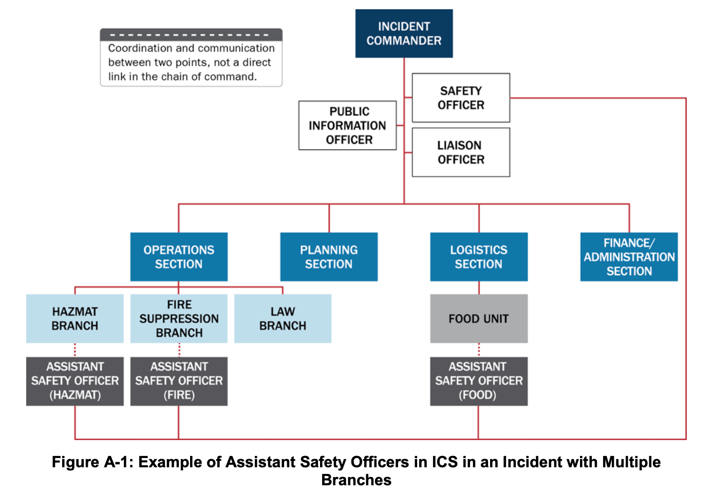
*Figure A-1: 다수 지대(Branches)가 운영되는 사건에서 안전보좌관(Assistant Safety Officers)의 ICS 배치 예시*

3. **연락담당관 (Liaison Officer, LNO):**
   - 사건 관리 인력과 대응을 지원·협력하는 외부 조직(관할권이나 법적 권한이 없는 타 정부기관, NGO, 민간 부문) 간의 정보 및 지원 통로 역할을 함.
   - 지원/협력 기관이 파견한 **기관대표(Agency Representatives)**들은 소속 기관을 대변하며 연락담당관과 직접 조율함.
4. **지휘자문관 (Command Advisors):**
   - IC/UC는 3대 지휘참모 외에 기술전문가를 지휘자문관으로 임명할 수 있음: ① **법률자문관(Legal Counsel)**(비상선포, 대피·격리 명령, 언론 접근권 자문), ② **의료자문관(Medical Advisor)**(급성·장기 의료, 정신건강, 다수사상자, 역학, 대량 예방투약 자문), ③ **과학기술자문관(Science and Technology Advisor)**, ④ **접근 및 기능적 필요 자문관(Access and Functional Needs Advisor)**(다양한 취약 계층의 통신·수송·필수 서비스 자문).

---

## 3. ICS Tab 2 — 작전부 (The Operations Section) *(원문 pp. 84–90)*

### 3.1 작전부의 임무와 조직 구조
- **핵심 임무:** 인명 구조, 즉각적 위험 감소, 재산 및 환경 보호, 상황 통제 확립, 정상 운영 복구에 초점을 맞춘 모든 **현장 전술 활동(Tactical activities)**을 수행함. **인명 구조와 대원 안전이 언제나 최우선 순위**임.
- 소방, 법집행(경찰), 공중보건, 공공사업, 응급의료(EMS), NGO, 민간 부문이 함께 참여하며 지대(Branches), 지역대(Divisions), 기능대(Groups), 태스크포스(Task Forces), 기동타격대(Strike Teams)로 편성됨(그림 A-2 참조).

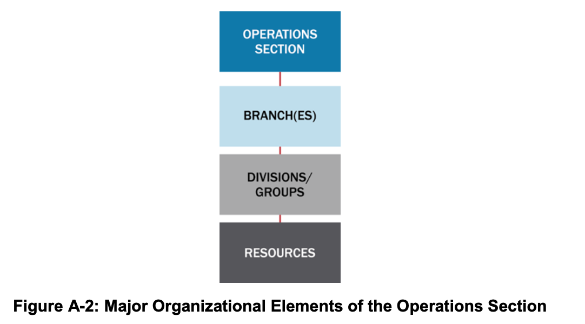
*Figure A-2: 작전부(Operations Section)의 주요 조직 구성 요소(지대, 지역대, 기능대, 기동타격대, 태스크포스, 단일자원)*

- **작전부장 (Operations Section Chief):** 현장 전술 활동을 직접 관리하고 IAP 이행을 감독하며, 차기 작전주기 IAP 수립에 직접적인 책임을 짐. 통제 범위를 유지하기 위해 지리적, 기능적, 또는 혼합형 구조로 하부 조직을 편성함.

### 3.2 지대 (Branches): 지리적 지대 및 기능적 지대
지역대(Divisions)나 기능대(Groups)의 수가 관리 가능한 통제 범위(Span of control)를 초과할 때, 작전부장과 지역대/기능대 사이에 **지대(Branches)**를 삽입함.
1. **지리적 지대 구조 (Geographic Branch Structure):** 2개 이상의 지역대/기능대를 묶어 통제 범위를 유지함. 예를 들어 4개 지역대가 작전부장에게 보고하던 중 2개 지역대가 추가되어 긴밀한 감독이 필요해지면 2개의 지대(Branch I, Branch II) 조직을 형성함(그림 A-3 참조). 지대 경계는 사건 지도에 표시하고 대원들에게 명확히 전파함.

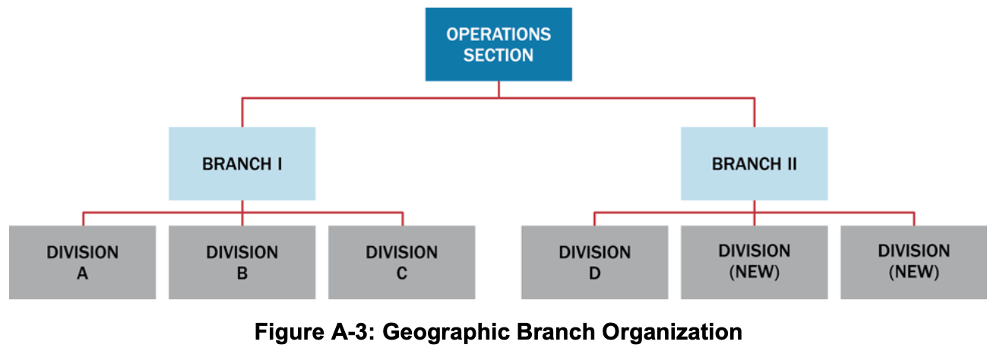
*Figure A-3: 지리적 지대(Geographic Branch) 조직 구성 예시*

2. **기능적 지대 구조 (Functional Branch Structure):** 대형 항공기 추락 사고와 같이 법집행, 소방, EMS, 공공사업, 공중보건 등 다양한 전문 분야가 단일 작전부장 아래에서 각각 기능적 지대를 운영하는 구조임(그림 A-4 참조).

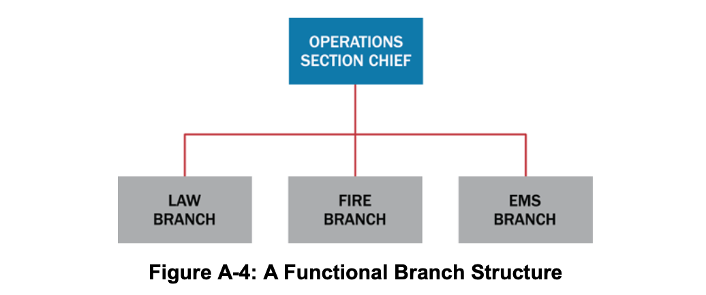
*Figure A-4: 기능적 지대(Functional Branch) 조직 구성 예시*

### 3.3 지역대(Divisions)와 기능대(Groups)
자원 수가 작전부장의 통제 범위를 초과할 때 지역대와 기능대를 설치함. **지역대 감독관과 기능대 감독관은 동일한 수준의 권한(Same level of authority)**을 가짐.
1. **지역대 (Divisions):** 항상 **지리적·물리적 구역 배정(Geographic assignments)**을 의미함. 행정 경계, 강·주요 도로 등 자연 지형, 또는 **고층 건물 화재 시의 층별 구역(Floors in a multistory building)**으로 구분함(그림 A-5 참조).

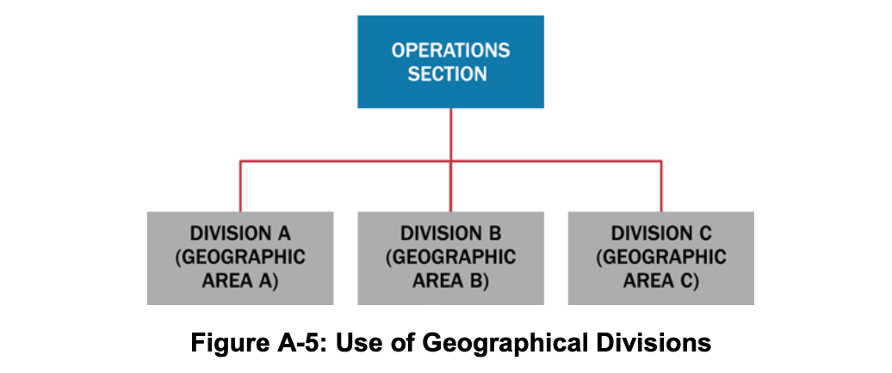
*Figure A-5: 지리적 지역대(Geographical Divisions) 분할 운영 예시*

2. **기능대 (Groups):** 항상 **유사한 활동의 기능적 임무 배정(Functional assignments)**(예: 구조대, 대피대, 법집행대, 의료처치·중증도분류대, 제연대 등)을 의미함(그림 A-6 참조). 단일 사건에서 지역대와 기능대를 동시에 혼합 운용할 수 있음.

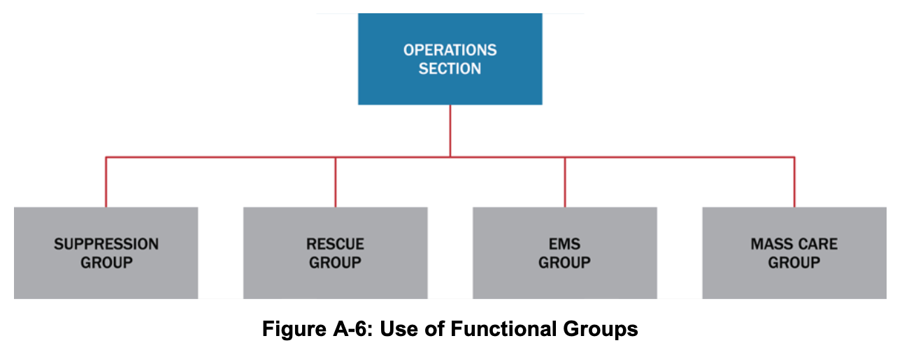
*Figure A-6: 기능대(Functional Groups) 편성 운영 예시*

### 3.4 자원의 편성 (Organizing Resources) 및 항공작전지대 (Air Operations Branch)
- **자원 결합의 3유형:**
  1. **단일 자원 (Single Resources):** 개별 인력 1명 또는 조작원이 포함된 개별 장비 1대.
  2. **태스크포스 (Task Forces):** 지정된 리더 아래 특정 임무 완수를 위해 **서로 다른 종류와 유형(Different kinds and types)의 자원**을 결합한 편성(예: 홍수 시 배수로 개방을 위해 덤프트럭 1대 + 백호 1대 + 삽과 차량을 갖춘 5인 작업조 + 공공사업 감독관으로 구성된 태스크포스).
  3. **기동타격대 (Strike Teams / 법집행 분야: Resource Teams):** 지정된 리더 아래 **동일한 종류와 유형(Same kind and type)의 자원**이 정해진 수량으로 결합된 편성(예: 3유형 덤프트럭 5대와 기동타격대장으로 구성된 잔해제거 기동타격대).
- **항공작전지대 (Air Operations Branch):** 헬기 1대만 운용될 때는 작전부장이 직접 통제하나, 다수 항공기 투입 및 공역 통제(Air-space control)가 필요한 복잡한 항공 작전 시 항공작전지대를 설치함. 회전익(헬기)과 고정익 항공기가 동시에 공역에서 활동할 경우 **항공전술기능대 감독관(Air Tactical Group Supervisor)**이 헬기조정관 및 고정익조정관의 보좌를 받아 공중 활동을 조정하며, **항공지원기능대(Air Support Group)**는 헬기 기지 운영 및 항공 자원 근무시간 기록(Timekeeping)을 담당함(그림 A-7 참조).

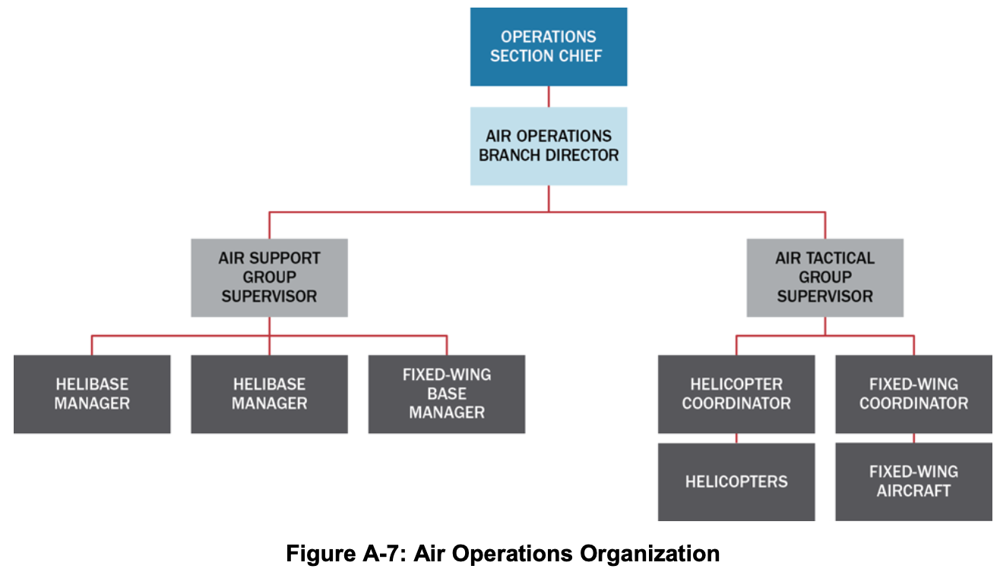
*Figure A-7: 항공작전(Air Operations) 조직 구성도*

---

## 4. ICS Tab 3 — 기획부 (The Planning Section) *(원문 pp. 91–93)*

### 4.1 기획부장과 4대 핵심 반(Units)
- **기획부장 (Planning Section Chief):** 사건 작전 및 배정 자원에 관한 데이터 수집·분석을 총괄하고, 사건활동계획(IAP) 회의를 주재하며, 매 작전주기의 IAP를 작성함. 기획부는 4개 기본 반(자원반, 상황반, 문서반, 동원해제반)과 기술전문가로 구성됨(그림 A-8 참조).

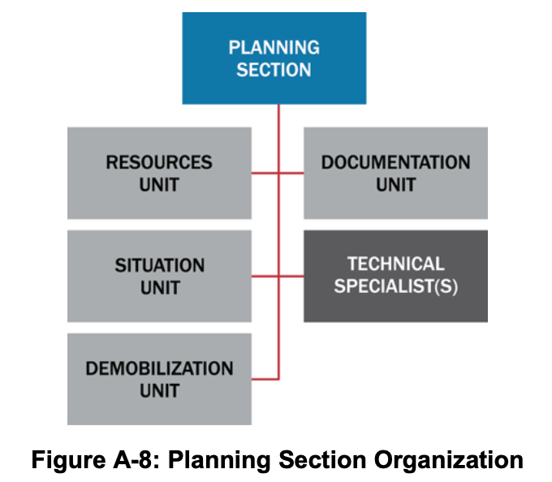
*Figure A-8: 기획부(Planning Section) 조직 구성도*

1. **자원반 (Resources Unit):**
   - 사건에 배정된 모든 자원의 현장 체크인(Check-in)을 확인하고 위치와 상태를 지속적으로 추적함.
   - **자원 상태 3대 분류:** ① **임무배정(Assigned)**(체크인 후 작업 과업이 부여된 자원), ② **가용대기(Available)**(체크인 후 자원대기소 등에서 임무 배정을 대기 중인 자원), ③ **운용불가(Out of Service)**(기계 고장, 휴식, 인력 사유로 배정 불가한 자원).
   - *(구분 유의)* 이미 현장에 배정된 자원은 **기획부 자원반**이 추적하지만, 주문되었으나 아직 현장에 도착하지 않은 자원은 **물류부(Logistics Section)**가 추적함.
2. **상황반 (Situation Unit):**
   - 상황 정보를 수집·처리·조직화하고 상황요약보고서(SITREP) 및 향후 전개 예측을 작성함. 지리공간정보시스템(GIS) 전문가를 포함하여 사건 지도를 제작하고, 현장관측관(Field Observers)을 운용함.
3. **문서반 (Documentation Unit):**
   - 법적·분석적·역사적 목적을 위해 사건 파일과 기록을 보존하고, IAP의 취합·복제·배포 서비스를 제공함.
4. **동원해제반 (Demobilization Unit):**
   - 사건 초기부터 인력·자원 명부를 작성하여 **사건동원해제계획(Incident Demobilization Plan)**을 수립하고, IC/UC 승인 후 배포함.
5. **기술전문가 (Technical Specialists):**
   - 특수 전문성을 가진 인력으로 필요시에만 활성화됨. 단기 1인 자문은 상황반에 배속하고, 장기 다수 전문가가 필요하면 기획부 내에 별도의 기술반(Technical Unit)을 설치함(예: 제독 전문가, 환경영향 전문가, 역학조사관, 기상학자, 독성학자, 수의사, 행동건강 전문가 등).

---

## 5. ICS Tab 4 — 물류부/군수부 (The Logistics Section) *(원문 pp. 94–96)*

### 5.1 물류부장과 2대 지대(Service / Support Branches) 6대 반 구조
- **물류부장 (Logistics Section Chief):** 사건 대원들을 위한 시설, 수송, 보급품, 장비 정비·연료, 통신, 급식, 의료 서비스를 총괄 제공함. 대규모 사건에서는 통제 범위를 유지하기 위해 **서비스지대(Service Branch: 통신·의료·급식)**와 **지원지대(Support Branch: 보급·시설·지상지원)**의 2개 지대로 분할 가능함(그림 A-9 참조).

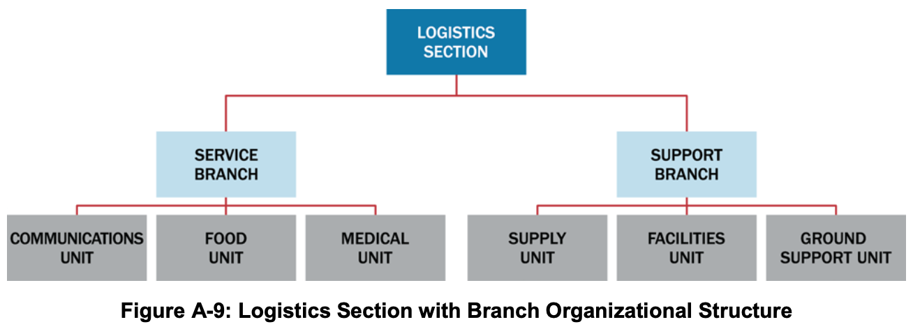
*Figure A-9: 지대(Branch) 구조로 편성된 물류부(Logistics Section) 조직도*

1. **보급반 (Supply Unit):** 전술 및 지원 자원(인력 포함)과 소모성·비소모성 보급품의 현장 외 주문(Off-incident ordering), 수령, 보관, 목록화, 배분을 전담함.
2. **시설반 (Facilities Unit):** 현장지휘소(ICP), 사건기지(Incident Base), 캠프(Camps) 및 대원 식사·수면·위생·샤워 시설을 설치·유지·철거하고 시설 보안을 제공함.
3. **지상지원반 (Ground Support Unit):** 지상 수송 차량 관리, 장비 정비·연료 보급, 사용 전후 장비 점검을 수행하며 **사건교통계획(Incident Traffic Plan)**을 수립·시행함.
4. **통신반 (Communications Unit):** 통신 장비 설치·테스트, 현장 통신센터 운영, 무선 주파수 배정 및 **사건통신계획(Incident Communications Plan, ICS Form 205)**을 수립함.
5. **급식반 (Food Unit):** 캠프와 자원대기소를 포함한 모든 현장 대원들의 식수와 영양 급식을 계획·조달·제공함.
6. **의료반 (Medical Unit):** **현장 대응 대원(Incident personnel)**에 대한 응급처치, 정신건강, 산업보건, 부상 대원 이송을 담당하고 **사건의료계획(Medical Plan, ICS Form 206)**을 수립하며 재정/행정부의 산재 보상 서류 작업을 지원함.

> **💡 [원문 핵심 구분 박스: 물류부(Logistics) vs 작전부(Operations)의 책임 경계]**
> 물류부의 **시설반, 급식반, 의료반**은 오직 **현장 대응 대원(Incident workers/personnel)**을 위한 숙소, 급식, 의료만을 지원함. 재난으로 피해를 입은 **일반 이재민/생존자(Survivors/Evacuees)에게 비상 대피소, 구호 급식, 응급 의료를 제공하는 것은 물류부가 아니라 작전부(Operations Section)의 전술적 활동**임!

---

## 6. ICS Tab 5 — 재정/행정부 (The Finance/Administration Section) *(원문 pp. 97–98)*

### 6.1 재정/행정부장과 4대 핵심 반(Units)
- **재정/행정부장 (Finance/Administration Section Chief):** 현장 재정 및 행정 서비스가 필요할 때 설치되며, 다수의 자금원을 모니터링하고 발생 비용(Accrued costs)을 추적·보고하여 지휘관이 자금 부족으로 작전에 차질을 빚기 전에 추가 예산을 예측·확보하도록 지원함(그림 A-10 참조).

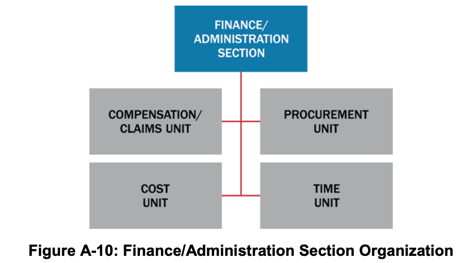
*Figure A-10: 재정/행정부(Finance/Administration Section) 조직 구성도*

1. **보상/배상반 (Compensation and Claims Unit):** 사건 현장의 재산 피해, 부상, 사망으로 인한 재정 문제를 처리함. 대원 산재 보상(Workers' compensation) 서류 작성(의료반과 긴밀 협조) 및 민간 불법행위 손해배상 청구(Civil tort claims) 조사를 지원함.
2. **비용반 (Cost Unit):** 모든 배정 자원의 실제 비용을 기록·분석하고 비용 추계 및 비용 절감 방안을 기획부에 제공함.
3. **조달반 (Procurement Unit):** 장비 임대차 계약(Equipment rental agreements) 및 벤더 보급품 계약을 포함한 모든 재정 계약을 관리함.
4. **시간기록반 (Time Unit):** 관련 기관 정책에 따라 현장 투입 인력과 장비의 일일 근무·가동 시간을 정확히 기록·검증함.

---

## 7. ICS Tab 6 — 정보/수사 기능 (The Intelligence/Investigations Function) *(원문 pp. 99–101)*

- **목적:** 감염병 창궐, 방화, 복합 테러 공격, 사이버 사건 등 사건의 원인이나 출처를 규명하여 영향을 통제하고 유사 사건 재발을 방지함.
- **ICS 내 4대 배치 옵션 (그림 A-11 참조):** 사건의 성격과 정보/수사 활동의 비중에 따라 다음 4곳 중 하나(또는 조합)에 배치할 수 있음:
  1. **기획부 내 배치 (In the Planning Section):** 상황반(Situation Unit)의 일부 또는 별도의 정보/수사반(I/I Unit)으로 통합하여 일반 상황정보 수집·분석 역량을 강화함.
  2. **작전부 내 배치 (In the Operations Section):** 법집행, 소방, EMS, 화생방, 공중보건 등 모든 전술 작전과 수사 활동을 하나로 통합함. 테러 사건 등 정보/수사 활동이 지배적인 단계에서는 정보/수사 인력이 작전부장 등 리더십 직위를 맡아야 함.
  3. **지휘참모 내 배치 (In the Command Staff):** 직접적인 수사 작전은 없으나 정보/수사 차원의 자문이 필요할 때 지휘자문관(Command Advisor)으로 배치하여 IC/UC, 법률자문관, 안전담당관, PIO와 즉각 소통하게 함.
  4. **독립된 제5의 일반참모 부서로 설치 (As a Standalone General Staff Section):** 실제 또는 잠재적 범죄·테러 행위나 대규모 역학조사 등 정보/수사 측면을 일반 작전·기획과 분리 관리해야 할 때 **정보/수사부(Intelligence/Investigations Section)**로 독립 설치함. 산하에 수사작전대, 실종자대, 정보대, 다수사망자관리대, 과학수사(포렌식)대, 수사지원대를 둠 *(각주 21)*.

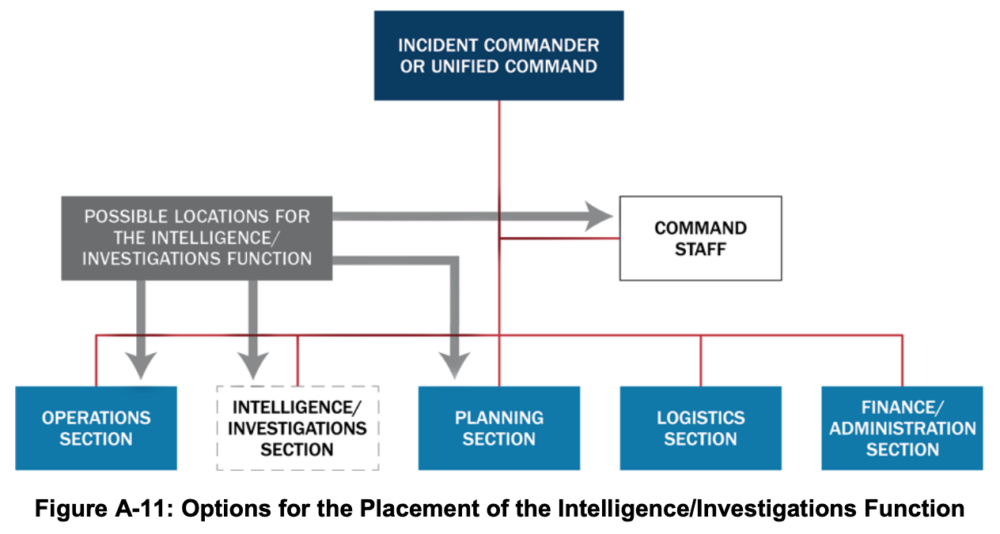
*Figure A-11: ICS 조직 내 정보/수사(Intelligence/Investigations) 기능의 4가지 배치 옵션*

---

## 8. ICS Tab 7 — 다수 사건 관리의 통합 (Consolidating the Management of Multiple Incidents) *(원문 pp. 102–103)*

1. **사건복합체 (Incident Complex):**
   - 동일한 일반 구역 내에서 발생한 2개 이상의 개별 사건을 단일 사건지휘관(IC) 또는 통합지휘부(UC)에 배정하여 하나의 ICS 조직으로 통합 관리하는 구조임. 기존 개별 사건들은 사건복합체 작전부(Operations Section) 산하의 **지대(Branches) 또는 지역대(Divisions)**로 편입됨.
   - 산불, 지진, 토네이도, 홍수 등으로 근접 지역에 소규모 사건이 동시다발적으로 발생할 때 지휘·물류 지원의 규모의 경제(Economies)를 달성할 수 있음.
2. **광역지휘부 (Area Command / Unified Area Command):**
   - 다수의 사건 관리를 감독하거나 다수의 ICS 조직이 가동 중인 대형·진화 사건을 감독하기 위해 설치됨.
   - **핵심 원칙:** 광역지휘부는 **직접적인 현장 작전 책임(Operational responsibilities)을 지지 않으며**, 사건들 간의 **희소 자원(Scarce resources) 사용 우선순위를 결정·할당**함.
   - **주요 직책:** 광역지휘관(Area Commander / 다관할 시 통합광역지휘부[Unified Area Command]), 광역지휘 물류부지휘관(Assistant Area Commander–Logistics), 광역지휘 기획부지휘관(Assistant Area Commander–Planning), 광역지휘 항공조정관(Area Command Aviation Coordinator) 및 지원 참모(자원반장, 상황반장, PIO, 연락담당관).
   - **위치 지침:** 사건들과 충분히 가까워야 하나, **개별 현장지휘소(ICP)와의 혼선을 피하기 위해 어느 개별 ICP와도 같은 장소에 함께 배치(Co-located)해서는 안 됨**.

---

## 9. ICS Tab 8 — 사건활동계획 수립 프로세스 및 플래닝 P (Incident Action Planning & Planning "P") *(원문 pp. 104–108)*

### 9.1 사건활동계획(IAP)의 의의와 플래닝 P (Planning "P")
- 사건활동계획(IAP) 수립 프로세스는 작전을 동기화하고 모든 활동이 사건 목표를 뒷받침하도록 보장하는 일정한 리듬과 구조를 제공함.
- **플래닝 P (Planning "P", 그림 A-12 참조):** 사건활동계획 주기를 구성하는 회의, 작업 기간, 브리핑의 순서와 관계를 도식화한 모델임.
  - **"P"의 기둥 다리 (Leg of the "P"):** 사건 초기 상황인식을 확보하고 조직을 구축하는 단계로, **사건 발생 시 단 한 번만 수행**함(사건 발생 → 초기 대응 및 평가 → 기관장 브리핑 → 사건 브리핑[ICS 201] → 초기 통합지휘 회의).
  - **"P"의 원형 고리 (Top of the "P"):** 매 작전주기(Operational Period)마다 반복되는 계획 및 작전 순환 주기임(목표 설정/갱신 → 전략회의/지휘·일반참모 회의 → 전술회의 준비 → 전술회의[ICS 215, 215A 활용] → 기획회의 준비 → 기획회의 → IAP 작성 및 승인 → 작전주기 브리핑 → 작전 실행 및 상황 평가).

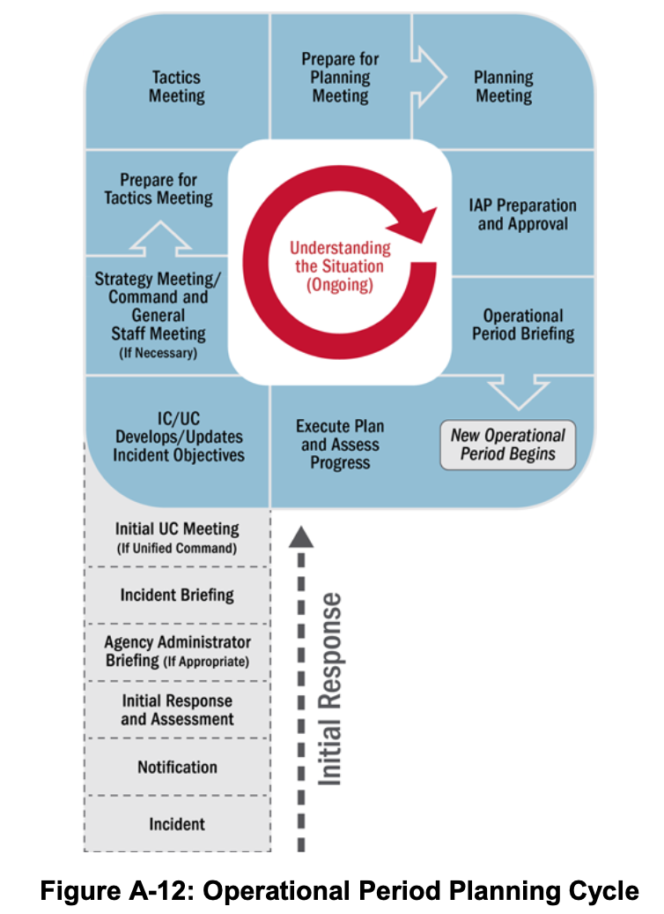
*Figure A-12: 작전주기 계획 수립 사이클 — 플래닝 P (Operational Period Planning Cycle / Planning "P")*

#### 📊 [표 A-2] 사건활동계획(IAP) 구성 서식 및 작성 책임 부서 (Table A-2: The IAP and Typical Attachments)

| IAP 구성 요소 및 첨부 계획 (Component) | 작성 책임 단위 (Normally Prepared By ICS) |
| :--- | :--- |
| **사건 목표 (Incident Objectives — ICS Form 202)** | 사건지휘관(IC) 또는 통합지휘부(UC) |
| **조직배정목록 또는 조직도 (ICS Forms 203, 207)** | 자원반 (Resources Unit) |
| **작전배정목록 (Assignment List — ICS Form 204)** | 자원반 (Resources Unit) |
| **무선통신계획 (ICS Form 205) 또는 통신연락망 (ICS Form 205A)** | 통신반 (Communications Unit) |
| **의료계획 (Medical Plan — ICS Form 206)** | 의료반 (Medical Unit) |
| **사건 지도 (Incident Maps)** | 상황반 (Situation Unit) |
| **일반 안전 메시지 / 현장안전계획 (ICS Form 208)** | 안전담당관 (Safety Officer) |
| **항공작전 요약서 (Air Operations Summary)** *(필요시)* | 항공작전지대 (Air Operations) |
| **교통계획 (Traffic Plan)** *(필요시)* | 지상지원반 (Ground Support Unit) |
| **제독계획 / 폐기물관리계획** *(필요시)* | 기술전문가 (Technical Specialist) |
| **동원해제/비활성화 계획 (Demobilization Plan)** *(필요시)* | 동원해제반 (Demobilization Unit) |
| **현장보안계획 / 수사계획** *(필요시)* | 법집행기관, 보안매니저 / 정보·수사 기능 |
| **회의 일정표 (Meeting Schedule — ICS Form 230)** *(필요시)* | 상황반 (Situation Unit) |
| **대피계획 / 대피소·대량구호계획** *(필요시)* | 필요 부서 (As needed) |

---

## 10. ICS Tab 9 & Tab 10 — ICS 표준 서식 및 주요 직위별 핵심 기능 요약 *(원문 pp. 109–111)*

### 10.1 주요 ICS 표준 서식 18종 요약 (ICS Tab 9 — ICS Forms) *(각주 22)*

| 서식 번호 | 공식 명칭 (Form Title) | 핵심 용도 및 특징 |
| :--- | :--- | :--- |
| **ICS Form 201** | **사건 브리핑 (Incident Briefing)** | 초기 지휘관이 후임 지휘관에게 지휘권을 인계할 때 사용하는 4섹션(4페이지) 브리핑 문서(서면 IAP에는 미포함) |
| **ICS Form 202** | **사건 목표 (Incident Objectives)** | 서면 IAP의 첫 페이지. 작전주기 목표, 기상 정보, 일반 안전 메시지 및 IC/UC의 최종 승인 서명란 포함 |
| **ICS Form 203** | **조직배정목록 (Organization Assignment List)** | 서면 IAP의 두 번째 섹션. 해당 작전주기의 지휘·감독 인력 전체 명단 수록 |
| **ICS Form 204** | **작전배정목록 (Assignment List)** | 각 지역대(Division)/기능대(Group)별 전담 페이지. 감독관, 배정 자원, 세부 과업, 특수 지시, 통신망 수록 |
| **ICS Form 205** | **사건무선통신계획 (Radio Comm. Plan)** | 지역대/기능대 수준까지의 무선 주파수 및 채널 배정 내역 기록 |
| **ICS Form 205A**| **통신연락망 목록 (Communications List)** | 무선 외(유선·휴대전화·이메일 등) 사건 인력 연락처 기록 |
| **ICS Form 206** | **의료계획 (Medical Plan)** | 현장 대원들의 응급 의료 처치 및 후송 병원 계획 제시 |
| **ICS Form 207** | **사건 조직도 (Incident Organization Chart)** | ICS 조직의 주요 요소와 핵심 참모를 시각적 차트로 표시 |
| **ICS Form 208** | **안전 메시지/계획 (Safety Message/Plan)** | 안전 메시지, 확장 안전 메시지 및 현장안전계획 수록 |
| **ICS Form 209** | **사건현황요약 (Incident Status Summary)** | EOC, MAC Group, 기관장에게 상황 정보를 보고하는 핵심 요약 서식 |
| **ICS Form 210** | **자원상태변경 (Resource Status Change)** | 현장 배정 자원의 상태 변경 및 도착·출발 추적 워크시트 |
| **ICS Form 211** | **사건 체크인 목록 (Incident Check-In List)** | 현장에 도착하여 등록(Check-in)한 모든 자원 기록 |
| **ICS Form 213** | **일반 메시지 서식 (General Message Form)** | 현장 인력 간 또는 지휘 계층 간 공식 메시지 전달용 서식 |
| **ICS Form 214** | **활동 일지 (Activity Log)** | 주요 활동이나 사건을 시간순으로 기록하는 공식 로그 |
| **ICS Form 215** | **작전기획 워크시트 (Operational Planning)** | 전술회의에서 차기 작전주기의 전술 배정 및 자원 소요를 도출하는 핵심 워크시트 |
| **ICS Form 215A**| **IAP 안전분석 (IAP Safety Analysis)** | 전술회의 시 안전담당관이 식별한 위험 요소와 완화 대책을 기록 |
| **ICS Form 221** | **동원해제 체크아웃 (Demobilization Check-Out)**| 동원 해제되는 자원의 복귀 점검 및 세부 사항 기록 |
| **ICS Form 230** | **회의 일정표 (Meeting Schedule)** | 작전주기 중 예정된 공식 회의 및 브리핑 일정 기록 |

### 10.2 주요 ICS 직위별 핵심 기능 총괄표 (ICS Tab 10 — Table A-3)

| 주요 ICS 직위 | 핵심 수행 기능 (Primary Functions) |
| :--- | :--- |
| **사건지휘관(IC) 또는 통합지휘부(UC)** | • 명확한 권한 보유 및 기관 정책 숙지, 사건 관리에 필요한 ICS 조직 확립[[BR]]• 사건 목표(Objectives) 설정 및 우선순위 결정, 현장지휘소(ICP) 설치[[BR]]• 지휘참모 및 일반참모 관리, 사건활동계획(IAP) 승인 및 현장 안전 보장[[BR]]• 자원 요청 승인 및 자원봉사자·보조 인력 활용 승인[[BR]]• 언론 정보 배포 승인, 필요시 동원 해제 명령 및 사후강평보고서(AAR) 완수 보장 |
| **공보담당관 (PIO)** | • 언론 브리핑 및 소셜 미디어 배포용 정확·신속·접근 가능한 정보 개발[[BR]]• 전통 매체 및 소셜 미디어 모니터링, 루머 통제(Rumor control) 기법 식별·시행[[BR]]• 보도자료에 대한 지휘관 승인 획득, 언론 브리핑 실시 및 기획회의 참여 |
| **안전담당관 (Safety Officer)** | • 위험 상황 식별·완화 및 불안전한 행위 즉각 중지·예방[[BR]]• 사건안전계획(Safety Plan) 수립·유지, 안전 메시지 작성 및 IAP 안전 검토[[BR]]• 특수 위험 평가 유자격 안전보좌관 배치, 현장 내 사고 초기 조사 개시[[BR]]• 의료계획(Medical Plan) 검토·승인 및 미래 작전 위험 대비를 위한 기획회의 참여 |
| **연락담당관 (Liaison Officer)** | • 외부 지원·협력 기관 대표(Agency Representatives)들의 단일 접촉 창구 역할[[BR]]• 기관 간 현재·잠재적 쟁점 식별을 위한 작전 모니터링 및 지원·협력 기관 명부 유지[[BR]]• 기획회의에 참여하여 각 기관 자원의 한계와 역량, 기관별 동원해제 요구사항 제공 |
| **작전부장 (Operations Section Chief)** | • 모든 현장 전술 작전 관리, 전략·전술 결정 및 전술 작전의 안전 보장[[BR]]• IAP 수립 프로세스에서 작전부의 중심 역할 총괄 및 IAP 배정 임무 실행 감독[[BR]]• 전술 작전 지원을 위한 추가 자원 요청, 작전 배정 자원의 해제 승인 및 긴급 IAP 변경 승인 |
| **기획부장 (Planning Section Chief)** | • 사건 관련 작전 데이터 수집·관리 및 사건 기획 활동 감독·촉진[[BR]]• IAP 작성 총괄 감독 및 IC·작전부에 자원 정보 투입 제공[[BR]]• 운용불가(Out-of-service) 인력의 ICS 내 재배치, 상황 정보 취합·전시 및 대안 전략 정보 수집[[BR]]• 사건 잠재력에 대한 주기적 예측 제공 및 동원해제계획(Demobilization Plan) 작성 감독 |
| **물류부장 (Logistics Section Chief)** | • 모든 사건 물류·군수 관리(시설, 수송, 통신, 보급, 장비 정비·연료, 대원 급식·의료)[[BR]]• 현재 및 예상되는 사건 서비스·지원 소요 식별 및 추가 자원 요청[[BR]]• IAP에 물류부 투입 요소 제공, 교통·의료·통신계획 수립 감독 및 물류 자원 동원해제 감독 |
| **재정/행정부장 (Finance/Admin Chief)** | • 사건의 모든 재정적 측면 관리, 재정·비용 분석 정보 제공 및 보상·배상 기능 처리 보장[[BR]]• 협력·지원 기관과 재정 문제 일일 소통, 인력 근무시간 기록의 정확성 검증 및 소속 기관 전송[[BR]]• 현장에서 개시된 모든 채무·계약 문서의 정확성 보장 및 IAP 재정 요소 투입 제공 |

---

# 부록 B. 비상운영센터 조직 구조 (Appendix B. EOC Organizations)
> **참고 원문:** *National Incident Management System (Third Edition, October 2017) - Appendix B (pp. 112–118)*  
> **작성 원칙:** 미국 내 비상운영센터(EOC)에서 가장 널리 사용되는 **3대 표준 조직 구조 모델(EOC Tabs 1–3)**의 적용 조건, 장단점, 부서별 핵심 기능을 원문 도표(`Figure B-1` ~ `Figure B-3`)와 함께 100% 충실하게 정리함.

---

## 1. 목적 및 개요 (Purpose & Organization of This Appendix) *(원문 p. 112)*

- 본 부록은 미국 내 EOC에서 일반적으로 사용되는 3가지 조직 구조 예시를 설명함. 이는 강제적이거나 배타적인 것이 아니며, 관할구역이나 조직은 이 중 하나를 선택하거나 여러 구조의 요소를 결합하거나 완전히 다른 구조를 사용할 수 있음.
- 조직도 그래픽에는 직접 표시되지 않으나, 모든 EOC는 주지사, 시장, 시 매니저, 부족 지도자 등 **선출직 및 임명직 고위 공직자로 구성된 정책그룹(Policy Groups / MAC Groups)의 지침**을 받음.
- **부록 B의 3대 탭(Tab) 구성:**
  - **EOC Tab 1** — 현장지휘체계(ICS) 또는 ICS 유사형 EOC 구조 (ICS or ICS-like EOC Structure)
  - **EOC Tab 2** — 사건지원모델(ISM) EOC 구조 (Incident Support Model EOC Structure)
  - **EOC Tab 3** — 부서별(부처별) EOC 구조 (Departmental EOC Structure)

---

## 2. EOC Tab 1 — ICS 또는 ICS 유사형 EOC 구조 (ICS or ICS-like EOC Structure) *(원문 pp. 113–114)*

### 2.1 채택 배경 및 특징
- 인력들이 이미 ICS 구조에 익숙하고 현장(Field)에서 사용하는 구조와 일치하기 때문에 많은 관할구역이 선택함. 특히 EOC가 직접 작전 임무를 수행해야 하는 경우에 유용한 기능적 분류를 제공함.
- **표준 ICS 채택 조건:** ① EOC 인력이 사건에 직접 전술적 지시(Tactical direction)를 제공하는 경우, ② 추가 교육 없이 ICS 교육 이수 인력을 그대로 활용하려는 경우, ③ 현장 인력의 조직을 그대로 미러링(Mirror)하려는 경우.
- **ICS 유사형(ICS-like) 변형:** 현장지휘소(ICP)의 전술·물류 관리 역할과 구별하여 EOC의 **조정 및 지원(Coordination and Support) 임무를 강조**하기 위해 부서 명칭에 **"조정(Coordination)" 또는 "지원(Support)"**을 붙여 변경함(그림 B-1 참조).

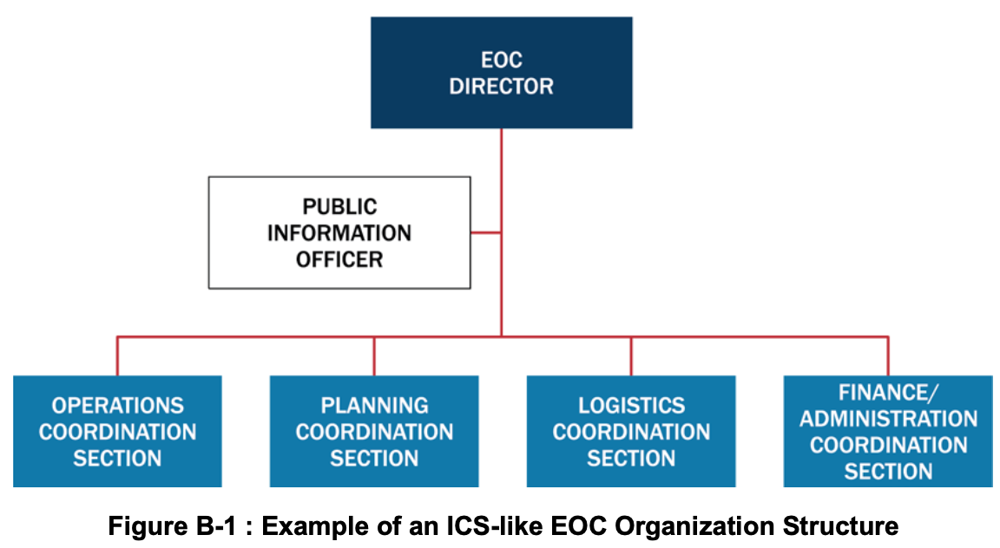
*Figure B-1: ICS 유사형 비상운영센터(ICS-like EOC) 조직 구조 예시*

### 2.2 주요 구성 부서별 기능
1. **EOC 지휘참모 (EOC Command Staff / EOC Management Staff):** 현장 작전을 직접 지휘하는 것이 아님을 명확히 하기 위해 흔히 'EOC 관리참모'로 불림. **EOC 센터장(EOC Director)**을 중심으로 공보담당관(PIO), 법률자문관, 안전담당관 등이 포함되며, EOC 목표·과업 설정 및 고위 공직자 정책 방향 수립을 보좌함.
2. **작전조정부 (Operations Coordination Section):** 현장 대응 인력이 사건 목표 달성에 필요한 자원과 작전 지원을 받도록 보장함. 흔히 비상지원기능(ESF) 또는 복구지원기능(RSF)별로 편성되며 현장 대응 인력의 일차적 연락 창구 역할을 함.
3. **기획조정부 (Planning Coordination Section):** 상황인식(Situational Awareness) 관리와 활성화 관련 계획 수립의 2대 핵심 기능을 수행함. 현장 ICS 기획부와 긴밀히 협력하여 공간정보·기술정보를 통합하고 리더십 및 이해관계자를 위한 브리핑·보고서를 작성함.
4. **물류조정부 (Logistics Coordination Section):** 계약 시행, 상호응원협약 가동, 타 정부 지원 요청(지자체→주→연방)을 통해 현장에 고도화된 자원 조달 지원을 제공하며, EOC 자체 운영을 위한 IT·급식·숙박 지원도 담당함.
5. **재정/행정조정부 (Finance/Administration Coordination Section):** 다수 자금원 모니터링 및 활성화 관련 전체 지출·비용 분석을 관리하며, 필요시 현장 ICS 재정/행정부의 책임을 대신 수행하기도 함.

---

## 3. EOC Tab 2 — 사건지원모델(ISM) EOC 구조 (Incident Support Model EOC Structure) *(원문 pp. 115–116)*

### 3.1 채택 배경 및 핵심 구조적 특징
- 사건지원모델(ISM)은 실제 현장 대응·복구 작전을 직접 지휘하기보다 **전적으로 지원 기능(Support functions)에만 집중하는 EOC**를 위해 고안된 ICS 변형 구조임.
- **3대 구조 개편 핵심:**
  1. ICS 기획부(Planning Section)에서 **정보 관리 및 상황인식 기능을 분리하여 센터장 직속의 독립된 일반참모 부서인 '상황인식부(Situational Awareness Section)'로 격상**함.
  2. ICS 작전부(Operations)와 물류부(Logistics)의 자원 조달·지원 기능을 결합하고, 여기에 ICS 재정/행정부의 감사관/구매(Comptroller/Purchasing) 기능까지 하나로 합쳐 **원스톱 자원 지원 부서인 '자원지원부(Resources Support Section)'로 통합**함.
  3. EOC 자체의 시설·IT·행정·급식을 전담하는 **'센터지원부(Center Support Section)'**를 별도로 둠(그림 B-2 참조).

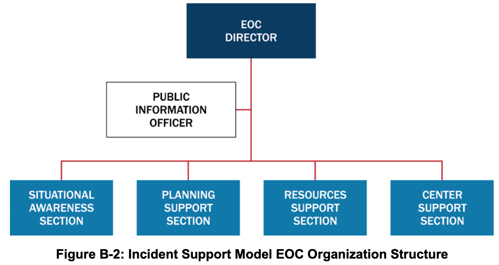
*Figure B-2: 사건지원모델 비상운영센터(ISM EOC) 조직 구조도*

### 3.2 주요 구성 부서별 기능
1. **ISM EOC 센터장 및 직속 참모 (ISM EOC Director's Staff):** EOC 센터장, PIO, 법률자문관, 안전담당관 등으로 구성되어 정책 지침 개발을 지원하고 대국민 정보를 배포함.
2. **상황인식부 (Situational Awareness Section):** 현장 ICS 기획부 상황반(Situation Unit)의 기능을 EOC 일반참모 부서 수준으로 격상한 부서로, EOC 센터장에게 직접 보고함. 사건 정보를 수집·분석·배포하고 정보요청(RFI) 처리, 브리핑 제작, GIS 통합, 대국민 경보 메시지 자료 개발을 수행함(ESF #15 대외협력 대표 포함 가능).
3. **기획지원부 (Planning Support Section):** 비상대비계획(Contingency), 비활성화(Deactivation), 복구(Recovery) 계획 등 현재 및 미래 기획 서비스를 제공하고 현장 ICS 기획부와 긴밀히 조율함.
4. **자원지원부 (Resources Support Section):** 현장 인력이 필요한 모든 자원(부처 보유분, 상호응원/EMAC, 구매·임대·계약 및 자금 집행 포함)을 소싱·주문·추적하는 **원스톱 숍(One-stop shop)** 역할을 수행함.
5. **센터지원부 (Center Support Section):** EOC 및 합동정보센터(JIC) 시설과 근무 인력들이 효과적으로 기능할 수 있도록 통신, IT, 행정, 보안, 시설 유지보수, 급식 등 내부 물류를 전담 지원함.

---

## 4. EOC Tab 3 — 부서별(부처별) EOC 구조 (Departmental EOC Structure) *(원문 pp. 117–118)*

### 4.1 채택 배경 및 특징
- 관할구역이나 조직이 평상시(Day-to-day) 각 부서 및 기관들과 유지하고 있는 일상적인 관계와 권한 체계를 재난 대응 및 복구 시에도 그대로 유지하고자 할 때 선택하는 모델임(부서 대신 비상지원기능[ESF] 단위로 구성할 수도 있음).
- 별도의 복잡한 교육훈련이 적게 요구되며, 모든 참여 부서와 기관 간의 **조정과 동등한 위상(Equal footing)**을 강조함.
- 관할구역의 **비상관리국장(Emergency Manager)** 또는 고위 공직자 1인이 EOC 센터장(EOC Director)으로서 지원 기관, NGO, 파트너들을 직접 조정하며, 그룹 내에서 통합지휘(UC)와 유사하게 상호 합의된 목표를 달성하기 위한 의사결정이 이루어짐(그림 B-3 참조).

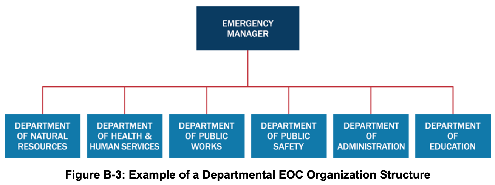
*Figure B-3: 부서별 비상운영센터(Departmental EOC) 조직 구조 예시*

### 4.2 부서별 대표들의 일상 업무 기반 역할 수행 예시
- **천연자원부 대표:** 평시 권한에 따라 역사 보존, 대기·수질, 공원, 야생동물, 산불 진압 조정 담당
- **공중보건·의료·인적서비스 기관 대표:** 노인 서비스, 지역 병원·클리닉·응급의료, 대피소 및 대량구호, 감염병 역학조사, 약국 및 대량 예방투약소, 인도주의 구호단체 연락 담당
- **공공사업부(도로·토목) 대표:** 도로·교량, 하수도·위생, 정수, 연료, 유틸리티, 교통, 폐기물 처리 자원 조정 담당
- **경찰·보안관·소방·EMS 대표:** 각자의 현장 대응 기능과 EOC 내 자원 조정 담당
- **행정부서 대표:** 공보, 재정, 교육훈련, 민간·부족 연락, 사회·문화 센터 조정 담당
- **공립학교 교육청 대표:** 아동 돌봄 서비스, 학교 시설(비상 대피소 활용 시), 스쿨버스 수송 지원 담당
