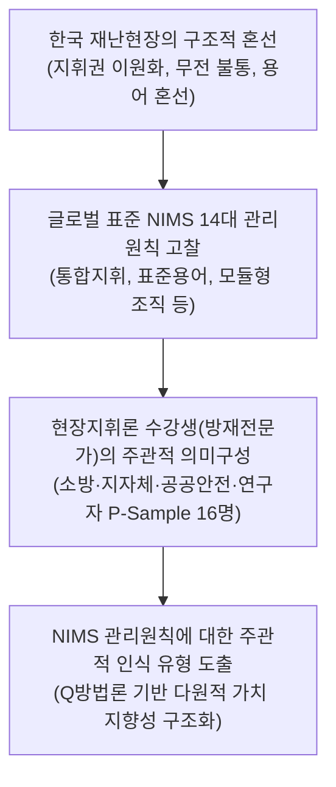
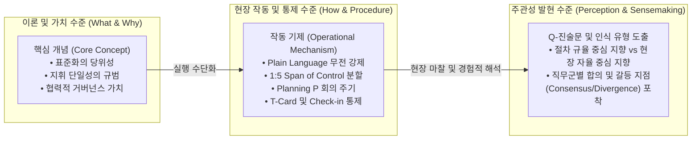
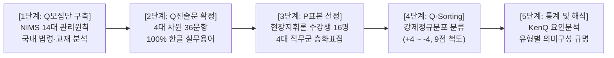
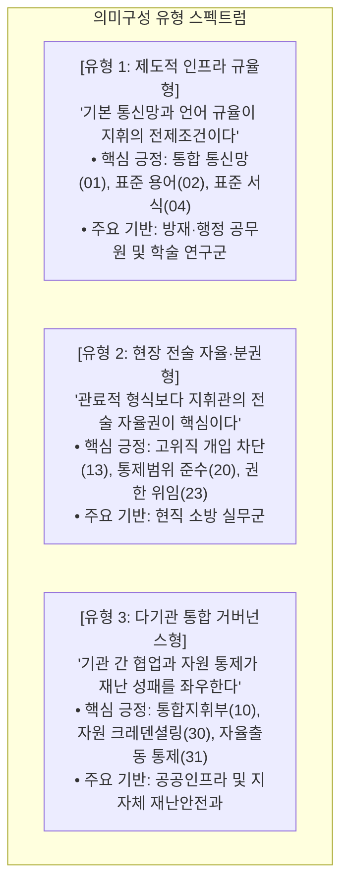
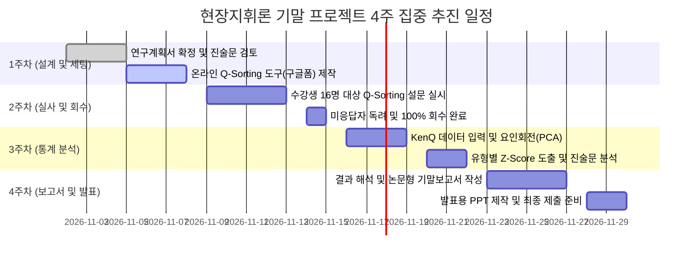

# [연구계획서] NIMS 핵심 재난지휘 관리원칙에 대한 주관적 인식 유형 분석
## - 재난관리학과 「현장지휘론」 수강생 집단의 의미구성(Sensemaking)을 중심으로 -

---

> **과목명:** 현장지휘론 (대학원 기말 연구 프로젝트)  
> **연구기간:** 2026년 11월 1일 ~ 11월 30일 (4주 완성 단기 집중 프로젝트)  
> **연구방법:** 주관성 연구방법론 (Q-Methodology)  
> **연구대상(P-Sample):** 재난관리학과 「현장지휘론」 수강생 16명 (소방·방재행정·안전인프라·학술연구 4대 직무군 균등 층화표집)  
> **분석도구:** KenQ Analysis Desktop Edition v1.0.8

### 👨‍🎓 연구자 인적사항 (Academic Affiliation)

| 항목 (Item) | 상세 정보 (Details) |
| :--- | :--- |
| **소속 (Department)** | **Department of Disaster and Emergency Management** |
| **학위과정 (Degree Program)** | **재난관리학박사 과정 (Doctor of Philosophy in Disaster and Emergency Management)** |
| **성명 (Name)** | **강석균 (Kang, Seokgyun)** |
| **학번 (Student ID)** | **2678125** |

---

## 1. 연구배경 및 문제의식

### 1.1 시대적·사회적 문제의식
* 최근 이태원 참사, 오송 지하차도 침수사고, 대형 산불 및 산업단지 복합화재 등 대형·복합재난이 빈발하면서 대한민국 재난대응 체계의 구조적 한계가 지속적으로 노출되고 있다.
* 재난 현장에서 소방, 경찰, 지방자치단체, 의료기관 등 다기관이 동시에 투입되지만, **기관 간 무전 불통, 상이한 현장 용어 사용, 지휘권 중복 및 혼선, 미요청 자원의 통제되지 않은 현장 진입, 통합 현장행동계획 부재** 등 현장 지휘·통제의 난맥상이 반복되고 있다.
* 한국은 「재난 및 안전관리 기본법」 상의 지자체 ‘재난안전대책본부(통합지원본부)’와 「소방기본법」 및 「119구조·구급에 관한 법률」 상의 소방 ‘긴급구조통제단’으로 현장 지휘 권한이 이원화되어 있어, 재난 초기 골든타임에 단일하고 강력한 현장 통합지휘(Unified Command)를 발휘하기 어려운 제도적·문화적 특수성을 지닌다.

### 1.2 연구의 필요성 및 Q방법론 적용 당위성
* 미국은 9/11 테러 이후 분절된 재난지휘체계를 단일한 국가 표준으로 통합하기 위해 **국가재난관리체계(NIMS: National Incident Management System)**를 수립하고, **14대 핵심 현장지휘 관리원칙(Management Characteristics)**을 정립하였다(FEMA, 2017).
* 그러나 미국의 NIMS 관리원칙을 한국 재난관리 체계에 도입하는 과정에서, 소방 실무자, 방재 행정직 공무원, 안전 인프라 관리자, 학술 연구자 등 **각 행위 주체들은 자신의 직무 경험과 조직 문화에 따라 NIMS 원칙들을 서로 다른 시각과 신념체계로 지각(Perception)하고 해석**한다.
* 이는 단순한 항목별 계량 서열이나 단일한 기술적 우열의 문제가 아니라, **"재난 지휘의 성공을 구성하는 본질적 가치가 무엇인가?"에 대한 행위자들의 내면적 의미구성(Sensemaking)과 다원적 가치관(Multiple Perspectives)의 차이**에서 비롯된다.
* 따라서 본 연구는 전문가들의 내면적 태도와 주관적 신념 구조(Subjectivity)를 심층적으로 유형화하는 데 최적화된 **Q방법론(Q-Methodology)**을 적용하여 NIMS 관리원칙을 둘러싼 다원적 인식 지형도를 도출하고자 한다.



---

## 2. 이론적 개념 및 분석 틀

### 2.1 Weick의 의미구성 이론 (Sensemaking Theory)과 주관성
* Karl Weick(1995)에 따르면, 극심한 혼란과 위기 상황에서 조직 구성원들은 사전에 정의된 규정만을 기계적으로 따르는 것이 아니라, 각자의 경험적 틀과 인지적 지도를 통해 상황의 의미를 능동적으로 구성(Sensemaking)한다.
* 재난 현장의 지휘관과 방재 전문가들이 NIMS의 14대 관리원칙 중 어떤 요소를 핵심적 성공 요인으로 지각하고 어떤 요소를 부차적·형식적 요소로 인식하는가는 이들의 **인지적 프레임워크(Cognitive Framework)**에 의해 결정된다.

### 2.2 NIMS 14대 핵심 현장지휘 관리원칙의 개념 및 작동기제 분석 틀
본 연구는 FEMA NIMS 원문의 14대 핵심 관리원칙을 학술 연구 목적에 부합하도록 **핵심 개념(Core Concept: 본질적 가치 및 규범적 정의)**과 **작동 기제(Operational Mechanism: 현장 작동 절차, 규칙, 시스템적 통제 메커니즘)**로 명확히 분리하여 체계화한다. 이를 통해 현장지휘론 교과 맥락에 부합하는 **4대 차원(영역)**의 분석 틀을 확립한다.

| 대분류 (4대 차원) | 세부 관리원칙 (14대 특성) | 핵심 개념 (Core Concept: 본질 및 가치) | 작동 기제 (Operational Mechanism: 실행 절차 및 통제 규칙) |
| :--- | :--- | :--- | :--- |
| **차원 1: 표준화 및 소통체계** | **1. 표준 용어<br/>(Common Terminology)** | 기관 간 은어·약어를 배제하고 기능·자원·시설 명칭을 표준화하여 소통 오류를 차단하는 원칙 | • 무전 은어(10-Code) 전면 금지 및 평이한 일상 언어(Plain Language) 강제<br/>• 조직 직책, 자원 등급(Type 1~4), 핵심 시설 표준 용어 편람 적용<br/>• 모든 공식 IAP 문서 및 대외 브리핑에 비표준 용어 필터링 규칙 적용 |
| | **2. 통합 통신<br/>(Integrated Communications)** | 이기종 통신망을 연계하여 다기관 간 실시간 상호운용성(Interoperability)을 보장하는 체계 | • 공통 통신계획(ICS 205 양식) 수립 및 단일 재난안전통신망(PS-LTE) 채널 사전 할당<br/>• 트래픽 과부하 방지를 위한 3계층 채널 분리(지휘망 / 전술망 / 지원망)<br/>• 이기종 무전기 연동을 위한 이동형 통신 게이트웨이 및 크로스밴드 중계기 가동 |
| | **3. 정보 및 정보인텔리전스 관리<br/>(Information & Intelligence)** | 불확실성을 최소화하고 올바른 결정을 내릴 수 있도록 상황 정보를 체계적으로 수집·분석·공유하는 원칙 | • 필수정보요소(EEI: Essential Elements of Information) 사전 정의 및 정기 수집<br/>• 기획부 상황분석실(Situation Unit) 교차 검증을 거친 공통작전상황도(COP) 실시간 전파<br/>• 테러·보건 등 특수 위협 시 인텔리전스 참모 별도 편제 및 정보보안 프로토콜 적용 |
| **차원 2: 명령 및 지휘구조** | **4. 명령 계통 및 지휘 단일성<br/>(Chain & Unity of Command)** | 수직적 권한 체계를 명확히 하고, 대원은 오직 1인의 직속 상관에게만 보고·명령받는 원칙 | • "1인 1직속상관 보고체계(Single reporting line)" 엄수를 통한 다중 지시 혼선 차단<br/>• 외부 고위직 직통 개입 차단 및 정규 명령계통(Chain of Command)을 통한 명령 하달 강제<br/>• 비인가 지휘선으로부터의 임의 지시 수령 시 거부 및 정규 라인 확인 절차 확립 |
| | **5. 통합지휘<br/>(Unified Command, UC)** | 관할·권한이 다른 다기관이 개별 권한을 유지하되 단일 지휘부를 구성하여 공동 목표를 추구하는 거버넌스 | • 다기관 책임자가 집결하는 단일 현장지휘소(Single ICP) 개설 및 합동 대면회의<br/>• 다기관 공동 목표(Joint Incident Objectives) 합의 및 단일 우선순위 결정<br/>• 단일 작전부서장(Operations Section Chief) 임명을 통한 현장 전술 실행 창구 일원화<br/>• 통합 IAP 공동 승인 및 단일 자원 주문 창구 운영 |
| | **6. 지휘권 확립 및 이양<br/>(Transfer of Command)** | 초동 지휘 공백을 방지하기 위해 지휘권을 공식 선언하고 상황 변화 시 안전·체계적으로 인수인계하는 원칙 | • 선착대 선임 대원의 초기 지휘권 공식 무전 선언(신원, ICP 위치 공표)<br/>• 상급자 도착 시 공식 대면 브리핑 실시(ICS 201 양식: 상황·전술·자원·안전·과업)<br/>• 지휘권 인수인계 사실을 전 현장 투입 인력 및 유관기관에 무전 공지 및 서면 기록화 |
| **차원 3: 조직 유연성 및 통제** | **7. 모듈형 조직<br/>(Modular Organization)** | 재난 규모와 복잡성에 맞추어 1인 지휘관부터 다기능 참모 체제까지 조직을 탄력적으로 확장·축소하는 원칙 | • 현장 필요에 따른 상향식(Bottom-up) 직위 활성화 및 안정화 시 역순 해제<br/>• **책임 자동 귀속(Default Responsibility)**: 위임되지 않은 기능은 차상위 감독자가 직접 수행<br/>• 통제범위 한계 도달 시 단계별 분과(Section/Branch) 신설 및 공식 권한 위임(Delegation) |
| | **8. 관리 가능한 통제범위<br/>(Span of Control)** | 지휘관 1인이 안전하고 효과적으로 감독할 수 있는 부하/조직 수를 제한하는 원칙 (적정 1:5, 범위 3~7) | • 직접 감독 인원이 7명을 초과하거나 위험 시 방면(Division: 지리) 또는 그룹(Group: 기능) 신설<br/>• 재난 축소로 대상이 3명 미만일 경우 하위 조직을 상위 단위로 통합(슬림화)<br/>• 위험도, 과업성격, 대원 경험, 통신 접근성 등 5대 변수에 따른 탄력적 가변 비율 적용 |
| | **9. 현장 시설 및 위치 표준화<br/>(Incident Facilities & Locations)** | 현장 활동의 효율성과 안전을 위해 사전 정의된 표준 명칭과 기능을 가진 물리적 거점을 배치하는 원칙 | • 안전 구역에 현장지휘소(ICP), 외곽 진입로에 자원대기소(Staging Area) 분리 설치<br/>• 사건기지(Base), 캠프(Camp), 임시응급의료소 등 표준 시설명 및 공통 지도 기호 표시<br/>• 자원대기소를 통한 미요청 자원의 현장 진입 물리적 통제 및 대기 점검 체계화 |
| **차원 4: 체계적 작전 및 자원관리**| **10. 목표기반 관리<br/>(Management by Objectives, MBO)** | 주관적 직관을 배제하고 구체적·측정 가능한 사건 목표를 중심으로 모든 작전을 기획·실행·평가하는 원칙 | • SMART 원칙(구체성, 측정가능성, 시한성 등)에 기반한 사건 목표 공식 수립<br/>• 목표 달성을 위한 전략·전술 수립 및 기능별 세부 임무(Assignments) 부여<br/>• 작전 주기별 목표 달성도 정량/정성 평가 및 차기 작전 주기 환류(Feedback) |
| | **11. 단일 현장행동계획<br/>(Incident Action Planning, IAP)** | 작전 주기별 모든 기관이 공유하는 통합 목표, 전술, 조직, 안전 수칙을 문서화하여 동기화하는 계획 체계 | • **기획 P(Planning P)** 회의 사이클(상황브리핑→전술회의→기획회의→IAP승인→작전브리핑) 가동<br/>• ICS 표준 양식군(ICS 202 목표, 203 조직, 204 임무배정, 205 통신, 206 의무, 208 안전 등) 번들링<br/>• 새로운 작전 주기(Operational Period) 개시 전 전원 배포 및 필독 브리핑 강제 |
| | **12. 종합 자원관리<br/>(Comprehensive Resource Management)** | 투입 자원의 역량을 표준화하여 식별·인증하고 전 생애주기에 걸쳐 흐름과 안전을 철저히 추적하는 체계 | • 자원 유형화(Resource Typing: 역량별 1~4급) 및 사전 자격인증(Credentialing) 검증<br/>• 자원관리 6단계(식별/요청 → 주문/취득 → 동원 → 추적/보고 → 해제 → 정산) 순환<br/>• T-Card(ICS 219) 또는 바코드/전산망을 통한 자원 가용성(할당/가용/비가용) 실시간 추적 |
| | **13. 자원 배치 및 통제<br/>(Dispatch/Deployment)** | 공식 요청과 정규 승인 절차를 거친 자원만 현장에 투입하고 미승인 자발적 출동을 엄단하는 규율 원칙 | • 비인가 자율출동(Self-dispatching) 전면 차단 및 외곽 통제선(Access Control) 운영<br/>• 현장 도착 자원의 필수 체크인(Check-in: ICS 211 양식) 등록 및 Staging Area 대기 명령<br/>• 미요청 자원 발견 시 즉각 등록 후 임무 부여 또는 안전 귀대(Demobilization) 조치 |
| | **14. 전문 기술 및 인텔리전스 활용<br/>(Information/Intelligence Utilization)** | 유해물질·붕괴 등 특수 복합 위험에 대처하기 위해 외부 과학기술 전문가를 지휘부에 직접 편입하는 원칙 | • 기획부 내 전문기술단(Technical Specialists) 편제 또는 지휘관 직속 특수참모 위촉<br/>• 위험성 평가 시뮬레이션, 구조안전 공학 분석 데이터를 IAP 전술 수립에 직접 반영<br/>• 기술 전문가에게 현장 위험 구역에 대한 독립적 안전 자문 및 작전 중지요청 권한 부여 |

---

### 2.3 핵심 개념(Core Concept)과 작동 기제(Operational Mechanism)의 상호작용 및 Q-연구 함의

본 연구가 핵심 개념과 작동 기제를 엄격히 분리하여 고찰하는 이유는, **재난 전문가들의 주관적 의미구성(Sensemaking)이 '규범적 가치(핵심 개념)'와 '실제 현장 실행 규칙(작동 기제)' 사이의 간극에서 첨예하게 분화**되기 때문이다.



1. **핵심 개념 (Core Concept - What & Why):**  
   관리원칙이 지향하는 학술적·이론적 정의이자 규범적 지향점이다. 예컨대 '통합지휘(UC)'의 핵심 개념은 "관할권이 상이한 다기관이 단일 목표를 공유하여 노력의 통일성을 달성하는 거버넌스"이다. 대부분의 방재 전문가들은 이러한 핵심 개념의 당위성에는 이론적으로 동의한다.
2. **작동 기제 (Operational Mechanism - How & Procedure):**  
   그 개념을 재난 현장에서 실제로 구현하고 집행하는 구체적인 행동 규칙, 서식(Form), 통제 프로토콜, 조직적 메커니즘이다. 예컨대 통합지휘의 작동 기제는 "단일 ICP 구축, 단일 작전부서장 임명, 통합 IAP 공동 서명, 자원 주문 창구 일원화" 등이다.
3. **주관성 연구에서의 의의:**  
   현장 전문가들은 핵심 개념 자체보다 **작동 기제의 현실 적합성과 실행 방식(예: 한국적 상황에서 단일 작전부서장을 소방이 맡을 것인가, 지자체가 맡을 것인가? 서면 IAP 작성이 골든타임을 지연시키는가 아닌가?)을 두고 극명한 주관적 시각차(Perception Gap)**를 드러낸다. 따라서 핵심 개념과 작동 기제를 정밀하게 분리하여 제시할 때 비로소 Q-진술문의 변별력과 내용 타당도(Content Validity)가 비약적으로 제고된다.

---

## 3. 연구목적 및 핵심 연구질문 (Research Questions)

### 3.1 연구목적
본 연구는 재난관리학과 대학원에서 「현장지휘론」을 이수한 전문 인력(소방관, 방재공무원, 안전인프라 재직자, 재난연구자)을 대상으로, NIMS 14대 관리원칙을 바라보는 이들의 주관적 신념체계와 가치 지향성을 탐색하고, 서로 상이하게 형성된 **주관적 인식 유형(Perception Types)**을 도출하여 한국형 재난지휘체계의 성공적 수용 방안을 모색하는 것을 목적으로 한다.

### 3.2 핵심 연구질문
1. **[RQ 1]** 현장지휘론을 학습한 방재 전문가 집단이 NIMS 14대 관리원칙에 대해 형성하고 있는 주관적 인식 유형은 어떻게 분류되는가?
2. **[RQ 2]** 각 인식 유형별로 가장 본질적인 지휘 가치로 지각(Perception)하는 원칙과 상대적으로 부차적으로 평가하는 원칙은 무엇이며, 그 이면에 작동하는 실무적·이론적 의미구성(Sensemaking)의 특성은 무엇인가?
3. **[RQ 3]** 서로 다른 직무 배경(소방 실무 vs 방재 행정 vs 안전 인프라 vs 학술 연구) 간에 NIMS 원칙을 바라보는 합의된 공통 인식(Consensus Items)과 갈등 지점(Divergent Items)은 무엇인가?

---

## 4. 연구방법론 (Research Design)

### 4.1 연구 프로세스



### 4.2 P-표본(P-Sample) 설계: 이론적 층화표집 (N=16)
Q방법론에서는 표본의 크기보다 표본의 질적 다양성과 이론적 대표성이 핵심이다. 「현장지휘론」을 함께 이수하여 동일한 이론적 지식을 공유하면서도 현업의 맥락이 서로 다른 4개 직무군에서 각 4명씩 총 16명을 표집한다.

| 직무 군 (Stratum) | 표본 수 | 주요 배경 및 특성 | 기대되는 의미구성 관점 |
| :--- | :---: | :--- | :--- |
| **[그룹 A] 현직 소방 실무군** | **4명** | 현직 소방공무원 (진압팀장, 구조대원, 현장대응단 지휘조사팀) | 현장 즉시성, 전술적 자율성, 대원 안전 중심의 의미구성 |
| **[그룹 B] 방재·행정 공무원군** | **4명** | 시·군 지자체 재난안전과, 경찰, 유관 행정부서 재직 공무원 | 법적 권한, 통합지원, 행정 절차 및 상급기관 보고 중심의 의미구성 |
| **[그룹 C] 공공·인프라 안전군** | **4명** | 방재 공기업(가스, 전력, 철도 등), 다중이용시설 안전총괄팀 | 시설 보호, 자원 지원, 비즈니스 연속성 및 연계 중심의 의미구성 |
| **[그룹 D] 학술·연구 전문가군** | **4명** | 재난관리학과 전업 대학원생, 방재안전 전문 연구원 | 이론적 정합성, 시스템적 완결성, 선진 표준 모델 중심의 의미구성 |
| **합계** | **16명** | **「현장지휘론」 수강 및 NIMS 이론 사전 학습 완료자** | **다차원적 주관성(Multiple Perspectives) 충족** |

### 4.3 Q-표본(Q-Sample) 구성: 36개 진술문
* NIMS 원문의 14대 관리원칙을 4대 차원으로 완전 매핑하여 총 36문항으로 추출함.
* **표준화 원칙:** 「현장지휘론」 수강생의 학술적 이해도와 실무 전문성을 고려하여, NIMS 표준 개념(ICS 원칙)과 국내 소방·방재 제도적 용어를 정합성 있게 연계하여 진술문을 구성함.
* **핵심 개념과 작동 기제의 이중 구조화(Dual Layering):**  
  진술문 36문항은 추상적 구호에 머물지 않도록, 관리원칙의 본질적 가치와 규범을 다루는 **[핵심 개념 문항]**과 현장의 구체적 절차, 서식, 회의체, 통제 프로토콜의 집행성을 다루는 **[작동 기제 문항]**을 명확히 안배함. 이를 통해 연구 참여자들이 원칙의 당위성에는 동의하더라도 구체적 현장 작동 규칙에서 어떠한 실무적 마찰과 인지적 차이를 보이는지(Perceptual Gap)를 입체적으로 규명할 수 있도록 설계함.

```
       [강제정규분포도 (9점 척도 Grid, N=36)]
  가장 동의 안함 (-4)                       가장 동의함 (+4)
  [-4]   [-3]   [-2]   [-1]   [0]    [+1]   [+2]   [+3]   [+4]
  (2)    (3)    (4)    (5)    (8)    (5)    (4)    (3)    (2)
```

---

## 5. Q-진술문 36선 (제2장 NIMS 관리원칙 및 현장 작동기제 연계 매핑)

본 Q-진술문 36선은 단순한 법령 열거를 지양하고, **제2장에서 정립한 NIMS 14대 핵심 현장 작동기제(Operational Mechanisms)가 현장에서 어떻게 집행되고 평가받는지**를 직접 연결하는 구체적 조작화(Operationalization) 결과물이다.

### [차원 1: 표준화 및 소통체계] (문항 1 ~ 9)
* **진술문 01:** 재난 현장에서 기관 간 무전 불통을 방지하기 위해 단일 통합 재난안전통신망 사용을 법적으로 의무화해야 한다.  
  *(2장 연계: [원칙 2. 통합 통신] │ 작동기제 연결: 단일 PS-LTE 운영 채널 사전 할당 및 지휘·전술·지원 3계층 통신망 강제 분리 메커니즘 / 재난안전법 제74조)*
* **진술문 02:** 소방, 경찰, 지자체가 현장에서 서로 다른 은어나 약어를 쓰지 못하도록 표준 용어(Common Terminology) 사전을 의무 적용해야 한다.  
  *(2장 연계: [원칙 1. 표준 용어] │ 작동기제 연결: 무전 은어(10-Code) 전면 배제 및 직책·자원(Type 1~4)·시설 표준 용어 편람 강제 메커니즘 / 표준 현장지휘 규정)*
* **진술문 03:** 지휘관의 개인적 직관에 의존하지 않고, 드론 및 공간정보 기반의 실시간 현장 상황정보를 모든 기관이 동시 공유해야 한다.  
  *(2장 연계: [원칙 3. 정보 관리] │ 작동기제 연결: 기획부 상황분석실(Situation Unit) 교차 검증을 거친 공통작전상황도(COP) 다기관 실시간 동기화 메커니즘 / 평가기준)*
* **진술문 04:** 재난 초기 현장 브리핑은 단순 구두 보고를 지양하고, 정형화된 표준 상황보고 양식(ICS 201 양식 등)에 따라 일관되게 진행되어야 한다.  
  *(2장 연계: [원칙 3. 정보 관리] │ 작동기제 연결: 구두 보고의 자의성을 차단하고 지도·자원·과업을 포괄하는 ICS 201 서식 기반 브리핑 집행 메커니즘 / 서브노트 표 7.2)*
* **진술문 05:** 기관별 개별 무전 채널 사용을 엄격히 금지하고, 현장 진입 시 사전에 지정된 통합 지휘통신 채널로 강제 통일해야 한다.  
  *(2장 연계: [원칙 2. 통합 통신] │ 작동기제 연결: ICS 205(통신계획서)에 따른 지휘망 전환 프로토콜 및 비인가 사설 채널 사용 차단 메커니즘 / 현장지휘 매뉴얼)*
* **진술문 06:** 현장의 위험물 정보, 건물 구조도 등 전문 기술 인텔리전스는 복잡한 결재선 없이 현장지휘관에게 실시간으로 직통 보고되어야 한다.  
  *(2장 연계: [원칙 3 & 14. 기술전문성] │ 작동기제 연결: 필수정보요소(EEI) 사전 정의 및 위험물·건축 구조 등 긴급 기술정보의 지휘부 직통 핫라인 메커니즘 / 건축법·위험물법)*
* **진술문 07:** 언론 대응 및 대국민 안내 시 혼선을 방지하기 위해 다기관 합동 공보실(JIC: Joint Information Center)을 초기에 의무 설치해야 한다.  
  *(2장 연계: [원칙 1. 표준 공보체계] │ 작동기제 연결: 기관별 개별 언론 접촉 차단 및 JIC 설치를 통한 공식 대국민 단일 창구(One-Voice) 통제 메커니즘 / 재난방송 규정)*
* **진술문 08:** 재난 현장의 피해 규모와 상황 평가는 각 기관이 개별 집계하지 않고 공통 상황평가 절차를 통해 단일화되어야 한다.  
  *(2장 연계: [원칙 3. 정보 관리] │ 작동기제 연결: 기관별 피해 추산 상충을 방지하는 다기관 단일 상황평가 기준 및 공식 집계창구 일원화 메커니즘 / 재난상황보고 지침)*
* **진술문 09:** 현장 대원의 안전과 직결된 긴급 철수 신호(Evacuation Signal)는 기관에 상관없이 동일한 표준 음향과 수신호로 통일되어야 한다.  
  *(2장 연계: [원칙 1 & 8. 표준화·안전] │ 작동기제 연결: 급박한 위험 시 다기관 투입 대원의 즉각 생존을 보장하는 표준 음향 경보 및 철수 수신호 강제 프로토콜 / 소방현장안전관리규정 제12조)*

### [차원 2: 명령 및 지휘구조] (문항 10 ~ 18)
* **진술문 10:** 복합재난 시 소방, 지자체, 경찰의 책임자가 한 공간에 모여 공동의 작전 목표를 세우는 통합지휘체계(Unified Command)를 필히 가동해야 한다.  
  *(2장 연계: [원칙 5. 통합지휘 (UC)] │ 작동기제 연결: 단일 현장지휘소(Single ICP) 개설 및 대면 회의를 통한 다기관 공동 목표(Joint Objectives) 승인 거버넌스 / 재난안전법 제15조의2)*
* **진술문 11:** 한 명의 현장 대원은 오직 한 명의 직속 상관에게만 명령을 받고 보고하는 지휘의 단일성(Unity of Command)이 철저히 지켜져야 한다.  
  *(2장 연계: [원칙 4. 지휘의 단일성] │ 작동기제 연결: 1인 1직속상관 보고체계(Single Reporting Line) 엄수 및 외부/상위기관 비인가 직통 지시 무효화 메커니즘 / 소방기본법 제16조)*
* **진술문 12:** 선착대장에서 상급 지휘관으로 지휘권을 넘길 때는 반드시 공식적인 상황 인수인계 브리핑(Transfer of Command)을 거쳐야 한다.  
  *(2장 연계: [원칙 6. 지휘권 이양] │ 작동기제 연결: ICS 201 기반 대면 브리핑(상황·전술·자원·위험 인계) 및 지휘 공백 방지 절차 메커니즘 / 현장지휘지침)*
* **진술문 13:** 지자체장이나 외부 고위직 인사가 현장에 오더라도 전문 지휘관의 현장 전술 지휘권을 침해할 수 없도록 법적 독립성이 보장되어야 한다.  
  *(2장 연계: [원칙 4. 지휘 계통 확립] │ 작동기제 연결: 외부 비전문가 개입 차단, 현장지휘관의 배타적 전술권 보장 및 정규 지휘계통(Chain of Command) 보호 메커니즘 / 소방기본법 제52조)*
* **진술문 14:** 재난 규모가 커지면 상급자가 관서에서 무전으로 원격 지휘하지 않고, 현장지휘소(ICP)에 직접 합류하여 통합지휘체계를 갖추어야 한다.  
  *(2장 연계: [원칙 5. 통합지휘 (UC)] │ 작동기제 연결: 관서 원격지휘의 인지 오류 방지, 현장지휘소(ICP) 물리적 합류를 통한 대면 합동 의사결정 집행 메커니즘 / 현장대응단 규정)*
* **진술문 15:** 타 기관(경찰, 군, 자원봉사 등) 지원 인력은 독자적으로 행동하지 않고 현장지휘관의 명령 계통(Chain of Command) 하에 완전 편속되어야 한다.  
  *(2장 연계: [원칙 4. 지휘 계통] │ 작동기제 연결: 기관별 독자 행동(Freelancing) 차단, 외부 전력을 현장 직제(Section/Branch/Group) 내 직속 라인으로 편속시키는 메커니즘 / 재난안전법 응원 규정)*
* **진술문 16:** 지휘권 이양 시 현장 상황, 투입 자원, 미완료 과업을 명시한 공식 서면 기록을 남겨 지휘 공백과 책임 회피를 방지해야 한다.  
  *(2장 연계: [원칙 6. 지휘권 이양] │ 작동기제 연결: 인수인계 시점의 상황·자원·미완료 과업을 공식 서면화하여 지휘 책임성(Accountability)을 담보하는 메커니즘 / 표준작전절차 SOP)*
* **진술문 17:** 다기관 합동 대응 시 각 기관의 법적 책임을 존중하되, 현장 안전관리와 인명구조 작전은 소방 지휘관이 총괄 지휘권을 행사해야 한다.  
  *(2장 연계: [원칙 5. 통합지휘 (UC)] │ 작동기제 연결: 통합지휘 내에서도 현장 전술 집행을 일원화하기 위해 긴급구조 국면 단일 작전부서장(Operations Section Chief)을 소방에 단일 귀속시키는 메커니즘 / 소방기본법 제14조)*
* **진술문 18:** 현장지휘관 부재나 유고 시 사전에 승계 서열과 대리 권한이 문서화되어 있어 즉각적이고 공식적인 지휘권 승계가 이루어져야 한다.  
  *(2장 연계: [원칙 6. 지휘권 확립] │ 작동기제 연결: 돌발 유고 시 지휘 공백을 방지하기 위해 사전 직무대리 서열 및 비상 대리권 자동 발동 프로토콜 / 직무대리규정)*

### [차원 3: 조직 유연성 및 통제] (문항 19 ~ 27)
* **진술문 19:** 재난의 성격과 규모에 맞춰 지휘 조직을 단계별로 유연하게 확장·축소하는 모듈형 조직(Modular Organization) 편성이 정착되어야 한다.  
  *(2장 연계: [원칙 7. 모듈형 조직] │ 작동기제 연결: 책임 자동 귀속(Default Responsibility: 미위임 기능은 지휘관 직접 수행) 원칙 및 상향식(Bottom-up) 직제 분화 메커니즘 / 긴급구조통제단 가동지침)*
* **진술문 20:** 한 명의 지휘관이 효과적으로 통제할 수 있는 관리 가능한 통제범위(Span of Control)는 최대 7명(적정 5명)을 넘지 않도록 제한해야 한다.  
  *(2장 연계: [원칙 8. 통제범위 (Span)] │ 작동기제 연결: 1:5 최적 비율 가이드라인 준수 및 직접 감독 7명 초과 시 직속 보고 단위 강제 분할 메커니즘 / ICS 표준 지침)*
* **진술문 21:** 현장지휘소(ICP), 자원대기소(Staging Area), 임시응급의료소 등 핵심 현장 시설의 위치와 명칭은 사전에 표준화되어야 한다.  
  *(2장 연계: [원칙 9. 시설 표준화] │ 작동기제 연결: 안전 구역 내 ICP 개설, 외곽 Staging Area 등 표준 거점 배치 및 지도 표식(Map Symbols) 동기화 메커니즘 / 119구조구급법시행령)*
* **진술문 22:** 단순 화재라도 연소 확대 위험이 있으면 초기부터 전술 분과(진압, 구조, 안전, 자원)를 조기에 분리·편성해야 한다.  
  *(2장 연계: [원칙 7. 모듈형 조직] │ 작동기제 연결: 복잡성 확대 징후 포착 시 지휘관 1인 체제에서 기능별 분과(Section/Branch)를 선제적으로 활성화하는 확장 메커니즘 / 통제단 직제 규정)*
* **진술문 23:** 지휘관 1명에게 과도한 보고가 집중되는 것을 막기 위해 중간 관리자(방면지휘관, 분과장)에게 전술적 권한을 대폭 위임해야 한다.  
  *(2장 연계: [원칙 8. 통제범위 & 권한위임] │ 작동기제 연결: 지휘 병목 차단, 현장 방면장(Division) 및 분과장(Branch)에게 전술적 RAA(책임·권한)를 위임하는 분권형 메커니즘 / 서브노트 표 7.2 RAA)*
* **진술문 24:** 지원 출동한 외부 자원이 현장에 무질서하게 섞이지 않도록 외곽 자원대기소(Staging Area)를 사전에 의무 지정·운영해야 한다.  
  *(2장 연계: [원칙 9 & 13. 시설 & 자원통제] │ 작동기제 연결: 진입로 외곽 Staging Area 설치를 통해 비인가 자원의 현장 진입을 물리적으로 차단하고 대기 상태를 유지시키는 필터링 메커니즘 / 소방력 운용 지침)*
* **진술문 25:** 특수 재난(화학물질, 붕괴 등) 발생 시 구조공학 전문가 등 전문 기술 자문관(Technical Specialist)을 지휘관 직속 참모로 즉시 배치할 수 있어야 한다.  
  *(2장 연계: [원칙 7 & 14. 기술참모 편제] │ 작동기제 연결: 특수 위험 분석을 위해 기획부 내 전문기술단(Technical Specialists) 신설 및 지휘관 직속 특수참모 직결 편제 메커니즘 / 기술자문단 운영지침)*
* **진술문 26:** 지휘관의 시야를 벗어난 대규모 현장은 지리적 방면(Division)이나 기능별(Group)로 세분화하여 별도 구역 지휘관을 두어야 한다.  
  *(2장 연계: [원칙 8. 통제범위 유지] │ 작동기제 연결: 공간적 한계를 극복하기 위해 지리적 구역(Division: 층/방면) 및 기능별 구역(Group: 구조/환기)으로 지휘 단위를 2차원 분할하는 메커니즘 / NIMS Appendix A)*
* **진술문 27:** 다수사상자 발생 시 중증도 분류와 이송을 전담하는 임시응급의료소는 일반 환자 가족 통제구역과 명확히 공간적으로 분리 설치되어야 한다.  
  *(2장 연계: [원칙 9. 특수 시설 표준화] │ 작동기제 연결: 환자 처치 골든타임 확보 및 혼란 차단을 위해 중증도 분류(Triage) 구역을 일반 구역과 물리적으로 격리하는 시설 운영 메커니즘 / 다수사상자 대응 매뉴얼)*

### [차원 4: 체계적 작전 및 자원관리] (문항 28 ~ 36)
* **진술문 28:** 모든 현장 활동은 지휘관의 경험적 직관이 아닌 명문화된 목표기반 관리(MBO: Management by Objectives) 체계에 따라 수립되어야 한다.  
  *(2장 연계: [원칙 10. 목표기반 관리 (MBO)] │ 작동기제 연결: SMART 원칙(구체성, 측정가능성, 시한성)에 부합하는 사건 목표 수립 및 기능별 세부 임무 정렬 성과관리 메커니즘 / 재난현장 표준작전절차)*
* **진술문 29:** 재난 현장의 모든 투입 기관이 공유하고 실행하는 단일 현장행동계획(IAP: Incident Action Plan)이 작전 주기마다 공식 문서로 작성되어야 한다.  
  *(2장 연계: [원칙 11. 단일 IAP] │ 작동기제 연결: ICS 표준 서식군(ICS 202~208) 번들링 승인 및 모든 참여 기관 대원에게 다음 작전 주기 전 배포·숙지시키는 문서 동기화 메커니즘 / Appendix A)*
* **진술문 30:** 현장에 투입되는 인력과 장비는 사전에 객관적으로 검증된 자격 및 역량 인증(Credentialing)을 거친 자원만 투입되어야 한다.  
  *(2장 연계: [원칙 12. 종합 자원관리] │ 작동기제 연결: 자원 유형화(Resource Typing: 1~4급) 기준에 따라 사전 검증된 자격·장비 역량을 대조하여 부적격 자원을 걸러내는 인증 메커니즘 / NIMS 제4장)*
* **진술문 31:** 지휘부의 정식 요청이나 배정 없이 자발적으로 현장에 무단 진입하는 자율 출동(Self-dispatching)은 엄격히 통제·차단해야 한다.  
  *(2장 연계: [원칙 13. 자원배치 통제] │ 작동기제 연결: 미인가 자율출동을 진입로 검문소(Access Control)에서 차단하고, 정규 절차를 거친 공인 자원만 전술 배치하는 규율 메커니즘 / 소방안전관리규정)*
* **진술문 32:** 현장 교대 주기에 맞춰 상황 브리핑과 계획 수립 주기가 맞물려 돌아가는 체계적 작전 계획 주기(Planning P)가 가동되어야 한다.  
  *(2장 연계: [원칙 11. 계획 주기 (Planning P)] │ 작동기제 연결: 기획 P 엄격한 5단계 회의 사이클(상황브리핑→지휘관지침→전술회의→기획회의→IAP승인)을 작전 주기마다 반복 순환시키는 프로세스 / Appendix A Figure A-12)*
* **진술문 33:** 투입된 모든 자원(소방차, 굴착기, 민간 구호대 등)의 현장 위치와 가동 상태가 실시간으로 전산 추적·기록되어야 한다.  
  *(2장 연계: [원칙 12. 종합 자원관리] │ 작동기제 연결: T-Card(ICS 219) 및 전산망을 통해 자원의 3대 가용성 상태(할당됨/가용함/점검중)를 실시간 추적·기록하는 책무성 메커니즘 / 국가재난관리정보시스템)*
* **진술문 34:** 현장 작전 목표는 막연한 구호가 아니라 측정 가능하고 구체적인 달성 기준(예: 30분 내 잔여층 검색 완료)으로 명시되어야 한다.  
  *(2장 연계: [원칙 10. 목표기반 관리 (MBO)] │ 작동기제 연결: 구호가 아닌 수치화된 시간·범위 기준(ICS 202)을 명시하여 전술 달성도를 계량 측정하는 평가 메커니즘 / MBO 이론)*
* **진술문 35:** 임무가 끝난 자원은 현장에 머무르지 않고 즉각 점검 후 철수·복귀시키는 자원 해제(Demobilization) 절차가 공식화되어야 한다.  
  *(2장 연계: [원칙 12. 자원관리 6단계] │ 작동기제 연결: 현장 낭비 및 대원 피로를 방지하기 위해 자원관리 생애주기 5단계인 공식 자원 해제(Demobilization Check-out) 절차를 거치는 복귀 메커니즘 / NIMS 제4장)*
* **진술문 36:** 작전 종료 후 각 기관이 함께 모여 실수와 개선점을 가감 없이 평가하는 사후 검토(AAR: After Action Review) 회의가 제도적으로 의무화되어야 한다.  
  *(2장 연계: [원칙 10. 사후 평가 및 환류] │ 작동기제 연결: 작전 종료 후 참여 기관 전원이 모여 계획 대비 실제 달성도를 냉정히 분석하고 교훈을 환류(Feedback)하는 공식 AAR 메커니즘 / GEMINI.md 평가 원칙)*

---

## 6. 예상 연구결과: 다원적 의미구성(Sensemaking) 인식 유형

P표본 16명의 응답 데이터 요인분석(Factor Analysis)을 통해, 연구 참여자들이 NIMS 14대 관리원칙을 해석하는 방식에 따라 다음과 같은 **3가지 주관성 인식 유형**이 도출될 것으로 이론적으로 가설화된다.



### [유형 1] 제도적 인프라 및 규율 지향형 (Institutional Standardization Group)
* **의미구성 특성:** 재난 지휘의 실패 원인을 '시스템적 규율 및 인프라의 부재'로 진단함.
* **핵심 지지 항목:** 문항 01번(통합 통신망 법제화), 문항 02번(표준 공통 용어 사전), 문항 04번(표준 브리핑 양식).
* **특징:** 행정·학술 연구자 그룹에서 강하게 나타나며, 상호운용 가능한 기술 인프라와 제도적 강제력을 지휘 유효성의 핵심 전제로 파악함.

### [유형 2] 현장 전술 자율 및 분권 지향형 (Tactical Autonomy & Devolution Group)
* **의미구성 특성:** 과도한 문서 작성이나 상급기관의 행정적 간섭은 초동 대응의 적시성을 저해한다고 봄.
* **핵심 지지 항목:** 문항 13번(외부 고위직 개입 차단), 문항 20번(통제범위 엄수), 문항 23번(중간관리자 권한 위임).
* **특징:** 현직 소방대원 그룹에서 주로 발견되며, NIMS의 모듈형 조직과 통제범위(Span of Control) 원칙을 현장 자율성과 대원 안전의 보호 장치로 인식함.

### [유형 3] 다기관 통합 거버넌스 및 자원통제 지향형 (Multi-Agency Governance Group)
* **의미구성 특성:** 현대 재난은 단일 기관의 전술만으로는 한계가 명확하며, 다기관의 통합적 협업과 무분별한 자원 낭비 통제가 핵심이라고 봄.
* **핵심 지지 항목:** 문항 10번(통합지휘부 필수 가동), 문항 30번(자원 사전 역량 인증), 문항 31번(무단 자율출동 엄단).
* **특징:** 인프라 공기업 및 재난총괄 행정가 그룹에서 지지되며, 기관 간 수평적 통합과 자원의 체계적 배치를 재난 지휘의 본령으로 해석함.

---

## 7. 연구의 학술적·실무적 기대효과

### 7.1 학술적 의의
* **단편적 계량화의 한계 극복:** NIMS 원칙들을 단순 서열이나 수치로 환원하지 않고, 행위자들이 부여하는 다원적 신념 구조와 상황적 의미구성(Sensemaking)의 맥락을 심층 포착함.
* **한국적 재난지휘 수용성 이론화:** 왜 동일한 NIMS 교육을 받고도 소방과 지자체, 연구자가 서로 다른 지휘 철학을 갖는지 그 인지적 간극(Perceptual Gap)을 실증적으로 증명함.

### 7.2 정책 및 실무적 기여
* **기관 간 갈등 원인 사전 규명:** 현장 지휘권을 둘러싼 소방과 지자체 간의 반복되는 갈등 요인을 인식 차원(현장 자율형 vs 제도 규율형)에서 규명하여 갈등 완화 정책 수립에 기여.
* **맞춤형 합동 교육 프로그램 설계:** 도출된 유형별 특성을 기반으로, 중앙소방학교 및 국가민방위재난안전교육원의 다기관 통합지휘 교육과정에 상호 이해 모듈을 개발·적용.

---

## 8. 4주 집중 연구 추진 일정 (4-Week Intensive Sprint Roadmap)



| 주차 | 기간 | 주요 과업 (Action Items) | 산출물 (Deliverables) |
| :---: | :---: | :--- | :--- |
| **1주차** | 11.02 ~ 11.08 | • 36개 진술문 최종 검토<br/>• Google Forms 기반 Q-Sorting 카드 분류 설문화<br/>• P-표본 16명 사전 섭외 및 동의 확보 | • Q-소팅 설문지 URL<br/>• P표본 16명 매트릭스 확정표 |
| **2주차** | 11.09 ~ 11.15 | • 16명 대상 모바일/온라인 Q-Sorting 실시<br/>• 양극단(+4, -4) 선택 이유 주관식 심층 인터뷰 수집<br/>• 16명 전원 설문 회수 및 데이터 검증 | • Raw Data 시트 (16명 정규분포 데이터)<br/>• 주관식 질적 코멘트 녹취록 |
| **3주차** | 11.16 ~ 11.22 | • KenQ 통계 프로그램에 데이터 로딩<br/>• 주성분분석(PCA) 및 바리맥스(Varimax) 요인 회전<br/>• 유형별 대표 요인(Factor Loadings) 및 Z값 산출 | • KenQ 통계 결과 파일<br/>• 유형별 진술문 표준점수 정렬표 |
| **4주차** | 11.23 ~ 11.30 | • 도출된 인식 유형(3개) 명명 및 의미구성 특성 해석<br/>• 직무군별 합의/불일치 항목 비교 분석<br/>• 기말 연구보고서 및 발표 슬라이드 완성 | • **최종 기말 연구보고서 (PDF)**<br/>• **발표용 프레젠테이션 (PPT)** |

---

## 9. 참고문헌 (References)

1. FEMA. (2017). *National Incident Management System (3rd ed.)*. U.S. Department of Homeland Security.
2. Weick, K. E. (1995). *Sensemaking in Organizations*. SAGE Publications.
3. Brown, S. R. (1980). *Political Subjectivity: Applications of Q Methodology in Political Science*. Yale University Press.
4. 김흥규. (2008). 『Q방법론: 과학철학, 이론, 분석 그리고 적용』. 커뮤니케이션북스.
5. 김순은. (2007). 『Q방법론과 정책학』. 금정.
6. 소방청. (2023). 『재난현장 표준작전절차(SOP)』. 소방청 훈령.
7. 행정안전부. (2022). 『재난 및 안전관리 기본법 해설서』. 행정안전부.
