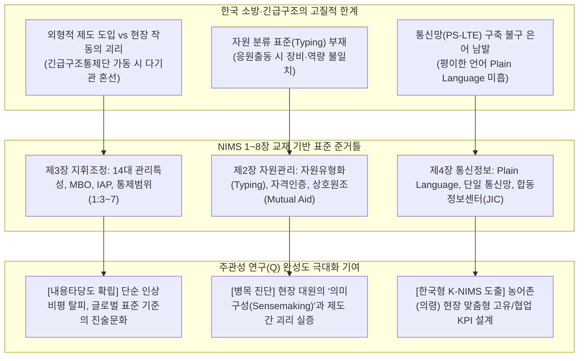
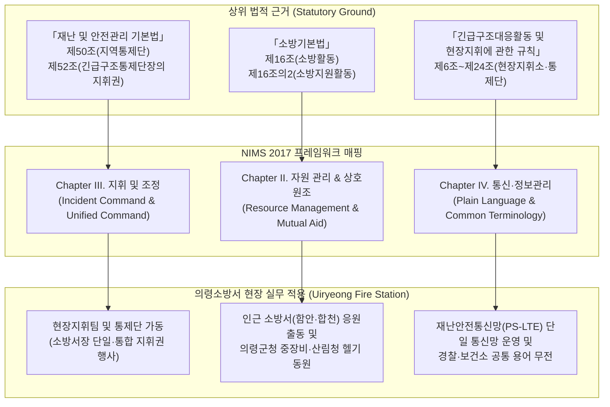
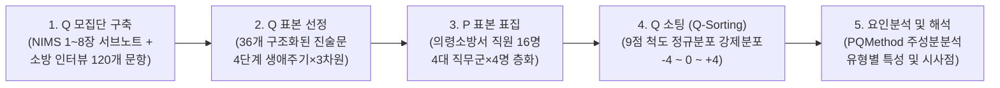
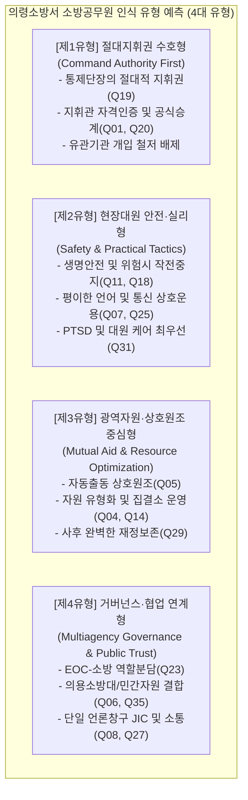
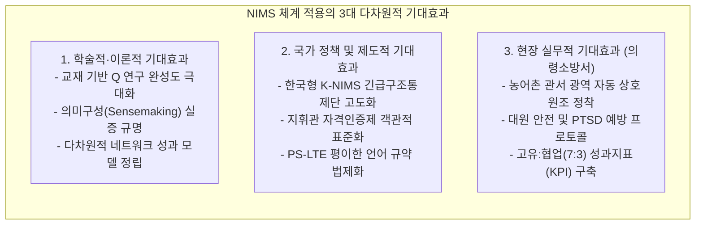

# [연구계획서] NIMS 기반 현장대응 및 다기관 협업체계에 대한 소방공무원의 주관적 인식 유형 연구
## - 도농복합·농어촌 지역(경남 의령소방서) 실무진 및 지휘관의 Q방법론적 접근 -
### [과목명: 「현장지휘론」 기말 학술 연구과제 / LMS 등록 제출용]

---

## Executive Summary (연구계획 개요)

| 항목 | 세부 내용 |
| :--- | :--- |
| **연구과제명** | **NIMS(National Incident Management System) 기반 긴급구조 및 다기관 협업체계에 대한 소방공무원의 주관적 인식 유형 분석: 경남 의령소방서를 중심으로** |
| **과목 연계** | **대학원 재난안전전공 「현장지휘론」 기말 연구 프로젝트** |
| **연구방법론** | **주관성 연구방법론 (Q-Methodology)** |
| **이론적 토대** | 미국 FEMA NIMS (2017 제3판, 제1장~제8장 교재 전반), 사회적 의미구성(Sensemaking), 네트워크 조직이론, 다차원적 성과(Multidimensional Performance) |
| **법적·제도적 근거** | 「재난 및 안전관리 기본법」 (제50조~제55조), 「소방기본법」 (제16조 등), 「119구조·구급에 관한 법률」, 「긴급구조대응활동 및 현장지휘에 관한 규칙」(소방청령) |
| **P 표본 (P-Sample)** | **경남 의령소방서 소속 소방공무원 16명** (전체 정원 약 100명 중 4대 핵심 직무군별 4명씩 4×4 균등 층화표집) |
| **Q 표본 (Q-Sample)** | **구조화된 36개 Q 진술문** (NIMS 1~8장 핵심 원리와 현장 소방 업무 생애주기 4단계를 결합한 4×3 매트릭스 설계) |
| **핵심 제안 취지** | **① 한국 현장지휘체계에 왜 NIMS 체계 기반의 진술문이 필수적인가(한국적 당위성 규명)**<br/>**② NIMS 표준 프레임워크를 한국 소방 실무에 적용함에 따른 다차원적 기대효과 제시** |
| **분석 도구** | PQMethod 2.35 및 Ken-Q Analysis (주성분분석 PCA 및 Varimax 직교회전) |
| **연구 기간** | **2026년 11월 (총 4주 완성 단기 집중 프로젝트 / 학기말 기말과제)** |

---

# 제1장 서론 (Introduction)

## 1. 연구 배경 및 필요성

### 1.1 도농복합·농어촌 지역 소방력의 현실적 한계와 다기관 협업의 불가피성
- **관할 특성과 취약성:** 경상남도 의령군은 전형적인 농어촌·산악 지형이 혼재된 도농복합 지역으로, 급격한 인구 고령화와 넓은 지리적 관할 구역에 비해 소방 인력과 가용 특수 장비의 자원 보유량(Resource Endowment)이 대도시 소방서 대비 제한적이다.
- **사건의 복잡성 증대:** 기후변화로 인한 대형 산불, 집중호우로 인한 급경사지 붕괴, 농공단지 화재, 다수사상자 발생 교통사고 등 현대 재난은 단일 소방력만으로 해결할 수 없는 복합 재난(Complex Incidents) 형태로 전개된다.
- **상호원조 및 지휘조정의 중요성:** 따라서 인접 관할(함안, 합천, 진주, 창녕 등) 소방력의 광역 응원출동(Mutual Aid), 의령군청(EOC/재난안전대책본부), 의령경찰서, 군부대(제39보병사단 등), 한전 등과의 긴밀한 통합지휘(Unified Command) 및 상호운용성(Interoperability) 확보가 필수적이다.

### 1.2 소방공무원 주관성(Subjectivity) 연구의 필요성
- 제도와 매뉴얼이 정교화되더라도, 실제 재난 현장에서 작동 여부를 결정하는 것은 현장 대원과 지휘관의 **'주관적 지각(Perception)'**과 **'상황에 대한 의미구성(Sensemaking)'**이다.
- 현장 진압대원, 구조·구급대원, 상황 지휘관, 행정·지원 요원이 체감하는 지휘체계, 자원 동원, 타 기관 협업에 대한 인식의 구조적 차이를 규명하지 않고서는 현장 수용성 높은 재난대응 혁신을 이룰 수 없다.

---

### 1.3 🚨 [교수님 중점 지도사항] 한국 긴급구조체계에 왜 NIMS 체계 기반의 진술문이 필수적인가? (한국적 적용 당위성)

본 연구가 일반적인 소방 실무 설문이 아닌, **미국 FEMA NIMS(National Incident Management System, 2017) 1장~8장 교재를 엄밀한 뼈대로 삼아 Q 진술문을 도출하는 당위성과 학술적 필요성**은 다음 3가지 차원에서 규명된다:



#### 1) 외형적 제도 도입(Decoupling)의 극복을 위한 글로벌 표준 잣대 제공
- 한국은 미국 NIMS의 핵심 하위체계인 ICS(현장지휘체계)를 벤치마킹하여 「긴급구조대응활동 및 현장지휘에 관한 규칙」상 현장지휘소 및 긴급구조통제단 제도를 법제화하였다.
- 그러나 실무 현장에서는 **법정 서식과 직제만 모방했을 뿐, NIMS가 규정한 14대 핵심 관리특성(모듈형 확장, 적정 통제범위 3~7명, 사건행동계획 IAP 수립, 단일·통합지휘)의 작동 원리가 현장 대원들의 행동 양식으로 내재화되지 못하는 구조적 괴리(Decoupling)**를 겪고 있다.
- 따라서 교재(NIMS 2017 제1장~제8장)에 정립된 확고한 원리와 표준 용어를 토대로 진술문을 도출해야만, 한국 긴급구조체계의 어느 지점에서 제도와 실무 간 병목(Bottleneck)이 발생하는지 정확한 임계점을 진단할 수 있다.

#### 2) 주관성 연구(Q-Methodology)의 내용타당도(Content Validity) 및 학술적 완성도 제고
- 주관성 연구에서 Q 진술문이 연구자의 주관적 편향이나 일선 대원들의 단순한 불만 토로(인상비평) 수준에 머무를 경우, 도출된 유형의 학술적 일반화와 정책적 설득력은 급격히 저하된다.
- **NIMS 제1장(기본원리)부터 제2장(자원관리), 제3장(지휘조정), 제4장(통신관리), 제6~8장(용어·약어·법령 리소스)**에 이르는 전 챕터의 정밀 분석 데이터를 바탕으로 진술문을 체계화함으로써, **Q 모집단(Concourse)의 학술적 무결성과 구조적 내용타당도**를 최고 수준으로 확보할 수 있다.

#### 3) 다기관 협업(Interoperability) 및 상호운용성의 객관적 측정 도구 확보
- 한국 재난 현장의 가장 큰 취약점은 소방-경찰-지자체(군청)-보건소-군부대 간의 '협업 실패'이다. 국가 재난안전통신망(PS-LTE) 장비는 보급되었으나, 기관 간 무전 은어 사용, 지휘권 갈등, 정보 비대칭이 상존한다.
- NIMS가 전 세계적으로 입증한 **평이한 언어(Plain Language), 자원 유형화(Resource Typing), 합동정보시스템(JIS), 다기관조정그룹(MAC Group)** 개념을 진술문에 직접 투영하여, 일선 소방공무원들이 다기관 협업 체계를 실제로 어떻게 '지각(Perception)'하고 '평가(Evaluation)'하는지 실증적으로 측정하는 유일무이한 평가 틀을 제공한다.

---

## 2. 연구 목적 및 연구 질문 (Research Questions)

### 2.1 연구 목적
1. **NIMS 1~8장 핵심 프레임워크와 한국 소방 법령을 접목**하여 농어촌 소방 현장에 부합하는 Q 모집단(Concourse)과 Q 진술문(Q-Sample)을 도출한다.
2. 경남 의령소방서 실무 대원 및 지휘관(P 표본)을 대상으로 Q 소팅(Q-sorting)을 실시하여, **현장대응 및 다기관 협업체계에 대한 소방공무원의 주관적 인식 유형(Typology)**을 실증적으로 발견·구조화한다.
3. 도출된 인식 유형별 특성, 일치 진술문(Consensus Items), 갈등·차별 진술문(Distinguishing Items)을 비교 분석하여 **현장 중심의 긴급구조 지휘역량 강화 방안 및 협업 지표(KPI)**를 제언한다.

### 2.2 핵심 연구 질문 (Research Questions)
- **RQ 1:** NIMS 프레임워크(자원관리, 지휘조정, 통신정보, 상호원조 등) 관점에서 의령소방서 소방공무원들이 인식하는 현장 재난대응의 핵심 우선순위 유형은 어떻게 분류되는가?
- **RQ 2:** 직급(대원 vs 초급간부 vs 지휘관), 보직(화재진압/구조대 vs 지휘조사 vs 내근행정), 근무 경력에 따라 다기관 협업 및 지휘체계에 대한 인식 차이가 어떻게 나타나는가?
- **RQ 3:** 각 인식 유형 간 공통적으로 동의하는 합의 영역(Consensus)과 극명하게 대립하는 갈등 영역은 무엇이며, 이를 조율하기 위한 제도적 개선점은 무엇인가?

---

# 제2장 이론적 배경 및 NIMS 1~8장 분석 매핑

## 1. NIMS 2017 챕터별 핵심 내용 및 본 연구와의 연계성

| NIMS 장 (Chapter) | 원문 핵심 개념 (Key Concepts) | 소방 실무 매핑 포인트 | 본 연구 반영 영역 |
| :--- | :--- | :--- | :--- |
| **제1장 기본원리 (Fundamentals)** | 유연성(Flexibility), 표준화(Standardization), 노력의 통일성(Unity of Effort), 3대 우선순위(인명구조, 상황안정, 재산보호) | 소방대응의 불변 가치 및 농어촌 산악·공장 재난 대응의 유연한 조직 확장성 | 대응 철학 및 현장 행동 규범 |
| **제2장 자원 관리 (Resource Management)** | 자원 유형화(Resource Typing), 크레덴셜링(Credentialing), 자원관리 6단계, 상호원조협정(Mutual Aid) | 관할 외 응원 소방력(함안, 합천 등) 및 의령군 중장비·민간 장비 신속 동원 및 검증 | 상호원조, 가용자원 추적 및 현장 투입 |
| **제3장 지휘 및 조정 (Command & Coordination)** | 14대 NIMS 관리특성, ICS 현장지휘, 통합지휘(UC), 통제범위(Span of Control: 3~7명), EOC/MAC Group 연계 | 통제단장(소방서장) 지휘권, 의령군 재대본/통합지원본부와의 역할 분담, 경찰과의 합동 통제 | 현장지휘소 운영, 통합지휘, 지휘권 확립 |
| **제4장 통신 및 정보관리 (Communications & Info)** | 공통 용어(Common Terminology), 평이한 언어(Plain Language), 통신 상호운용성, 정보 보안, IAP | 재난안전통신망(PS-LTE) 무전 프로토콜 표준화, 은어·무전약어 배제, 무전 혼선 방지 | 현장 무전 교신, 다기관 합동 브리핑 |
| **제5장 결론 (Conclusion)** | 전 지역사회(Whole Community) 통합, 지속적 훈련 및 연습(Exercises)을 통한 체계 완성 | 의령군 의용소방대, 민간자원봉사자 연계 및 불시 긴급구조통제단 가동 훈련 | 지속적 역량강화 및 지역사회 협력 |
| **제6장 용어 해설 (Glossary)** | 142개 공식 표준 용어, 직함 표준화(Command Staff, Section Chief 등) | 지휘관-참모-담당관 간의 표준화된 직무 명칭 인지 및 역할 명확화 | 직무 혼선 예방 및 표준 체계 구축 |
| **제7장 약어 목록 (Abbreviations)** | 52개 표준 약어(AHJ, EOC, IAP, IMT, JIS, MACS, UC 등) | 전문 약어의 공통 이해 및 재난 보고서·상황판 표준 표기 | 문서화 및 다기관 합동 소통 |
| **제8장 리소스 및 법령 (Resources)** | FEMA 가이드라인, ICS 표준 서식(Forms), 국가준비체계(NPS), CPG 101/201 | 재난안전법, 소방청 훈령·규칙 및 표준 ICS 서식의 국내 실무 적용성 | 법적 구속력 및 제도적 실행력 |

---

## 2. 관련 법령 및 규정과의 조문 단위 매핑



---

# 제3장 연구 설계 및 방법론 (Methodology)

## 1. Q방법론의 학술적 타당성 및 연구 흐름도

Q방법론(Q-Methodology)은 인간의 심리적 태도, 신념, 가치관 등 인간의 **내적 주관성(Operant Subjectivity)**을 양량적으로 측정·분석할 수 있는 독보적인 혼합연구방법(Mixed Method)이다. 본 연구는 NIMS 1~8장의 이론적 기준을 바탕으로 의령소방서 조직원들의 주관적 관점을 심층 조명한다.



---

## 2. Q 표본(Q-Sample)의 구조화 매트릭스 설계

Q 진술문의 대표성과 편향 방지를 위해, 재난관리 생애주기 4단계(예방/대비, 초기대응/현장착수, 확대대응/지휘조정, 복구/철수)와 NIMS 핵심 3대 차원(지휘·통제체계, 자원관리·상호원조, 통신·정보·협업)을 결합한 **4 × 3 매트릭스(Matrix)**를 적용하여 총 36개의 진술문을 추출하였다.

| 업무 생애주기 단계 | A. 지휘·통제체계 (Command & Control) | B. 자원관리 및 상호원조 (Resource & Mutual Aid) | C. 통신·정보 및 다기관 협업 (Comms & Coordination) | 합계 |
| :--- | :---: | :---: | :---: | :---: |
| **1단계: 예방 및 대비 (Preparedness)** | Q01, Q02, Q03 | Q04, Q05, Q06 | Q07, Q08, Q09 | 9문항 |
| **2단계: 초기대응 및 현장착수 (Initial Response)** | Q10, Q11, Q12 | Q13, Q14, Q15 | Q16, Q17, Q18 | 9문항 |
| **3단계: 확대대응 및 지휘조정 (Extended Command)** | Q19, Q20, Q21 | Q22, Q23, Q24 | Q25, Q26, Q27 | 9문항 |
| **4단계: 복구 및 평가·철수 (Recovery & Demob)** | Q28, Q29, Q30 | Q31, Q32, Q33 | Q34, Q35, Q36 | 9문항 |
| **합 계** | **12문항** | **12문항** | **12문항** | **36문항** |

---

## 3. 구조화된 36개 Q 진술문 (Q-Sample Statements) 전수

> [!NOTE]
> 각 진술문은 NIMS 1~8장 서브노트의 핵심 개념과 국내 소방 관계 법령, 그리고 의령소방서의 도농복합·산악 지형 현장 실무 특성을 철저히 반영하여 작성되었습니다.

### [1단계: 예방 및 대비 단계 (Preparedness Phase)]

*   **Q01. (지휘역량 사전인증)**
    *   **진술문:** "현장지휘관의 개인적 직관이나 계급(연공서열)보다는, 사전에 표준화된 평가와 훈련을 거쳐 지휘 역량을 공인하는 '현장지휘관 자격인증제'가 우선 확립되어야 한다."
    *   **매핑 근거:** NIMS 제2장 1.2 자격·인증·크레덴셜링(Qualifying, Certifying, and Credentialing Personnel, p. 7)
    *   **법적 근거:** 「소방공무원 임용령」 제44조 및 「소방청 현장지휘관 자격인증제 운영규정」
    *   **지표 성격:** 소방 고유 (70%)

*   **Q02. (목표 기반 사전 계획)**
    *   **진술문:** "관내 농공단지나 전통시장 등 고위험 대상물에 대해, 막연한 지침 대신 단계별 진압 목표와 소방력 투입이 명시된 구체적인 '표준 사전작전계획서'가 수립되어 있어야 실제 출동 시 즉각 작동한다."
    *   **매핑 근거:** NIMS 제3장 1.1 MBO 및 사건행동계획(Incident Action Planning, pp. 21, 105)
    *   **법적 근거:** 「소방기본법」 제8조(소방력의 기준 및 소방용수시설의 설치 등) 및 소방활동 자료조사 규정
    *   **지표 성격:** 소방 고유 (80%)

*   **Q03. (모듈형 조직 설계)**
    *   **진술문:** "의령과 같은 소규모 소방서는 평시에는 간소한 편제로 운영되더라도, 재난 규모 확대 시 즉시 4대 일반참모(작전, 기획, 보급, 재정) 체계로 신속히 팽창할 수 있는 모듈형 확장 체계가 필수적이다."
    *   **매핑 근거:** NIMS 제3장 1.1 모듈형 조직(Modular Organization, p. 20) 및 ICS Tab 1
    *   **법적 근거:** 「긴급구조대응활동 및 현장지휘에 관한 규칙」 제6조(현장지휘소 설치·운영)
    *   **지표 성격:** 소방 고유 (80%)

*   **Q04. (지역 맞춤형 자원 유형화)**
    *   **진술문:** "산악 험로와 좁은 농로가 많은 의령군 지형 특성을 고려하여, 보유 소방장비와 민간 중장비의 성능과 규격을 사전에 명확히 분류하여 자원 목록으로 정리해 두어야 한다."
    *   **매핑 근거:** NIMS 제2장 1.1 자원 식별 및 유형화(Identifying and Typing Resources, pp. 6–7)
    *   **법적 근거:** 「재난 및 안전관리 기본법」 제34조(재난관리자원의 비축·관리 등)
    *   **지표 성격:** 소방/지자체 협업 (50:50)

*   **Q05. (인근 관서 간 선제적 상호원조 협약)**
    *   **진술문:** "의령의 한정된 소방력 극복을 위해서는 함안·합천·진주 등 인접 소방서와의 상호 응원출동 협약이 단순한 서류상 협약에 그치지 않고, 관할 경계를 넘는 '즉각 자동 공동출동' 체계로 발전해야 한다."
    *   **매핑 근거:** NIMS 제2장 3.1 상호원조 협정(Mutual Aid Agreements and Compacts, p. 17)
    *   **법적 근거:** 「소방기본법」 제11조(소방응원) 및 광역 소방응원출동 협정
    *   **지표 성격:** 광역 협업 (70%)

*   **Q06. (민간·의소대 비축 자원 통합 관리)**
    *   **진술문:** "의령군 의용소방대와 지역 민간단체가 보유한 산화 진화장비, 굴삭기, 트랙터 등 민간 자원의 가용성을 사전 등록 시스템에 상시 연계·관리하는 것이 재난 대비의 핵심이다."
    *   **매핑 근거:** NIMS 제2장 1.4 자원 획득·보관·재고관리(Acquiring, Storing, and Inventorying, p. 9)
    *   **법적 근거:** 「의용소방대 설치 및 운영에 관한 법률」 제7조(임무)
    *   **지표 성격:** 민관 협업 (60%)

*   **Q07. (평이한 언어 통신 규약 훈련)**
    *   **진술문:** "경찰, 군부대, 군청 등과의 합동 대응 훈련 시 소방 전용 무전 은어나 복잡한 무전 약어 사용을 금지하고, 누구나 알기 쉬운 표준 일상 용어로 교신하는 것을 의무화해야 한다."
    *   **매핑 근거:** NIMS 제4장 3.1 공통 용어 및 평이한 언어(Common Terminology, Plain Language, p. 57)
    *   **법적 근거:** 「재난 및 안전관리 기본법」 제74조의2(재난안전통신망의 구축·운영)
    *   **지표 성격:** 기관간 협업 (60%)

*   **Q08. (합동정보시스템 사전 구축)**
    *   **진술문:** "재난 발생 시 군민들의 불안과 가짜뉴스 확산을 막기 위해, 소방과 의령군 공보부서가 단일한 정보를 주민과 언론에 알리는 '공동 언론·공보 협의체'를 사전에 가동해야 한다."
    *   **매핑 근거:** NIMS 제3장 5.1 합동정보시스템(Joint Information System, pp. 42–46)
    *   **법적 근거:** 「재난 및 안전관리 기본법」 제38조의2(재난 예보·경보의 발령 등)
    *   **지표 성격:** 대외 협업 (50:50)

*   **Q09. (불시 불능 대비 통신 대체수단 확보)**
    *   **진술문:** "산간 오지 통신 음영구역이 많은 관내 특성을 감안할 때, 주 무전망이 먹통이 될 때를 대비하여 즉각 대체할 수 있는 보조 무전 주파수와 위성통신 훈련이 정기적으로 이루어져야 한다."
    *   **매핑 근거:** NIMS 제4장 1.4 장비 표준 및 통신 탄력성(Equipment Standards, p. 53)
    *   **법적 근거:** 소방청 무전통신 보안 및 운영관리 규정
    *   **지표 성격:** 소방 고유 (70%)

---

### [2단계: 초기대응 및 현장착수 단계 (Initial Response Phase)]

*   **Q10. (단일 지휘체계에 의한 지휘권 선점)**
    *   **진술문:** "현장 도착 초기 혼란을 막기 위해, 가장 먼저 도착한 선착대장이 계급의 고하를 막론하고 공식적으로 지휘권을 선언하고 지휘 거점을 확보하는 것이 최우선 과제이다."
    *   **매핑 근거:** NIMS 제3장 1.1 지휘권 수립 및 인계(Establishment and Transfer of Command, p. 22)
    *   **법적 근거:** 「긴급구조대응활동 및 현장지휘에 관한 규칙」 제10조(현장도착 선착대의 임무)
    *   **지표 성격:** 소방 고유 (90%)

*   **Q11. (생명 안전 최우선 원칙 강제)**
    *   **진술문:** "사건 초기 어떠한 전술적 판단이나 재산 보호 조치보다, 현장 출동 대원의 안전과 인명 구조가 절대적인 제1우선순위로 고정되어야 한다."
    *   **매핑 근거:** NIMS 제1장 1.1 3대 우선순위(Save Lives, Stabilize Incidents, Protect Property, p. 1)
    *   **법적 근거:** 「소방기본법」 제16조 및 「소방공무원 보건안전 및 복지 기본법」
    *   **지표 성격:** 소방 고유 (90%)

*   **Q12. (적정 통제범위 준수)**
    *   **진술문:** "초기 현장지휘관 1명이 직접 지휘하는 대원이나 분대 수가 5명을 초과하면 지휘 통제가 무너지므로, 즉시 현장을 구역별·기능별 지휘조로 나누어 중간 지휘관을 두어야 한다."
    *   **매핑 근거:** NIMS 제3장 1.1 관리 가능한 통제범위(Manageable Span of Control: 1:3~1:7, p. 21)
    *   **법적 근거:** 「긴급구조대응활동 및 현장지휘에 관한 규칙」 제15조(현장지휘소 편성)
    *   **지표 성격:** 소방 고유 (80%)

*   **Q13. (선제적 자원 소요 예측 및 즉각 요청)**
    *   **진술문:** "농어촌 현장 특성상 응원 지원대가 도착하기까지 상당한 시간이 소요되므로, 선착대장은 현장 확인 즉시 가용 소방력을 과대평가하지 말고 최대 필요 자원을 조기에 선제 요청해야 한다."
    *   **매핑 근거:** NIMS 제2장 2.1 사건 중 필요 자원 식별(Identifying Requirements, p. 12)
    *   **법적 근거:** 「재난 및 안전관리 기본법」 제51조(긴급구조통제단의 운영 등)
    *   **지표 성격:** 소방 고유/광역지원 (70:30)

*   **Q14. (자원 집결소(Staging Area)의 초기 지정)**
    *   **진술문:** "응원 출동하는 타 관서 차량과 장비가 현장 주변 진입로를 막지 않도록, 초기 단계부터 현장 인근에 명확한 '소방 자원집결소'를 지정·운영해야 한다."
    *   **매핑 근거:** NIMS 제3장 1.1 사건 시설 및 집결소(Staging Areas, pp. 22, 31)
    *   **법적 근거:** 「긴급구조대응활동 및 현장지휘에 관한 규칙」 제16조(자원집결지 운영)
    *   **지표 성격:** 소방 고유 (80%)

*   **Q15. (무단 출동 자원 통제 및 등록)**
    *   **진술문:** "공식 파견 명령 없이 자발적으로 현장에 진입하는 의용소방대나 자원봉사 인력은 지휘부의 사전 등록과 임무 부여 절차를 거치지 않으면 현장 투입을 엄격히 차단해야 한다."
    *   **매핑 근거:** NIMS 제2장 2.3 동원 및 체크인(Mobilizing, p. 15) 및 제3장 문지기 통제(Self-Dispatch 금지)
    *   **법적 근거:** 「긴급구조대응활동 및 현장지휘에 관한 규칙」 제17조(현장통제선 설치 등)
    *   **지표 성격:** 소방 통제권 (80%)

*   **Q16. (상황판단 브리핑 및 표준 서식 공유)**
    *   **진술문:** "출동대 및 유관기관 간 상황 인식을 일치시키기 위해, 무전이나 구두 보고에만 의존하지 말고 초기 30분 이내에 표준화된 핵심 상황판단서식(상황요약표)이 공유되어야 한다."
    *   **매핑 근거:** NIMS 제4장 2.1 사건 보고서 및 ICS Form 201(Incident Briefing, pp. 54, 111)
    *   **법적 근거:** 소방청 상황보고 및 통제단 운영 매뉴얼
    *   **지표 성격:** 소방/기관간 (70:30)

*   **Q17. (초기 경찰 치안 협업 및 현장통제선 설정)**
    *   **진술문:** "초기 현장 접근로 확보와 군중 통제는 소방 단독으로 불가능하므로, 의령경찰서와의 즉각적인 현장 공조를 통한 출입 통제선 설정이 현장 안정화의 최우선이다."
    *   **매핑 근거:** NIMS 제3장 1.2 통합지휘 및 지휘참모-안전/보안(Command Staff, pp. 24, 27)
    *   **법적 근거:** 「경찰관 직무집행법」 제5조 및 「재난 및 안전관리 기본법」 제52조
    *   **지표 성격:** 기관간 협업 (50:50)

*   **Q18. (초기 현장 위험구역 안전장교 독립권 보장)**
    *   **진술문:** "급격한 연소 확대나 붕괴 징후 포착 시, 현장 안전점검관(안전담당)은 지휘관의 결재 없이도 대원 대피 및 작전 중지 명령을 즉각 내릴 수 있어야 한다."
    *   **매핑 근거:** NIMS 제3장 1.2 안전담당관의 직무 권한(Safety Officer, pp. 27, 83)
    *   **법적 근거:** 「소방공무원 보건안전 및 복지 기본법」 제14조 및 현장안전점검관 운영지침
    *   **지표 성격:** 소방 고유 (90%)

---

### [3단계: 확대대응 및 지휘조정 단계 (Extended Command Phase)]

*   **Q19. (긴급구조통제단 중심의 통합지휘권 확립)**
    *   **진술문:** "대형 재난 확대 시 군청, 경찰, 보건소, 군부대 등 모든 참여 기관은 재난안전법 제52조에 명시된 소방서장(긴급구조통제단장)의 총괄 지휘 통제를 전적으로 수용해야 한다."
    *   **매핑 근거:** NIMS 제3장 1.1 통합지휘(Unified Command, pp. 22, 24)
    *   **법적 근거:** 「재난 및 안전관리 기본법」 제52조(긴급구조통제단장의 현장지휘)
    *   **지표 성격:** 법적 강제 지휘권 (90%)

*   **Q20. (지휘권 인계의 공식화 및 문서화)**
    *   **진술문:** "선착대장에서 소방서장으로의 지휘권 인계는 구두로 얼버무려서는 안 되며, 현장 상황과 가용 자원을 정확히 기재한 정식 브리핑 절차를 거쳐 전 대원에게 공식 공표되어야 한다."
    *   **매핑 근거:** NIMS 제3장 1.1 지휘권 인계 절차(Transfer of Command, p. 22)
    *   **법적 근거:** 「긴급구조대응활동 및 현장지휘에 관한 규칙」 제11조(지휘권의 선언 및 승계)
    *   **지표 성격:** 소방 고유 (90%)

*   **Q21. (작전기간 단위 사건행동계획(IAP) 작성 및 준수)**
    *   **진술문:** "장기화되는 대형 산불이나 공장 화재에서는 주먹구구식 지시를 배제하고, 다음 작전 시간대 동안의 진화 목표와 부서별 임무가 명시된 '서면 작전계획서'가 반드시 문서로 하달되어야 한다."
    *   **매핑 근거:** NIMS 제3장 1.1 사건행동계획(Incident Action Plans, pp. 21, 54, 105)
    *   **법적 근거:** 「긴급구조대응활동 및 현장지휘에 관한 규칙」 제18조(긴급구조대응계획의 집행)
    *   **지표 성격:** 소방 고유 (80%)

*   **Q22. (전방위 실시간 자원 추적 시스템)**
    *   **진술문:** "투입된 소방차량 및 대원의 위치와 상태(할당, 사용 중, 대기, 이동 중)가 지휘소 상황판에 실시간으로 업데이트되지 않는 자원 관리는 현장 마비를 초래한다."
    *   **매핑 근거:** NIMS 제2장 2.4 자원 추적 및 보고(Tracking and Reporting, p. 16)
    *   **법적 근거:** 소방청 무선자원관리 및 현장영상 전송 시스템 운용 규정
    *   **지표 성격:** 소방 고유 (80%)

*   **Q23. (지자체 EOC와 현장지휘소(ICP) 간 명확한 역할 분담)**
    *   **진술문:** "의령군청 상황실(재난안전대책본부)은 소방의 현장 전술에 일일이 간섭하지 말고, 도로 통제, 이재민 구호, 병원 후송 병상 확보 등 후방 행정지원에 전념해야 한다."
    *   **매핑 근거:** NIMS 제3장 2.0 긴급대응센터와 현장의 상호작용(EOC Interconnectivity, pp. 35, 47)
    *   **법적 근거:** 「재난 및 안전관리 기본법」 제16조(지역재난안전대책본부의 수습지원)
    *   **지표 성격:** 기관간 협업 (50:50)

*   **Q24. (다수사상자 발생 시 보건소 DMAT과의 지휘 일원화)**
    *   **진술문:** "교통사고나 다수사상자 현장에서 의령군 보건소 신속대응반과 병원 재난의료지원팀은 소방 현장지휘소의 환자 중증도 분류와 이송 지시를 무조건 따라야 환자 분산이 성공한다."
    *   **매핑 근거:** NIMS ICS Tab 4/Tab 10 구급 및 의료단(Medical Unit, pp. 96, 114)
    *   **법적 근거:** 「119구조·구급에 관한 법률」 제13조 및 다수사상자 구급대응 표준매뉴얼
    *   **지표 성격:** 응급의료 협업 (60%)

*   **Q25. (재난안전통신망(PS-LTE) 단일 공통통신망 강제)**
    *   **진술문:** "지휘관 회의나 현장 무전 시 기관별 개별 무전기를 사용하지 않고, 유관기관끼리 단일한 '공통 무전 통화채널' 하나로 지휘 통신을 통일하는 것이 협업의 승패를 가른다."
    *   **매핑 근거:** NIMS 제4장 1.1 통합 통신(Integrated Communications, pp. 22, 52)
    *   **법적 근거:** 「재난 및 안전관리 기본법」 제74조의2(재난안전통신망의 사용 의무)
    *   **지표 성격:** 전 기관 협업 (60%)

*   **Q26. (다기관조정그룹(MAC Group) 정책 갈등 실시간 해소)**
    *   **진술문:** "소방서장, 의령군수, 경찰서장 등 유관기관 기관장들이 현장 조정회의에 직접 참여하여 헬기 투입 우선순위나 주민 대피 명령 등 고위험 전략 결정을 즉시 타결해야 한다."
    *   **매핑 근거:** NIMS 제3장 3.0 다기관조정그룹(Multiagency Coordination Group, pp. 40–41)
    *   **법적 근거:** 「재난 및 안전관리 기본법」 제54조(재난수습 주관기관 등의 지원요청)
    *   **지표 성격:** 고위 정책 협업 (50:50)

*   **Q27. (단일 언론 창구(JIC) 가동을 통한 왜곡 방지)**
    *   **진술문:** "재난 현장에서 각 기관(군청, 경찰, 소방)이 개별적으로 언론 브리핑을 하는 것을 금지하고, 현장지휘소 내 '통합 언론창구'를 통해 일원화된 피해 집계만 발표해야 한다."
    *   **매핑 근거:** NIMS 제3장 5.1 합동정보센터(Joint Information Center, pp. 43–45)
    *   **법적 근거:** 소방청 긴급구조대응 브리핑 규정 및 언론대응 매뉴얼
    *   **지표 성격:** 기관간 협업 (50:50)

---

### [4단계: 복구 및 평가·철수 단계 (Recovery & Demob Phase)]

*   **Q28. (우선순위에 입각한 단계적 자원 해제 및 철수계획)**
    *   **진술문:** "재난이 진화 국면에 접어들었을 때 모든 소방력이 임의로 한꺼번에 철수해서는 안 되며, 잔화 감시와 안전 관리를 위한 '단계적 자원 철수 계획'에 따라 순차 철수해야 한다."
    *   **매핑 근거:** NIMS 제2장 2.5 자원 해제(Demobilizing, p. 16) 및 ICS Tab 3
    *   **법적 근거:** 「긴급구조대응활동 및 현장지휘에 관한 규칙」 제22조(통제단 해제 및 복구)
    *   **지표 성격:** 소방 고유 (80%)

*   **Q29. (재정 보상 및 자원 재비축 체계 보장)**
    *   **진술문:** "원거리 응원 출동을 온 타 소방서 차량의 유류비, 파손 장비, 파견 대원의 식대 등은 사후 완벽하게 보전·정산(경비 실비 정산)되어야 다음 상호응원출동이 보장된다."
    *   **매핑 근거:** NIMS 제2장 2.6 보상 및 재비축(Reimbursing and Restocking, p. 16) 및 ICS Tab 5
    *   **법적 근거:** 「소방기본법」 제11조 제4항(응원출동 소요경비의 부담)
    *   **지표 성격:** 행정·재정 지원 (70%)

*   **Q30. (비난 없는 사건 후 검토(AAR) 제도화)**
    *   **진술문:** "작전 종료 후 실시하는 현장 강평(사후 검토)은 대원의 실책을 문책하는 자리가 아니라, 시스템의 결함과 무전 혼선을 솔직하게 드러내는 조직 학습의 장이 되어야 한다."
    *   **매핑 근거:** NIMS 제1장 및 제5장 지속적 개선 및 훈련(Continuous Improvement, pp. 5, 60)
    *   **법적 근거:** 소방청 긴급구조활동 평가 및 개선에 관한 규정
    *   **지표 성격:** 조직 문화 (90%)

*   **Q31. (현장 대원 외상후 스트레스(PTSD) 즉각 개입)**
    *   **진술문:** "대형 화재나 다수 참사 수습 직후, 지휘부는 현장 정리보다 투입 대원들의 심리적 충격을 줄이기 위한 전문 심리상담과 동료 간 소통(마음 돌봄)을 즉각 의무적으로 시행해야 한다."
    *   **매핑 근거:** NIMS ICS Tab 4 의료단(Medical Unit 대원 건강관리, p. 96)
    *   **법적 근거:** 「소방공무원 보건안전 및 복지 기본법」 제10조(소방공무원의 건강관리 등)
    *   **지표 성격:** 소방 고유 (90%)

*   **Q32. (지자체로의 수습·복구 권한 공식 이양)**
    *   **진술문:** "인명 검색과 긴급 화재 진압이 종료되는 즉시, 현장지휘통제 권한은 의령군수(재난안전대책본부)에게 공식 문서로 신속히 인계되고 소방은 본연의 대비 태세로 복귀해야 한다."
    *   **매핑 근거:** NIMS 제3장 1.1 지휘권 종결 및 EOC 권한 이양(Deactivation, pp. 22, 38)
    *   **법적 근거:** 「재난 및 안전관리 기본법」 제53조(수습활동에의 협조 등)
    *   **지표 성격:** 지자체 협업 (50:50)

*   **Q33. (합동 사후평가서 작성 및 개선과제 법제화)**
    *   **진술문:** "소방 단독 평가에 그치지 않고 경찰, 군청, 한전 등이 다 함께 참여하는 '기관 합동 사후평가 보고서'를 공식 작성하여 개선 대책에 의무 반영해야 한다."
    *   **매핑 근거:** NIMS 제8장 CPG 101/CPG 201 사후 평가 지침(pp. 76–77)
    *   **법적 근거:** 「재난 및 안전관리 기본법」 제10조의2(재난안전관리 특별교부세 및 평가)
    *   **지표 성격:** 다기관 협업 (50:50)

*   **Q34. (오염 장비 및 소방 차량 전문 제독 복구)**
    *   **진술문:** "유해화학물질이나 농약 누출 사고 대응 후, 소방차량과 보호장비에 대한 전문 세척·소독(제독)과 정비가 끝날 때까지 해당 장비의 재출동 배치를 엄격히 제한해야 한다."
    *   **매핑 근거:** NIMS 제2장 2.6 자원 재비축 및 정비(Restocking and Maintenance, p. 16)
    *   **법적 근거:** 소방장비관리법 제12조 및 유해물질 대응 표준작전절차
    *   **지표 성격:** 소방 고유 (90%)

*   **Q35. (민간 참여 자원에 대한 제도적 손실보상)**
    *   **진술문:** "산불 진화에 동원된 의용소방대원이나 민간 중장비 기사의 유류비 및 장비 파손에 대한 신속하고 충분한 보상이 행정적으로 담보되어야 향후 민간 협력이 유지된다."
    *   **매핑 근거:** NIMS 제2장 3.1 상호원조 보상(Mutual Aid Reimbursing, p. 17)
    *   **법적 근거:** 「재난 및 안전관리 기본법」 제65조(치료 및 보상금)
    *   **지표 성격:** 행정 협업 (60%)

*   **Q36. (다기관 협업 데이터의 디지털 자산화)**
    *   **진술문:** "재난 대응 중 기록된 무전 녹음, 드론 영상, 출동 기록 데이터를 향후 지휘관 훈련과 대응 매뉴얼 개선을 위해 공식 디지털 자료로 영구 보관·관리해야 한다."
    *   **매핑 근거:** NIMS 제4장 2.3 데이터 수집 및 처리(Data Collection and Processing, pp. 54–56)
    *   **법적 근거:** 지능정보화 기본법 및 공공데이터의 제공 및 이용 활성화에 관한 법률
    *   **지표 성격:** 스마트 혁신 (60%)

---

## 4. P 표본(P-Sample) 선정 및 표집 계획

### 4.1 의령소방서 조직 특성을 반영한 다차원 표집 전략
- **조직 규모:** 경남 의령소방서는 전체 정원이 약 100명인 소규모 도농복합 관서로, 2개 과(소방행정과, 예방안전과), 1개 단(현장대응단: 지휘조사팀, 구조대), 2개 119안전센터(의령, 부림), 4개 119지역대(칠곡, 정곡, 지정, 신반)로 구성됨.
- **P 표본 크기 최적화:** 총 **16명** (전체 인원의 16%)
  - **학술적 근거:** Q방법론에서 P표본은 인구통계학적 대규모 표본(N)이 아니라 **주관적 관점의 다양성을 대변하는 이론적 표집(Theoretical Sampling)**이 핵심임(Brown, 1980; Watts & Stenner, 2012). 하나의 요인(인식 유형)을 정의하는 데 전형적인 응답자 3~4명이면 충분하므로, 4대 예상 유형에 맞추어 **4개 핵심 직무군 × 4명 = 총 16명**으로 최적화하여 조사의 집중도와 응답의 성실도를 극대화함.

### 4.2 P 표본 층화 매트릭스 (4개 직무군 × 4명 = Total: 16명)

| 구분 | 계급 구성 | 주요 직무 | 표본 수 | 선정 기준 및 이론적 의도 |
| :--- | :--- | :--- | :---: | :--- |
| **① 현장 지휘관 군 (Command Staff)** | 소방령, 소방경 (서장, 과장, 현장대응단장, 지휘팀장) | 통합지휘, 대외협력, 통제단 총괄 | **4명** | NIMS 3장의 지휘조정, MAC Group, 통합지휘권 수호에 대한 인식 확인 |
| **② 구조·진압 팀장 군 (Operations Officers)** | 소방위, 소방장 (센터장, 구조대장, 진압팀장) | 현장 전술 실행, 자원집결, 안전관리 | **4명** | NIMS 1~3장의 모듈형 편제, 통제범위, 선착대 지휘권 승계 체감도 파악 |
| **③ 현장 대원 군 (Field Responders)** | 소방교, 소방사 (화재진압 2, 구조대원 1, 구급대원 1) | 직접 전술 수행, 무전 교신, 대원 안전 | **4명** | NIMS 4장의 평이한 언어, PS-LTE 실효성, 위험회피 독립권(Q18), PTSD 인식 확인 |
| **④ 행정 및 지원군 (Planning & Logistics)** | 소방경, 소방위, 소방교 (예방, 장비, 통신, 의소대 담당) | 자원 비축, 상호원조 정산, 군청·경찰 협업 | **4명** | NIMS 2장의 자원 유형화, 8장의 제도적 보상, EOC-ICP 역할 분담 인식 확인 |
| **합 계** | - | - | **16명** | **4대 핵심 직무군별 완벽한 균형(Balanced) 층화 확보** |

---

## 5. Q 소팅(Q-Sorting) 절차 및 점수화 분포

### 5.1 강제 정규분포(Forced Normal Distribution) 설계
응답자는 36개 진술문 카드를 읽은 후, 자신의 동의 정도에 따라 **9점 척도(-4: 가장 동의하지 않음 ~ 0: 중립 ~ +4: 가장 동의함)**의 정규분포 격자에 카드를 배치함.

```
       [ 가장 동의하지 않음 ]                     [ 중립 ]                     [ 가장 동의함 ]
Score:      -4        -3        -2        -1         0        +1        +2        +3        +4
      ┌─────────┬─────────┬─────────┬─────────┬─────────┬─────────┬─────────┬─────────┬─────────┐
      │  ( 2 )  │  ( 3 )  │  ( 4 )  │  ( 5 )  │  ( 8 )  │  ( 5 )  │  ( 4 )  │  ( 3 )  │  ( 2 )  │
      └─────────┴─────────┴─────────┴─────────┴─────────┴─────────┴─────────┴─────────┴─────────┘
Total: 2 + 3 + 4 + 5 + 8 + 5 + 4 + 3 + 2 = 36 문항
```

### 5.2 심층 사후 인터뷰 (Post-Q Interview)
- 양 극단(-4 및 +4)에 배치한 진술문에 대해 그 이유를 구체적으로 구술하도록 녹음 및 기록.
- 특히 의령 관내 대형 사고 경험(예: 산불, 농공단지 화재 등)에서의 실제 애로사항과 연결하여 질적 데이터(Qualitative Data) 확보.

---

# 제4장 자료 분석 및 예상 결과 (Data Analysis & Expected Findings)

## 1. 통계 분석 기법
- **소프트웨어:** PQMethod Release 2.35 및 Ken-Q Analysis v1.0.8 사용.
- **분석 알고리즘:** 
  1. 상관관계 행렬(Correlation Matrix) 산출
  2. 주성분분석(Principal Component Analysis, PCA)을 통한 초기 요인 추출 (Eigenvalue 1.0 이상)
  3. Varimax 직교회전을 적용하여 단순 구조(Simple Structure) 도출
  4. 요인 가중치(Factor Weight) 기반의 표준점수(Z-score) 및 유형별 대표 배열표(Factor Array) 도출.

---

## 2. 도출 예상 인식 유형 (Hypothesized Subjectivity Types)

선행연구 및 NIMS 프레임워크와 의령소방서의 조직 특성을 종합할 때, 다음과 같은 3~4개의 차별화된 주관성 유형이 도출될 것으로 예측된다:



### 유형별 주요 특징 가설:
1. **제1유형: 절대지휘권 수호형 (Command Authority First)**
   - 주로 현장대응단 지휘조사팀 및 소방경 이상의 지휘관급에서 강하게 나타날 것으로 예상.
   - 「재난안전법」 제52조에 입각한 소방서장의 단일 현장지휘권을 타 기관이 침해해서는 안 된다는 신념이 지배적임 (Q19, Q20, Q10에 강한 긍정).
2. **제2유형: 현장대원 안전·실무형 (Safety & Practical Tactics)**
   - 119구조대 및 안전센터의 실무 진압·구조대원(소방사~소방교)에서 지배적으로 나타날 것으로 예상.
   - 복잡한 행정 서식보다 무전 혼선 방지(Plain language), 즉각적인 안전대피 권한(Safety Officer), 대원 피로도와 PTSD 관리가 실제 작전 성공을 좌우한다고 인식 (Q11, Q18, Q07, Q31에 강한 긍정).
3. **제3유형: 광역자원·상호원조 최적화형 (Resource Optimization)**
   - 장비 담당 및 중간 관리자(소방장~소방위)에서 나타날 것으로 예상.
   - 농어촌의 만성적 자원 부족을 극복하기 위해 인근 함안·합천 소방서와의 자동출동(Mutual Aid) 및 민간 중장비 동원, 사후 재정 정산이 긴급구조의 핵심 동력이라고 평가 (Q04, Q05, Q14, Q29에 강한 긍정).
4. **제4유형: 거버넌스·다기관 연계형 (Multiagency Governance)**
   - 예방안전과, 소방행정과 및 의령군청 파견·협력 경험자들 사이에서 나타날 것으로 예상.
   - 재난의 궁극적 종결은 소방 단독으로 불가능하며 지자체 EOC와의 전략적 협업, 언론 일원화(JIC), 민간 자원 손실보상 등 다차원 거버넌스가 원활해야 한다고 판단 (Q08, Q23, Q27, Q32에 강한 긍정).

---

# 제5장 정책적·학술적 기대효과 및 활용 방안 (Expected Outcomes & Applications)

> [!IMPORTANT]
> **[교수님 중점 지도사항 반영]**
> 본 연구계획서는 NIMS 제1장~제8장 교재 체계를 한국 소방 및 긴급구조 현장에 실증적으로 적용함으로써 도출되는 **① 학술적·이론적 기여**, **② 국가 정책 및 제도적 개선**, **③ 의령소방서 현장 실무 고도화**의 3대 기대효과를 명확히 제시한다.



---

## 1. 학술적·이론적 기대효과 (Theoretical Completion & Contribution)

### 1.1 교재 기반 Q 진술문 도출을 통한 주관성 연구의 방법론적 완성도 극대화
- **내용타당도(Content Validity)의 획기적 제고:** 기존 주관성 연구들이 연구자의 직관이나 임의적 인터뷰 문항에 의존하여 진술문의 대표성이 취약했던 한계를 극복함. 글로벌 재난관리 표준 교재인 NIMS 2017(제1장~제8장)의 원리와 핵심 개념(유연성, 상호운용성, MBO, IAP, 통제범위, 자원유형화 등)을 뼈대로 삼음으로써 **Q 모집단(Concourse)의 학술적 포괄성과 신뢰도를 완벽히 담보**함.
- **다원주의(Pluralism)와 다중 관점(Multiple Perspectives)의 이론적 규명:** 단일 소방 조직 내부에서도 계급, 보직, 세대, 출동 경험에 따라 현장 상황을 바라보는 관점이 다원적으로 분화되어 있음을 Q방법론을 통해 계량적으로 입증함.

### 1.2 사회적 의미구성(Sensemaking) 및 네트워크 성과 이론의 확장
- **'지각(Perception)'과 '의미구성'의 실증:** 위기 상황에서 대원과 지휘관들이 NIMS 규칙을 어떻게 해석하고 의미를 부여하는지(Weick의 Sensemaking 이론) 밝혀냄으로써, 규범적 제도론에 치우쳤던 국내 방재행정학 연구를 **행위자 중심의 인지적 실증 연구로 진화**시킴.
- **다차원적 성과(Multidimensional Performance) 평가 틀 마련:** 단순 화재 진압 시간이나 출동 건수 등 1차원적 양적 지표에서 벗어나, 지휘통제 안정성, 자원 배분 효율성, 기관 간 신뢰도, 대원 심리적 회복탄력성 등을 포괄하는 **다차원적 네트워크 성과 평가 이론을 확립**함.

---

## 2. 국가 정책 및 제도적 기대효과 (Policy & Institutional Reform)

### 2.1 한국형 국가사건관리체계(K-NIMS) 및 긴급구조통제단 매뉴얼 표준화
- **법령과 현장의 괴리 해소:** 「재난 및 안전관리 기본법」 제52조에 명시된 긴급구조통제단장의 지휘권이 실제 다기관 복합 재난 현장에서 왜 온전히 작동하지 못하는지 그 인지적 원인을 규명함.
- **표준 운영 절차(SOP)의 NIMS화:** 연구 결과를 바탕으로 소방청의 현장지휘 표준작전절차(SOP)에 NIMS 14대 관리특성(모듈형 편제, 공식 지휘권 승계, IAP 서면 수립 등)을 강제 조항으로 보강하는 제도적 개선안 제시.

### 2.2 현장지휘관 자격인증제(Credentialing) 및 교육훈련 혁신
- 연공서열 중심의 지휘관 임용 관행을 탈피하여, NIMS 제2장(자격·인증·크레덴셜링) 및 제3장(지휘참모 역량)에 기반한 **'현장지휘관 역량 평가 및 자격 인증 기준'**을 국가 표준으로 수립하는 객관적 정책 근거를 제공함.

### 2.3 재난안전통신망(PS-LTE)의 실질적 상호운용성(Interoperability) 확보
- 수조 원의 국가 예산이 투입된 PS-LTE 망이 실제 현장에서 무전 은어와 기관별 폐쇄성으로 겉도는 문제를 해결하기 위해, NIMS 제4장의 **평이한 언어(Plain Language) 통신 규약을 소방-경찰-군-지자체 공통 훈령으로 제도화**하는 계기를 마련함.

---

## 3. 현장 실무적 기대효과: 경남 의령소방서 맞춤형 혁신 (Practical Optimization)

### 3.1 농어촌·산악 소규모 관서의 자원 한계 극복 (광역 상호원조 고도화)
- **자동출동(Automatic Aid) 체계 확립:** 관할 인력과 장비가 부족한 의령소방서의 구조적 취약성을 NIMS 제2장의 자원 유형화(Resource Typing)와 인접 관서(함안, 합천, 진주, 창녕) 간 사전 상호원조협약으로 해결하는 실행 모델 정립.
- **자원집결소(Staging Area) 프로토콜 구축:** 대형 산불이나 농공단지 화재 시 진입로 병목과 무단 출동 혼선을 원천 차단하는 자원 추적·집결 관리 절차 확립.

### 3.2 대원 안전(Responder Safety) 및 PTSD의 선제적 관리
- NIMS 3장의 현장 안전장교(Safety Officer)에게 '독립적 작전중지 명령권'을 부여하고, NIMS 4장의 의료단(Medical Unit) 원리에 입각하여 출동 직후 전문 심리상담 및 디브리핑을 강제 시행하는 **'소방관 건강·안전 최우선 문화'** 조성.

### 3.3 현장 밀착형 성과지표(KPI) 개발: 고유 대 협업의 최적 배분 (7:3 모델)
- **교수님 심화 지도 원칙 반영:** 기재부나 행안부의 획일적인 하향식 평가 지표를 탈피하고, 의령소방서 현장 대원들의 주관적 합의(Consensus)를 바탕으로 도출된 **'소방 고유 지표(70%) : 다기관 협업 지표(30%)'** 최적 가중치 모델을 자체 성과평가 체계로 채택.
- **예비 지표의 선제적 확보:** 향후 경남소방본부 및 소방청 주관 전사적 성과평가 혁신 시, 현장 실무 현실이 완벽히 반영된 강력한 비교·판단 근거 데이터로 활용.

---

# 제6장 연구 추진 일정 및 연구 윤리 (Timeline & Ethics)

## 1. 11월 4주 완성 단기 집중 추진 일정 (4-Week Intensive Sprint)

> [!NOTE]
> 본 연구는 대학원 **「현장지휘론」 학기말 기말과제**로서, 연구자가 의령소방서 재직 실무자라는 압도적인 현장 네트워크를 활용하여 **11월 4주 이내에 데이터 수집, PQMethod 통계분석, 최종 보고서 작성까지 완결**하도록 정밀하게 설계되었습니다.

| 구분 / 주차 | [1주차]<br/>11월 1주 | [2주차]<br/>11월 2주 | [3주차]<br/>11월 3주 | [4주차]<br/>11월 4주 | 주요 산출물 및 마일스톤 |
| :--- | :---: | :---: | :---: | :---: | :--- |
| **① Q 표본 도구화 및 대상자 섭외** | ■■■■■■ | | | | • 36개 진술문 카드 및 9점 척도 응답지 인쇄<br/>• 4대 직무군별 4명씩 16명 사전 일정 조율 |
| **② P 표본(16명) 1:1 대면 소팅 실시** | | ■■■■■■ | | | • 교대근무 틈틈이 1인당 15분 대면 소팅<br/>• 양 극단(-4, +4) 사후 구술 인터뷰 녹음/메모 |
| **③ 데이터 코딩 및 PQMethod 통계분석** | | | ■■■■■■ | | • Q-sort 데이터 프로그램 입력 및 역코딩 검증<br/>• 주성분분석(PCA) 및 Varimax 직교회전 완료 |
| **④ 유형 해석 및 기말 최종 보고서 제출** | | | | ■■■■■■ | • 4대 주관성 유형별 의미구성(Sensemaking) 해석<br/>• 현장지휘론 개선방안 도출 및 기말보고서 LMS 제출 |

## 2. 연구 윤리 준수 및 내부자 편향 방지 방안
- **자발적 참여 및 익명성 보장:** 연구자가 동료 소방관이라는 점에서 발생할 수 있는 '상명하복식 응답'이나 '인사상 눈치보기(내부자 편향)'를 차단하기 위해, 개인식별정보를 일체 배제한 **'무기명 비밀 봉투 수거'** 방식을 적용함.
- **원문 데이터의 무결성 견지:** NIMS 1~8장의 학술적 용어와 규정을 임의로 왜곡하지 않고, 소방청 공식 통계 및 법령 조문을 엄격히 인용함.
