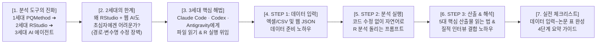
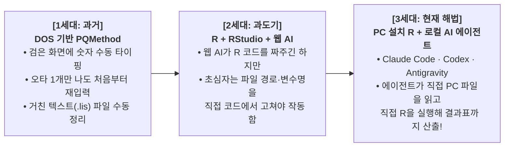
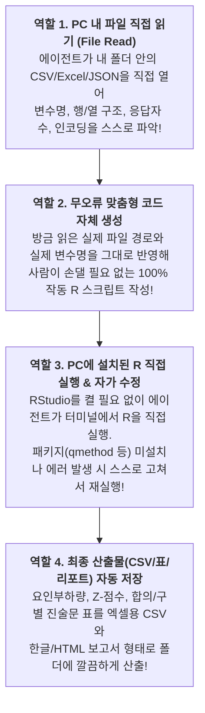

# [발표 준비안] Q-방법론 알기 쉽게 설명하기: 데이터 입력부터 산출까지 실전 노하우

> **발표 대상**: 대학원 동료 원우 및 교수님  
> **발표 전제**: 지난 시간을 통해 Q-방법론의 철학적 기원, R과의 차이, 진술문(Q-Sample) 구성 이론은 이미 학습 완료함.  
> **이번 발표 주제**: **Q-방법론 알기 쉽게 설명하기 (데이터 입력부터 산출까지, 실전 노하우)**  
> **핵심 초점 (패러다임 전환)**:
> 1. **1세대 (과거)**: DOS 프로그램인 **PQMethod**에 수동으로 숫자를 치던 고통스러운 방식
> 2. **2세대 (과도기)**: **R + RStudio + 웹 AI(ChatGPT 등)** 코드 생성 방식 ➔ *하지만 RStudio를 다뤄본 적 없는 연구자는 파일 경로나 데이터 변수명을 직접 코드에서 수정해야 해서 여전히 진입장벽이 높음!*
> 3. **3세대 (현재 해법)**: **PC에 설치된 R + 로컬 AI 에이전트(Claude Code, Codex, Antigravity)** 위임 방식 ➔ *에이전트가 직접 PC 내 파일을 열어 구조를 읽고, 직접 R을 실행하여 산출물까지 뽑아내므로 코딩 수정이 전혀 필요 없는 실전 노하우 전수!*

---



---

## 📌 [Slide 1] 프롤로그: Q-분석 도구의 3세대 진화 — 왜 '통계 분석'이 가장 큰 장벽이었나?

### 1. 슬라이드 구성 내용
* **제목**: **이론과 진술문은 알겠는데, 실제 분석은 어떻게 돌리는가?**
* **부제**: *"도스(DOS) 수동 입력과 RStudio 코딩 수정을 넘어, 로컬 AI 에이전트에게 역할을 위임하는 시대로"*
* **Q-방법론 분석 도구의 3세대 진화 과정**:



* **핵심 메시지**:
  > *"R이나 RStudio를 한 번도 다뤄본 적 없는 연구자도, **PC에 설치된 R과 로컬 AI 에이전트**를 연결하면 단 한 줄의 코드 수정 없이 데이터 입력부터 최종 산출물까지 한 번에 끝낼 수 있습니다."*

### 2. 발표자 대본 (Script)
> "안녕하십니까, 원우 여러분. 우리가 지난 시간까지 Q-방법론이 무엇인지, 그리고 콘코스에서 출발해 36개의 Q-진술문을 어떻게 뽑아내는지 그 이론적 과정은 모두 마쳤습니다.
> 
> 그런데 막상 내 연구 주제로 36개의 진술문을 다 만들고 나면, 모든 연구자가 똑같은 벽에 부딪힙니다. 바로 **'그래서 응답자들에게 받은 데이터를 어디에 어떻게 입력하고, 도대체 어떻게 통계를 돌려서 논문 표를 뽑아내는가?'** 하는 실전의 벽입니다.
> 
> 과거 1세대에는 **PQMethod**라는 새까만 도스(DOS) 프로그램에 응답자 수십 명의 점수를 손으로 일일이 쳤습니다. 숫자 하나만 밀려 쳐도 에러가 나서 처음부터 다시 쳐야 했죠.
> 
> 그래서 최근 2세대로 넘어오면서 **R과 RStudio에 생성형 AI가 짜준 코드를 붙여넣어 분석하는 방식**이 도입되었습니다. 하지만 오늘 제가 솔직하게 짚고 싶은 문제는 이것입니다. **'과거에 R이나 RStudio를 한 번도 다뤄본 적이 없는 원우님들에게는, AI가 짜준 R 코드조차 돌리기가 너무 어렵다'**는 사실입니다. 파일 경로를 바꾸고 변수명을 고치는 과정에서 또다시 에러가 나기 때문입니다.
> 
> 그래서 오늘 발표에서는 이 문제를 완벽히 해결하기 위해, **PC에 설치된 R에 Claude Code, Codex, Antigravity 같은 '로컬 AI 에이전트'를 결합하여, 에이전트가 직접 내 PC의 파일을 읽고 직접 R을 실행하게 만드는 가장 쉽고 확실한 실전 노하우**를 데이터 입력부터 산출까지 단계별로 설명해 드리겠습니다."

---

## 📌 [Slide 2] 2세대의 한계: 왜 'RStudio + 웹 AI 코드 생성'도 초심자에게는 어려운가?

### 1. 슬라이드 구성 내용
* **제목**: **RStudio를 써본 적 없는 연구자가 웹 AI 코드를 복붙할 때 겪는 3대 장벽**
* **문제의 본질**: 웹 브라우저의 챗봇(ChatGPT 웹, Claude 웹 등)은 **내 PC 안에 있는 실제 데이터 파일을 직접 열어볼 수 없고, 내 PC의 폴더 경로도 모른다!**

* **초심자가 반드시 마주치는 3대 코드 수정(디버깅) 지옥**:

| 장벽 구분 | 웹 AI가 만들어준 코드의 문제점 | RStudio 실행 시 발생하는 에러 | 초심자가 직접 해야 했던 일 (고통 포인트) |
| :--- | :--- | :--- | :--- |
| **① 파일 경로(Path) 불일치** | `read.csv("C:/path/to/your/file.csv")` 처럼 가짜 경로로 코드를 생성함 | `Error: cannot open file (No such file or directory)` | 역슬래시(`\`)를 슬래시(`/`)로 바꾸고 `setwd()` 작업 폴더 경로를 직접 찾아 수정해야 함 |
| **② 변수명(Schema) 상상 코딩** | 내 파일의 열 이름을 모르니 `data$score`, `data$user_id`처럼 AI가 마음대로 상상해서 코딩함 | `Error: $ operator is invalid` 또는 `NULL / Subscript out of bounds` | 내 엑셀/JSON 파일을 열어 실제 변수명(`scoresArray`, `respondent$id` 등)을 대조하며 코드를 고쳐야 함 |
| **③ 패키지 & 인코딩 충돌** | `library(qmethod)`만 적어주거나 맥/윈도우 한글 인코딩 차이를 무시함 | `there is no package called 'qmethod'` / 한글 깨짐 에러 | 에러 메시지를 다시 복사해서 챗봇에게 물어보고 `CP949`/`UTF-8` 옵션을 수동으로 고쳐야 함 |

* **핵심 진단**:
  > *"웹 AI가 코드를 짜주더라도, **마지막에 RStudio에서 변수값과 파일 경로를 맞추는 역할은 결국 사람(연구자)이 해야 했다.** RStudio가 낯선 분들에게는 이 '약간의 코드 수정'조차 거대한 장벽이다!"*

### 2. 발표자 대본 (Script)
> "왜 R과 RStudio에 AI를 쓰는데도 여전히 어려울까요? 우리가 흔히 쓰는 웹 브라우저 기반의 챗봇에게 'Q방법론 R 분석 코드 짜줘'라고 하면, 10초 만에 그럴싸한 R 코드를 쫙 짜줍니다.
> 
> 그런데 RStudio를 처음 켜보는 분이 그 코드를 복사해서 붙여넣고 실행(Run)을 누르면 어떻게 될까요? **백이면 백, 빨간색 에러 메시지가 쏟아집니다.**
> 
> 이유는 간단합니다. 웹에 있는 AI는 내 컴퓨터 바탕화면에 있는 엑셀이나 JSON 파일이 어느 폴더에 있는지, 또 그 파일 안에 변수 이름이 한글로 되어 있는지 영어로 되어 있는지 전혀 보지 못한 채 **'상상으로' 코드를 짰기 때문**입니다.
> 
> 결국 연구자가 직접 RStudio 코드 창에서 파일 경로 슬래시(`/`) 방향을 고치고, 내 파일의 실제 열 이름(변수명)을 찾아서 코드 안의 변수값들을 일일이 수정해야만 돌아갑니다. 코딩을 해본 분들에겐 5분 걸리는 수정이지만, RStudio를 평생 처음 보는 연구자에게는 '도대체 어디에 따옴표를 넣고 어디를 고쳐야 하는지' 막막한 벽이 되는 것입니다."

---

## 📌 [Slide 3] 3세대 핵심 해법: Claude Code · Codex · Antigravity에게 '역할'을 넘기자!

### 1. 슬라이드 구성 내용
* **제목**: **코드 수정을 사람이 하지 말고, 로컬 AI 에이전트에게 맡기면 어떻게 될까?**
* **패러다임의 전환 (역할 위임, Role Delegation)**:
  * **기존 (RStudio + 웹 AI)**: AI는 텍스트로 코드만 생성 ➔ **사람이 파일 확인 + 경로 지정 + 코드 수정 + RStudio 실행**
  * **현재 (로컬 R + 로컬 AI 에이전트)**: 사람은 자연어로 지시만 ➔ **에이전트(Claude Code, Codex, Antigravity)가 PC 내 파일 직접 읽기 + 변수명/경로 자동 파악 + R 백그라운드 직접 실행 + 산출물 파일 생성까지 전담!**

* **로컬 AI 에이전트가 연구자 대신 수행하는 4대 자동화 역할**:



* **필수 준비 환경 (딱 2가지만 설치하면 끝)**:
  1. **PC에 R 기본 프로그램 설치** (`cran.r-project.org`에서 운영체제에 맞는 R 설치 — *RStudio 화면은 몰라도 됨!*)
  2. **로컬 실행형 AI 에이전트 도구**: **Claude Code**, **OpenAI Codex**, **Google Antigravity** 중 하나

### 2. 발표자 대본 (Script)
> "그렇다면 이 문제를 어떻게 해결할 수 있을까요? 해답은 놀라울 정도로 간단합니다. **'사람이 하던 파일 확인과 코드 수정, 그리고 R 실행이라는 역할을 AI 에이전트에게 통째로 넘겨주는 것'**입니다.
> 
> 요즘 나오는 **클로드 코드(Claude Code), 오픈AI 코덱스(Codex), 그리고 구글 안티그래비티(Antigravity)** 같은 도구들은 단순한 웹 챗봇이 아니라 **'내 PC 안에서 직접 행동하는 에이전트'**입니다.
> 
> 내 컴퓨터에 R 프로그램만 깔려 있으면, 우리는 RStudio를 열 필요조차 없습니다.
> 에이전트에게 내 데이터가 들어있는 폴더를 열어주고 일을 시키면, **첫째로 에이전트가 직접 내 PC 안의 데이터 파일을 열어봅니다.** '아, 이 파일은 경로가 어디고, 진술문 점수는 `scoresArray`라는 변수에 들어있고, 응답자는 총 16명이구나!' 하고 에이전트가 스스로 파일 정보를 읽어냅니다.
> 
> **둘째로, 에이전트가 자기가 읽은 실제 경로와 변수명을 넣어서 R 코드를 짜고, 내 PC에 깔린 R을 직접 돌립니다.** 만약 `qmethod`라는 통계 패키지가 안 깔려 있어서 에러가 나면? 에이전트가 에러 메시지를 스스로 읽고 알아서 패키지를 설치한 뒤 다시 실행합니다.
> 
> 즉, 연구자는 변수값이나 파일 경로를 단 한 글자도 수정할 필요가 없습니다. 에이전트에게 많은 역할을 부여할수록 연구자는 훨씬 더 쉽게 결과물을 얻을 수 있는 것입니다."

---

## 📌 [Slide 4] [STEP 1] 데이터 입력부터 쉽게! — 소팅 데이터를 파일로 만드는 실전 노하우

### 1. 슬라이드 구성 내용
* **제목**: **[STEP 1. 데이터 입력 노하우] 응답자의 피라미드 배치를 어떻게 파일로 준비할까?**
* **핵심 원칙**: 과거 PQMethod처럼 띄어쓰기 칸수를 맞춰 `.dat` 파일을 만들 필요가 전혀 없음! **엑셀(CSV)이든 웹 설문(JSON)이든 있는 그대로 폴더에 넣으면 에이전트가 알아서 변환함.**

* **실전 데이터 수집·입력의 2가지 추천 방식**:

#### 방식 A. 오프라인 종이 카드 소팅 시 ➔ **엑셀(Excel / CSV)에 그대로 입력하기**
* **입력 요령**: 엑셀 시트를 열고 행(Row)에는 `Q01 ~ Q36`, 열(Column)에는 응답자 이름(`P01_김철수`, `P02_이영희`...)을 적고 피라미드 점수(`-4` ~ `+4`)만 입력. *(※ 행과 열을 반대로 입력했어도 걱정 무! 에이전트가 알아서 뒤집어줌)*
* **데이터 무결성 체크 노하우 (실수 방지 팁)**:
  * 9점 척도(-4 ~ +4) 대칭 피라미드의 경우, **한 응답자가 부여한 36개 점수의 합(SUM)은 무조건 `0`**이 되어야 함!
  * 엑셀 하단에 `=SUM(B2:B37)`을 걸어 합계가 `0`인지 확인하거나, **에이전트에게 *"입력 오타로 합계가 0이 안 되는 응답자가 있는지 먼저 검사해 줘"*라고 시키면 끝!**

#### 방식 B. 온라인/비대면 수집 시 ➔ **웹 Q-소팅 앱으로 JSON/CSV 자동 수집하기 (우리 연구실 실습 방식)**
* **작동 방식**: HTML 파일 하나로 된 웹 Q-소팅 도구를 응답자에게 카톡/이메일로 전달 ➔ 응답자가 마우스로 피라미드 배치 후 완료 버튼 클릭 ➔ 응답자별로 `NIMS_QSort_김동욱_GroupB.json` 파일이 자동 생성됨.
* **장점**:
  1. 정원(Quota: -4는 2칸, 0은 8칸 등)이 안 맞으면 제출 자체가 안 되므로 **입력 오타 확률 0%**!
  2. 숫자 점수(`scoresArray`)뿐만 아니라 **양 극단(+4, -4) 선택 이유(질적 인터뷰)**까지 파일 하나에 깔끔하게 묶여서 저장됨.
  3. 연구자는 카톡이나 메일로 받은 파일들을 **`data` 폴더 하나에 드래그해서 모아두기만 하면 데이터 입력 준비 100% 완료!**

### 2. 발표자 대본 (Script)
> "자, 이제 데이터 입력부터 산출까지 구체적인 3단계 실전 노하우로 들어가 보겠습니다. 첫 번째 단계는 **데이터 입력(준비)**입니다.
> 
> 과거 PQMethod 시절에는 메모장을 열어서 띄어쓰기 칸수까지 정확히 맞춰가며 숫자를 쳐야 했습니다. 하지만 AI 에이전트를 쓸 때는 데이터 입력이 정말 자유롭고 쉬워집니다.
> 
> 만약 현장에서 종이 카드로 Q-소팅을 진행하셨다면, 그냥 편하게 **엑셀(Excel)**을 여십시오. 첫 번째 열에 1번부터 36번까지 진술문 번호를 적고, 옆 열에 응답자 이름을 적은 뒤 그 사람이 배치한 점수(`-4`에서 `+4`)를 쭉 적으시면 됩니다. 혹시 행과 열을 가로세로 반대로 적으셨나요? 전혀 상관없습니다! 에이전트에게 '행과 열을 분석에 맞게 알아서 뒤집어서(Transpose) 읽어줘'라고 하면 에이전트가 다 처리합니다.
> 
> 여기서 실전 노하우 하나! 종이를 보고 엑셀에 옮겨 적다 보면 사람이니까 오타가 날 수 있겠죠? 대칭형 피라미드에서는 한 사람이 준 점수를 다 더하면 무조건 합계가 **'0'**이 나와야 합니다. 이것조차 내가 찾을 필요 없이 에이전트에게 **'엑셀 파일 읽어서 응답자별로 점수 합계가 0이나 칸수 분포에 어긋나는 오타가 있는지 먼저 검수해 줘'**라고 시키면 오타가 난 응답자와 문항을 1초 만에 찾아줍니다.
> 
> 더 좋은 방법은 저희가 이번 실습에서 활용한 **웹 기반 Q-소팅 앱**을 쓰는 것입니다. 응답자가 화면에서 카드를 배치하고 극단값 선택 이유를 적으면, 오타가 아예 날 수 없게 설계된 JSON 파일이 툭 튀어나옵니다. 연구자는 응답자들에게 받은 파일들을 내 PC의 `data` 폴더 안에 모아 넣기만 하면 데이터 입력이 끝납니다."

---

## 📌 [Slide 5] [STEP 2] 에이전트에게 분석 맡기기 — 코드 수정 없이 한 번에 돌리는 프롬프트 노하우

### 1. 슬라이드 구성 내용
* **제목**: **[STEP 2. 분석 실행 노하우] 에이전트에게 어떻게 말해야 알아서 파일을 읽고 실행할까?**
* **핵심 노하우**: 내가 파일 경로나 변수명을 설명하려고 애쓰지 말고, **에이전트에게 "네가 먼저 폴더 안의 파일을 열어서 구조를 확인하고, 직접 R을 실행해라"**라고 작업 순서(Workflow)를 지시한다!

* **진행 흐름도 (실제 우리 프로젝트 `labs/` 실행 구조)**:

```
[내 PC의 프로젝트 폴더]
 ├── 📁 data/  (응답자 JSON 또는 엑셀 파일 + 진술문 목록 파일 넣어두기)
 └── 💬 Antigravity / Claude Code / Codex 실행 후 아래 프롬프트 입력!
          │
          ▼ (사람의 개입 0% — 에이전트 자율 실행 구간)
   1) 에이전트가 data/ 폴더 스캔 & 샘플 파일 1개 직접 Read (변수명·구조 파악)
   2) 에이전트가 run_q_analysis.R 스크립트 자동 작성
   3) 에이전트가 PC의 R을 직접 호출해 실행 (패키지 없으면 자동 설치)
   4) 📁 output/ 폴더 생성 후 6종의 결과 CSV 파일 자동 저장 완료!
```

* **📋 그대로 복사해서 쓰는 [로컬 AI 에이전트 전용 만능 지시문(Prompt)]**:

```markdown
내 PC의 현재 폴더 안(`data/` 폴더)에 Q-방법론 소팅 응답 데이터 파일들과 36개 Q-진술문 목록이 들어있어.
나는 RStudio 사용법이나 코딩을 모르니, 네가 직접 아래 작업을 순서대로 수행해 줘:

1. [파일 구조 직접 확인]: 먼저 `data/` 폴더 안의 파일 목록을 확인하고, 파일을 직접 열어서 변수명과 데이터 구조(점수 배열, 응답자 ID, 직무 집단, 질적 인터뷰 텍스트 등)를 네가 스스로 파악해.
2. [데이터 무결성 검증]: 각 응답자의 진술문 점수가 36개씩 빠짐없이 들어있는지, 강제분포 척도(-4부터 +4까지: 2, 3, 4, 5, 8, 5, 4, 3, 2칸)에 맞는지 먼저 점검해.
3. [R 코드 작성 및 직접 실행]: 내 PC에 설치된 R(`qmethod`, `psych` 패키지 활용, 미설치 시 자동 설치)을 네가 직접 실행해서 주성분분석(PCA)과 배리맥스(Varimax) 직교 회전을 수행해. (고유값 1.0 이상 기준으로 최적 요인 수 추출)
4. [산출물 CSV 자동 저장]: 분석이 끝나면 `output/` 폴더를 만들어서 아래 표들을 엑셀에서 바로 열 수 있는 한글 인코딩(UTF-8-BOM) CSV 파일로 저장해 줘.
   - ① 응답자 간 상관행렬 (Correlation Matrix)
   - ② 응답자별 요인적재치 및 유의수준(p<0.01) 자동 플래깅 표 (Factor Loadings)
   - ③ 요인별 36개 진술문 표준화 Z-점수 및 Q-배열 점수표 (Factor Z-scores & Arrays)
   - ④ 유형 간 합의 진술문(Consensus) 및 구별 진술문(Distinguishing) 표
   - ⑤ 응답자별 양 극단(+4, -4) 선택 이유 질적 인터뷰 정리표
```

### 2. 발표자 대본 (Script)
> "두 번째 단계는 대망의 **분석 실행 노하우**입니다. 데이터 파일들을 폴더에 모아두셨다면, 이제 Claude Code나 Codex, 또는 지금 화면에 보시는 Antigravity를 그 폴더에서 켭니다.
> 
> 여기서 가장 중요한 프롬프트 노하우가 있습니다. 웹 챗봇을 쓸 때는 우리가 파일 안의 변수명을 찾아서 AI에게 일일이 알려줘야만 에러가 안 났습니다. 하지만 로컬 AI 에이전트에게는 그럴 필요가 없습니다!
> 
> 화면의 지시문 박스를 보십시오. 1번을 보시면 **'먼저 data 폴더 안의 파일을 네가 직접 열어서 변수명과 데이터 구조를 스스로 파악해라'**라고 시킵니다. 그러면 에이전트가 알아서 파일을 열어보고 '아, 점수는 여기에 있고 응답자 이름은 여기에 있구나' 하고 1초 만에 파악합니다.
> 
> 이어서 2번과 3번에서 **'데이터에 오타가 없는지 검증하고, 내 PC에 깔린 R을 네가 직접 돌려서 요인분석과 Varimax 회전을 수행해라'**라고 역할을 부여합니다.
> 
> 이렇게 한 단락만 입력하고 엔터를 치면 어떻게 될까요? 내가 RStudio를 켜거나 코드를 복사할 필요도 없이, 에이전트가 알아서 R 코드를 짜고, 알아서 백그라운드에서 R을 돌리고, 에러가 나면 혼자 고쳐서 단 몇 초 만에 `output` 폴더 안에 우리가 논문에 써야 할 모든 통계 표를 엑셀 CSV 파일로 깔끔하게 만들어 놓습니다."

---

## 📌 [Slide 6] [STEP 3] 데이터 산출부터 해석까지 — 어떤 표가 나오고 논문에 어떻게 쓰는가?

### 1. 슬라이드 구성 내용
* **제목**: **[STEP 3. 산출물 & 해석 노하우] 에이전트가 뽑아준 5대 결과표 읽는 법과 논문 완성**
* **부제**: *"복잡한 통계 수치를 학위논문 제4장(연구결과)의 표와 해석 텍스트로 직결하는 노하우"*

* **에이전트가 `output/` 폴더에 산출해 주는 5대 핵심 파일과 읽는 법**:

| 산출 파일명 (`output/`) | 담겨 있는 핵심 통계 수치 | 논문 작성 시 확인 포인트 (해석 노하우) |
| :--- | :--- | :--- |
| **1. `Correlation_Matrix.csv`** | 응답자(P-표본) 간의 피어슨 상관계수 행렬 | 누구와 누구의 전체적인 피라미드 배치 패턴이 가장 유사한지 초기 탐색 |
| **2. `Factor_Loadings.csv`** | 요인별 적재치(`f1`, `f2`...) 및 **자동 플래깅(`flag = TRUE`)** | **★ 가장 중요!** `TRUE`가 찍힌 응답자들이 그 유형(Factor)을 대표하는 인물임. 각 유형에 어떤 직무/경력자가 모였는지 파악 |
| **3. `Factor_Zscores.csv`** | 요인별 36개 진술문의 **Z-점수(`zsc`)** 및 **환산 Q-점수(`fsc`: -4~+4)** | 각 유형이 **가장 동의하는 진술문(+4, +3: Z점수 최상위)**과 **가장 거부하는 진술문(-4, -3: Z점수 최하위)**을 뽑아 유형의 성격을 규정 |
| **4. `Consensus_Distinguishing.csv`** | 유형 간 Z-점수 차이 검정 ($p < 0.05$, $p < 0.01$) | • `Consensus`: 모든 유형이 공통으로 동의하는 보편적 기반<br/>• `Distinguains`: **유형 간 생각이 극명하게 갈리는 핵심 쟁점 문항!** |
| **5. `Qualitative_Interviews.csv`** | 응답자별 `+4` / `-4` 선택 이유 주관식 답변 모음 | 통계 수치(Z-점수)가 **'왜'** 그렇게 나왔는지 응답자의 생생한 육성 인용문(`"..."`)으로 뒷받침 |

* **🔥 실전 최고급 노하우: 에이전트에게 '통계표 + 인터뷰' 융합 정리까지 시키기**:
  * 단순히 숫자 CSV만 뽑고 끝내는 것이 아니라, 에이전트에게 **두 번째 지시**를 내림:
    > *"방금 네가 `output/` 폴더에 만든 `Factor_Loadings.csv`, `Factor_Zscores.csv`와 진술문 원문, 그리고 `Qualitative_Interviews.csv`를 모두 결합해서, **각 요인(유형)별로 대표 응답자 명단, 최동의/최비동의 진술문 표(Z-점수 포함), 그리고 그 유형에 속한 응답자들의 실제 인터뷰 이유를 매칭한 종합 분석 리포트(HTML/Markdown)**를 만들어 줘. 단, 원 데이터에 없는 수치나 인터뷰를 절대 지어내지(Hallucination) 마!"*
  * **결과**: 연구자가 엑셀 파일 여러 개를 번갈아 보며 번호(Q08이 무슨 문장이었지?)를 대조하는 수작업 시간이 **수 시간에서 0분으로 단축**됨!

### 2. 발표자 대본 (Script)
> "세 번째 단계는 **산출물 확인과 논문 해석 노하우**입니다. 에이전트가 R을 돌리고 나면 `output` 폴더에 다섯 가지 핵심 CSV 파일이 나옵니다. 우리가 논문을 쓸 때 딱 세 가지만 기억하시면 됩니다.
> 
> **첫째는 `Factor_Loadings.csv`입니다.** 여기에는 응답자 한 명 한 명이 1유형에 속하는지, 2유형에 속하는지가 `TRUE` / `FALSE`로 명확히 찍혀 나옵니다. 아까 PQMethod에서는 이걸 수계산하거나 수동으로 X표를 쳐야 했지만, R의 `qmethod` 패키지는 통계적 유의수준($p<0.01$)을 계산해 자동으로 찍어줍니다.
> 
> **둘째는 `Factor_Zscores.csv`입니다.** 각 유형별로 36개 진술문 중 어떤 문장에 가장 열광했고(+4, +3), 어떤 문장을 가장 싫어했는지(-4, -3) Z-점수 순위로 보여줍니다.
> 
> **셋째는 `Consensus_Distinguishing.csv`입니다.** 모든 유형이 다 같이 공감하는 '합의 진술문'과, 1유형과 2유형이 정반대로 대립하는 '구별 진술문'을 골라줍니다.
> 
> 그런데 원우 여러분, 여기서 진짜 꿀팁 노하우가 하나 더 있습니다! 원래는 연구자가 엑셀 파일들을 띄워놓고 '어? 1유형이 8번 문항에 Z점수 1.65점을 줬네? 8번 문항 내용이 뭐였지? 그리고 1유형에 속한 김동욱 님은 인터뷰에서 왜 8번을 뽑았다고 했지?' 하고 파일 세 개를 눈으로 왔다 갔다 하며 대조해야 했습니다. 이게 정말 손이 많이 갑니다.
> 
> 하지만 로컬 에이전트에게는 **'방금 네가 뽑은 Z-점수 파일과 진술문 텍스트, 그리고 응답자 인터뷰 파일을 하나로 합쳐서, 유형별로 최동의/최비동의 문장 옆에 실제 응답자의 인터뷰 이유까지 나란히 매칭한 종합 리포트를 만들어 줘'**라고 시킬 수 있습니다.
> 
> 단, 이때 반드시 지켜야 할 연구 윤리 원칙은 **'절대 원 데이터에 없는 수치를 지어내지 말고, 실제 R 산출값과 실제 인터뷰 원문만 그대로 연결하라'**고 통제하는 것입니다. 그러면 에이전트는 단순 정리를 완벽히 끝내주고, 연구자는 그 리포트를 보며 깊이 있는 학술적 해석과 유형 명명(Naming)에만 집중할 수 있습니다."

---

## 📌 [Slide 7] 요약 및 결론: Q-분석 3세대 비교와 내일 당장 따라 하는 체크리스트

### 1. 슬라이드 구성 내용
* **제목**: **한눈에 보는 Q-분석 노하우 총정리 — 도구의 장벽을 넘어 연구의 본질로**
* **1세대 vs 2세대 vs 3세대 Q-분석 패러다임 최종 비교표**:

| 비교 항목 | 1세대: DOS 기반 PQMethod | 2세대: RStudio + 웹 AI (ChatGPT) | **3세대: 로컬 R + 로컬 AI 에이전트 (추천 ★)** |
| :--- | :--- | :--- | :--- |
| **활용 도구** | PQMethod (DOS 창) | RStudio + 웹 브라우저 챗봇 | **PC 설치 R + Claude Code / Codex / Antigravity** |
| **데이터 입력** | 띄어쓰기 맞춰 `.dat` 수동 타이핑 | 엑셀/CSV/JSON 파일 준비 | **엑셀/CSV/JSON 파일을 폴더에 모아두기만 함** |
| **파일 경로/변수명** | 파일명 8글자 제한 등 극도의 제약 | **연구자가 직접 코드에서 경로·변수명 수정 필수** | **에이전트가 직접 파일을 열어 경로·변수명 자동 파악** |
| **RStudio 숙련도** | 불필요 (대신 DOS 명령어 숙지) | **초급 이상 필요 (에러 발생 시 직접 디버깅)** | **전혀 불필요! (RStudio를 켜지 않아도 됨)** |
| **통계 + 인터뷰 매칭** | 출력물 인쇄 후 형광펜 칠하며 수작업 | R 통계표와 인터뷰 엑셀을 사람이 수동 대조 | **에이전트가 Z-점수표 + 진술문 + 인터뷰를 1:1 자동 결합** |
| **연구자의 역할** | 숫자 타이피스트 & 수동 계산자 | 코드 복사자 & 에러 수정자(디버거) | **연구 설계자 & 주관성 의미 해석가 (100% 본질 집중)** |

* **내일 당장 따라 할 수 있는 4단계 실전 체크리스트**:
  1. **[환경 준비]**: 내 PC에 **R 프로그램**을 설치하고, **Claude Code, Codex, Antigravity** 중 편한 에이전트를 준비한다.
  2. **[데이터 폴더링]**: 응답자들의 Q-소팅 데이터(엑셀/CSV 또는 웹 소팅 JSON)와 36개 진술문 목록을 **`data` 폴더 하나에 모아 넣는다.**
  3. **[에이전트 위임]**: 에이전트에게 **"직접 파일을 읽고 구조를 파악한 뒤, R을 실행해 결과 CSV들을 산출하라"**고 역할을 부여한다.
  4. **[통찰과 해석]**: 에이전트가 매칭해 준 **Z-점수표 + 구별 진술문 + 심층 인터뷰**를 바탕으로, 연구자만의 학술적 시각으로 **유형을 명명(Naming)하고 논문을 완성**한다!

### 2. 발표자 대본 (Script)
> "마지막으로 오늘 발표한 내용을 한 장의 표로 정리하며 마무리하겠습니다.
> 
> 그동안 Q-방법론이 훌륭한 연구 방법론임에도 많은 원우님들이 주저하셨던 이유는, 1세대 도스 프로그램인 PQMethod의 불편함 때문이었고, 최근에는 2세대 R과 RStudio를 쓰더라도 코딩을 해본 적 없는 분들이 겪어야 했던 '파일 경로 지정과 변수값 수정'이라는 디버깅의 장벽 때문이었습니다.
> 
> 하지만 오늘 살펴본 **3세대 방식—즉 내 PC에 설치된 R에 Claude Code, Codex, Antigravity 같은 로컬 AI 에이전트를 연결하는 방식**을 활용하면, 파일을 읽고, 변수명을 맞추고, 코드를 짜서 R을 돌리고, 통계표와 인터뷰를 매칭하는 모든 번거로운 실무 역할을 에이전트에게 온전히 맡길 수 있습니다.
> 
> 이제 우리는 R 코드에 점 하나, 슬래시 하나가 틀려서 밤을 새우는 '코더'가 될 필요가 없습니다. 데이터 입력부터 산출까지의 기계적인 작업은 AI 에이전트에게 맡기시고, 우리 연구자들은 **'왜 현장의 사람들은 이런 독특한 관점과 신념 체계를 형성했는가?'**를 깊이 있게 해석하는 학자로서의 본질적인 즐거움만 누리시기를 바랍니다. 이상으로 발표를 마치겠습니다. 감사합니다."
