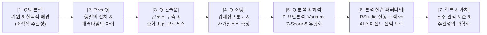
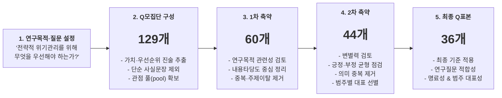
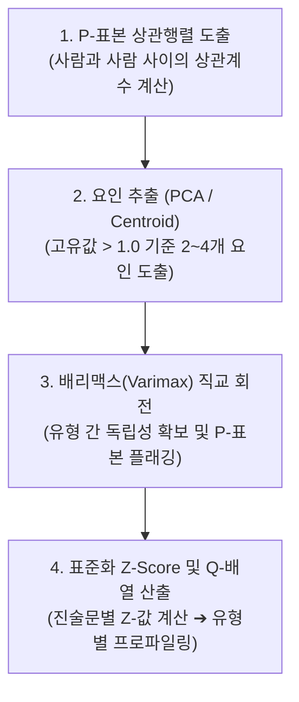
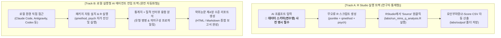

# [발표 준비안] 순수 주관성 연구 방법론: Q-방법론(Q-Methodology)의 이론과 실제

> **발표 대상**: 대학원 동료 원우 및 교수님  
> **발표 주제**: 사람의 관점을 과학적으로 연구하는 독자적 방법론 — Q의 철학, 진술문 구축, 그리고 현대적 AI 분석 실습  
> **핵심 아젠다**:
> 1. **Q 방법론이란 무엇인가?** (기원, 철학, R과의 차이)
> 2. **진술문(Q-Sample)은 어떻게 만드는가?** (콘코스 수집부터 층화 표집까지)
> 3. **분석(Q-Analysis)은 어떻게 수행하고 해석하는가?** (피라미드 소팅, P-상관행렬, 요인분석 및 Z-점수)
> 4. **현대적 분석 실습 패러다임**: R Studio 실행 트랙 vs AI 에이전트 전임 자동화 트랙

---



---

## 📌 [Slide 1] Q는 어디에서 왔는가? — 사람의 관점을 과학화하려는 문제의식

### 1. 슬라이드 구성 내용
* **제목**: **Q는 어디에서 왔는가?** (사람의 관점을 과학적으로 연구하려는 문제의식의 출발)
* **4단계 학술사적 타임라인**:
  * **1935 | William Stephenson**: 물리학자이자 심리학자. 스피어먼의 제자로서 검사(Test)가 아니라 **사람(Person)을 상관시키자**고 제안.
  * **1936 | Inverted Factor Technique**: 행렬을 뒤집어(Inversion) 개인의 취향, 신념, 판단을 유형(Type)으로 분석하는 기법 발표.
  * **1953 | 『The Study of Behavior』 출간**: 단순 통계 기법을 넘어 **주관적 행동을 연구하는 독자적 방법론(Q-Methodology)**으로 체계화.
  * **1980 이후 | Steven Brown → 현대 Q**: 단순한 'R의 전치'가 아니라 **'조작적 주관성(Operant Subjectivity)'**을 측정하는 질적·양적 통합 패러다임으로 발전.
* **핵심 인용구**:
  > *"Q방법론의 출발은 '행렬을 뒤집는 통계 테크닉'이 아니라, **인간의 내면적 관점을 과학적으로 연구할 수 있는가**라는 근본적인 질문이었다."*

### 2. 발표자 대본 (Script)
> "원우 여러분, 우리는 보통 '통계'라고 하면 설문조사의 평균, 표준편차, 가설검정을 떠올립니다. 하지만 사람의 생각, 신념, 가치관 같은 '주관성(Subjectivity)'도 과학적으로 측정할 수 있을까요?
> 
> 1935년, 찰스 스피어먼의 제자이자 물리학과 심리학 박사 학위를 모두 가졌던 윌리엄 스티븐슨(William Stephenson)은 기존 통계학의 한계를 지적하며 혁명적인 아이디어를 던졌습니다. **'왜 우리는 문항과 검사를 상관시키면서, 정작 중요한 사람의 관점은 상관시키지 않는가?'**
> 
> 이것이 바로 Q-방법론의 출발입니다. 1953년 『The Study of Behavior』를 통해 독자적 방법론으로 정립되었고, 1980년대 스티븐 브라운(Steven Brown)을 거치며 오늘날 정책학, 행정학, 심리학 전반에서 **'사람의 내면적 신념체계를 있는 그대로 과학화하는 독보적 연구 틀'**로 확립되었습니다."

---

## 📌 [Slide 2] R-방법론 vs Q-방법론 — 무엇이 다른가?

### 1. 슬라이드 구성 내용
* **제목**: **R vs Q — 패러다임과 데이터 구조의 비교**
* **비교 매트릭스 표**:

| 비교 항목 | 전통적 계량 연구 (R-방법론) | 주관성 연구 (Q-방법론) |
| :--- | :--- | :--- |
| **철학적 기반** | 논리실증주의, 객관주의 (외부자 시각) | 구성주의, 현상학 (행위자 내면 시각) |
| **관심의 초점** | 변수(Variables) 간의 관계와 차이 | 사람(Persons)의 관점과 의미구성(Sensemaking) |
| **연구의 목적** | 가설 검정(Hypothesis Testing) 및 일반화 | 가설 생성(Hypothesis Generating) 및 주관성 유형화 |
| **표본의 대상** | **사람이 표본** (대규모 N, 확률표집) | **진술문(생각)이 표본** (소규모 N, 이론적 층화) |
| **데이터 행렬** | **$N \times V$ 행렬** (행: 사람, 열: 문항 변수) | **$V \times P$ 행렬** (행: 진술문, 열: 사람) |
| **상관의 대상** | 문항 변수 간의 상관 ($r_{xy}$) | **사람들 간의 상관 ($r_{person}$)** |
| **표본 수 요구** | 많을수록 좋음 ($N > 300$) | 소규모로 충분 ($P = 20 \sim 40$명) |

* **핵심 명제**:
  * R-방법론은 **"얼마나 많은 사람이 그렇게 생각하는가(How many)?"**를 묻는다.
  * Q-방법론은 **"어떤 종류의 생각과 신념 체계가 존재하는가(What kinds)?"**를 밝힌다.

### 2. 발표자 대본 (Script)
> "Q방법론을 가장 쉽게 이해하는 방법은 우리가 익히 알고 있는 일반 설문조사, 즉 R-방법론과 비교하는 것입니다.
> 
> 일반 설문조사는 대규모 사람($N$)에게 설문 문항($V$)을 던져 문항 간의 관계를 분석합니다. 즉, '사람이 표본'입니다. 따라서 표본 수가 수백 명이어야 통계적 유의성이 나옵니다.
> 
> 반면 Q-방법론은 정반대입니다. **'생각(진술문)이 표본'이고, 응답하는 사람은 변수(Variable)가 됩니다.** 
> 사람을 수백 명 모으는 것이 아니라, 세상에 떠도는 다양한 의견과 관점들을 정교하게 표본 추출하여 한 사람 한 사람에게 그 생각들의 우선순위를 매기게 합니다.
> 
> 그래서 Q-방법론에서는 20명, 30명, 심지어 15명의 소규모 표본(P-Sample)만으로도 우리 사회에 존재하는 뚜렷한 '신념의 유형(Types)'을 완벽하게 규명해낼 수 있습니다."

---

## 📌 [Slide 3] Q 진술문은 어떻게 만드는가? — 콘코스(Concourse)에서 Q-표본까지

### 1. 슬라이드 구성 내용
* **제목**: **Q 진술문(Q-Sample)의 도출 과정**
* **3단계 진술문 추출 프로세스**:

```
[1단계: 콘코스(Concourse) 수집]
문헌, 언론, 선행연구, 현장 인터뷰로부터
해당 주제에 관한 "세상의 모든 담론" 수집 (수백 개 문장)
                ▼
[2단계: 층화 매트릭스(Stratified Grid) 설계]
이론적 프레임워크에 따른 4~6대 범주화 (행 × 열 교차)
중복, 동어반복, 모호한 문장 정제 및 제거
                ▼
[3단계: Q-표본(Q-Sample) 최종 확정]
대표성을 띤 균형 잡힌 진술문 30~50선 확정
예비 검사(Pilot Test)를 통한 문맥 명확성 검증
```

* **진술문 작성의 3대 황금률**:
  1. **사실(Fact)이 아닌 의견(Opinion/Value)이어야 한다**: "A는 법률 제1조다(X)" ➔ "A 법률은 현장의 자율성을 침해한다(O)".
  2. **자가참조성(Self-referential)**: 응답자가 자신의 주관적 신념에 비추어 동의/비동의를 판단할 수 있어야 함.
  3. **양면성의 균형**: 긍정적 시각과 부정적 시각이 특정 방향으로 편향되지 않도록 균형 표집.

### 2. 발표자 대본 (Script)
> "그렇다면 연구자는 질문지를 어떻게 만들까요? Q에서는 설문 문항 대신 **'Q-진술문(Q-Sample)'**을 만듭니다.
> 
> 가장 먼저 하는 작업은 **'콘코스(Concourse)'**를 모으는 것입니다. 콘코스란 라틴어로 '함께 흐른다'는 뜻으로, 특정 주제에 대해 세상 사람들이 나누는 모든 대화, 문헌, 언론 기사, 인터뷰를 총망라하는 작업입니다. 보통 수백 개의 문장이 모입니다.
> 
> 그 다음, 이론적 틀에 따라 층화 매트릭스(Grid)를 만들어 분류합니다. 중복되거나 모호한 표현을 쳐내고, 긍정과 부정, 제도와 사람 등 다양한 차원이 균형을 이루도록 정제하여 보통 **30개에서 50개 내외의 진술문**으로 압축합니다.
> 
> 여기서 가장 중요한 규칙은 진술문이 시험 문제처럼 '참/거짓을 가리는 사실'이어서는 안 되며, **'개인의 가치관에 따라 호불호가 갈리는 주관적 의견'**이어야 한다는 점입니다."

---

## 📌 [Slide 3-1] 실전 사례: Q모집단에서 Q표본 36개로 축약하는 구조적 과정

### 1. 슬라이드 구성 내용
* **제목**: **Q모집단에서 Q표본 36개로 축약하는 과정**
* **부제**: *"Chapter 12. Crisis Management 사례를 활용한 구조적 축약 과정"*

* **5단계 구조적 축약 파이프라인 (5-Step Reduction Pipeline)**:



* **하단 세부 구조 및 기준**:
  * **[구조 분류 6대 범주]**:
    1) 기본관점 | 2) 전략적 리더십 | 3) 위기 식별·의사결정 | 4) 조직역량 | 5) 위기소통 | 6) 전략적 회복
  * **[최종 선정 5대 기준]**:
    ① **연구질문 적합성** | ② **변별력** | ③ **중복성 최소화** | ④ **명료성** | ⑤ **범주 대표성**
  * **[핵심 메시지]**:
    > *"Q표본은 임의로 고르는 문항이 아니라, **연구목적과 연구질문에 맞추어 구조적으로 축약한 결과**이다."*

### 2. 발표자 대본 (Script)
> "원우 여러분, 그렇다면 실제로 수백 개의 말 속에서 어떻게 36개의 정예 진술문을 뽑아낼까요? 실제 『Crisis Management(위기관리)』 교재 12장을 바탕으로 진행된 5단계 구조적 축약 사례를 보여드리겠습니다.
> 
> **첫 번째 단계는 연구질문의 명확화입니다.** '전략적 위기관리를 위해 우리는 무엇을 우선해야 하는가?'라는 핵심 질문을 먼저 세웁니다.
> 
> **두 번째 단계에서 129개의 Q-모집단 풀(pool)을 구성합니다.** 여기서 단순한 사실 기술 문장은 모두 쳐내고, 전문가들의 가치판단과 우선순위가 갈리는 문장 129개를 발췌했습니다.
> 
> **세 번째 단계인 1차 축약에서 60개로 줄입니다.** 연구목적과 직접 관련이 없는 주제 이탈 문장과 중복된 표현들을 내용타당도 기준으로 1차 정리합니다.
> 
> **네 번째 단계인 2차 축약에서 44개로 좁힙니다.** 긍정적 시각과 부정적 시각의 균형을 점검하고, 문장의 변별력을 검토하여 범주별 대표 문장을 선별합니다.
> 
> **그리고 마지막 5단계에서 최종 36개의 Q-표본을 확정합니다.**
> 하단에 보시는 것처럼 리더십, 의사결정, 소통, 회복 등 6대 구조 분류 범주를 모두 아우르면서, 5대 기준인 '적합성, 변별력, 비중복성, 명료성, 범주 대표성'을 엄격하게 통과한 36개 문장만이 살아남습니다.
> 
> 즉, Q-진술문은 연구자가 자의적으로 몇 개 골라 넣은 것이 아니라, **철저한 필터링과 층화 매트릭스를 거쳐 구조적으로 벼려낸 학술적 결과물**인 것입니다."

---

## 📌 [Slide 4] 데이터는 어떻게 수집하는가? — 피라미드 강제분포와 Q-소팅

### 1. 슬라이드 구성 내용
* **제목**: **Q-소팅(Q-Sorting)과 강제정규분포의 원리**
* **Q-소팅의 2단계 진행 절차**:
  * **1차 3분류 (Rough Sorting)**: 카드를 읽으며 [동의 (+)] / [중립 (0)] / [비동의 (-)] 3개 그룹으로 러프하게 구분.
  * **2차 피라미드 강제분포 배치**: 3개 그룹의 카드를 준정규분포(Quasi-normal distribution) 격자판에 양 극단부터 채워 넣음.

* **피라미드 격자 구조 (예: N=36 기준 9점 척도)**:

```text
       [최비동의]                 [중립]                 [최동의]
          -4    -3    -2    -1     0    +1    +2    +3    +4
         [  ]  [  ]  [  ]  [  ]  [  ]  [  ]  [  ]  [  ]  [  ]
         [  ]  [  ]  [  ]  [  ]  [  ]  [  ]  [  ]  [  ]  [  ]
               [  ]  [  ]  [  ]  [  ]  [  ]  [  ]  [  ]
                     [  ]  [  ]  [  ]  [  ]  [  ]
                           [  ]  [  ]  [  ]
                                 [  ]
                                 [  ]
                                 [  ]
-----------------------------------------------------------------
칸수:      2     3     4     5     8     5     4     3     2   = 총 36칸
```

* **왜 강제분포(Forced Distribution)를 시키는가?**:
  * **가치 타협(Trade-off)의 강제**: 리커트 척도처럼 모든 문항에 5점을 주는 '관대화 경향'을 원천 차단.
  * 응답자 내면에서 "무엇이 가장 중요하고, 무엇을 끝까지 포기할 수 없는가?"를 스스로 치열하게 저울질하게 만듦.

### 2. 발표자 대본 (Script)
> "진술문이 완성되면 응답자에게 분류 작업, 즉 **'Q-소팅(Q-Sorting)'**을 시킵니다.
> 
> 응답자는 카드를 받아 먼저 '동의 / 중립 / 비동의'로 대분류한 뒤, 화면에 보시는 피라미드 형태의 격자판에 카드를 하나씩 배치합니다.
> 
> 여기서 핵심은 **'강제정규분포'**입니다. 가장 동의하는 (+4) 칸에는 딱 2장, 가장 비동의하는 (-4) 칸에도 딱 2장만 넣을 수 있습니다.
> '이것도 중요하고 저것도 중요한데 왜 2장만 넣어야 합니까?'라는 불평이 나올 수 있습니다. 바로 그 갈등을 유도하는 것이 Q의 목적입니다!
> 
> 자원이 한정된 현실 세계처럼, 응답자가 스스로 자신의 가치관을 치열하게 저울질하며 '가장 포기할 수 없는 것'과 '가장 버릴 수 있는 것'을 스스로 결정하도록 강제하는 것입니다."

---

## 📌 [Slide 5] 분석은 어떻게 수행하는가? — R 통계와 주관성 해석

### 1. 슬라이드 구성 내용
* **제목**: **Q 데이터의 통계적 분석 및 해석 절차**
* **4단계 분석 알고리즘**:



* **결과 해석의 핵심 요소**:
  1. **요인 부하량 (Factor Loadings)**: 각 개인이 어떤 주관성 유형에 얼마나 강하게 소속되어 있는가를 나타냄 (플래깅, $p < 0.01$).
  2. **표준화 Z-점수 (Z-Scores)**: 각 유형이 어떤 진술문에 가장 강하게 동의(+Z)하고 기피(-Z)하는지 비교 가능한 척도로 환산.
  3. **합의 진술문 (Consensus Statements)**: 서로 다른 유형들이 직무나 관점 차이를 초월하여 공통적으로 동의하는 보편적 가치.
  4. **구별 진술문 (Distinguishing Statements)**: 유형 간에 통계적으로 유의미한 인식 차이($p < 0.05$)를 보이는 핵심 쟁점.
  5. **질적 인터뷰와의 결합**: 극단값(+4, -4)을 선택한 이유를 응답자의 육성으로 인용하여 통계 수치에 질적 생명력을 부여.

### 2. 발표자 대본 (Script)
> "그렇다면 이렇게 수집된 피라미드 배치는 통계 프로그램에서 어떻게 처리될까요?
> 
> 앞서 말씀드렸듯 Q-분석은 **'사람 간의 상관행렬'**에서 시작합니다. A라는 사람의 배치와 B라는 사람의 배치가 얼마나 일치하는지를 피어슨 상관계수로 계산합니다.
> 
> 이 상관행렬을 바탕으로 **주성분 분석(PCA)**이나 중심인자분석을 돌려 고유값(Eigenvalue)이 1보다 큰 대표적인 요인들을 추출하고, **배리맥스(Varimax) 직교 회전**을 통해 서로 독립적인 주관성 유형들로 분리해 냅니다.
> 
> 통계 분석이 끝나면 각 요인마다 진술문들의 **표준화 Z-점수(Z-Score)**가 산출됩니다. 이를 통해 '유형 1은 어떤 진술문에 열광하고 어떤 진술문을 기피하는가?', '유형 2와 유형 1을 가르는 결정적인 차이(구별 진술문)는 무엇인가?'를 명확한 숫자로 확인할 수 있습니다.
> 
> 그리고 마지막으로, 소팅이 끝난 뒤 응답자에게 받은 **질적 인터뷰 텍스트**를 Z-점수와 연결하여 '이 유형은 이러이러한 철학을 가진 유형이다'라고 학술적으로 명명(Naming)하고 프로파일링을 완성하게 됩니다."

---

## 📌 [Slide 6] 현대적 Q-분석 실습 패러다임: R Studio vs AI 에이전트

### 1. 슬라이드 구성 내용
* **제목**: **Q-분석 실습의 새로운 패러다임 — 수동 코딩에서 AI 자동화까지**
* **부제**: *"과거의 고통스러운 코딩 디버깅에서, AI를 활용한 신속하고 정확한 연구 자동화로"*

* **2대 실습 트랙 비교 (Workflows)**:



* **🚨 [Track A의 핵심 성공 요건] "변수명(Schema) 사전 명시가 없으면 왜 실패하는가?"**:
  * **일반적인 실패 사례**: AI에게 단순히 *"Q-소팅 JSON 읽어서 R 코드 짜줘"*라고 하면, AI는 파일 내부 변수명을 임의로 상상하여 `data$user_name`, `data$q_sort` 등으로 코딩함 ➔ RStudio 실행 즉시 `NULL` 또는 `Index Error` 발생 ➔ 연구자가 코드를 한 줄씩 뜯어고쳐야 하는 극심한 검수 피로도 발생!
  * **Zero-Error 프롬프트 작성 3대 원칙**:
    1. **정확한 파일 구조 지정**: `[경로]/*.json`
    2. **JSON 내부 4대 핵심 변수명 명시**:
       - 배치 점수 배열: `scoresArray` (길이 36, -4 ~ +4)
       - 응답자 정보: `respondent$id`, `respondent$group`
       - 질적 인터뷰: `qualitativeInterview$positiveReason`, `negativeReason`
    3. **강제분포 척도 벡터(distribution) 전달**: `-4(2), -3(3) ... +4(2)`
    *(※ 이 스키마만 복사해 넣으면 연구자의 추가 검수가 필요 없는 100% 작동 코드가 생성됨)*

* **🤖 [Track B의 핵심 도구] 단순 웹 챗봇 vs 로컬 실행형 AI 에이전트의 차이**:
  * **단순 챗봇 (ChatGPT 웹, Claude 웹 등)**: 텍스트로 R 코드만 제시할 뿐, 내 컴퓨터의 로컬 파일에 접근하거나 R을 직접 돌릴 수 없음.
  * **로컬 실행형 AI 에이전트 (Claude Code, Google Antigravity, OpenAI Codex 등)**:
    1. **로컬 데이터 직접 탐색 (File Access)**: 내 컴퓨터 폴더(`labs/data/`)의 JSON 파일들을 직접 스캔하고 파싱.
    2. **터미널 & R 직접 제어 (Execution)**: 연구자가 RStudio를 켜지 않아도 백그라운드 터미널에서 R 스크립트를 직접 실행.
    3. **패키지 자가 진단 및 자동 설치 (Self-healing)**: `qmethod`, `psych` 패키지가 없으면 스스로 `install.packages()`를 실행하여 오류를 해결.
    4. **종합 리포팅 (End-to-End)**: 통계 수치와 인터뷰 텍스트를 결합하여 최종 HTML/Markdown 보고서까지 원스톱 완성.

* **과거 vs 현재의 실습 비교표**:

| 비교 항목 | 과거의 분석 방식 (Traditional) | 현대적 AI 기반 실습 (Contemporary) |
| :--- | :--- | :--- |
| **도구 환경** | DOS용 PQMethod, 수동 텍스트 포맷팅 | 웹 기반 자동 Q-소팅 (JSON 추출) |
| **코드 작성** | 연구자가 R 코드를 한 줄씩 타이핑 | **스키마 기반 프롬프트로 무검수 완전 코드 생성** |
| **데이터 변환** | 엑셀에서 복사-붙여넣기 노가다 | **JSON 파일 일괄 자동 로드 및 매트릭스 변환** |
| **분석 주체** | 연구자가 RStudio에서 수동 디버깅 | **로컬 에이전트(Claude Code, Antigravity, Codex)가 패키지 설치부터 분석·리포팅까지 전임** |
| **최종 산출물** | 거친 메모와 텍스트 파일 | **학술지 제출 수준의 HTML/Markdown 실증 리포트 완성** |

### 2. 발표자 대본 (Script)
> "원우 여러분, 사실 Q-방법론을 공부할 때 가장 큰 장벽은 '통계 분석을 실제로 어떻게 돌리는가?'입니다.
> 
> 과거에는 DOS 기반의 구시대 프로그램인 PQMethod를 쓰거나, RStudio에서 패키지를 깔고 코드를 짜다가 인코딩 에러와 문법 오류로 며칠 밤을 새우곤 했습니다. 하지만 지금은 생성형 AI 기술 덕분에 분석 패러다임이 완전히 바뀌었습니다.
> 
> 오늘 우리가 활용할 수 있는 실습 경로는 크게 두 가지입니다.
> 
> **첫 번째는 [R Studio 기반 실행 트랙]입니다.**  
> 여기서 아주 중요한 실무 팁이 있습니다. 많은 연구자들이 ChatGPT에 'Q-소팅 JSON 읽는 R 코드 짜줘'라고만 툭 던집니다. 그러면 AI는 파일 안의 변수명을 모르기 때문에 자기 마음대로 변수명을 상상해서 코드를 짭니다. 결국 RStudio에서 돌리는 순간 에러가 나고, 연구자가 코드를 한 줄 한 줄 검수하며 고쳐야 하는 피곤한 일이 생깁니다.
> 
> 그래서 프롬프트에 **'내 JSON 안의 점수 배열은 `scoresArray`이고, 이름은 `respondent$id`, 인터뷰는 `qualitativeInterview`에 들어있다'**라고 변수명을 정확하게 박아 넣어야 합니다. 이렇게 스키마를 던져주면 AI는 단 1초의 검수나 수정도 필요 없는 '100% 완벽한 무오류 R 스크립트'를 만들어 줍니다. 우리는 RStudio에서 `Source` 버튼만 누르면 됩니다.
> 
> **두 번째는 한 걸음 더 나아간 [로컬 실행형 AI 에이전트 전임 트랙]입니다.**  
> 여기서 말하는 AI는 단순히 웹 브라우저 창에서 대화만 나누는 챗봇이 아닙니다. 최근 연구 현장에서 쓰이는 **클로드 코드(Claude Code), 구글 안티그래비티(Google Antigravity), 오픈AI 코덱스(Codex)**와 같은 로컬 자율 실행형 에이전트들입니다.
> 
> 이 에이전트들은 **내 컴퓨터의 로컬 데이터 폴더에 직접 접근하고, 터미널에서 R을 백그라운드로 실행하며, 심지어 필요한 통계 패키지(`qmethod`, `psych`)가 안 깔려 있으면 스스로 설치까지 해내는 능력**을 갖추고 있습니다.
> 
> 연구자가 'labs/data 폴더에 있는 응답자 JSON들을 분석해 줘'라고 한마디만 명령하면, 에이전트가 알아서 데이터를 읽고, PCA와 Varimax 회전을 돌리며, 통계치와 응답자들의 질적 인터뷰 원문까지 스스로 결합하여 **'유형 1: 절차 표준화형 vs 유형 2: 네트워크 자원공조형'이라는 학위논문 제4장 수준의 종합 HTML 분석 리포트를 단 5분 만에 파일로 만들어 줍니다.**
> 
> 즉, 복잡한 코딩, 패키지 설치, 데이터 변환의 고통은 이러한 로컬 AI 에이전트에게 일임하고, 우리 연구자들은 **'이 주관성 유형이 우리 학문 분야에 어떤 의미를 갖는가?'**라는 연구의 본질적 통찰과 가치 해석에만 100% 집중할 수 있는 시대가 열린 것입니다."

---

## 📌 [Slide 7] 결론: Q-방법론이 갖는 진정한 학문적 가치

### 1. 슬라이드 구성 내용
* **제목**: **왜 우리는 Q-방법론을 배워야 하는가?**
* **3대 학문적 기여**:
  1. **소수자의 목소리(Minority Views) 보존**:
     * 일반 다수결 설문조사에서는 평균에 묻혀 사라지는 소수 집단의 독특한 신념 체계도 하나의 '독립된 요인(Type)'으로 온전히 발견됨.
  2. **양적 통계와 질적 해석의 완벽한 결합 (Mixed Methods)**:
     * 통계적 객관성(요인분석, Z-점수)과 인문학적 깊이(인터뷰, 맥락 해석)가 결합된 이상적인 융합 연구 방법론.
  3. **갈등 관리와 정책 합의의 실마리 제공**:
     * 서로 대립하는 집단 간의 '구별 진술문'을 통해 갈등의 진원지를 찾고, '합의 진술문'을 통해 타협의 공통분모를 찾아낼 수 있음.

* **맺음 명제**:
  > ❝ **Q-방법론은 대상을 평가하는 도구가 아니라,**  
  > **사람의 마음속에 존재하는 다원적 세계관을 세상 밖으로 펼쳐 보여주는 '주관성의 지도(Map of Subjectivity)'이다.** ❞

### 2. 발표자 대본 (Script)
> "마지막으로, 우리가 왜 Q-방법론을 연구해야 하는가에 대한 말씀으로 발표를 맺고자 합니다.
> 
> 전통적인 설문조사는 대세를 확인하는 데는 유리하지만, 소수의 깊은 통찰은 '평균'이라는 숫자에 가려져 지워져 버립니다.
> 하지만 Q-방법론에서는 단 한두 명의 소수 의견이라도 그들만의 일관된 논리가 있다면 당당히 하나의 독립된 주관성 유형으로 나타납니다.
> 
> 또한 갈등이 첨예한 공공 정책이나 조직 관리 분야에서, 각 집단이 왜 서로를 이해하지 못하는지 그 '인식의 틈'을 정확히 짚어내고, 동시에 모두가 동의하는 '최소한의 합의점'을 찾아주는 중재의 나침반이 됩니다.
> 
> 원우 여러분께서도 향후 학위논문이나 연구를 구상하실 때, 단순히 남들의 빈도를 세는 연구를 넘어 인간의 생각과 의미구성을 과학적으로 파헤치는 이 아름다운 Q-방법론을 꼭 활용해 보시기를 권합니다. 경청해 주셔서 감사합니다."
