# 부록 A. 현장지휘체계 (Appendix A. Incident Command System - ICS)
> **참고 원문:** *National Incident Management System (Third Edition, October 2017) - Appendix A (pp. 79–111)*  
> **작성 원칙:** 『GEMINI.md』의 **연구자료(SUB-NOTE) 사용 10대 기본 원칙**에 입각하여 원문의 10개 탭(ICS Tabs 1–10), 표(Table A-1 ~ A-3), 도표(Figure A-1 ~ A-12), 각주(Footnotes 20–22)를 **단 하나의 누락이나 임의 왜곡 없이 100% 충실하게 한글로 정리**하고 주요 학술·실무 개념에 영문을 병기함. 조직도 및 다이어그램은 원문의 공식 그림 파일(`image-12.png` ~ `image-23.png`)을 그대로 수록함.

---

## 1. 목적 및 구성 (Purpose & Organization of This Appendix) *(원문 p. 79)*

### 1.1 목적 (Purpose)
- 본 부록은 현장지휘체계(Incident Command System, ICS)에 대한 추가적인 설명과 구체적인 예시를 제공함(단, 이 부록 자체가 ICS 교육훈련 과정을 대체하는 것은 아님).
- ICS는 일상적인 사건부터 복잡한 대형 재난에 이르기까지, 그리고 자연재난과 인위적 재난을 망라한 광범위한 사건에서 모든 계층의 정부(지방, 주, 부족, 준주, 도서지역, 연방)와 비정부기구(NGO) 및 민간 부문에 의해 사용됨.
- ICS는 현장 사건 관리 활동(On-scene incident management activities)과 관련된 **시설(Facilities), 장비(Equipment), 인력(Personnel), 절차(Procedures), 통신(Communications)**을 하나로 결합함.
- **사건에 ICS를 적용하는 핵심 6단계:**
  1. 상황에 따른 지휘권 확립 및 인계 (Establishing and transferring command as appropriate)
  2. 필요한 조직 요소의 식별 및 활성화 (Identifying and activating the organizational elements that are needed)
  3. 적절한 권한 위임 (Delegating authority as appropriate)
  4. 현장 작전을 지원하기 위해 필요한 사건 시설 설치 (Establishing incident facilities as needed to support field operations)
  5. 조직 요소, 직책 명칭, 시설, 자원 설정 시 ICS 공통 용어 사용 (Using ICS common terminology)
  6. 사건 목표 설정 및 사건활동계획(IAP) 수립 프로세스 개시 — 구두 계획에서 서면 사건활동계획(Written IAP)으로의 전환

### 1.2 부록 A의 10대 탭(Tab) 구성 (Organization of This Appendix)
ICS의 주요 구성요소는 다음 10개의 탭으로 구분되어 설명됨:
- **Tab 1** — ICS 조직 (ICS Organization)
- **Tab 2** — 작전부 (The Operations Section)
- **Tab 3** — 기획부 (The Planning Section)
- **Tab 4** — 물류부/군수부 (The Logistics Section)
- **Tab 5** — 재정/행정부 (The Finance/Administration Section)
- **Tab 6** — 정보/수사 기능 (The Intelligence/Investigations Function)
- **Tab 7** — 다수 사건 관리의 통합 (Consolidating the Management of Multiple Incidents)
- **Tab 8** — 사건활동계획 수립 (Incident Action Planning)
- **Tab 9** — ICS 표준 서식 (ICS Forms)
- **Tab 10** — 사건지휘관/통합지휘부, 지휘참모 및 일반참모 직위의 주요 기능 요약

---

## 2. ICS Tab 1 — ICS 조직 (ICS Organization) *(원문 pp. 80–83)*

### 2.1 기능적 구조와 모듈식 확장 (Functional Structure & Modular Expansion)
- **5대 주요 기능 영역:** ICS는 필요에 따라 인력이 배치되는 5대 주요 기능 영역인 **지휘(Command), 작전(Operations), 기획(Planning), 물류(Logistics), 재정/행정(Finance/Administration)**으로 구성됨.
- **하향식(Top-down) 모듈식 확장:** ICS 조직 구조는 사건의 유형, 규모, 범위, 복잡성에 필요한 모든 요소를 통합하기 위해 확장되는 모듈식(Modular) 구조임. 책임과 성과는 사건지휘(Incident Command)에서 시작하여 위에서 아래로 구축됨. 한 사람이 모든 주요 기능 영역을 동시에 관리할 수 있다면 추가 조직은 필요하지 않으며, 하나 이상의 기능에 독립적인 관리가 필요한 경우 해당 기능에 책임자를 임명함.
- **모듈식 확장의 5대 기준:**
  1. 수행할 기능이나 과업에 부합하도록 조직 구조를 발전시킬 것
  2. 과업 수행에 필요한 조직 요소에만 인력을 배치할 것
  3. 관리 가능한 통제 범위(Manageable span of control)를 보장할 것
  4. 활성화되지 않은 조직 요소의 기능은 그 직상위 계층(Next higher level)에서 수행할 것
  5. 더 이상 필요하지 않은 조직 요소는 즉시 동원 해제(Demobilize)할 것
- **부지휘관/차장(Deputies) 및 보좌관(Assistants)의 활용:**
  - **부지휘관/차장(Deputy):** 지휘(Command), 부(Section), 지대/분과(Branch) 계층에서 운용됨. 부지휘관/차장은 어느 계층에서든 **주 직위(Primary position)를 즉시 승계할 수 있는 완전한 자격(Fully qualified)**을 갖추어야 함. 사건지휘관(IC)이 부지휘관(Deputy IC)을 지정하는 3대 이유는 ① 지휘관이 지시하는 특정 과업 수행, ② 교대 인력으로서 지휘 기능 수행(차기 작전주기에 주 역할 인수), ③ 관할권을 공유하거나 향후 관할권을 가질 지원 기관의 대표성 확보임.
  - **보좌관(Assistant):** 지휘참모(Command Staff)와 각 부장(Section Chiefs)을 지원하기 위해 활용됨. 차장(Deputy)과 달리 보좌관은 주 직위보다 하위 수준의 기술 역량, 자격, 책임을 가지며 주 직위를 승계할 완전한 자격을 갖출 필요는 없음.

#### 📊 [표 A-1] ICS 조직 요소별 공식 명칭 및 지원 직위 (Table A-1: ICS Organization)

| 조직 요소 (Organizational Element) | 리더십 직위 명칭 (Leadership Position Title) | 지원 직위 (Support Positions) |
| :--- | :--- | :--- |
| **사건지휘 (Incident Command)** | 사건지휘관 (Incident Commander) | 부지휘관 (Deputy) |
| **지휘참모 (Command Staff)** | 참모/담당관 (Officer) | 보좌관 (Assistant) |
| **부 (Section)** | 부장 (Chief) | 차장 (Deputy), 보좌관 (Assistant) |
| **지대 / 분과 (Branch)** | 지대장 / 분과장 (Director) | 부지대장 (Deputy) |
| **지역대 / 기능대 (Divisions/Groups)** | 감독관 (Supervisors) | 해당 없음 (N/A) |
| **반 / 단위 (Unit)** | 반장 / 단위장 (Unit Leader) | 매니저 (Manager), 조정관 (Coordinator) |
| **기동타격대 / 태스크포스 (Strike Team/Task Force)** | 팀장 / 대장 (Leader) | 단일자원 반장 (Single Resource Boss) |
| **단일 자원 (Single Resource)** | 반장, 팀장 (Boss, Leader) | 해당 없음 (N/A) |
| **기술전문가 (Technical Specialist)** | 전문가 (Specialist) | 해당 없음 (N/A) |

### 2.2 지휘참모 (Command Staff)
지휘참모는 사건지휘관(IC)에게 직접 보고하며, 일반참모(General Staff) 기능에 속하지 않는 핵심 활동을 담당함. 전형적인 3대 지휘참모는 **공보담당관(PIO), 안전담당관(Safety Officer), 연락담당관(Liaison Officer)**이며, 필요시 기술전문가를 **지휘자문관(Command Advisors)**으로 추가 임명할 수 있음.

1. **공보담당관 (Public Information Officer, PIO):**
   - 대중, 언론, 사건 관련 정보 요구가 있는 타 관할/기관과의 소통을 책임짐. 정확하고 접근 가능하며 시의적절한 정보를 수집·검증·조정·배포하며, **사건지휘관(IC) 또는 통합지휘부(UC)가 정보 배포를 최종 승인**함.
   - 합동정보체계(JIS)의 현장 연결고리 역할을 하며 합동정보센터(JIC)에 참여하거나 이를 주도함. 또한 언론 및 소셜 미디어를 모니터링하여 루머 통제(Rumor control)를 시행하고 중요 정보를 현장·EOC·MAC Group에 전달함. 단일/통합 지휘 여부와 무관하게 **선임 PIO 1명(Lead PIO)**을 지정하고 필요시 보좌관(Assistants)을 둠.
2. **안전담당관 (Safety Officer):**
   - 현장 작전을 모니터링하고 대원 건강·안전을 포함한 모든 작전 안전 사항에 대해 IC/UC에 자문함. 궁극적인 안전 작전 책임은 IC/UC와 모든 계층의 감독관에게 있으나, 안전담당관은 위험 환경의 지속적 평가, 사건안전계획(Incident Safety Plan) 수립, 다기관 안전 조정을 담당함.
   - **즉각적 중단 권한:** 인력의 생명과 건강에 즉각적으로 위험한(Immediately dangerous to life and health, IDLH) 모든 활동을 **변경, 일시 중지 또는 종료(Alters, suspends, or terminates)**할 수 있는 권한을 가짐.
   - 통합지휘(UC) 구조에서도 단일 안전담당관(Single Safety Officer)을 지정함(단, 도시탐색구조팀[US&R] 등 자체 안전담당관을 보유한 자원은 고유 권한을 유지하며 지휘참모 안전담당관과 조율함 — *각주 20*).
   - 복잡한 사건에서는 위험물(HazMat — 29 CFR 1910.120 준수), 화재진압(Fire), 급식 위생(Food) 등을 전담하는 **안전보좌관(Assistant Safety Officers)**을 지정하여 현장 지대/지역대/기능대에 배치할 수 있음(그림 A-1 참조).

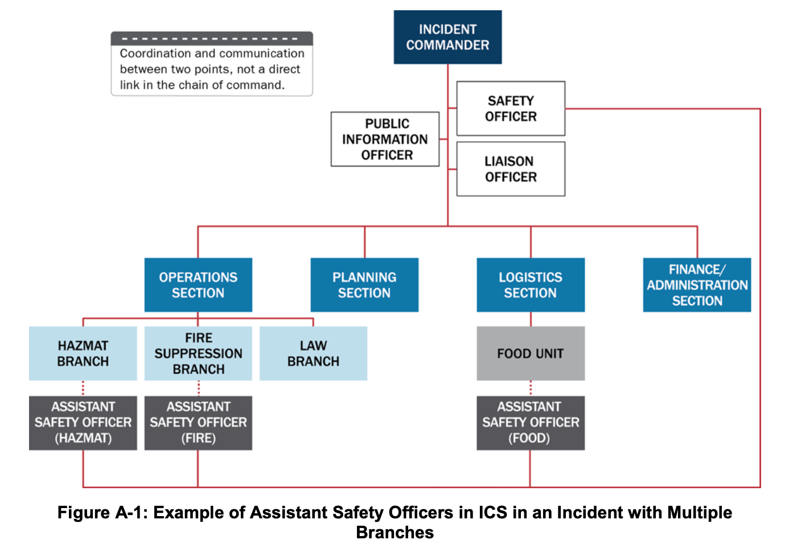
*Figure A-1: 다수 지대(Branches)가 운영되는 사건에서 안전보좌관(Assistant Safety Officers)의 ICS 배치 예시*

3. **연락담당관 (Liaison Officer, LNO):**
   - 사건 관리 인력과 대응을 지원·협력하는 외부 조직(관할권이나 법적 권한이 없는 타 정부기관, NGO, 민간 부문) 간의 정보 및 지원 통로 역할을 함.
   - 지원/협력 기관이 파견한 **기관대표(Agency Representatives)**들은 소속 기관을 대변하며 연락담당관과 직접 조율함.
4. **지휘자문관 (Command Advisors):**
   - IC/UC는 3대 지휘참모 외에 기술전문가를 지휘자문관으로 임명할 수 있음: ① **법률자문관(Legal Counsel)**(비상선포, 대피·격리 명령, 언론 접근권 자문), ② **의료자문관(Medical Advisor)**(급성·장기 의료, 정신건강, 다수사상자, 역학, 대량 예방투약 자문), ③ **과학기술자문관(Science and Technology Advisor)**, ④ **접근 및 기능적 필요 자문관(Access and Functional Needs Advisor)**(다양한 취약 계층의 통신·수송·필수 서비스 자문).

---

## 3. ICS Tab 2 — 작전부 (The Operations Section) *(원문 pp. 84–90)*

### 3.1 작전부의 임무와 조직 구조
- **핵심 임무:** 인명 구조, 즉각적 위험 감소, 재산 및 환경 보호, 상황 통제 확립, 정상 운영 복구에 초점을 맞춘 모든 **현장 전술 활동(Tactical activities)**을 수행함. **인명 구조와 대원 안전이 언제나 최우선 순위**임.
- 소방, 법집행(경찰), 공중보건, 공공사업, 응급의료(EMS), NGO, 민간 부문이 함께 참여하며 지대(Branches), 지역대(Divisions), 기능대(Groups), 태스크포스(Task Forces), 기동타격대(Strike Teams)로 편성됨(그림 A-2 참조).

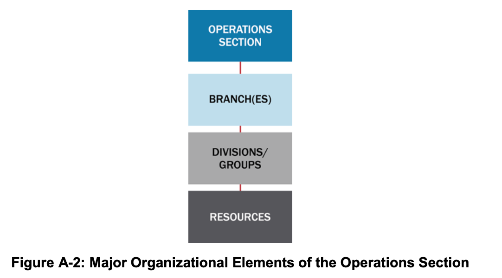
*Figure A-2: 작전부(Operations Section)의 주요 조직 구성 요소(지대, 지역대, 기능대, 기동타격대, 태스크포스, 단일자원)*

- **작전부장 (Operations Section Chief):** 현장 전술 활동을 직접 관리하고 IAP 이행을 감독하며, 차기 작전주기 IAP 수립에 직접적인 책임을 짐. 통제 범위를 유지하기 위해 지리적, 기능적, 또는 혼합형 구조로 하부 조직을 편성함.

### 3.2 지대 (Branches): 지리적 지대 및 기능적 지대
지역대(Divisions)나 기능대(Groups)의 수가 관리 가능한 통제 범위(Span of control)를 초과할 때, 작전부장과 지역대/기능대 사이에 **지대(Branches)**를 삽입함.
1. **지리적 지대 구조 (Geographic Branch Structure):** 2개 이상의 지역대/기능대를 묶어 통제 범위를 유지함. 예를 들어 4개 지역대가 작전부장에게 보고하던 중 2개 지역대가 추가되어 긴밀한 감독이 필요해지면 2개의 지대(Branch I, Branch II) 조직을 형성함(그림 A-3 참조). 지대 경계는 사건 지도에 표시하고 대원들에게 명확히 전파함.

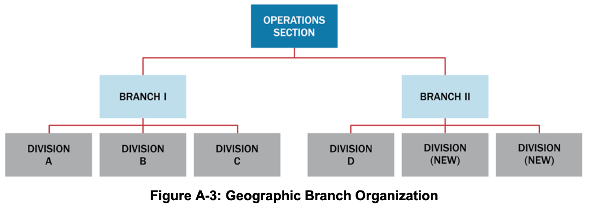
*Figure A-3: 지리적 지대(Geographic Branch) 조직 구성 예시*

2. **기능적 지대 구조 (Functional Branch Structure):** 대형 항공기 추락 사고와 같이 법집행, 소방, EMS, 공공사업, 공중보건 등 다양한 전문 분야가 단일 작전부장 아래에서 각각 기능적 지대를 운영하는 구조임(그림 A-4 참조).

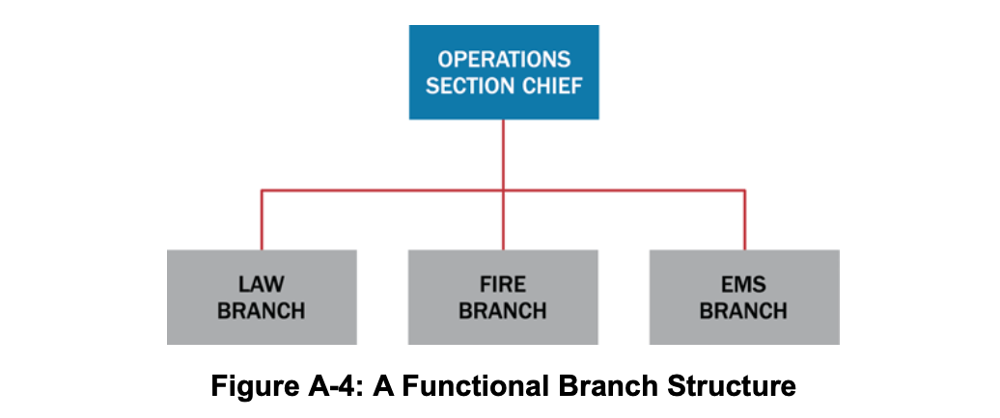
*Figure A-4: 기능적 지대(Functional Branch) 조직 구성 예시*

### 3.3 지역대(Divisions)와 기능대(Groups)
자원 수가 작전부장의 통제 범위를 초과할 때 지역대와 기능대를 설치함. **지역대 감독관과 기능대 감독관은 동일한 수준의 권한(Same level of authority)**을 가짐.
1. **지역대 (Divisions):** 항상 **지리적·물리적 구역 배정(Geographic assignments)**을 의미함. 행정 경계, 강·주요 도로 등 자연 지형, 또는 **고층 건물 화재 시의 층별 구역(Floors in a multistory building)**으로 구분함(그림 A-5 참조).

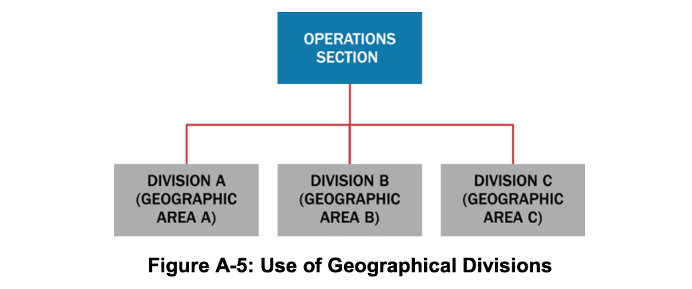
*Figure A-5: 지리적 지역대(Geographical Divisions) 분할 운영 예시*

2. **기능대 (Groups):** 항상 **유사한 활동의 기능적 임무 배정(Functional assignments)**(예: 구조대, 대피대, 법집행대, 의료처치·중증도분류대, 제연대 등)을 의미함(그림 A-6 참조). 단일 사건에서 지역대와 기능대를 동시에 혼합 운용할 수 있음.

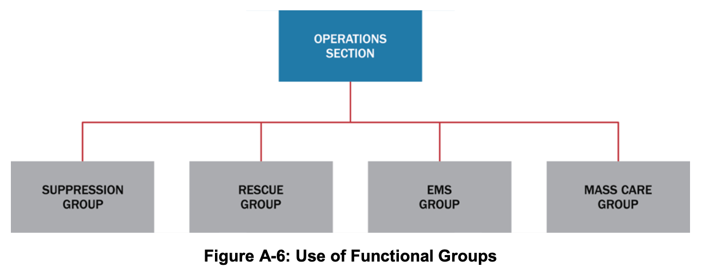
*Figure A-6: 기능대(Functional Groups) 편성 운영 예시*

### 3.4 자원의 편성 (Organizing Resources) 및 항공작전지대 (Air Operations Branch)
- **자원 결합의 3유형:**
  1. **단일 자원 (Single Resources):** 개별 인력 1명 또는 조작원이 포함된 개별 장비 1대.
  2. **태스크포스 (Task Forces):** 지정된 리더 아래 특정 임무 완수를 위해 **서로 다른 종류와 유형(Different kinds and types)의 자원**을 결합한 편성(예: 홍수 시 배수로 개방을 위해 덤프트럭 1대 + 백호 1대 + 삽과 차량을 갖춘 5인 작업조 + 공공사업 감독관으로 구성된 태스크포스).
  3. **기동타격대 (Strike Teams / 법집행 분야: Resource Teams):** 지정된 리더 아래 **동일한 종류와 유형(Same kind and type)의 자원**이 정해진 수량으로 결합된 편성(예: 3유형 덤프트럭 5대와 기동타격대장으로 구성된 잔해제거 기동타격대).
- **항공작전지대 (Air Operations Branch):** 헬기 1대만 운용될 때는 작전부장이 직접 통제하나, 다수 항공기 투입 및 공역 통제(Air-space control)가 필요한 복잡한 항공 작전 시 항공작전지대를 설치함. 회전익(헬기)과 고정익 항공기가 동시에 공역에서 활동할 경우 **항공전술기능대 감독관(Air Tactical Group Supervisor)**이 헬기조정관 및 고정익조정관의 보좌를 받아 공중 활동을 조정하며, **항공지원기능대(Air Support Group)**는 헬기 기지 운영 및 항공 자원 근무시간 기록(Timekeeping)을 담당함(그림 A-7 참조).

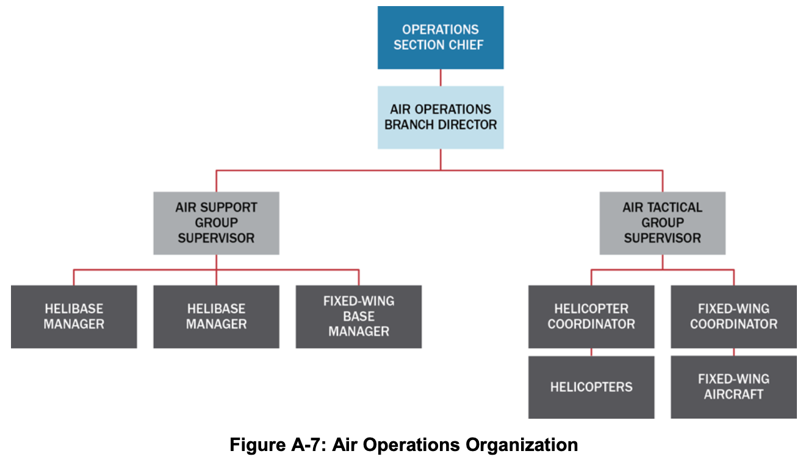
*Figure A-7: 항공작전(Air Operations) 조직 구성도*

---

## 4. ICS Tab 3 — 기획부 (The Planning Section) *(원문 pp. 91–93)*

### 4.1 기획부장과 4대 핵심 반(Units)
- **기획부장 (Planning Section Chief):** 사건 작전 및 배정 자원에 관한 데이터 수집·분석을 총괄하고, 사건활동계획(IAP) 회의를 주재하며, 매 작전주기의 IAP를 작성함. 기획부는 4개 기본 반(자원반, 상황반, 문서반, 동원해제반)과 기술전문가로 구성됨(그림 A-8 참조).

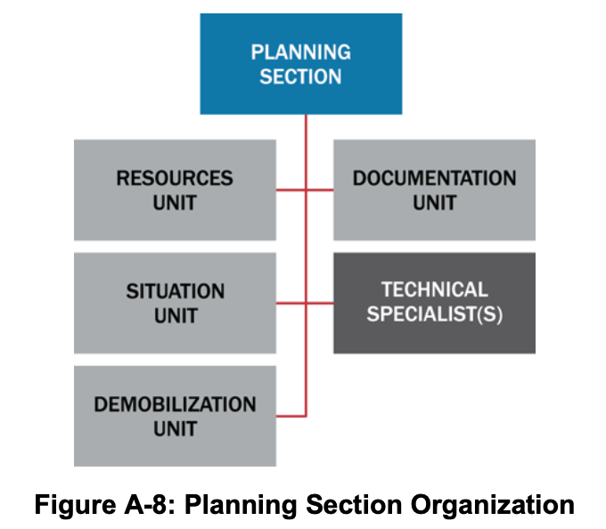
*Figure A-8: 기획부(Planning Section) 조직 구성도*

1. **자원반 (Resources Unit):**
   - 사건에 배정된 모든 자원의 현장 체크인(Check-in)을 확인하고 위치와 상태를 지속적으로 추적함.
   - **자원 상태 3대 분류:** ① **임무배정(Assigned)**(체크인 후 작업 과업이 부여된 자원), ② **가용대기(Available)**(체크인 후 자원대기소 등에서 임무 배정을 대기 중인 자원), ③ **운용불가(Out of Service)**(기계 고장, 휴식, 인력 사유로 배정 불가한 자원).
   - *(구분 유의)* 이미 현장에 배정된 자원은 **기획부 자원반**이 추적하지만, 주문되었으나 아직 현장에 도착하지 않은 자원은 **물류부(Logistics Section)**가 추적함.
2. **상황반 (Situation Unit):**
   - 상황 정보를 수집·처리·조직화하고 상황요약보고서(SITREP) 및 향후 전개 예측을 작성함. 지리공간정보시스템(GIS) 전문가를 포함하여 사건 지도를 제작하고, 현장관측관(Field Observers)을 운용함.
3. **문서반 (Documentation Unit):**
   - 법적·분석적·역사적 목적을 위해 사건 파일과 기록을 보존하고, IAP의 취합·복제·배포 서비스를 제공함.
4. **동원해제반 (Demobilization Unit):**
   - 사건 초기부터 인력·자원 명부를 작성하여 **사건동원해제계획(Incident Demobilization Plan)**을 수립하고, IC/UC 승인 후 배포함.
5. **기술전문가 (Technical Specialists):**
   - 특수 전문성을 가진 인력으로 필요시에만 활성화됨. 단기 1인 자문은 상황반에 배속하고, 장기 다수 전문가가 필요하면 기획부 내에 별도의 기술반(Technical Unit)을 설치함(예: 제독 전문가, 환경영향 전문가, 역학조사관, 기상학자, 독성학자, 수의사, 행동건강 전문가 등).

---

## 5. ICS Tab 4 — 물류부/군수부 (The Logistics Section) *(원문 pp. 94–96)*

### 5.1 물류부장과 2대 지대(Service / Support Branches) 6대 반 구조
- **물류부장 (Logistics Section Chief):** 사건 대원들을 위한 시설, 수송, 보급품, 장비 정비·연료, 통신, 급식, 의료 서비스를 총괄 제공함. 대규모 사건에서는 통제 범위를 유지하기 위해 **서비스지대(Service Branch: 통신·의료·급식)**와 **지원지대(Support Branch: 보급·시설·지상지원)**의 2개 지대로 분할 가능함(그림 A-9 참조).

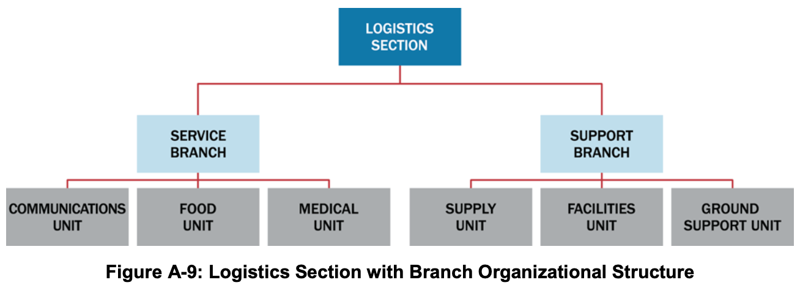
*Figure A-9: 지대(Branch) 구조로 편성된 물류부(Logistics Section) 조직도*

1. **보급반 (Supply Unit):** 전술 및 지원 자원(인력 포함)과 소모성·비소모성 보급품의 현장 외 주문(Off-incident ordering), 수령, 보관, 목록화, 배분을 전담함.
2. **시설반 (Facilities Unit):** 현장지휘소(ICP), 사건기지(Incident Base), 캠프(Camps) 및 대원 식사·수면·위생·샤워 시설을 설치·유지·철거하고 시설 보안을 제공함.
3. **지상지원반 (Ground Support Unit):** 지상 수송 차량 관리, 장비 정비·연료 보급, 사용 전후 장비 점검을 수행하며 **사건교통계획(Incident Traffic Plan)**을 수립·시행함.
4. **통신반 (Communications Unit):** 통신 장비 설치·테스트, 현장 통신센터 운영, 무선 주파수 배정 및 **사건통신계획(Incident Communications Plan, ICS Form 205)**을 수립함.
5. **급식반 (Food Unit):** 캠프와 자원대기소를 포함한 모든 현장 대원들의 식수와 영양 급식을 계획·조달·제공함.
6. **의료반 (Medical Unit):** **현장 대응 대원(Incident personnel)**에 대한 응급처치, 정신건강, 산업보건, 부상 대원 이송을 담당하고 **사건의료계획(Medical Plan, ICS Form 206)**을 수립하며 재정/행정부의 산재 보상 서류 작업을 지원함.

> **💡 [원문 핵심 구분 박스: 물류부(Logistics) vs 작전부(Operations)의 책임 경계]**
> 물류부의 **시설반, 급식반, 의료반**은 오직 **현장 대응 대원(Incident workers/personnel)**을 위한 숙소, 급식, 의료만을 지원함. 재난으로 피해를 입은 **일반 이재민/생존자(Survivors/Evacuees)에게 비상 대피소, 구호 급식, 응급 의료를 제공하는 것은 물류부가 아니라 작전부(Operations Section)의 전술적 활동**임!

---

## 6. ICS Tab 5 — 재정/행정부 (The Finance/Administration Section) *(원문 pp. 97–98)*

### 6.1 재정/행정부장과 4대 핵심 반(Units)
- **재정/행정부장 (Finance/Administration Section Chief):** 현장 재정 및 행정 서비스가 필요할 때 설치되며, 다수의 자금원을 모니터링하고 발생 비용(Accrued costs)을 추적·보고하여 지휘관이 자금 부족으로 작전에 차질을 빚기 전에 추가 예산을 예측·확보하도록 지원함(그림 A-10 참조).

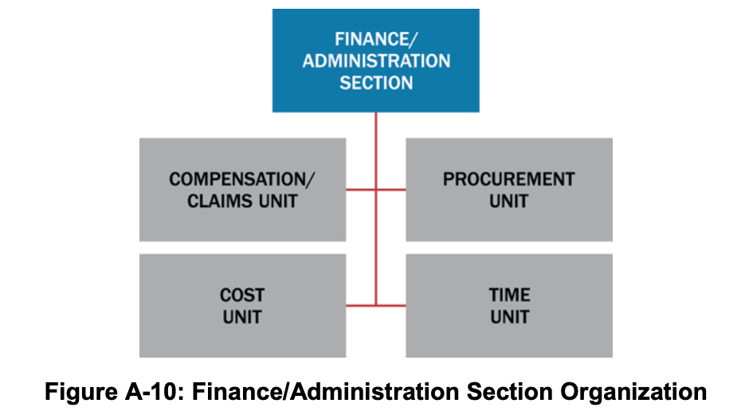
*Figure A-10: 재정/행정부(Finance/Administration Section) 조직 구성도*

1. **보상/배상반 (Compensation and Claims Unit):** 사건 현장의 재산 피해, 부상, 사망으로 인한 재정 문제를 처리함. 대원 산재 보상(Workers' compensation) 서류 작성(의료반과 긴밀 협조) 및 민간 불법행위 손해배상 청구(Civil tort claims) 조사를 지원함.
2. **비용반 (Cost Unit):** 모든 배정 자원의 실제 비용을 기록·분석하고 비용 추계 및 비용 절감 방안을 기획부에 제공함.
3. **조달반 (Procurement Unit):** 장비 임대차 계약(Equipment rental agreements) 및 벤더 보급품 계약을 포함한 모든 재정 계약을 관리함.
4. **시간기록반 (Time Unit):** 관련 기관 정책에 따라 현장 투입 인력과 장비의 일일 근무·가동 시간을 정확히 기록·검증함.

---

## 7. ICS Tab 6 — 정보/수사 기능 (The Intelligence/Investigations Function) *(원문 pp. 99–101)*

- **목적:** 감염병 창궐, 방화, 복합 테러 공격, 사이버 사건 등 사건의 원인이나 출처를 규명하여 영향을 통제하고 유사 사건 재발을 방지함.
- **ICS 내 4대 배치 옵션 (그림 A-11 참조):** 사건의 성격과 정보/수사 활동의 비중에 따라 다음 4곳 중 하나(또는 조합)에 배치할 수 있음:
  1. **기획부 내 배치 (In the Planning Section):** 상황반(Situation Unit)의 일부 또는 별도의 정보/수사반(I/I Unit)으로 통합하여 일반 상황정보 수집·분석 역량을 강화함.
  2. **작전부 내 배치 (In the Operations Section):** 법집행, 소방, EMS, 화생방, 공중보건 등 모든 전술 작전과 수사 활동을 하나로 통합함. 테러 사건 등 정보/수사 활동이 지배적인 단계에서는 정보/수사 인력이 작전부장 등 리더십 직위를 맡아야 함.
  3. **지휘참모 내 배치 (In the Command Staff):** 직접적인 수사 작전은 없으나 정보/수사 차원의 자문이 필요할 때 지휘자문관(Command Advisor)으로 배치하여 IC/UC, 법률자문관, 안전담당관, PIO와 즉각 소통하게 함.
  4. **독립된 제5의 일반참모 부서로 설치 (As a Standalone General Staff Section):** 실제 또는 잠재적 범죄·테러 행위나 대규모 역학조사 등 정보/수사 측면을 일반 작전·기획과 분리 관리해야 할 때 **정보/수사부(Intelligence/Investigations Section)**로 독립 설치함. 산하에 수사작전대, 실종자대, 정보대, 다수사망자관리대, 과학수사(포렌식)대, 수사지원대를 둠 *(각주 21)*.

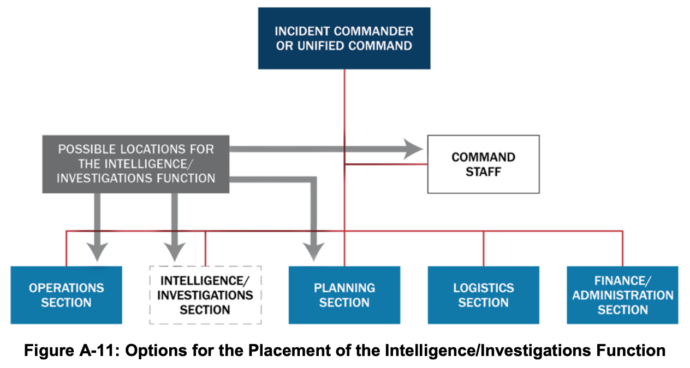
*Figure A-11: ICS 조직 내 정보/수사(Intelligence/Investigations) 기능의 4가지 배치 옵션*

---

## 8. ICS Tab 7 — 다수 사건 관리의 통합 (Consolidating the Management of Multiple Incidents) *(원문 pp. 102–103)*

1. **사건복합체 (Incident Complex):**
   - 동일한 일반 구역 내에서 발생한 2개 이상의 개별 사건을 단일 사건지휘관(IC) 또는 통합지휘부(UC)에 배정하여 하나의 ICS 조직으로 통합 관리하는 구조임. 기존 개별 사건들은 사건복합체 작전부(Operations Section) 산하의 **지대(Branches) 또는 지역대(Divisions)**로 편입됨.
   - 산불, 지진, 토네이도, 홍수 등으로 근접 지역에 소규모 사건이 동시다발적으로 발생할 때 지휘·물류 지원의 규모의 경제(Economies)를 달성할 수 있음.
2. **광역지휘부 (Area Command / Unified Area Command):**
   - 다수의 사건 관리를 감독하거나 다수의 ICS 조직이 가동 중인 대형·진화 사건을 감독하기 위해 설치됨.
   - **핵심 원칙:** 광역지휘부는 **직접적인 현장 작전 책임(Operational responsibilities)을 지지 않으며**, 사건들 간의 **희소 자원(Scarce resources) 사용 우선순위를 결정·할당**함.
   - **주요 직책:** 광역지휘관(Area Commander / 다관할 시 통합광역지휘부[Unified Area Command]), 광역지휘 물류부지휘관(Assistant Area Commander–Logistics), 광역지휘 기획부지휘관(Assistant Area Commander–Planning), 광역지휘 항공조정관(Area Command Aviation Coordinator) 및 지원 참모(자원반장, 상황반장, PIO, 연락담당관).
   - **위치 지침:** 사건들과 충분히 가까워야 하나, **개별 현장지휘소(ICP)와의 혼선을 피하기 위해 어느 개별 ICP와도 같은 장소에 함께 배치(Co-located)해서는 안 됨**.

---

## 9. ICS Tab 8 — 사건활동계획 수립 프로세스 및 플래닝 P (Incident Action Planning & Planning "P") *(원문 pp. 104–108)*

### 9.1 사건활동계획(IAP)의 의의와 플래닝 P (Planning "P")
- 사건활동계획(IAP) 수립 프로세스는 작전을 동기화하고 모든 활동이 사건 목표를 뒷받침하도록 보장하는 일정한 리듬과 구조를 제공함.
- **플래닝 P (Planning "P", 그림 A-12 참조):** 사건활동계획 주기를 구성하는 회의, 작업 기간, 브리핑의 순서와 관계를 도식화한 모델임.
  - **"P"의 기둥 다리 (Leg of the "P"):** 사건 초기 상황인식을 확보하고 조직을 구축하는 단계로, **사건 발생 시 단 한 번만 수행**함(사건 발생 → 초기 대응 및 평가 → 기관장 브리핑 → 사건 브리핑[ICS 201] → 초기 통합지휘 회의).
  - **"P"의 원형 고리 (Top of the "P"):** 매 작전주기(Operational Period)마다 반복되는 계획 및 작전 순환 주기임(목표 설정/갱신 → 전략회의/지휘·일반참모 회의 → 전술회의 준비 → 전술회의[ICS 215, 215A 활용] → 기획회의 준비 → 기획회의 → IAP 작성 및 승인 → 작전주기 브리핑 → 작전 실행 및 상황 평가).

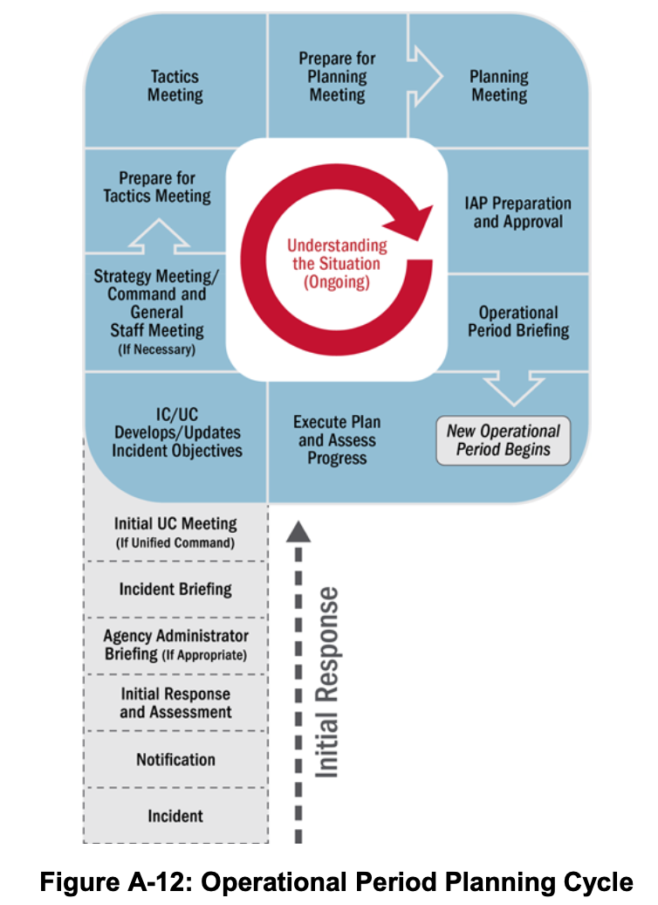
*Figure A-12: 작전주기 계획 수립 사이클 — 플래닝 P (Operational Period Planning Cycle / Planning "P")*

#### 📊 [표 A-2] 사건활동계획(IAP) 구성 서식 및 작성 책임 부서 (Table A-2: The IAP and Typical Attachments)

| IAP 구성 요소 및 첨부 계획 (Component) | 작성 책임 단위 (Normally Prepared By ICS) |
| :--- | :--- |
| **사건 목표 (Incident Objectives — ICS Form 202)** | 사건지휘관(IC) 또는 통합지휘부(UC) |
| **조직배정목록 또는 조직도 (ICS Forms 203, 207)** | 자원반 (Resources Unit) |
| **작전배정목록 (Assignment List — ICS Form 204)** | 자원반 (Resources Unit) |
| **무선통신계획 (ICS Form 205) 또는 통신연락망 (ICS Form 205A)** | 통신반 (Communications Unit) |
| **의료계획 (Medical Plan — ICS Form 206)** | 의료반 (Medical Unit) |
| **사건 지도 (Incident Maps)** | 상황반 (Situation Unit) |
| **일반 안전 메시지 / 현장안전계획 (ICS Form 208)** | 안전담당관 (Safety Officer) |
| **항공작전 요약서 (Air Operations Summary)** *(필요시)* | 항공작전지대 (Air Operations) |
| **교통계획 (Traffic Plan)** *(필요시)* | 지상지원반 (Ground Support Unit) |
| **제독계획 / 폐기물관리계획** *(필요시)* | 기술전문가 (Technical Specialist) |
| **동원해제/비활성화 계획 (Demobilization Plan)** *(필요시)* | 동원해제반 (Demobilization Unit) |
| **현장보안계획 / 수사계획** *(필요시)* | 법집행기관, 보안매니저 / 정보·수사 기능 |
| **회의 일정표 (Meeting Schedule — ICS Form 230)** *(필요시)* | 상황반 (Situation Unit) |
| **대피계획 / 대피소·대량구호계획** *(필요시)* | 필요 부서 (As needed) |

---

## 10. ICS Tab 9 & Tab 10 — ICS 표준 서식 및 주요 직위별 핵심 기능 요약 *(원문 pp. 109–111)*

### 10.1 주요 ICS 표준 서식 18종 요약 (ICS Tab 9 — ICS Forms) *(각주 22)*

| 서식 번호 | 공식 명칭 (Form Title) | 핵심 용도 및 특징 |
| :--- | :--- | :--- |
| **ICS Form 201** | **사건 브리핑 (Incident Briefing)** | 초기 지휘관이 후임 지휘관에게 지휘권을 인계할 때 사용하는 4섹션(4페이지) 브리핑 문서(서면 IAP에는 미포함) |
| **ICS Form 202** | **사건 목표 (Incident Objectives)** | 서면 IAP의 첫 페이지. 작전주기 목표, 기상 정보, 일반 안전 메시지 및 IC/UC의 최종 승인 서명란 포함 |
| **ICS Form 203** | **조직배정목록 (Organization Assignment List)** | 서면 IAP의 두 번째 섹션. 해당 작전주기의 지휘·감독 인력 전체 명단 수록 |
| **ICS Form 204** | **작전배정목록 (Assignment List)** | 각 지역대(Division)/기능대(Group)별 전담 페이지. 감독관, 배정 자원, 세부 과업, 특수 지시, 통신망 수록 |
| **ICS Form 205** | **사건무선통신계획 (Radio Comm. Plan)** | 지역대/기능대 수준까지의 무선 주파수 및 채널 배정 내역 기록 |
| **ICS Form 205A**| **통신연락망 목록 (Communications List)** | 무선 외(유선·휴대전화·이메일 등) 사건 인력 연락처 기록 |
| **ICS Form 206** | **의료계획 (Medical Plan)** | 현장 대원들의 응급 의료 처치 및 후송 병원 계획 제시 |
| **ICS Form 207** | **사건 조직도 (Incident Organization Chart)** | ICS 조직의 주요 요소와 핵심 참모를 시각적 차트로 표시 |
| **ICS Form 208** | **안전 메시지/계획 (Safety Message/Plan)** | 안전 메시지, 확장 안전 메시지 및 현장안전계획 수록 |
| **ICS Form 209** | **사건현황요약 (Incident Status Summary)** | EOC, MAC Group, 기관장에게 상황 정보를 보고하는 핵심 요약 서식 |
| **ICS Form 210** | **자원상태변경 (Resource Status Change)** | 현장 배정 자원의 상태 변경 및 도착·출발 추적 워크시트 |
| **ICS Form 211** | **사건 체크인 목록 (Incident Check-In List)** | 현장에 도착하여 등록(Check-in)한 모든 자원 기록 |
| **ICS Form 213** | **일반 메시지 서식 (General Message Form)** | 현장 인력 간 또는 지휘 계층 간 공식 메시지 전달용 서식 |
| **ICS Form 214** | **활동 일지 (Activity Log)** | 주요 활동이나 사건을 시간순으로 기록하는 공식 로그 |
| **ICS Form 215** | **작전기획 워크시트 (Operational Planning)** | 전술회의에서 차기 작전주기의 전술 배정 및 자원 소요를 도출하는 핵심 워크시트 |
| **ICS Form 215A**| **IAP 안전분석 (IAP Safety Analysis)** | 전술회의 시 안전담당관이 식별한 위험 요소와 완화 대책을 기록 |
| **ICS Form 221** | **동원해제 체크아웃 (Demobilization Check-Out)**| 동원 해제되는 자원의 복귀 점검 및 세부 사항 기록 |
| **ICS Form 230** | **회의 일정표 (Meeting Schedule)** | 작전주기 중 예정된 공식 회의 및 브리핑 일정 기록 |

### 10.2 주요 ICS 직위별 핵심 기능 총괄표 (ICS Tab 10 — Table A-3)

| 주요 ICS 직위 | 핵심 수행 기능 (Primary Functions) |
| :--- | :--- |
| **사건지휘관(IC) 또는 통합지휘부(UC)** | • 명확한 권한 보유 및 기관 정책 숙지, 사건 관리에 필요한 ICS 조직 확립 • 사건 목표(Objectives) 설정 및 우선순위 결정, 현장지휘소(ICP) 설치 • 지휘참모 및 일반참모 관리, 사건활동계획(IAP) 승인 및 현장 안전 보장 • 자원 요청 승인 및 자원봉사자·보조 인력 활용 승인 • 언론 정보 배포 승인, 필요시 동원 해제 명령 및 사후강평보고서(AAR) 완수 보장 |
| **공보담당관 (PIO)** | • 언론 브리핑 및 소셜 미디어 배포용 정확·신속·접근 가능한 정보 개발 • 전통 매체 및 소셜 미디어 모니터링, 루머 통제(Rumor control) 기법 식별·시행 • 보도자료에 대한 지휘관 승인 획득, 언론 브리핑 실시 및 기획회의 참여 |
| **안전담당관 (Safety Officer)** | • 위험 상황 식별·완화 및 불안전한 행위 즉각 중지·예방 • 사건안전계획(Safety Plan) 수립·유지, 안전 메시지 작성 및 IAP 안전 검토 • 특수 위험 평가 유자격 안전보좌관 배치, 현장 내 사고 초기 조사 개시 • 의료계획(Medical Plan) 검토·승인 및 미래 작전 위험 대비를 위한 기획회의 참여 |
| **연락담당관 (Liaison Officer)** | • 외부 지원·협력 기관 대표(Agency Representatives)들의 단일 접촉 창구 역할 • 기관 간 현재·잠재적 쟁점 식별을 위한 작전 모니터링 및 지원·협력 기관 명부 유지 • 기획회의에 참여하여 각 기관 자원의 한계와 역량, 기관별 동원해제 요구사항 제공 |
| **작전부장 (Operations Section Chief)** | • 모든 현장 전술 작전 관리, 전략·전술 결정 및 전술 작전의 안전 보장 • IAP 수립 프로세스에서 작전부의 중심 역할 총괄 및 IAP 배정 임무 실행 감독 • 전술 작전 지원을 위한 추가 자원 요청, 작전 배정 자원의 해제 승인 및 긴급 IAP 변경 승인 |
| **기획부장 (Planning Section Chief)** | • 사건 관련 작전 데이터 수집·관리 및 사건 기획 활동 감독·촉진 • IAP 작성 총괄 감독 및 IC·작전부에 자원 정보 투입 제공 • 운용불가(Out-of-service) 인력의 ICS 내 재배치, 상황 정보 취합·전시 및 대안 전략 정보 수집 • 사건 잠재력에 대한 주기적 예측 제공 및 동원해제계획(Demobilization Plan) 작성 감독 |
| **물류부장 (Logistics Section Chief)** | • 모든 사건 물류·군수 관리(시설, 수송, 통신, 보급, 장비 정비·연료, 대원 급식·의료) • 현재 및 예상되는 사건 서비스·지원 소요 식별 및 추가 자원 요청 • IAP에 물류부 투입 요소 제공, 교통·의료·통신계획 수립 감독 및 물류 자원 동원해제 감독 |
| **재정/행정부장 (Finance/Admin Chief)** | • 사건의 모든 재정적 측면 관리, 재정·비용 분석 정보 제공 및 보상·배상 기능 처리 보장 • 협력·지원 기관과 재정 문제 일일 소통, 인력 근무시간 기록의 정확성 검증 및 소속 기관 전송 • 현장에서 개시된 모든 채무·계약 문서의 정확성 보장 및 IAP 재정 요소 투입 제공 |

---

# 부록 B. 비상운영센터 조직 구조 (Appendix B. EOC Organizations)
> **참고 원문:** *National Incident Management System (Third Edition, October 2017) - Appendix B (pp. 112–118)*  
> **작성 원칙:** 미국 내 비상운영센터(EOC)에서 가장 널리 사용되는 **3대 표준 조직 구조 모델(EOC Tabs 1–3)**의 적용 조건, 장단점, 부서별 핵심 기능을 원문 도표(`Figure B-1` ~ `Figure B-3`)와 함께 100% 충실하게 정리함.

---

## 1. 목적 및 개요 (Purpose & Organization of This Appendix) *(원문 p. 112)*

- 본 부록은 미국 내 EOC에서 일반적으로 사용되는 3가지 조직 구조 예시를 설명함. 이는 강제적이거나 배타적인 것이 아니며, 관할구역이나 조직은 이 중 하나를 선택하거나 여러 구조의 요소를 결합하거나 완전히 다른 구조를 사용할 수 있음.
- 조직도 그래픽에는 직접 표시되지 않으나, 모든 EOC는 주지사, 시장, 시 매니저, 부족 지도자 등 **선출직 및 임명직 고위 공직자로 구성된 정책그룹(Policy Groups / MAC Groups)의 지침**을 받음.
- **부록 B의 3대 탭(Tab) 구성:**
  - **EOC Tab 1** — 현장지휘체계(ICS) 또는 ICS 유사형 EOC 구조 (ICS or ICS-like EOC Structure)
  - **EOC Tab 2** — 사건지원모델(ISM) EOC 구조 (Incident Support Model EOC Structure)
  - **EOC Tab 3** — 부서별(부처별) EOC 구조 (Departmental EOC Structure)

---

## 2. EOC Tab 1 — ICS 또는 ICS 유사형 EOC 구조 (ICS or ICS-like EOC Structure) *(원문 pp. 113–114)*

### 2.1 채택 배경 및 특징
- 인력들이 이미 ICS 구조에 익숙하고 현장(Field)에서 사용하는 구조와 일치하기 때문에 많은 관할구역이 선택함. 특히 EOC가 직접 작전 임무를 수행해야 하는 경우에 유용한 기능적 분류를 제공함.
- **표준 ICS 채택 조건:** ① EOC 인력이 사건에 직접 전술적 지시(Tactical direction)를 제공하는 경우, ② 추가 교육 없이 ICS 교육 이수 인력을 그대로 활용하려는 경우, ③ 현장 인력의 조직을 그대로 미러링(Mirror)하려는 경우.
- **ICS 유사형(ICS-like) 변형:** 현장지휘소(ICP)의 전술·물류 관리 역할과 구별하여 EOC의 **조정 및 지원(Coordination and Support) 임무를 강조**하기 위해 부서 명칭에 **"조정(Coordination)" 또는 "지원(Support)"**을 붙여 변경함(그림 B-1 참조).

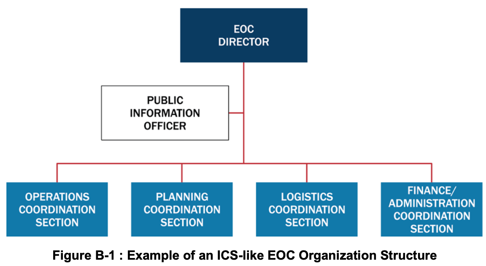
*Figure B-1: ICS 유사형 비상운영센터(ICS-like EOC) 조직 구조 예시*

### 2.2 주요 구성 부서별 기능
1. **EOC 지휘참모 (EOC Command Staff / EOC Management Staff):** 현장 작전을 직접 지휘하는 것이 아님을 명확히 하기 위해 흔히 'EOC 관리참모'로 불림. **EOC 센터장(EOC Director)**을 중심으로 공보담당관(PIO), 법률자문관, 안전담당관 등이 포함되며, EOC 목표·과업 설정 및 고위 공직자 정책 방향 수립을 보좌함.
2. **작전조정부 (Operations Coordination Section):** 현장 대응 인력이 사건 목표 달성에 필요한 자원과 작전 지원을 받도록 보장함. 흔히 비상지원기능(ESF) 또는 복구지원기능(RSF)별로 편성되며 현장 대응 인력의 일차적 연락 창구 역할을 함.
3. **기획조정부 (Planning Coordination Section):** 상황인식(Situational Awareness) 관리와 활성화 관련 계획 수립의 2대 핵심 기능을 수행함. 현장 ICS 기획부와 긴밀히 협력하여 공간정보·기술정보를 통합하고 리더십 및 이해관계자를 위한 브리핑·보고서를 작성함.
4. **물류조정부 (Logistics Coordination Section):** 계약 시행, 상호응원협약 가동, 타 정부 지원 요청(지자체→주→연방)을 통해 현장에 고도화된 자원 조달 지원을 제공하며, EOC 자체 운영을 위한 IT·급식·숙박 지원도 담당함.
5. **재정/행정조정부 (Finance/Administration Coordination Section):** 다수 자금원 모니터링 및 활성화 관련 전체 지출·비용 분석을 관리하며, 필요시 현장 ICS 재정/행정부의 책임을 대신 수행하기도 함.

---

## 3. EOC Tab 2 — 사건지원모델(ISM) EOC 구조 (Incident Support Model EOC Structure) *(원문 pp. 115–116)*

### 3.1 채택 배경 및 핵심 구조적 특징
- 사건지원모델(ISM)은 실제 현장 대응·복구 작전을 직접 지휘하기보다 **전적으로 지원 기능(Support functions)에만 집중하는 EOC**를 위해 고안된 ICS 변형 구조임.
- **3대 구조 개편 핵심:**
  1. ICS 기획부(Planning Section)에서 **정보 관리 및 상황인식 기능을 분리하여 센터장 직속의 독립된 일반참모 부서인 '상황인식부(Situational Awareness Section)'로 격상**함.
  2. ICS 작전부(Operations)와 물류부(Logistics)의 자원 조달·지원 기능을 결합하고, 여기에 ICS 재정/행정부의 감사관/구매(Comptroller/Purchasing) 기능까지 하나로 합쳐 **원스톱 자원 지원 부서인 '자원지원부(Resources Support Section)'로 통합**함.
  3. EOC 자체의 시설·IT·행정·급식을 전담하는 **'센터지원부(Center Support Section)'**를 별도로 둠(그림 B-2 참조).

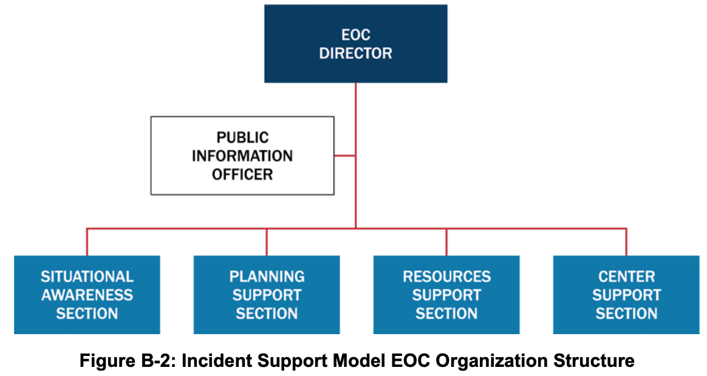
*Figure B-2: 사건지원모델 비상운영센터(ISM EOC) 조직 구조도*

### 3.2 주요 구성 부서별 기능
1. **ISM EOC 센터장 및 직속 참모 (ISM EOC Director's Staff):** EOC 센터장, PIO, 법률자문관, 안전담당관 등으로 구성되어 정책 지침 개발을 지원하고 대국민 정보를 배포함.
2. **상황인식부 (Situational Awareness Section):** 현장 ICS 기획부 상황반(Situation Unit)의 기능을 EOC 일반참모 부서 수준으로 격상한 부서로, EOC 센터장에게 직접 보고함. 사건 정보를 수집·분석·배포하고 정보요청(RFI) 처리, 브리핑 제작, GIS 통합, 대국민 경보 메시지 자료 개발을 수행함(ESF #15 대외협력 대표 포함 가능).
3. **기획지원부 (Planning Support Section):** 비상대비계획(Contingency), 비활성화(Deactivation), 복구(Recovery) 계획 등 현재 및 미래 기획 서비스를 제공하고 현장 ICS 기획부와 긴밀히 조율함.
4. **자원지원부 (Resources Support Section):** 현장 인력이 필요한 모든 자원(부처 보유분, 상호응원/EMAC, 구매·임대·계약 및 자금 집행 포함)을 소싱·주문·추적하는 **원스톱 숍(One-stop shop)** 역할을 수행함.
5. **센터지원부 (Center Support Section):** EOC 및 합동정보센터(JIC) 시설과 근무 인력들이 효과적으로 기능할 수 있도록 통신, IT, 행정, 보안, 시설 유지보수, 급식 등 내부 물류를 전담 지원함.

---

## 4. EOC Tab 3 — 부서별(부처별) EOC 구조 (Departmental EOC Structure) *(원문 pp. 117–118)*

### 4.1 채택 배경 및 특징
- 관할구역이나 조직이 평상시(Day-to-day) 각 부서 및 기관들과 유지하고 있는 일상적인 관계와 권한 체계를 재난 대응 및 복구 시에도 그대로 유지하고자 할 때 선택하는 모델임(부서 대신 비상지원기능[ESF] 단위로 구성할 수도 있음).
- 별도의 복잡한 교육훈련이 적게 요구되며, 모든 참여 부서와 기관 간의 **조정과 동등한 위상(Equal footing)**을 강조함.
- 관할구역의 **비상관리국장(Emergency Manager)** 또는 고위 공직자 1인이 EOC 센터장(EOC Director)으로서 지원 기관, NGO, 파트너들을 직접 조정하며, 그룹 내에서 통합지휘(UC)와 유사하게 상호 합의된 목표를 달성하기 위한 의사결정이 이루어짐(그림 B-3 참조).

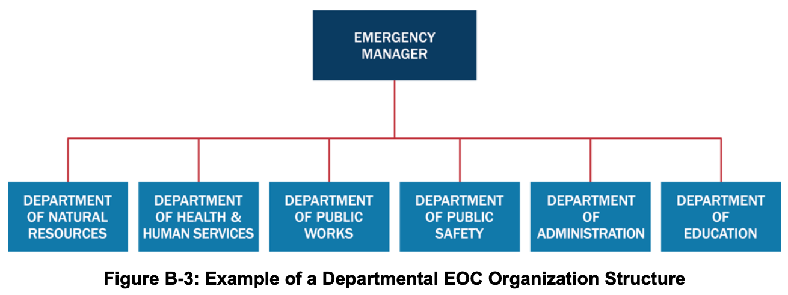
*Figure B-3: 부서별 비상운영센터(Departmental EOC) 조직 구조 예시*

### 4.2 부서별 대표들의 일상 업무 기반 역할 수행 예시
- **천연자원부 대표:** 평시 권한에 따라 역사 보존, 대기·수질, 공원, 야생동물, 산불 진압 조정 담당
- **공중보건·의료·인적서비스 기관 대표:** 노인 서비스, 지역 병원·클리닉·응급의료, 대피소 및 대량구호, 감염병 역학조사, 약국 및 대량 예방투약소, 인도주의 구호단체 연락 담당
- **공공사업부(도로·토목) 대표:** 도로·교량, 하수도·위생, 정수, 연료, 유틸리티, 교통, 폐기물 처리 자원 조정 담당
- **경찰·보안관·소방·EMS 대표:** 각자의 현장 대응 기능과 EOC 내 자원 조정 담당
- **행정부서 대표:** 공보, 재정, 교육훈련, 민간·부족 연락, 사회·문화 센터 조정 담당
- **공립학교 교육청 대표:** 아동 돌봄 서비스, 학교 시설(비상 대피소 활용 시), 스쿨버스 수송 지원 담당
