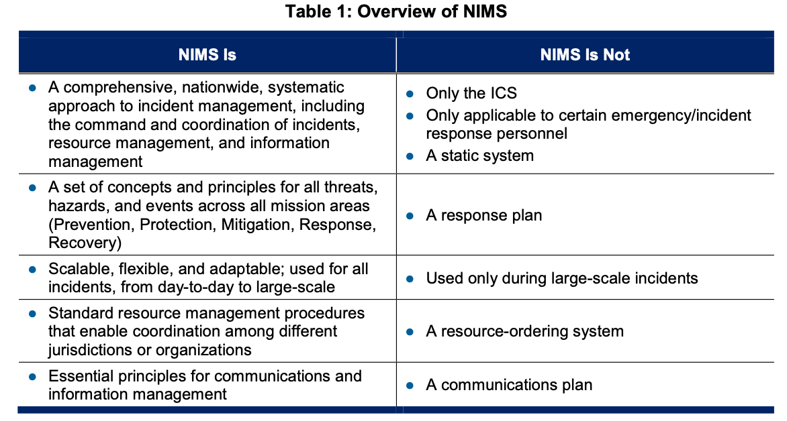

# 제1장 NIMS의 기본 원리와 핵심 개념 (I. Fundamentals and Concepts of NIMS)
> **참고 원문:** *National Incident Management System (Third Edition, October 2017) - Chapter I (pp. 1–5)*  
> **작성 원칙:** [GEMINI.md](file:///Users/sg/Project/NIMS-2017/GEMINI.md)의 **연구자료(SUB-NOTE) 사용 10대 기본 원칙**에 입각하여 원문의 단락, 표(Table 1), 각주(Footnotes 1~5), 6대 핵심 용어를 **단 하나의 누락이나 임의 왜곡 없이 100% 충실하게 정리**하고 주요 학술·실무 개념에 영문을 병기함. 원문 연구 결과(제1절~제6절)와 연구자의 비교·해석(제7절~제9절)은 엄격히 분리함.

---

## 1. 개요 (Introduction) *(원문 pp. 1–2)*

### 1.1 배경 및 필요성 *(원문 p. 1)*
- **위협과 위험의 다양성:** 미국 전역의 지역사회(Communities across the Nation)는 자연재난, 사회재난, 테러, 대규모 기술적 사고 등 매우 다양한 위협(Threats), 위험(Hazards), 사건/행사(Events)를 경험함.
- **사건(Incident)의 특성과 3대 우선순위:** 사건의 규모(Size), 빈도(Frequency), 복잡성(Complexity), 범위(Scope)는 다양하지만, 모든 사건은 공통적으로 **인명 구조(Save lives), 사건 안정화(Stabilize the incident), 재산 및 환경 보호(Protect property and the environment)**라는 목표를 달성하기 위해 다양한 인력과 조직의 협력을 필요로 함. *(각주 1 참조)*
- **상호운용성(Interoperability)의 핵심성:** 관할구역(Jurisdictions)과 조직들은 일상적으로 자원을 공유하고, 전술을 통합하며, 협력적으로 행동함. 인접한 조직들이든 미 전역에서 원거리 지원을 오는 조직들이든 관계없이, 이들의 성공은 **자원 공유(Sharing resources), 사건 조정 및 관리(Coordinating and managing incidents), 정보 소통(Communicating information)에 대한 공통적이고 상호운용 가능한 접근법(Common, interoperable approach)**에 달려 있음.
- **NIMS의 정의:** 국가사건관리시스템(National Incident Management System, NIMS)은 이러한 포괄적인 접근법을 정의함.

### 1.2 NIMS의 목적과 적용 범위 *(원문 p. 1)*
- **범정부 및 민관 협력 지침:** NIMS는 모든 계층의 정부(All levels of government), 비정부기구(Nongovernmental organizations, NGO), 민간 부문(Private sector)이 사건을 **예방(Prevent), 보호(Protect against), 완화(Mitigate), 대응(Respond to), 복구(Recover from)**하기 위해 함께 협력하도록 안내함.
- **전체 공동체(Whole Community) 접근법:** NIMS는 이해관계자들에게 공유된 어휘(Shared vocabulary), 시스템(Systems), 프로세스(Processes)를 제공하여, 전체 공동체(Whole community)가 협력하고 **국가대비체계(National Preparedness System, NPS)**에서 규정한 역량(Capabilities)을 성공적으로 전달하도록 지원함. *(각주 2, 3 참조)*
- **운영 시스템 규정:** NIMS는 현장지휘체계(Incident Command System, ICS), 긴급운영센터(Emergency Operations Center, EOC) 구조, 다기관조정그룹(Multiagency Coordination Groups, MAC Groups)을 포함하여, 사건 관리 인력들이 함께 일하도록 돕는 운영 시스템(Operational systems)을 정의함.
- **모든 사건에의 적용:** NIMS는 일상적인 사건(Day-to-day incidents)부터 대규모 재난(Major disasters)에 이르기까지 모든 사건에 적용됨.
- **다양한 역량의 통합과 경험의 결집 *(원문 p. 1 제3문단 원문 보완)*:** 사건 관리에 참여하는 관할구역과 조직들은 법적 권한(Authorities), 관리 구조(Management structures), 통신 역량 및 프로토콜(Communication capabilities and protocols) 등 여러 요소에서 차이가 남. NIMS는 이러한 다양한 역량을 통합하고 공통의 목표(Common goals)를 달성하기 위한 **공통 프레임워크(Common framework)**를 제공함. 본 문서에 담긴 지침은 미 전역의 사건 관리 인력들이 **수십 년간의 경험(Decades of experience)을 통해 발전시킨 해결책**을 통합한 것임.

### 1.3 NIMS의 3대 핵심 구성요소 (The Three Major Components) *(원문 pp. 1–2)*
NIMS는 다음의 **3대 주요 구성요소(Three major components)**로 이루어져 있으며, 이 세 가지 구성요소는 함께 작동하는 **빌딩 블록 접근법(Building-block approach)**을 나타내므로, 그중 어느 하나라도 결여되면 NIMS의 성공적인 구현이 저해됨.

```
       ┌─────────────────────────────────────────────────────────┐
       │     National Incident Management System (NIMS)          │
       └────────────────────────────┬────────────────────────────┘
                                    │
    ┌───────────────────────────────┼───────────────────────────────┐
    ▼                               ▼                               ▼
┌─────────────────────────┐ ┌─────────────────────────┐ ┌─────────────────────────┐
│  1. 자원 관리           │ │  2. 지휘 및 조정        │ │  3. 통신 및 정보 관리   │
│  (Resource Management)  │ │ (Command & Coordination)│ │(Communications & Info)│
├─────────────────────────┤ ├─────────────────────────┤ ├─────────────────────────┤
│• 자원 식별 및 유형화    │ │• 현장지휘체계 (ICS)     │ │• 표준 통신 및 상호운용│
│• 자격인증 및 크레덴셜링 │ │• 긴급운영센터 (EOC)     │ │• 정보 관리 프레임워크 │
│• 사전 준비 및 동원·해제 │ │• 다기관조정그룹 (MAC)   │ │• 합동정보시스템 (JIS) │
│                         │ │• 합동정보센터 (JIC)     │ │                         │
└─────────────────────────┘ └─────────────────────────┘ └─────────────────────────┘
```

1. **자원 관리 (Resource Management):**
   - 사건 발생 전(Prior to an incident)과 사건 진행 중(During an incident) 모두에 걸쳐 인력(Personnel), 주요 장비(Major equipment), 보급품(Supplies), 팀(Teams), 시설(Facilities)을 포함한 자원을 체계적으로 관리하기 위한 표준 메커니즘을 기술함.
   - 이를 통해 필요할 때 조직들이 자원을 효과적으로 공유하고 통합할 수 있도록 보장함.
2. **지휘 및 조정 (Command and Coordination):**
   - 운영적 현장 수준(Operational on-scene level)과 사건 지원 수준(Incident support level)에서의 리더십 역할(Leadership roles), 프로세스(Processes), 권장 조직 구조(Recommended organizational structures)를 기술함.
   - ICS, EOC, MAC Group, 합동정보체계(Joint Information System, JIS) 등 다양한 구조가 사건을 효과적이고 효율적으로 관리하기 위해 어떻게 함께 작동하는지 설명함.
3. **통신 및 정보 관리 (Communications and Information Management):**
   - 사건 관리 인력과 기타 의사결정자들이 핵심적인 결정을 내리고 소통하는 데 필요한 수단과 정보를 갖출 수 있도록 보장하는 통신 및 정보 시스템을 위한 시스템과 방법을 기술함.

---

> ### 📌 [원문 각주 1~3 전수 번역 및 해설 (Footnotes 1–3, pp. 1–2)]
> - **각주 1 (사건[Incident]의 정의, p. 1):** NIMS에서 사용하는 "사건(Incident)"이란 자연적 현상이든 인위적 현상이든 관계없이, 인명 손실이나 재산·환경 피해를 예방하거나 최소화하기 위해 대응 조치를 필요로 하는 실제 발생했거나 임박한 발생 사건(Actual or impending occurrence)—비상사태(Emergencies)나 재난(Disasters)뿐 아니라 사전에 계획된 행사(Planned events)까지 포함—을 의미함.
> - **각주 2 (전체 공동체[Whole Community]의 정의, p. 1):** 본 문서에서 정의하는 "전체 공동체(Whole community)"란 비상관리에 대한 접근법으로서, 더 나은 조정과 협력 관계를 조성하기 위해 모든 계층의 정부 참여와 더불어 비정부기구(NGO) 및 일반 대중을 포함한 민간 및 비영리 부문의 폭넓은 주체들이 사건 관리 활동에 참여할 수 있도록 하는 데 초점을 맞추는 것을 의미함. 이는 정부만으로는 지역사회가 직면한 모든 과제를 해결할 수 없다는 사실을 인식하기 위해 전국적인 비상관리 공동체가 공동으로 개발한 프레임워크에서 유래함.
> - **각주 3 (국가대비체계[National Preparedness System, NPS], p. 2):** 2011년 3월 발표된 대통령 정책지침 제8호(Presidential Policy Directive 8, PPD-8) 「국가 대비(National Preparedness)」에 의해 확립된 국가대비체계(NPS)는 국가대비목표(National Preparedness Goal)를 달성하기 위해 미국이 채택하는 접근법을 기술함. 국가대비체계는 예방(Prevention), 보호(Protection), 완화(Mitigation), 대응(Response), 복구(Recovery)의 5대 임무 영역(Five mission areas)에 걸친 도구, 프로그램, 지침을 포함함. 국가대비체계는 **국가계획프레임워크(National Planning Frameworks), 연방기관간작전계획(Federal Interagency Operational Plans, FIOPs), 국가대비보고서(National Preparedness Report, NPR)**를 포함한 기존의 정책, 프로그램, 지침들로 구성되며 그 기반 위에 구축됨.

---

## 2. 적용 대상 및 범위 (Applicability and Scope) *(원문 pp. 2–3)*

### 2.1 적용 대상 (Audience) *(원문 p. 2)*
- **모든 사건 관리 및 지원 이해관계자:** NIMS의 대상 독자는 사건 관리 또는 지원 책임을 지는 모든 개인과 조직임. 여기에는 모든 계층의 정부, 비정부기구(NGO), 민간 부문의 응급 대응요원(Emergency responders) 및 기타 사건 인력뿐 아니라, 사건 시 주요 결정을 내리는 **선출직 및 임명직 공직자(Elected and appointed officials)**가 포함됨.
- **접근 및 기능적 필요(Access and Functional Needs)의 완전한 통합:** NIMS는 전체 공동체를 포괄하며, 그 계획과 운영에는 아동(Children), 노인(Older adults), 장애인(Individuals with disabilities), 비영어권 인력 및 주민(Non-English speaking personnel and residents)을 포함하여 **접근 및 기능적 필요가 있는 개인들(Individuals with access and functional needs)**이 완전히 통합되어야 함. *(각주 4 참조)*

### 2.2 적용 범위 (Scope) *(원문 p. 2)*
- **규모·유형·위험과 무관한 전면적 적용:** NIMS는 원거리의 사건을 지원하는 활동을 포함하여, 규모(Size), 범위(Scope), 발생 원인(Cause)과 관계없이 모든 사건과 모든 유형의 위험(All types of hazards)에 적용됨.

---

### 2.3 표 1 상세 분석: NIMS의 개요 (Table 1: Overview of NIMS) *(원문 p. 2)*



원문의 `Table 1: Overview of NIMS`는 NIMS의 본질을 **"NIMS인 것(NIMS Is)"**과 **"NIMS가 아닌 것(NIMS Is Not)"**으로 명확히 대비하여 제시함.

| NIMS Is (NIMS인 것) | NIMS Is Not (NIMS가 아닌 것) |
| :--- | :--- |
| **1. 종합적·전국적·체계적인 사건 관리 접근법**<br>*(A comprehensive, nationwide, systematic approach to incident management, including the command and coordination of incidents, resource management, and information management)* | **● 단지 현장지휘체계(ICS)에 불과한 것**<br>*(Only the Incident Command System)*<br>**● 특정 응급/사건 대응 인력에게만 적용 가능한 시스템**<br>*(Only applicable to certain emergency/incident response personnel)* |
| **2. 5대 임무 영역 전반에 관련된 일련의 개념 및 원칙**<br>*(A set of concepts and principles for all threats, hazards, and events across all five mission areas: Prevention, Protection, Mitigation, Response, and Recovery)* | **● 고정된(정적인) 시스템**<br>*(A static system)*<br>**● 하나의 대응 계획서**<br>*(A response plan)* |
| **3. 확장 가능하고 유연하며 적응성 있는 체계**<br>*(Scalable, flexible, and adaptable for all incidents, from day-to-day to large-scale)* | **● 대규모 사건 중에만 사용되는 시스템**<br>*(Used only during large-scale incidents)* |
| **4. 관할구역 및 조직 간 조정을 가능케 하는 표준 자원 관리 절차**<br>*(Standard resource management procedures that enable coordination among different jurisdictions or organizations)* | **● 자원 주문 시스템**<br>*(A resource-ordering system)* |
| **5. 통신 및 정보 관리를 위한 필수 원칙**<br>*(Essential principles for communications and information management)* | **● 통신 계획서**<br>*(A communications plan)* |

```
                       [ NIMS의 본질: Doctrine vs Plan ]
┌────────────────────────────────────────────────────────────────────────┐
│  NIMS (국가 표준 교리/프레임워크)                                      │
│  - 표준 언어, 조직 원리(스팬 오브 컨트롤), 자격 기준, 의사결정 프로세스  │
└───────────────────────────────────┬────────────────────────────────────┘
                                    │ 구체화 (Operationalization)
                                    ▼
┌────────────────────────────────────────────────────────────────────────┐
│  EOP (비상운영계획) / IAP (사건작전계획) / 주파수 계획 등                │
│  - "누가, 언제, 어디서, 무엇을, 어떤 통신망으로 실행할 것인가"          │
└────────────────────────────────────────────────────────────────────────┘
```

> ### 💡 [연구자 주석 — 표 1 심층 해설: NIMS에 대한 대표적 오해 3가지]
> 1. **"NIMS = 소방관의 ICS다?" (X)**  
>    가장 흔한 오해임. ICS는 현장에서 발전했으나 NIMS는 이를 행정지원(EOC), 정책결정(MAC Group), 공보(JIS), 자격검증(NQS)까지 아우르는 국가적 거버넌스 체계로 확장했음.
> 2. **"NIMS는 비상대응계획서(EOP)나 매뉴얼이다?" (X)**  
>    NIMS는 구체적 계획서(Plan)가 아님. 재난이 발생했을 때 다양한 기관들이 어떻게 모여서 단일한 사건활동계획(IAP)을 수립하고 협력할 것인가를 규정하는 **메타 시스템(Meta-system)**이자 **행동 교리(Doctrine)**임.
> 3. **"평상시 작은 사고에는 필요 없고 국가비상사태에만 쓴다?" (X)**  
>    평소 소규모 일상 사고에서 NIMS 원리(단일지휘, 통제범위 유지, 평문 통신)를 사용하지 않는 조직은 대형 참사가 발생했을 때 절대로 NIMS 체계로 전환할 수 없음.

---

> ### 📌 [원문 각주 4 전수 번역 및 해설 (Footnote 4, p. 2)]
> - **각주 4 (접근 및 기능적 필요가 있는 개인[Individuals with Access and Functional Needs], p. 2):** 접근 및 기능적 필요가 있는 개인에는 장애인(Individuals with disabilities), 제한된 영어 구사력(Limited English proficiency)을 가진 사람, 교통수단에의 접근성이 제한된 사람, 만성 의료 질환자(Chronic medical disorders), 의사소통·건강 유지·자립 유지·보조 서비스 이용 또는 교통수단 이용에 있어 추가적인 지원이 필요한 일시적 또는 영구적 제한(Temporary or permanent limitations)을 가진 사람들이 포함됨.

---

## 3. NIMS 지도 원칙 (NIMS Guiding Principles) *(원문 p. 3)*

사건 관리 인력은 **인명 구조(Saving lives), 사건 안정화(Stabilizing the incident), 재산 및 환경 보호(Protecting property and the environment)**라는 우선순위(Priorities)를 반드시 달성해야 함. 이러한 목표를 달성하기 위해 사건 관리 인력은 다음의 **3대 NIMS 지도 원칙(NIMS guiding principles)**을 적용함.

```
                   ┌────────────────────────────────────────┐
                   │    NIMS 3대 지도 원칙 (Guiding Principles) │
                   └───────────────────┬────────────────────┘
                                       │
         ┌─────────────────────────────┼─────────────────────────────┐
         ▼                             ▼                             ▼
┌──────────────────┐          ┌──────────────────┐          ┌──────────────────┐
│  1. 유연성       │          │  2. 표준화       │          │ 3. 노력의 통일성 │
│   (Flexibility)  │          │ (Standardization)│          │ (Unity of Effort)│
├──────────────────┤          ├──────────────────┤          ├──────────────────┤
│• 규모의 확장·축소│          │• 공통 어휘/용어  │          │• 공동 목표 추구  │
│• 위험 유형별 적응│          │• 표준 조직 구조  │          │• 고유 권한 유지  │
│• 다기관·다관할 수용│       │• 표준 운영 절차  │          │• 통합지휘(UC) 실현│
└──────────────────┘          └──────────────────┘          └──────────────────┘
```

### 3.1 유연성 (Flexibility) *(원문 p. 3)*
- NIMS 구성요소는 정기적인 지역 사건(Routine, local incidents) 및 사전 계획된 특별 행사(Scheduled events)부터 주 간 상호응원(Interstate mutual aid)이나 연방 정부의 지원이 수반되는 사건에 이르기까지 모든 상황(Any situation)에 적응할 수 있음(Adaptable).
- 또한 NIMS는 위험 요소(Hazard), 지리(Geography), 인구통계(Demographics), 기후(Climate), 문화적 규범(Cultural norms), 당국/권한(Authorities)에 관계없이 다양한 사건에 적용 가능함.

### 3.2 표준화 (Standardization) *(원문 p. 3)*
- 표준화는 사건 중 다수의 관할구역과 조직이 통합되는 것을 지원하므로 상호운용성(Interoperability)에 필수적임.
- NIMS는 다음 3가지를 정의함:
  1. **표준 조직 구조 (Standard organizational structures):** 사건 관리 중 통합과 연결성(Integration and connectivity)을 향상시킴.
  2. **표준 실무 관행 (Standard practices):** 서로 다른 관할구역과 기관의 인력들이 효과적으로 함께 일할 수 있게 함.
  3. **공통 용어 (Common terminology):** 사건에 참여하는 다양한 주체들이 효과적으로 소통하고 서로를 명확히 이해할 수 있게 함.

### 3.3 노력의 통일성 (Unity of Effort) *(원문 p. 3)*
- **노력의 통일성(Unity of effort)**이란 명확한 목표(Clear objectives)를 달성하기 위해 다수의 조직들이 활동을 조정(Coordinating activities among various organizations)하는 것을 의미함.
- 노력의 통일성은 참여하는 각 조직이 **자체적인 법적 권한과 책임을 그대로 유지(Maintain its own authority and accountability)**하면서도 공동의 목표를 달성할 수 있게 해줌.

---

## 4. 발전 배경 및 연혁 (Background) *(원문 pp. 3–4)*

NIMS는 40년 이상에 걸쳐 발전해 온 사건 관리 개념과 구조의 총집합체임.

```
[ NIMS의 40년 진화 연표 ]

1970년대            1982년             2001년       2004/2008년      2017년 (현재)
┌───────────┐      ┌───────────┐      ┌───────────┐ ┌───────────┐    ┌───────────┐
│ FIRESCOPE │ ───> │   NIIMS   │ ───> │ 9.11 테러 │ │ NIMS 초판 │ ─> │ NIMS 3판  │
│ (캘리포니아)│     │(전국산불대응)│    │(통합필요성)│ │ 및 2판     │    │(EOC 대폭보강)
└───────────┘      └───────────┘      └───────────┘ └───────────┘    └───────────┘
• 소방 자원 조정    • All-Hazards 확장 • 국토안보부설립• FEMA 발행     • 현장-지원 결합
• ICS 및 MACS 고안  • 전미 확산 시도    • 표준 교리화 • 전 연방 의무화 • NQS(자격) 연계
```

### 4.1 1970년대: FIRESCOPE 프로젝트와 ICS·MACS의 탄생 *(원문 p. 3)*
- 1970년대 남부 캘리포니아에서 발생한 파괴적인 산불(Devastating wildfires) 이후, 지방·주·연방 산림 및 화재 관리 인력들은 남부 캘리포니아 7개 카운티의 잠재적 비상사태에 대비하여 자원을 획득·배분·조정하기 위한 지역 시스템을 구축하고자 **FIRESCOPE(Firefighting Resources of California Organized for Potential Emergencies)**를 결성함.
- 이 노력의 결과로 최초의 **현장지휘체계(ICS)**와 **다기관조정시스템(Multiagency Coordination System, MACS)** 개념이 탄생함.

### 4.2 1982년: NIIMS의 창설과 확산 *(원문 p. 3)*
- 1982년, 많은 수의 소규모 사건들이 다수의 관할구역에 영향을 미쳤고, 이러한 사건들의 상당수가 산불 이외의 사건이었음을 인식한 FIRESCOPE와 전국다기관산불조정그룹(National Wildfire Coordinating Group, NWCG)은 ICS 및 MACS의 일상적 사용을 촉진하기 위해 **전국기관간사건관리시스템(National Interagency Incident Management System, NIIMS)**을 창설함.
- 이후 수십 년에 걸쳐 미 전역의 지역사회들은 ICS와 MACS를 포함한 NIIMS의 구성요소들을 채택함.

### 4.3 2001년 9.11 테러와 NIMS의 제정 *(원문 pp. 3–4)*
- **2001년 9월 11일 테러 공격:** 뉴욕시 세계무역센터와 버지니아주 알링턴의 펜타곤에 대한 테러 공격은 사건 관리를 위한 통합된 국가적 접근법(Integrated national approach to incident management)의 필요성을 입증함.
- **2003년 국토안보대통령지침 제5호(HSPD-5):** 조지 W. 부시 대통령은 국토안보부(Department of Homeland Security, DHS)에 모든 계층의 정부, 비정부기구(NGO), 민간 부문이 모든 유형의 사건을 관리하기 위해 함께 일할 수 있게 하는 국가사건관리시스템(NIMS)을 개발하도록 지시함.
- **2004년 초판 및 2008년 개정판:** DHS는 **2004년 3월** 초판 NIMS 문서를 발행했으며, 연방재난관리청(Federal Emergency Management Agency, FEMA)은 이해관계자들의 피드백과 최근 사건의 교훈을 통합하기 위해 **2008년 12월** NIMS를 개정함.

### 4.4 2017년 제3판 개정판 (본 문서)의 주요 변화 *(원문 p. 4)*
2017년 제3판(This third edition of NIMS)은 2008년 이후의 사건들로부터 얻은 교훈과 업데이트된 국가대비체계(NPS)를 반영하여 다음과 같이 개선됨:
1. **지휘 및 조정 구성요소 간의 관계 명확화:** 현장지휘체계(ICS)부터 고위급 정책 의사결정 그룹(MAC Groups)에 이르기까지 지휘 및 조정 구성요소의 프로세스와 구조가 어떻게 상호 연결되는지 명확히 설명함.
2. **긴급운영센터(EOC) 지침 확대 및 신설:** 기존의 긴급운영센터(EOC) 지침을 확장하고 새로운 지침을 추가함.
3. **국가자격체계(National Qualification System, NQS) 설명:** 직무 자격 및 크레덴셜링에 관한 국가자격체계(NQS)를 설명함.
4. **전국 이해관계자 의견 반영:** 이번 개정은 지방, 주(State) *(각주 5 참조)*, 부족, 준주, 도서 지역 및 연방 정부와 비정부기구(NGO), 민간 부문을 대표하는 미 전역 이해관계자들의 의견을 반영함.

---

> ### 📌 [원문 각주 5 전수 번역 및 해설 (Footnote 5, p. 4)]
> - **각주 5 (주[State]의 법적 정의, p. 4):** 2002년 국토안보법(Homeland Security Act of 2002, Public Law 107-296, 116 Stat. 2135)에 정의된 바와 같이, 본 문서에서 사용되는 "주(State)"라는 용어는 미국의 모든 주(Any state of the United States), 컬럼비아 특별구(District of Columbia, 워싱턴 D.C.), 푸에르토리코 자치령(Commonwealth of Puerto Rico), 미국령 버진아일랜드(Virgin Islands), 괌(Guam), 아메리칸 사모아(American Samoa), 북마리아나 제도 자치령(Commonwealth of the Northern Mariana Islands), 그리고 미국의 모든 기타 영토 또는 속령(Any other territory or possession of the United States)을 의미함.

---

## 5. 핵심 용어 사전 정의 (Key Terms) *(원문 pp. 4–5)*

원문 제1장 말미(pp. 4–5)에서 후속 장들의 이해를 돕기 위해 사전 정의한 6대 핵심 용어의 원문 직역 및 해설임.

```
┌────────────────────────────────────────────────────────────────────────┐
│                        NIMS의 다계층 지휘·조정 체계                     │
└────────────────────────────────────────────────────────────────────────┘
                                    │
    ┌───────────────────────────────┴───────────────────────────────┐
    │                                                               │
    ▼ [전략·정책 계층]                                              ▼ [자격·인증 거버넌스]
┌─────────────────────────┐                                 ┌─────────────────────────┐
│ MAC Group (정책그룹)    │                                 │ AHJ (관할권한보유기관)  │
│ - 지자체장, 기관장, CEO │                                 │ - 자격 기준 수립        │
│ - 정책 결정, 자원 우선순위                                 │ - 대원 교육 및 인증     │
└───────────┬─────────────┘                                 └─────────────────────────┘
            │ 정책 지침 하달 및 지원
            ▼
┌─────────────────────────┐
│ EOC (긴급운영센터)      │
│ - 다기관 상황 종합 분석 │
│ - 전략적 자원 조달·추적 │
└───────────┬─────────────┘
            │ 현장 자원 지원 및 정보 수렴
            ▼
┌─────────────────────────────────────────────────────────┐
│ 현장 지휘 계층 (On-Scene Command)                       │
│                                                         │
│   ┌─────────────────────────────────────────────────┐   │
│   │ [다수 현장/광역 관할 시] Area Command /         │   │
│   │                          Unified Area Command   │   │
│   └────────────────────────┬────────────────────────┘   │
│                            │ 지휘·자원 배분              │
│                            ▼                            │
│   ┌────────────────────────┬────────────────────────┐   │
│   │ 단일 기관 관할         │ 다기관 / 다관할 교차   │   │
│   │ ┌────────────────────┐ │ ┌────────────────────┐ │   │
│   │ │ Incident Commander │ │ │  Unified Command   │ │   │
│   │ │ (단일 현장지휘관)  │ │ │  (통합지휘체계)    │ │   │
│   │ └────────────────────┘ │ └────────────────────┘ │   │
│   └────────────────────────┴────────────────────────┘   │
└─────────────────────────────────────────────────────────┘
```

### 5.1 구역지휘 (Area Command) *(원문 p. 4)*
- **원문 정의:** 복수의 ICS 조직 설치를 필요로 하는 매우 복잡한 사건 또는 다수의 동시 발생 사건(Multiple concurrent incidents)의 관리를 감독(Oversee)하고 희소 자원을 배분(Allocate scarce resources)하는 조직.
- **통합구역지휘(Unified Area Command):** 구역지휘는 흔히 통합지휘(Unified Command)와 동일한 원칙에 따라 작동하는 **통합구역지휘(Unified Area Command)**로 설치됨.

### 5.2 관할권한보유기관 (Authority Having Jurisdiction, AHJ) *(원문 p. 4)*
- **원문 정의:** 사건 관리 직책/보직에 대해 인력을 **자격부여(Qualify), 인증(Certify), 신임장 발급(Credential)**하는 프로세스를 개발, 이행, 유지할 권한과 책임을 가진 실체(Entity).
- **범위:** AHJ는 연방, 주, 부족 또는 지방 정부의 부처나 기관, 훈련 위원회(Training commissions), 비정부기구(NGO), 또는 민간 부문 기업일 수 있음.

### 5.3 긴급운영센터 (Emergency Operations Center, EOC) *(원문 p. 4)*
- **원문 정의:** 정보 및 자원을 관리하여 현장 인력, 다른 EOC의 인력, 또는 기타 다기관조정시스템(MACS) 요소 내의 인력을 지원하는 물리적 또는 가상적 위치(Physical or virtual location).

### 5.4 현장지휘관 (Incident Commander, IC) *(원문 p. 4)*
- **원문 정의:** 사건 목표(Incident objectives) 설정, 전략(Strategies) 수립, 전술(Tactics) 실행, 그리고 사건을 위한 자원 요청 및 해제(Ordering and releasing resources)를 포함하여 **모든 사건 활동(All incident activities)에 대해 책임을 지는 개인(Individual)**.

### 5.5 다기관조정그룹 (Multiagency Coordination Group, MAC Group) *(원문 p. 5)*
- **원문 정의:** 정책 그룹(Policy group)이라고도 불리며, 일반적으로 기관 행정책임자(Agency administrators), 임원(Executives) 또는 그 지명자(Designees)로 구성되는 그룹.
- **주요 역할:** 사건에 필요한 자원의 우선순위 결정 및 배분(Resource prioritization and allocation), 정책 지침(Policy guidance) 제공, 그리고 선출직 및 임명직 공직자와 사건 관리 책임자 간의 의사결정 지원.

### 5.6 통합지휘 (Unified Command, UC) *(원문 p. 5)*
- **원문 정의:** 사건 관리에 대한 법적 권한이나 기능적 책임을 가진 다수의 관할구역 및/또는 기관들이 **개별 기관의 권한, 책임, 또는 책무성(Individual agency authority, responsibility, or accountability)에 영향을 주지 않으면서**, 공통의 사건 목표와 전략(Common set of incident objectives and strategies) 및 단일 사건활동계획(Single Incident Action Plan, IAP) 수립을 통해 사건 활동을 공동으로 관리하고 지시(Jointly manage and direct incident activities)할 수 있게 하는 ICS 적용 방식.

---

## 6. 대체 및 효력 (Supersession) *(원문 p. 5)*

- **공식 대체 문서:** 본 문서는 2008년 12월에 발간된 「국가사건관리시스템(National Incident Management System)」 문서를 공식적으로 대체(Supersedes)함.
- **폐지 및 통합 문서:** 또한 2006년 3월에 발간된 **NIMS Guide 0001(주 및 지방정부를 위한 국가사건관리시스템 준수 지표[National Incident Management System Compliance Metrics for States and Local Governments])** 및 **NIMS Guide 0002(부족 정부를 위한 국가사건관리시스템 지침[National Incident Management System Guidance for Tribal Governments])**을 공식 대체함.

---

> **[원칙 3 준수 고지]**  
> 위 **제1절~제6절**까지는 FEMA NIMS(2017) 제1장 원문(pp. 1–5)의 직접적인 내용과 각주(1~5), 표(Table 1)를 원문에 충실하게 번역·정리한 것이며, 아래 **제7절~제9절**은 원문 내용을 바탕으로 대한민국 재난안전관리체계와의 비교 및 학술적·정책적 시사점을 도출한 **연구자의 독립적 해석 및 응용 영역**입니다.

---

## 7. 한미 재난관리체계 비교 분석 (Comparative Analysis)

NIMS 제1장이 규정하는 핵심 철학과 개념을 대한민국 「재난 및 안전관리 기본법」(이하 재난안전법) 체계와 1:1로 비교하면 다음과 같은 구조적 차이가 드러남.

### 7.1 제도적 구조 대비표

| 구분 | 미국 NIMS (2017) | 대한민국 재난안전법 체계 |
| :--- | :--- | :--- |
| **기본 법률 및 교리** | • 법률 기반 연방 교리(National Doctrine)<br>• 시스템과 원리 중심의 유연한 프레임워크 | • 헌법 및 「재난안전법」 중심의 성문법 체계<br>• 법률-시행령-표준·실무·행동매뉴얼의 경직된 체계 |
| **현장 지휘 (On-Scene)** | • **Incident Commander (IC) / Unified Command (UC)**<br>• 자격과 전문성을 갖춘 자가 현장 전권 행사<br>• 다관할 시 단일 지휘소에서 '통합지휘(UC)' | • **긴급구조통제단장**(소방서장/소방본부장)<br>• **재난현장통합지원본부장**(시·군·구 부단체장)<br>• 초기 소방 지휘 후 지자체로 인계되는 이원적 구조 |
| **현장 지원 (Support)** | • **EOC (긴급운영센터)**<br>• 상설 또는 비상설 전문 상황실<br>• 현장 자원 지원, 다기관 정보 수렴에 집중 | • **재난안전상황실 / 재난현장통합지원본부**<br>• 지자체 공무원 중심 운영, 자원 동원력 한계<br>• 현장 지원보다는 상부 보고용 자료 취합 경향 |
| **최고 정책 결정 (Policy)** | • **MAC Group (다기관조정그룹)**<br>• 수평적 협의체, 자원 우선순위 갈등 조정<br>• 현장 전술에 직접 개입하지 않음 | • **중대본(행안부/총리) / 지대본(시·도지사, 시장·군수·구청장)**<br>• 위계적·관료제적 통제 본부<br>• 지자체장의 정무적 판단과 상명하복식 지시 하달 |
| **자원 및 자격인증** | • **AHJ & NQS (국가자격체계)**<br>• 직무별 자격 표준화(Type 1~4)<br>• 평시 전국 표준 크레덴셜링으로 상호운용성 보장 | • **공무원 직급 체계 및 순환보직**<br>• 재난 직무별 전문 자격 인증 체계 미흡<br>• 지자체 담당 공무원의 잦은 교체로 전문성 단절 |
| **운영 철학** | • **기능 중심(Role-based), 상향식(Bottom-up)**<br>• 로컬 현장이 주도하고 주·연방은 후방 지원 | • **직급 중심(Rank-based), 하향식(Top-down)**<br>• 중앙 및 상급 기관의 통제와 간섭이 강함 |

### 7.2 핵심 차이점 심층 분석

```
[ 지휘 구조의 비교 ]

(미국 NIMS: 단일화된 현장 통합지휘)
┌────────────────────────────────────────────────────────┐
│  현장: Unified Command (소방 + 경찰 + 지자체 + 보건 등)│ ───> 단일 IAP 수립
└───────────────────────────▲────────────────────────────┘
                            │ 자원 지원 및 정보 교환
┌───────────────────────────┴────────────────────────────┐
│  후방: EOC (자원·정보 지원) + MAC Group (정책·우선순위 조정)│
└────────────────────────────────────────────────────────┘

(한국 재난안전법: 이원화된 현장 지휘·수습 구조)
┌────────────────────────┐      ┌────────────────────────┐
│  소방: 긴급구조통제단  │ <==? │  지자체: 현장통합지원본부│
│  (인명구조, 소방서장)  │ 갈등?│  (수습·복구, 부구청장) │
└────────────────────────┘      └────────────────────────┘
            ▲                                ▲
            │ 지휘권 인계 논란                │ 보고 위주
┌───────────┴────────────────────────────────┴───────────┐
│  상부: 지역재난안전대책본부(지대본) / 중앙재난안전대책본부(중대본)     │
└────────────────────────────────────────────────────────┘
```

1. **현장지휘권의 이원화 vs 통합지휘(UC)의 부재:**
   - **한국:** 재난 초기 인명구조 단계에서는 소방서장이 '긴급구조통제단장'으로서 통제권을 갖지만, 수습·복구 단계로 넘어가면 시·군·구 부단체장이 이끄는 '재난현장통합지원본부'로 지휘권이 이양됨. 이 과정에서 **"언제, 어떻게 인계되는가", "경찰관이나 군 병력에 대해 소방통제단장이나 부구청장이 실질적 지휘권을 행사할 수 있는가"**에 대한 현장 마찰이 끊이지 않음 (이태원 참사, 오송 지하차도 참사 등에서 반복 확인).
   - **미국:** 지휘권을 인계하거나 이원화하지 않고, 처음부터 관할 기관들이 하나의 텐트(ICP)에 모여 동등한 권한을 유지한 채 **통합지휘(Unified Command)**를 결성함. 명령라인의 단절 없이 단일작전계획(IAP)으로 현장이 통제됨.

2. **교리(Doctrine) vs 매뉴얼(Manual) 중심주의:**
   - **미국:** NIMS는 현장의 자율성과 상황 적응력을 존중하는 원칙적 '교리(Doctrine)'임. 재난의 세부 양상이 예상과 달라도 융통성(Flexibility)을 발휘해 편제를 바꾸고(Modular organization) 작전을 전개함.
   - **한국:** 수천 쪽에 달하는 '위기관리 표준매뉴얼 - 실무매뉴얼 - 현장조치 행동매뉴얼' 체계에 의존함. 매뉴얼에 적히지 않은 돌발 상황이 발생하면 공무원들이 감사(Audit)나 형사처벌을 두려워하여 능동적으로 판단하지 못하고 **상부의 승인이나 법적 근거를 찾느라 골든타임을 허비**하는 치명적 약점을 지님.

3. **전문 자격(AHJ/Credentialing) vs 일반직 순환보직제:**
   - **미국:** 소방서장이든 민간 자원봉사자든 NIMS 사양에 따라 '작전과장(Operations Section Chief) Type 2' 자격을 검증받아야 해당 직무를 수행함.
   - **한국:** 지자체 재난안전대책본부나 통합지원본부의 핵심 보직(총괄지원반, 상황분석 등)에 투입되는 공무원은 1~2년 주기로 자리를 옮기는 일반 행정직 공무원임. 재난 발생 시 본인이 무슨 역할을 해야 하는지조차 모른 채 매뉴얼을 뒤적거리게 되는 구조적 한계가 존재함.

---

## 8. 미국의 NIMS 제도는 한국에서 작동할 수 있는가? (비판적 고찰)

미국의 NIMS가 체계적이고 우수하다고 해서 이를 한국에 직수입(Copy & Paste)할 경우 성공할 수 있는가? **결론부터 말하면, 현재 한국의 법률·행정·문화적 토양에서는 온전히 작동하기 극히 어렵다.** 그 이유와 극복 방안을 비판적으로 고찰한다.

### 8.1 한국에서 NIMS가 제대로 작동하지 않는 구조적 이유

#### ① 직급(계급) 중심의 관료 문화 vs 직무(역할) 중심 시스템의 충돌
- **NIMS의 기본 전제:** 계급이 낮더라도 해당 분야의 전문 자격을 갖춘 자가 Incident Commander(현장지휘관)가 되며, 계급이 높은 자(시장, 국장 등)는 현장 밖 MAC Group이나 EOC에서 후방 지원을 담당함.
- **한국의 현실:** 한국 공직사회는 철저한 **계급제(Rank-based)** 관료주의임.
  - 소방정(소방서장, 4급 상당)이 현장을 지휘하고 있는데, 3급 부구청장이나 1급 시 부시장, 나아가 선출직 구청장/시장이 현장에 도착하는 순간, 실질적 지휘권은 직급이 높은 행정직 단체장에게 쏠리게 됨.
  - 경찰(경찰서장, 총경)과 소방(소방서장, 소방정)은 법적으로 상호 독립된 기관으로, 직급 서열 의식 때문에 어느 한쪽의 지휘 아래 편입되는 것을 조직 생리상 거부함. 따라서 NIMS식의 유기적인 기능적 편제(Operations Section 아래 경찰·소방이 대등하게 분대 편성)가 성립하기 어려움.

#### ② 가혹한 형사책임 추궁 문화와 면책 부재 (감사 리스크)
- **미국의 거버넌스:** 중대한 과실이 없는 한, 재난 현장의 판단 실패는 시스템과 교리의 개선(Lessons Learned)으로 승화시키며, 지휘관 개인에게 사법적 살인·과실치사 혐의를 씌우는 일은 극히 드묾.
- **한국의 현실:** 대형 참사가 발생하면 수사기관이 즉각 투입되어 **업무상과실치사상죄, 중대재해처벌법** 등을 적용해 현장 지휘관(소방서장, 경찰서장, 구청장)을 압수수색하고 구속영장을 청구함.
  - 이러한 징벌적 환경에서 현장 지휘관은 "내 권한으로 유연하게 결단"하기보다는 **"매뉴얼대로 했는가", "상급자에게 서면/유선으로 보고했는가"**라는 법적 알리바이를 만드는 데 몰두하게 됨.
  - 통합지휘(UC)를 결성하여 공동 결정을 내렸다가 사고가 나면, "책임 소재가 불명확해져 모든 기관장이 공범으로 엮인다"는 공포 때문에 기관장들이 공동 지휘본부 구축을 회피하고 각자도생식 지휘소를 운영함.

#### ③ 상향식(Bottom-up) 연방 자치 모델 vs 중앙집권적 하향식(Top-down) 기대 심리
- **미국:** 소방서와 경찰서는 철저히 시·카운티(Local)의 조직이며, 주정부나 연방정부는 지방의 요청이 없으면 법적으로 개입할 수 없는 상향식 구조(Mutual Aid)임. NIMS는 이 분산된 지방 권력을 엮기 위해 고안된 것임.
- **한국:** 국토가 좁고 교통·통신이 고도화되어 있어, 사고 발생 즉시 대통령실, 행정안전부 장관, 소방청장이 실시간 CCTV를 보고 직접 지시를 내리는 **중앙집권적 하향식 구조**임.
  - 국민과 언론 역시 국지적 사고조차 "중앙정부와 대통령이 무한 책임을 져야 한다"고 요구함.
  - 결과적으로 현장의 Incident Commander에게 자율권을 주는 NIMS 철학은 상부의 실시간 개입 욕구와 언론의 중앙 책임론 앞에서 순식간에 무력화됨.

#### ④ 순환보직제로 인한 전문 역량의 부재 (AHJ 무력화)
- NIMS가 굴러가려면 전국적으로 인정받는 직무별 자격 기준(FEMA NQS)과 이를 인증하는 기관(AHJ)이 필수적임.
- 그러나 한국 지자체의 재난안전 부서는 공무원들이 기피하는 대표적 격무 부서로, 1~2년마다 담당자가 바뀌어 EOC 운영이나 IAP 작성법을 훈련받은 전문가가 조직 내에 축적되지 않음. 매번 초보자가 상황실에 앉아 있으니 시스템이 작동할 리 만무함.

---

### 8.2 한국적 재난 환경에서의 수용 및 제도 개선 방향

미국의 제도를 맹목적으로 추종할 수는 없지만, NIMS가 지닌 합리적 공학 원리는 한국 재난 체계의 고질병을 고치는 강력한 처방전이 될 수 있음. 다음과 같은 조건부 도입 및 제도 개선이 선행되어야 함.

```
       [ 한국형 재난관리 고도화를 위한 4대 개혁 과제 ]

 1. 현장지휘 일원화             2. 자격 기반 전문성
┌─────────────────────────┐    ┌─────────────────────────┐
│• 소방 중심 통합지휘 확립│    │• 방재안전직렬 권한 강화 │
│• '긴급구조'와 '수습'의  │    │• 직무별 자격인증(K-NQS) │
│   기계적 분리 철폐      │    │• 순환보직 제한 및 인센티브│
└─────────────────────────┘    └─────────────────────────┘
             │                              │
             ▼                              ▼
┌─────────────────────────┐    ┌─────────────────────────┐
│• 적극행정 면책의 법제화 │    │• 경찰-소방-지자체-군 간 │
│• 현장 판단에 대한       │    │   공통 무전·데이터 표준 │
│   형사처벌 남용 제한    │    │• 표준 IAP 템플릿 의무화 │
└─────────────────────────┘    └─────────────────────────┘
 3. 현장 지휘관 면책 보장       4. 공통 언어 및 정보공유
```

1. **지휘권 인계 모델에서 '통합지휘협의체(K-Unified Command)'로의 전환:**
   - 소방의 긴급구조통제단과 지자체의 통합지원본부를 물리적으로 합쳐 하나의 '현장통합지휘소(ICP)'를 의무화해야 함.
   - 단, 계급 갈등을 방지하기 위해 **"현장 전술(인명구조, 화재진압, 구급)은 소방이 총괄하고, 경찰은 교통·질서유지 전담, 지자체는 주민대피 및 자원조달 후방지원"**을 담당하도록 법률(재난안전법)에 명확한 기능별 분담을 못 박아야 함.
2. **현장 지휘관에 대한 실질적 형사 면책(Safe Harbor) 부여:**
   - 고의나 중대한 배임이 아닌 한, 급박한 재난 현장에서 취한 전술적 결정에 대해 업무상과실치사상죄의 책임을 묻지 않는 면책 조항을 재난안전법에 신설해야 지휘관들이 소신 있게 결단을 내릴 수 있음.
3. **방재안전직렬 육성 및 자격인증제도(한국형 NQS) 도입:**
   - 지자체 재난상황실과 통합지원본부 인력을 순환보직 일반직에서 방재안전 전문직으로 전면 교체하고, 승진과 보수를 보장해야 함.
   - 행정안전부 주관으로 '재난관리관 자격인증제'를 만들어 일정 수준 이상의 교육과 훈련(IAP 작성, EOC 운영)을 이수한 자만이 지휘·지원 보직을 맡도록 제도화해야 함.
4. **용어와 통신의 표준화(Plain Language 원칙 도입):**
   - 현재도 재난안전통신망(PS-LTE)이 구축되어 있으나, 이태원 참사 등에서 보듯 각 기관이 서로 다른 용어와 채널을 사용하여 무용지물이 되었음. NIMS의 '공통 어휘(Common Terminology)' 원칙을 의무화하여 은어 사용을 금지하고 합동 도상훈련(Tabletop Exercise)을 정례화해야 함.

---

## 9. 요약 및 핵심 시사점 (Key Takeaways)

1. **NIMS는 단순한 소방 지휘(ICS)나 계획서(Plan)가 아니다:**  
   NIMS는 모든 위험(All-Hazards), 전 주기(예방~복구), 전 공동체(정부·민간·NGO)를 아우르는 **전국 공통의 행동 교리(Doctrine)**이며, 자원 관리, 지휘·조정, 통신·정보 관리의 3대 빌딩 블록으로 구성된다.
2. **지휘의 본질은 명령통일이 아닌 '노력의 통일성(Unity of Effort)'이다:**  
   복합 재난에서 각 기관의 고유 권한을 억누를 수 없으므로, 통합지휘(Unified Command)와 MAC Group을 통해 단일한 목표(IAP) 아래 협력하는 거버넌스가 핵심이다.
3. **한국적 맹목적 도입은 실패할 수밖에 없다:**  
   계급주의 관료제, 순환보직에 따른 비전문성, 가혹한 형사처벌 및 감사 리스크, 중앙집권적 정치 문화라는 한국의 토양을 직시해야 한다.
4. **미국 제도의 본질을 한국적 법제화로 재해석해야 한다:**  
   미국의 '자율과 책임에 기반한 상향식 NIMS'를 그대로 모방하기보다, **현장지휘권의 기능적 단일화, 현장 지휘관 형사 면책, 방재안전직 자격인증제, 공통 언어와 합동 훈련**이라는 핵심 가치를 추출하여 한국의 재난안전법 체계를 실질적으로 수술하는 것이 본질적 과제이다.
