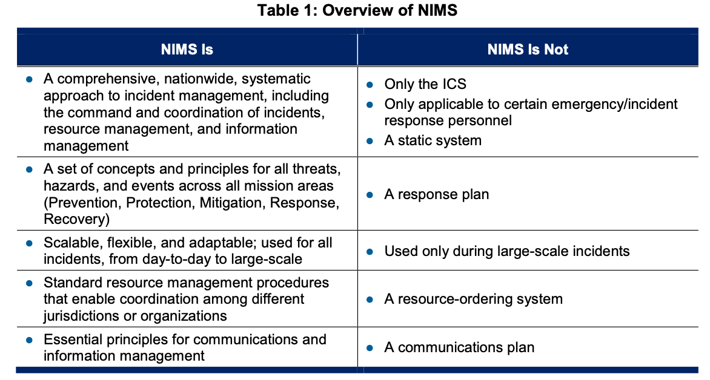

# I. Fundamentals and Concepts of NIMS

## Introduction

Communities across the Nation experience a diverse set of threats, hazards, and events. The size, frequency, complexity, and scope of these incidents[^1] vary, but all involve a range of personnel and organizations to coordinate efforts to save lives, stabilize the incident, and protect property and the environment. Every day, jurisdictions and organizations work together to share resources, integrate tactics, and act collaboratively. Whether these organizations are nearby or are supporting each other from across the country, their success depends on a common, interoperable approach to sharing resources, coordinating and managing incidents, and communicating information. The National Incident Management System (NIMS) defines this comprehensive approach.

NIMS guides all levels of government, nongovernmental organizations (NGO), and the private sector to work together to prevent, protect against, mitigate, respond to, and recover from incidents. NIMS provides stakeholders across the whole community[^2] with the shared vocabulary, systems, and processes to successfully deliver the capabilities described in the National Preparedness System.[^3] NIMS defines operational systems, including the Incident Command System (ICS), Emergency Operations Center (EOC) structures, and Multiagency Coordination Groups (MAC Groups) that guide how personnel work together during incidents. NIMS applies to all incidents, from traffic accidents to major disasters.

The jurisdictions and organizations involved in managing incidents vary in their authorities, management structures, communication capabilities and protocols, and many other factors. NIMS provides a common framework to integrate these diverse capabilities and achieve common goals. The guidance contained in this document incorporates solutions developed over decades of experience by incident personnel across the Nation.

This document is organized into three major components:

- **Resource Management** describes standard mechanisms to systematically manage resources, including personnel, equipment, supplies, teams, and facilities, both before and during incidents in order to allow organizations to more effectively share resources when needed.
- **Command and Coordination** describes leadership roles, processes, and recommended organizational structures for incident management at the operational and incident support levels and explains how these structures interact to manage incidents effectively and efficiently.
- **Communications and Information Management** describes systems and methods that help to ensure that incident personnel and other decision makers have the means and information they need to make and communicate decisions.

These components represent a building-block approach to incident management. Applying the guidance for all three components is vital to successful NIMS implementation.

## Applicability and Scope

NIMS is applicable to all stakeholders with incident management and support responsibilities. The audience for NIMS includes emergency responders and other emergency management personnel, NGOs (e.g., faith-based and community-based groups), the private sector, and elected and appointed officials responsible for making decisions regarding incidents. All incident management efforts, regardless of the incident or location, should fully incorporate people with disabilities and other people who have access and functional needs.[^4] The scope of NIMS includes all incidents, regardless of size, complexity, or scope, and planned events (e.g., sporting events). Table 1 describes the utility of NIMS as incident management doctrine.

**Table 1: Overview of NIMS**

| NIMS Is | NIMS Is Not |
| :--- | :--- |
| • A comprehensive, nationwide, systematic approach to incident management, including the command and coordination of incidents, resource management, and information management | • Only the ICS • Only applicable to certain emergency/incident response personnel • A static system |
| • A set of concepts and principles for all threats, hazards, and events across all mission areas (Prevention, Protection, Mitigation, Response, Recovery) | • A response plan |
| • Scalable, flexible, and adaptable; used for all incidents, from day-to-day to large-scale | • Used only during large-scale incidents |
| • Standard resource management procedures that enable coordination among different jurisdictions or organizations | • A resource-ordering system |
| • Essential principles for communications and information management | • A communications plan |

## NIMS Guiding Principles

Incident management priorities include saving lives, stabilizing the incident, and protecting property and the environment. To achieve these priorities, incident personnel apply and implement NIMS components in accordance with the principles of flexibility, standardization, and unity of effort.

### Flexibility

NIMS components are adaptable to any situation, from planned special events to routine local incidents to incidents involving interstate mutual aid or Federal assistance. Some incidents need multiagency, multijurisdictional, and/or multidisciplinary coordination. Flexibility allows NIMS to be scalable and, therefore, applicable for incidents that vary widely in terms of hazard, geography, demographics, climate, cultural, and organizational authorities.

### Standardization

Standardization is essential to interoperability among multiple organizations in incident response. NIMS defines standard organizational structures that improve integration and connectivity among jurisdictions and organizations. NIMS defines standard practices that allow incident personnel to work together effectively and foster cohesion among the various organizations involved. NIMS also includes common terminology, which enables effective communication.

### Unity of Effort

Unity of effort means coordinating activities among various organizations to achieve common objectives. Unity of effort enables organizations with specific jurisdictional responsibilities to support each other while maintaining their own authorities.

## Background

NIMS is the culmination of more than 40 years of efforts to improve interoperability in incident management. This work began in the 1970s with local, state,[^5] and Federal agencies collaborating to create a system called Firefighting Resources of California Organized for Potential Emergencies (FIRESCOPE). FIRESCOPE included ICS and the Multiagency Coordination System (MACS). In 1982, the agencies that developed FIRESCOPE and the National Wildfire Coordinating Group (NWCG) created the National Interagency Incident Management System (NIIMS), in part to make ICS and MACS guidance applicable to all types of incidents and all hazards. Recognizing the value of these systems, communities across the Nation adopted ICS and MACS, but adoption was not universal.

In the aftermath of the 2001 terrorist attacks, the need for an integrated nationwide incident management system with standard structures, terminology, processes, and resources became clear. The Department of Homeland Security (DHS) led a national effort to consolidate, expand, and enhance the previous work of FIRESCOPE, NIIMS, and others to develop NIMS.

The Federal Emergency Management Agency (FEMA) published the first NIMS document in 2004 and revised it in 2008. This 2017 version reflects progress since 2008, based on lessons learned, best practices, and changes in national policy, including updates to the National Preparedness System. Additionally, this version:

- Reiterates concepts and principles of the earlier versions of NIMS;
- Provides additional guidance for EOCs; and
- Describes how NIMS command and coordination mechanisms fit together.

## Key Terms

Several key terms are used throughout this document. While described in greater detail in the Resource Management Component, Command and Coordination Component, and supporting appendices, it is important to define these terms up front.

**Area Command:** When very complex incidents, or multiple concurrent smaller incidents, require the establishment of multiple ICS organizations, an Area Command can be established to oversee their management and prioritize scarce resources among the incidents. Due to the scope of incidents involving Area Commands and the likelihood of cross-jurisdictional operations, Area Commands are frequently established as Unified Area Commands, working under the same principles as a Unified Command.

**Authority Having Jurisdiction:** The Authority Having Jurisdiction (AHJ) is an entity that can create and administer processes to qualify, certify, and credential personnel for incident-related positions. AHJs include state, tribal, or Federal government departments and agencies, training commissions, NGOs, or companies, as well as local organizations such as police, fire, public health, or public works departments.

**Emergency Operations Center:** An EOC is a facility from which staff provide information management, resource allocation and tracking, and/or advanced planning support to personnel on scene or at other EOCs (e.g., a state center supporting a local center).

**Incident Commander:** The Incident Commander is the individual responsible for on-scene incident activities, including developing incident objectives and ordering and releasing resources. The Incident Commander has overall authority and responsibility for conducting incident operations.

**Multiagency Coordination Group:** MAC Groups, sometimes called policy groups, typically consist of agency administrators or executives from organizations or their designees. MAC Groups provide policy guidance to incident personnel, support resource prioritization and allocation, and enable decision making among elected and appointed officials and senior executives in other organizations as well as those directly responsible for incident management.

**Unified Command:** When more than one agency has incident jurisdiction, or when incidents cross political jurisdictions, the use of Unified Command enables multiple organizations to perform the functions of the Incident Commander jointly. Each participating partner maintains authority, responsibility, and accountability for its personnel and other resources while jointly managing and directing incident activities through the establishment of a common set of incident objectives, strategies, and a single Incident Action Plan (IAP).

## Supersession

This document supersedes the NIMS document issued in December 2008 and NIMS Guides 0001 and 0002 (both issued March 2006).

---

[^1]: In this document, the word “incident” includes planned events as well as emergencies and/or disasters of all kinds and sizes. See the Glossary for additional information.
[^2]: Whole community is a focus on enabling the participation in incident management activities of a wider range of players from the private and nonprofit sectors, including NGOs and the general public, in conjunction with the participation of all levels of government in order to foster better coordination and working relationships.
[^3]: The National Preparedness System outlines an organized process to help the whole community achieve the National Preparedness Goal. It comprises and builds on existing policies, programs, and guidance to include the National Planning Frameworks, Federal Interagency Operational Plans, and the National Preparedness Report.
[^4]: Access and functional needs are individual circumstances requiring assistance, accommodation, or modification for mobility, communication, transportation, safety, health maintenance, etc., due to any temporary or permanent situation that limits an individual’s ability to take action during an incident.
[^5]: In this document, “state” refers to the 56 states, territories, and insular areas (which includes any state of the United States, the District of Columbia, the Commonwealth of Puerto Rico, the Virgin Islands, Guam, American Samoa, and the Commonwealth of the Northern Mariana Islands).