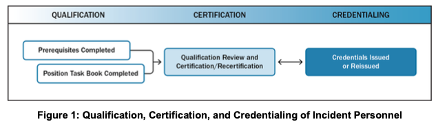

# II. Resource Management

NIMS resource management guidance enables many organizational elements to collaborate and coordinate to systematically manage resources—personnel, teams, facilities, equipment, and supplies. Most jurisdictions or organizations do not own and maintain all the resources necessary to address all potential threats and hazards. Therefore, effective resource management includes leveraging each jurisdiction’s resources, engaging private sector resources, involving volunteer organizations, and encouraging further development of mutual aid agreements.

This component includes three sections: Resource Management Preparedness, Resource Management During an Incident, and Mutual Aid.

## A. Resource Management Preparedness

Resource management preparedness involves: identifying and typing resources; qualifying, certifying, and credentialing personnel; planning for resources; and acquiring, storing, and inventorying resources.

### Identifying and Typing Resources

Resource typing is defining and categorizing incident resources by capability. Resource typing definitions establish a common language for discussing resources by defining minimum capabilities for personnel, teams, facilities, equipment, and supplies. Resource typing enables communities to plan for, request, and have confidence that the resources they receive have the capabilities they requested.

FEMA leads the development and maintenance of resource typing definitions for resources shared on a local, interstate, regional, or national scale. Jurisdictions can use these definitions to categorize local assets. When identifying which resources to type at the national level, FEMA selects resources that:

- Are widely used and sharable;
- Can be shared and/or deployed across jurisdictional boundaries through mutual aid agreements or compacts;
- Can be identified by the following characteristics:
  - **Capability:** The core capability[^6] for which the resource is most useful;
  - **Category:** The function for which a resource would be most useful (e.g., firefighting, law enforcement, health and medical);
  - **Kind:** A broad characterization, such as personnel, teams, facilities, equipment and supplies; and
  - **Type:** A resource’s level of minimum capability to perform its function;
    - The specific metrics used for determining a resource’s type depend on the kind of resource and the mission envisioned (e.g., a mobile kitchen unit is typed according to the number of meals it can produce, while dump trucks are typed according to haul capacity);
    - Type 1 is a higher capability than Type 2, which is higher capability than Type 3, etc.;
    - The level of capability is based on size, power, and capacity (for equipment) or experience and qualifications (for personnel or teams);
- Can be identified, inventoried, and tracked to determine availability;
- Are used for incident management, support, and/or coordination under ICS and/or in EOCs; and
- Are sufficiently interoperable or compatible to allow for deployment through common systems for resource ordering, managing, and tracking.

Resource users at all levels apply these standards to identify and inventory resources. Resource kind subcategories define the capabilities more precisely.

> **Resource Typing Library Tool**
>
> The Resource Typing Library Tool (RTLT) is an online catalog of NIMS resource typing definitions and job titles/position qualifications. The RTLT is accessible at http://www.fema.gov/resource-management-mutual-aid. From the RTLT home page, users can search by resource type, discipline, core capability, or other key words.

### Qualifying, Certifying, and Credentialing Personnel

Qualifying, certifying, and credentialing are the essential steps, led by an AHJ, that help ensure that personnel deploying through mutual aid agreements have the knowledge, experience, training, and capability to perform the duties of their assigned roles. These steps help to ensure that personnel across the Nation are prepared to perform their incident responsibilities based on criteria that are standard nationwide.

**Qualification** is the process through which personnel meet the minimum established criteria—training, experience, physical and medical fitness, and capability—to fill specific positions.

**Certification/Recertification** is the recognition from the AHJ or a third party[^7] stating that an individual has met and continues to meet established criteria and is qualified for a specific position.

**Credentialing** occurs when an AHJ or third party provides documentation—typically an identification card or badge—that identifies personnel and authenticates and verifies their qualification for a particular position. While credentialing includes issuing credentials such as identification cards, it is separate from an incident-specific badging process, which includes identity verification, qualification, and deployment authorization.

#### Applying the Qualification, Certification, and Credentialing Process

The NIMS qualification, certification, and credentialing process (see Figure 1) uses a performance-based approach. This process enables communities to plan for, request, and have confidence in personnel assigned from other organizations through mutual aid agreements. Nationally standardized criteria and minimum qualifications for positions provide a consistent baseline for qualifying and credentialing the incident workforce. Along with the job title and position qualifications, the position task book (PTB) is a basic tool that underpins the NIMS performance-based qualification process. PTBs describe the minimum competencies, behaviors, and tasks necessary to be qualified for a position. PTBs provide the basis for a qualification, certification, and credentialing process that is standard nationwide.

**Figure 1: Qualification, Certification, and Credentialing of Incident Personnel**

FEMA recommends minimum qualifications, but it is AHJs across the Nation that establish, communicate, and administer the qualification and credentialing process for individuals seeking qualification for positions under that AHJ’s purview. AHJs have the authority and responsibility to develop, implement, maintain, and oversee the qualification, certification, and credentialing process within their organization or jurisdiction. AHJs may impose additional requirements outside of NIMS for local needs. In some cases, the AHJ may support multiple disciplines that collaborate as a part of a team (e.g., an Incident Management Team [IMT]).

### Planning for Resources

Jurisdictions and organizations work together before incidents occur to develop plans for identifying, managing, estimating, allocating, ordering, deploying, and demobilizing resources. The planning process includes identifying resource requirements based on the threats to, and vulnerabilities of, the jurisdiction or organization. Planning also includes developing alternative strategies to obtain needed resources. Resource management personnel should consider resources necessary to support all mission areas (Prevention, Protection, Mitigation, Response, and Recovery).[^8] Resource management strategies that planners should consider include:

- Stockpiling resources;
- Establishing mutual aid agreements to obtain resources from neighboring jurisdictions;
- Determining how and where to reassign existing resources from non-essential tasks; and/or
- Developing contracts to acquire resources from vendors rapidly when needed.

Resource planners consider the urgency of needs, whether sufficient quantities of items are on hand, and whether the items can be produced quickly enough to meet demand. Stockpiling presents issues concerning shelf life and durability; however, the alternative of acquiring resources just in time also has potential pitfalls. Planners should verify, for example, that multiple jurisdictions are not relying on the same assets or vendors (such as hospitals in the same city relying on one supplier’s stock of surge medical supplies that may be adequate for only one hospital). Jurisdictions should also incorporate protocols for handling and distributing donated resources.

> **Capability Estimation**
>
> Estimating resource needs is key to resource planning. Through capability estimation, jurisdictions assess their ability to take a course of action. The resulting capability estimate feeds into the resource section of the plan or annex. Capability estimation helps answer the following questions:
> - What do we need to prepare for?
> - What resources do we have that allow us to achieve our targets?
> - What resources can we obtain through mutual aid to be prepared to meet our targets?
>
> The outputs of this process inform a variety of preparedness efforts, including strategic, operational, and/or tactical planning; development of mutual aid agreements and compacts; and hazard mitigation planning.

For activities that need surge capacity, planning often includes pre-positioning resources. Plans should anticipate conditions or circumstances that trigger a reaction, such as restocking supplies when inventories reach a predetermined minimum.

### Acquiring, Storing, and Inventorying Resources

Organizations acquire, store, and inventory resources for day-to-day operations, as well as additional resources that the organization has stockpiled for incidents. Those with resource management responsibilities should plan for periodic replenishments, preventive maintenance, and capital improvements. They should also plan for any ancillary support, supplies, or space that may be needed for large or complex resources. Effective resource management involves establishing a resource inventory and maintaining the currency and accuracy of the information. While a resource inventory can be as simple as a paper spreadsheet, many resource managers use information technology (IT)-based inventory systems to track the status of resources and maintain an accurate list of available resources. Accurate resource inventories not only enable organizations to resource incidents promptly, but also to support day-to-day resource management activities such as reconciliation, accounting, and auditing.

> **Resource Inventorying vs. Resource Tracking**
>
> For NIMS purposes, resource inventorying refers to the preparedness activity done outside of incident response. Inventories include an up-to-date count and pertinent details about an organization’s resources. Inventories often provide the basis for resource tracking during an incident.
>
> Resource tracking occurs during an incident and includes the number and status of resources assigned to an incident, the organizational element to which they are assigned, and their progress against applicable work/rest ratios. Incident needs drive the numbers and types of resources tracked.

An effective resource inventory includes the following information regarding each resource:

- **Name:** The resource’s unique name.
- **Aliases:** Any other names for the resource, whether formal or informal. These can be radio call signs, license numbers, nicknames, or anything else that helps users identify the resource.
- **Status:** The resource’s current condition or readiness state.
- **Resource Typing Definition or Job Title:** This can be either a standard NIMS resource typing definition or job title/position qualification or—for non-typed resources—a local, state, or tribal definition.
- **Mutual Aid Readiness:** The status of whether the resource is available and ready for deployment under mutual aid.
- **Home Location:** The resource’s permanent storage location, base, or office. This should also include the home location’s associated latitude/longitude and United States National Grid coordinates to ensure interoperability with mapping and decision support tools.
- **Present Location:** The resource’s current storage location, base, office, or deployment assignment with associated latitude/longitude and United States National Grid coordinates.
- **Point of Contact:** Individuals able to provide information and communicate essential information related to the resource.
- **Owner:** The agency, company, person, or other entity that owns the resource.
- **Manufacturer/Model (Equipment Only):** The entity that built the resource and the resource’s model name/number. This section also includes the serial number—the resource’s unique identifying number. This is a real-world inventory control number or other value used in official records.
- **Contracts:** Purchase, lease, rental, or maintenance agreements or other financial agreements associated with the resource.
- **Certifications:** Documentation that validates the official qualifications, certifications, or licenses associated with the resource.
- **Deployment Information:** Information needed to request a resource includes:
  - **Minimum Lead Time (in hours):** The minimum amount of time a resource needs to prepare for deployment to the incident.
  - **Maximum Deployment Time (in days):** The maximum amount of time a resource can be deployed or involved before it needs to be pulled back for maintenance, recovery, or resupply.
  - **Restrictions:** Any restrictions placed on the resource use, deployable area, capabilities, etc.
  - **Reimbursement Process:** Any information regarding repayment for items that are reimbursable.
  - **Release and Return Instructions:** Any information regarding the release and return of the resource.
  - **Sustainability Needs:** Any information regarding actions necessary to maintain the usability of the resource.
  - **Custom Attributes:** A customizable field that an agency can add to resource records. This can contain any necessary information that standard fields do not contain.

Resource inventories also account for (and mitigate) the potential for double-counting personnel and/or equipment. Resource summaries should clearly reflect any overlap of personnel, supplies, and/or equipment across different resource pools to avoid overstating the total resources.

## B. Resource Management During an Incident

The resource management process during an incident includes standard methods to identify, order, mobilize, and track resources. In some cases, the identification and ordering process is compressed, such as when an Incident Commander identifies the specific resources necessary for a given task and orders those resources directly. However, in larger, more complex incidents, the Incident Commander relies on the resource management process and personnel in the ICS and EOC organizations to identify and meet resource needs. Figure 2 depicts the six primary tasks of resource management during an incident.

**Figure 2: Resource Management Process**

### Identifying Requirements

During an incident, personnel continually identify, validate, and refine resource needs. This process involves identifying the type and quantity of resources needed, the location where resources should be sent, and who will receive and use the resources.

Resource availability and needs constantly change as an incident evolves. Consequently, incident management personnel and their affiliated organizations should coordinate as closely and as early as possible, both in advance of and during incidents.

### Ordering and Acquiring

Both incident and EOC staff make initial and ongoing assessments of resource requirements and either activate or request those resources. Incident personnel can order additional resources by executing contracts, implementing mutual aid agreements, or requesting assistance from another level of government (e.g., a local government to a state, or a state to the Federal Government).

Incident and/or EOC personnel request resources based on incident priorities and objectives. They base decisions about resource allocation on jurisdictional or organization protocol (e.g., minimum staffing levels) and, when applicable, the resource demands of other incidents. The organization providing resources consents to the request and communicates any discrepancies between requested resources and those available for delivery.

#### Resource Requests

Organizations that request resources should provide enough detail to ensure that those receiving the request understand what is needed. Using NIMS resource names and types helps ensure that requests are clearly communicated and understood. Requesting organizations should include the following information in the request:

- Detailed item description including quantity, kind, and type, if known, or a description of required capability and/or intended use if not;
  - If suitable substitute resources or preferred sources exist, these should also be indicated;
  - If the resource is not a common or standard incident resource, then the requestor should provide detailed specifications;
- Required arrival date and time;
- Required delivery or reporting location;
- The position title of the individual to whom the resource should report; and
- Any incident-specific health or safety concerns (e.g., vaccinations, adverse living/working conditions, or identified environmental hazards).

Personnel are assigned based on their qualifications and the needs of the incident, as well as any jurisdictional licensing requirements or limitations (i.e., personnel in some fields, including law enforcement and medicine, have limited authority outside of the jurisdiction in which they are sworn or licensed).

#### Incident Assignments

Effective and safe incident management depends on all personnel executing their responsibilities according to established guidelines. Personnel deploy to incidents at the request of the appropriate authority. Individuals remain deployment-ready by maintaining the skills, knowledge, certifications, physical fitness, and other items, such as equipment, that their organization requires or recommends.

Upon notification of deployment, individuals should:

- Review the most recent situation report (if available);
- Identify assignment, deployment location, and travel arrangements;
- Identify assigned supervisor and associated contact information, if possible;
- Obtain a copy of assignment paperwork;
- Review any briefings on worksite security or access procedures and any special environmental or health concerns for the deployment area (if available); and
- Ensure/verify coverage for day-to-day job responsibilities.

When personnel reach their designated incident worksite, they should adhere to accountability procedures, including:

- **Check-In:** Report in to receive an assignment. (Applies to all personnel regardless of agency affiliation)
- **Recordkeeping:** Follow incident procedures for documenting their activities. Maintaining complete and accurate records helps with state and Federal assistance, reimbursements, and potential future litigation.
- **Communication:** Observe radio and/or telephone procedures; use plain language and clear text, not codes.
- **Checkout:** When notified of their demobilization, follow the local checkout procedures before leaving the incident area. Personnel should complete all work in progress (unless otherwise directed); ensure all records and files are up to date; return or transfer any equipment received in support of the incident; and brief incoming personnel, if applicable, on work status and assignments.

#### Unrequested Resources

During incidents, responders sometimes come to an incident area without being requested. Such personnel converging on a site, commonly referred to as self-dispatching or self-deploying, may interfere with incident management and place an extra logistical and management burden on an already stressed system by:

- Creating additional supervisory, logistical, and safety needs;
- Depleting the resources needed to provide continued services to their home community;
- Complicating resource tracking and accountability; and/or
- Interfering with the access of formally requested resources.

Responders should wait for official deployment notification rather than self-deploying to an incident.

### Mobilizing

Personnel and other resources begin mobilizing when notified by the requesting jurisdiction or by an intermediary acting on its behalf, such as the state Emergency Management Assistance Compact (EMAC) coordinator. At the time of notification, deploying personnel should be notified regarding:

- The date, time, and place of departure;
- Mode of transportation to the incident;
- Estimated date and time of arrival;
- Reporting location (address, position title, and phone number or radio frequency);
- Anticipated incident assignment;
- Anticipated duration of deployment;
- Resource order number;
- Incident number; and
- Applicable cost and funding codes.

Resource tracking directly links to the mobilization process. Resources arriving on scene check in according to the receiving organization’s check-in process.

The mobilization process includes:

- Conducting incident-specific deployment planning;
- Equipping;
- Providing just-in-time training;
- Designating assembly points; and
- Delivering resources to the incident on schedule and in line with priorities and budgets.

Mobilizing fixed facility resources, such as laboratories, hospitals, EOCs, shelters, and waste management systems, involves activation rather than deployment. Plans and systems to monitor resource mobilization status should be flexible enough to adapt to both types of resources. Managers plan and prepare for the demobilization process at the same time they begin mobilizing resources.

#### Survivors as Resources

Before emergency responders can mobilize and arrive, neighbors and bystanders are often the first people to provide life-saving assistance. The natural desire to help does not disappear once responders arrive on the scene. Incident management personnel should anticipate this and have plans to use these volunteers’ capabilities safely and effectively.

#### Private and Voluntary Organizations

Voluntary organizations, such as the American Red Cross or Medical Reserve Corps, also mobilize and provide valuable assistance before, during, and after incidents. These groups provide a structure to integrate volunteers into incident activities. They also frequently have established relationships with the community, provide assistance that governmental organizations cannot, and support requests through formal resource-ordering processes.

### Tracking and Reporting

Incident managers use established procedures to track resources from mobilization through demobilization. Resource tracking occurs prior to, during, and after an incident. This process helps staff prepare to receive and use resources; tracks resource location; facilitates the safety and security of personnel, equipment, teams, and facilities; and enables effective resource coordination and movement.

> **Information Management Systems for Resource Management**
>
> Information management systems enhance resource status information flow by providing real-time data to jurisdictions, incident personnel, and their affiliated organizations. Information management systems used to support resource management include location-enabled situational awareness and decision support tools with resource tracking that links to the entity’s resource inventory(s).

### Demobilizing

The goal of demobilization is the orderly, safe, and efficient return of a resource to its original location and status. Once resources are no longer needed on an incident, those responsible for resources should demobilize them. The resource requestor and provider may agree to reassign a resource rather than demobilize it. Prior to demobilization, incident staff responsible for the planning and logistics functions collaborate to plan how resources are rehabilitated, replenished, disposed of, and/or returned or restored to operational condition.

### Reimbursing and Restocking

Reimbursement includes the payment of expenses incurred by resource providers for specific activities. Reimbursement processes are important for establishing and maintaining resource readiness and establishing the means to pay providers in a timely manner. Processes include mechanisms for collecting bills, validating costs against the scope of the work, replacing or repairing damaged equipment, and accessing reimbursement programs. Reimbursement procedures are often specified in mutual aid and assistance agreements.

## C. Mutual Aid

Mutual aid involves sharing resources and services between jurisdictions or organizations. Mutual aid occurs routinely to meet the resource needs identified by the requesting organization. This assistance can include the daily dispatch of law enforcement, emergency medical services (EMS), and fire service resources between local communities, as well as the movement of resources within a state or across state lines when larger-scale incidents occur. Mutual aid can provide essential assistance to fill mission needs. NIMS resource management guidance supports mutual aid efforts nationwide.

### Mutual Aid Agreements and Compacts

Mutual aid agreements establish the legal basis for two or more entities to share resources. Mutual aid agreements exist in various forms among and between all levels of government. These agreements support effective and efficient resource management. Mutual aid agreements may authorize mutual aid between two or more neighboring communities, among all jurisdictions within a state, between states, between Federal agencies, and/or internationally. Mutual aid also exists through formal and informal arrangements developed by tribal governments, NGOs, and in various forms within the private sector.

> **Emergency Management Assistance Compact**
>
> EMAC is a congressionally ratified mutual aid compact that defines a non-Federal, state-to-state system for sharing resources across state lines during an emergency or disaster. Signatories include all 50 states, the District of Columbia, Puerto Rico, Guam, and the U.S. Virgin Islands. EMAC’s unique relationships with states, regions, territories, and Federal organizations, such as FEMA and the National Guard Bureau, enable it to move a wide variety of resources to meet the jurisdictions’ needs.

These mutual aid agreements often address participating entities’ liability, compensation, and procedures, and might include some of the following topics:

- **Reimbursement:** Mutual aid services are either paid or unpaid (e.g., based on providing reciprocal services). Some mutual aid agreements specify reimbursement parameters.
- **Recognition of Licensure and Certification:** Guidelines to ensure recognition of licensures across geopolitical boundaries.
- **Procedures for Mobilization (Request, Dispatch, and Response):** Specific procedures for parties to request and dispatch resources through mutual aid.
- **Protocols for Voice and Data Interoperability:** Protocols that specify how different communications and IT systems share information.
- **Protocols for Resource Management:** Standard templates for packaging resources based on NIMS resource typing definitions and/or local inventory systems.

### Mutual Aid Process

Upon receipt of a request for mutual aid, the providing jurisdiction evaluates the request against its capacity to accommodate the temporary loss of the resource(s). For example, resource managers in a fire department consider whether the department could still meet its community’s needs after deploying requested equipment and personnel to another jurisdiction.

If the providing jurisdiction determines it can accommodate the requested deployment of resources, it identifies specific resources and arranges their deployment in accordance with the terms of the mutual aid agreement. The receiving jurisdiction can decline resources if they do not meet its needs.

---

[^6]: Core capabilities, as defined in the National Preparedness Goal, are essential elements for the execution of the five mission areas: Prevention, Protection, Mitigation, Response, and Recovery.
[^7]: Certain positions require third-party certification and/or credentialing from an accredited body such as a state licensure board for medical professionals.
[^8]: The National Preparedness Goal and the five National Planning Frameworks describe the mission areas in greater detail.