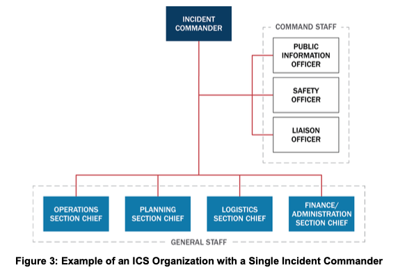
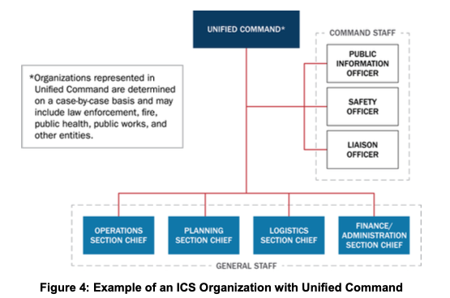
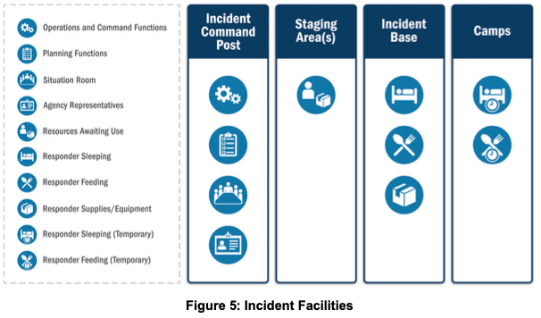
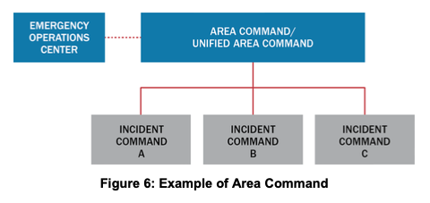
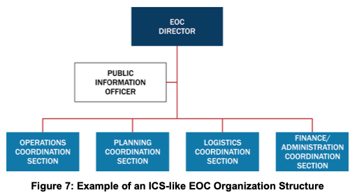
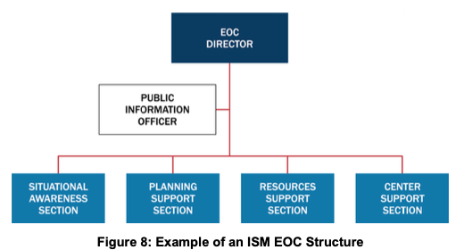
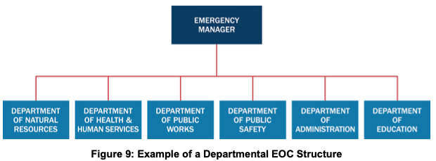
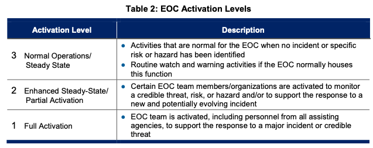
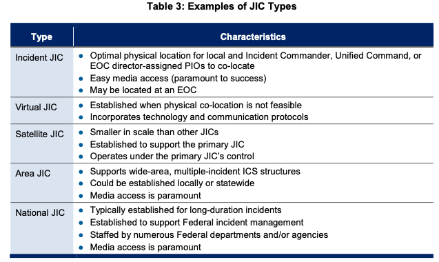
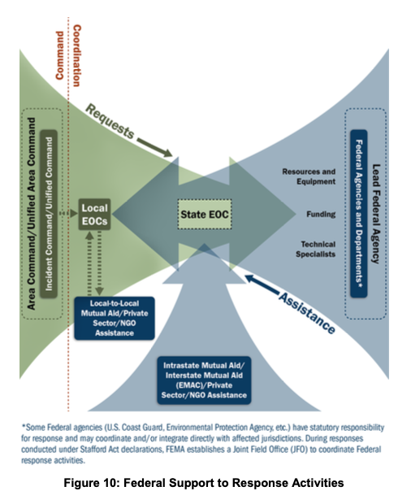

# III. Command and Coordination

Local authorities handle most incidents using the communications systems, dispatch centers, and incident personnel within a single jurisdiction. Larger and more complex incidents, however, may begin with a single jurisdiction, but rapidly expand to multijurisdictional and/or multidisciplinary efforts necessitating outside resources and support. Standard incident command and coordination systems allow the efficient integration of these outside resources and enable assisting personnel from anywhere in the Nation to participate in the incident management structure. The Command and Coordination component of NIMS describes the systems, principles, and structures that provide a standard, national framework for incident management.

Regardless of the size, complexity, or scope of the incident, effective command and coordination—using flexible and standard processes and systems—helps save lives and stabilize the situation. Incident command and coordination consist of four areas of responsibility:

1. Tactical activities to apply resources on scene;
2. Incident support, typically conducted at EOCs,[^9] through operational and strategic coordination, resource acquisition and information gathering, analysis, and sharing;
3. Policy guidance and senior-level decision making; and
4. Outreach and communication with the media and public to keep them informed about the incident.

MACS exist to coordinate these four areas across the different NIMS functional groups: ICS, EOCs, MAC Groups, and Joint Information Systems (JIS). The Command and Coordination component describes these MACS structures and explains how various elements operating at different levels of incident management interface with one another. By describing unified doctrine with common terminology, organizational structures, and operational protocols, NIMS enables all those involved in an incident—from the Incident Commander at the scene to national leaders in a major disaster—to harmonize and maximize the effects of their efforts.

## A. NIMS Management Characteristics

The following characteristics are the foundation of incident command and coordination under NIMS and contribute to the strength and efficiency of the overall system:

- Common Terminology
- Modular Organization
- Management by Objectives
- Incident Action Planning
- Manageable Span of Control
- Incident Facilities and Locations
- Comprehensive Resource Management
- Integrated Communications
- Establishment and Transfer of Command
- Unified Command
- Chain of Command and Unity of Command[^10]
- Accountability
- Dispatch/Deployment
- Information and Intelligence Management

### Common Terminology

NIMS establishes common terminology that allows diverse incident management and support organizations to work together across a wide variety of functions and hazard scenarios. This common terminology covers the following:

- **Organizational Functions:** Major functions and functional units with incident responsibilities are named and defined. Terminology for incident organizational elements is standard and consistent.
- **Resource Descriptions:** Major resources—including personnel, equipment, teams, and facilities—are given common names and are typed to help avoid confusion and to enhance interoperability.
- **Incident Facilities:** Incident management facilities are designated using common terminology.

### Modular Organization

ICS and EOC organizational structures develop in a modular fashion based on an incident’s size, complexity, and hazard environment. Responsibility for establishing and expanding ICS organizations and EOC teams ultimately rests with the Incident Commander (or Unified Command) and EOC director.[^11] Responsibility for functions that subordinates perform defaults to the next higher supervisory position until the supervisor delegates those responsibilities. As incident complexity increases, organizations expand as the Incident Commander, Unified Command, EOC director, and subordinate supervisors delegate additional functional responsibilities.

### Management by Objectives

The Incident Commander or Unified Command[^12] establishes objectives that drive incident operations. Management by objectives includes the following:

- Establishing specific, measurable objectives;
- Identifying strategies, tactics, tasks, and activities to achieve the objectives;
- Developing and issuing assignments, plans, procedures, and protocols for various incident management functional elements to accomplish the identified tasks; and
- Documenting results against the objectives to measure performance, facilitate corrective actions, and inform development of incident objectives for the subsequent operational period.

### Incident Action Planning

Coordinated incident action planning guides incident management activities. IAPs represent concise, coherent means of capturing and communicating incident objectives, tactics, and assignments for operational and support activities.

Every incident should have an action plan; however, not all incidents need written plans. The necessity for written plans depends on incident complexity, command decisions, and legal requirements. Formal IAPs are not always developed for the initial operational period of no-notice incidents. However, if an incident is likely to extend beyond one operational period, becomes more complex, or involves multiple jurisdictions and/or agencies, preparing a written IAP becomes increasingly important to maintain unity of effort and effective, efficient, and safe operations.

Staff in EOCs also typically conduct iterative planning and produce plans to guide their activities during specified periods, though these are typically more strategic than IAPs.

### Manageable Span of Control

Maintaining an appropriate span of control helps ensure an effective and efficient incident management operation. It enables management to direct and supervise subordinates and to communicate with and manage all resources under their control. The type of incident, nature of the task, hazards and safety factors, experience of the supervisor and subordinates, and communication access between the subordinates and the supervisor are all factors that influence manageable span of control.

> **Manageable Span of Control**
>
> The optimal span of control for incident management is one supervisor to five subordinates; however, effective incident management frequently necessitates ratios significantly different from this. The 1:5 ratio is a guideline, and incident personnel use their best judgment to determine the actual distribution of subordinates to supervisors for a given incident or EOC activation.

### Incident Facilities and Locations

Depending on the incident size and complexity, the Incident Commander, Unified Command, and/or EOC director establish support facilities for a variety of purposes and direct their identification and location based on the incident. Typical facilities include the Incident Command Post (ICP), incident base, staging areas, camps, mass casualty triage areas, points-of-distribution, and emergency shelters.

### Comprehensive Resource Management

Resources include personnel, equipment, teams, supplies, and facilities available or potentially available for assignment or allocation. Maintaining an accurate and up-to-date inventory of resources is an essential component of incident management. Section II, the Resource Management component of this document, describes this in more detail.

### Integrated Communications

Leadership at the incident level and in EOCs facilitates communication through the development and use of a common communications plan, interoperable communications processes, and systems that include voice and data links. Integrated communications provide and maintain contact among and between incident resources, enable connectivity between various levels of government, achieve situational awareness, and facilitate information sharing. Planning, both in advance of and during an incident, addresses equipment, systems, and protocols necessary to achieve integrated voice and data communications. Section IV, the Communications and Information Management component of this document, describes this in more detail.

### Establishment and Transfer of Command

The Incident Commander or Unified Command should clearly establish the command function at the beginning of an incident. The jurisdiction or organization with primary responsibility for the incident designates the individual at the scene responsible for establishing command and protocol for transferring command. When command transfers, the transfer process includes a briefing that captures essential information for continuing safe and effective operations, and notifying all personnel involved in the incident.

### Unified Command

When no one jurisdiction, agency or organization has primary authority and/or the resources to manage an incident on its own, Unified Command may be established. In Unified Command, there is no one “commander.” Instead, the Unified Command manages the incident by jointly approved objectives. A Unified Command allows these participating organizations to set aside issues such as overlapping and competing authorities, jurisdictional boundaries, and resource ownership to focus on setting clear priorities and objectives for the incident. The resulting unity of effort allows the Unified Command to allocate resources regardless of ownership or location. Unified Command does not affect individual agency authority, responsibility, or accountability.

### Chain of Command and Unity of Command

Chain of command refers to the orderly line of authority within the ranks of the incident management organization. Unity of command means that each individual only reports to one person. This clarifies reporting relationships and reduces confusion caused by multiple, conflicting directives, enabling leadership at all levels to effectively direct the personnel under their supervision.

### Accountability

Effective accountability for resources during an incident is essential. Incident personnel should adhere to principles of accountability, including check-in/check-out, incident action planning, unity of command, personal responsibility, span of control, and resource tracking.

### Dispatch/Deployment

Resources should deploy only when appropriate authorities request and dispatch them through established resource management systems. Resources that authorities do not request should refrain from spontaneous deployment to avoid overburdening the recipient and compounding accountability challenges.

### Information and Intelligence Management

The incident management organization establishes a process for gathering, analyzing, assessing, sharing, and managing incident-related information and intelligence.[^13] Information and intelligence management includes identifying essential elements of information (EEI) to ensure personnel gather the most accurate and appropriate data, translate it into useful information, and communicate it with appropriate personnel. Section IV, the Communications and Information Management component of this document, describes this in more detail.

## B. Incident Command System (ICS)

ICS is a standardized approach to the command, control, and coordination of on-scene incident management that provides a common hierarchy within which personnel from multiple organizations can be effective. ICS specifies an organizational structure for incident management that integrates and coordinates a combination of procedures, personnel, equipment, facilities, and communications. Using ICS for every incident helps hone and maintain skills needed to coordinate efforts effectively. ICS is used by all levels of government as well as by many NGOs and private sector organizations. ICS applies across disciplines and enables incident managers from different organizations to work together seamlessly. This system includes five major functional areas, staffed as needed,[^14] for a given incident: Command, Operations, Planning, Logistics, and Finance/Administration.

### Incident Command and Unified Command

Incident command is responsible for the overall management of the incident. A single Incident Commander or Unified Command conducts the command function on an incident. Command and General Staff support the incident command to meet the incident’s needs.

#### Single Incident Commander

When an incident occurs within a single jurisdiction and without jurisdictional or functional agency overlap, the appropriate authority designates a single Incident Commander who has overall incident management responsibility. In some cases where incident management crosses jurisdictional and/or functional agency boundaries, the various jurisdictions and organizations may still agree to designate a single Incident Commander. Figure 3 depicts an example organizational structure for an ICS organization with a single Incident Commander.

**Figure 3: Example of an ICS Organization with a Single Incident Commander**

#### Unified Command

Unified Command improves unity of effort in multijurisdictional or multiagency incident management. The use of Unified Command enables jurisdictions and those with authority or functional responsibility for the incident to jointly manage and direct incident activities through the establishment of a common set of incident objectives, strategies, and a single IAP. However, each participating partner maintains authority, responsibility, and accountability for its personnel and other resources, and each member of Unified Command is responsible for keeping other members of Unified Command informed.

#### Responsibilities of the Incident Commander and Unified Command

Whether using a single Incident Commander or a Unified Command, the command function:

- Establishes a single ICP for the incident;
- Establishes consolidated incident objectives, priorities, and strategic guidance, and updating them every operational period;
- Selects a single section chief for each position on the General Staff needed based on current incident priorities;
- Establishes a single system for ordering resources;
- Approves a consolidated IAP for each operational period;
- Establishes procedures for joint decision making and documentation; and
- Captures lessons learned and best practices.

#### Unified Command Composition

The exact composition of the Unified Command depends on factors such as incident location (i.e., which jurisdictions or organizations are involved) and the nature of the incident (i.e., which agencies from the jurisdiction(s) or organization(s) involved are needed). Figure 4 depicts a sample Unified Command structure. The organizations participating in the Unified Command use a collaborative process to establish and rank incident priorities and determine incident objectives.

**Figure 4: Example of an ICS Organization with Unified Command**

> **Single Incident Commander and Unified Command**
>
> **Single Incident Commander:** The Incident Commander is solely responsible (within the limits of his or her authority) for establishing incident objectives and is responsible for ensuring that incident activities work to accomplish objectives.
>
> **Unified Command:** The individuals designated by their jurisdictional or organizational authorities (or by departments within a single jurisdiction) jointly determine priorities and objectives, allocate resources, and work together to ensure the execution of integrated incident operations and maximize the use of assigned resources.

Agencies or organizations involved in the incident that lack jurisdictional responsibility or authorities are referred to as cooperating and/or assisting agencies. Whether represented in Unified Command or through the Liaison Officer, every jurisdiction, organization, and/or agency representative is responsible for communicating agency-specific information, including:

- Statutory authorities and responsibilities;
- Resource availability and capabilities;
- Constraints, limitations, concerns; and
- Areas of agreement and disagreement between agency officials.

### Command Staff

The Incident Commander or Unified Command assigns Command Staff as needed to support the command function. The Command Staff typically includes a Public Information Officer (PIO), a Safety Officer, and a Liaison Officer who report directly to the Incident Commander or Unified Command and have assistants as necessary. The Incident Commander or Unified Command may appoint additional advisors as needed.

#### Public Information Officer

The PIO interfaces with the public, media, and/or with other agencies with incident-related information needs. The PIO gathers, verifies, coordinates, and disseminates accessible,[^15] meaningful, and timely information on the incident for both internal and external audiences. The PIO also monitors the media and other sources of public information to collect relevant information and transmits this information to the appropriate components of the incident management organization. In incidents that involve PIOs from different agencies, the Incident Commander or Unified Command designates one as the lead PIO. All PIOs should work in a unified manner, speaking with one voice, and ensure that all messaging is consistent. The Incident Commander or Unified Command approves the release of incident-related information. In large-scale incidents, the PIO participates in or leads the Joint Information Center (JIC).

#### Safety Officer

The Safety Officer monitors incident operations and advises the Incident Commander or Unified Command on matters relating to the health and safety of incident personnel. Ultimate responsibility for the safe conduct of incident management rests with the Incident Commander or Unified Command and supervisors at all levels. The Safety Officer is responsible to the Incident Commander or Unified Command for establishing the systems and procedures necessary to assess, communicate, and mitigate hazardous environments. This includes developing and maintaining the incident Safety Plan, coordinating multiagency safety efforts, and implementing measures to promote the safety of incident personnel and incident sites. The Safety Officer stops and/or prevents unsafe acts during the incident. Agencies, organizations, or jurisdictions that contribute to joint safety management efforts do not lose their individual responsibilities or authorities for their own programs, policies, and personnel. Rather, each contributes to the overall effort to protect all personnel involved in the incident.

#### Liaison Officer

The Liaison Officer is the incident command’s point of contact for representatives of governmental agencies, jurisdictions, NGOs, and private sector organizations that are not included in the Unified Command. Through the Liaison Officer, these representatives provide input on their agency, organization, or jurisdiction’s policies, resource availability, and other incident-related matters. Under either a single Incident Commander or a Unified Command structure, representatives from assisting or cooperating jurisdictions and organizations coordinate through the Liaison Officer. The Liaison Officer may have assistants.

#### Additional Command Staff Positions

Additional Command Staff positions may be necessary, depending on the incident and specific requirements established by incident command. The Incident Commander or Unified Command may appoint technical specialists to serve as command advisors. Command Staff advisors are distinguished from officers because they serve in advisory capacities and lack the authority to direct incident activities.

### General Staff

The General Staff consists of the Operations, Planning, Logistics, and Finance/Administration Section Chiefs. These individuals are responsible for the functional aspects of the incident command structure. The Incident Commander or Unified Command activates these section chiefs as needed. These functions default to the Incident Commander or Unified Command until a section chief is assigned. The section chiefs may have one or more deputies as necessary. The sections are discussed more fully below.

#### Operations Section

The Incident Commander or Unified Command selects the Operations Section Chief based on current incident priorities and should review that selection periodically as the incident evolves. Operations Section personnel plan and perform tactical activities to achieve the incident objectives established by the Incident Commander or Unified Command. Objectives typically focus on saving lives, reducing the immediate hazard, protecting property and the environment, establishing situational control, and restoring normal operations.

Incident operations can be organized and executed in many ways. The Operations Section Chief organizes the section based on the nature and scope of the incident, the jurisdictions and organizations involved, and the incident’s priorities, objectives, and strategies. Key functions of Operations Section personnel include the following:

- Directing the management of tactical activities on the Incident Commander or Unified Command’s behalf;
- Developing and implementing strategies and tactics to achieve incident objectives;
- Organizing the Operations Section to best meet the incident’s needs, maintain a manageable span of control, and optimize the use of resources; and
- Supporting IAP development for each operational period.

#### Planning Section

Planning Section personnel collect, evaluate, and disseminate incident situation information to the Incident Commander or Unified Command and other incident personnel. The staff within this section prepare status reports, display situation information, maintain the status of assigned resources, facilitate the incident action planning process, and prepare the IAP based on input from other sections and Command Staff and guidance from the Incident Commander or Unified Command.

Additional key functions of Planning Section personnel include:

- Facilitating incident planning meetings;
- Recording the status of resources and anticipated resource needs;
- Collecting, organizing, displaying, and disseminating incident status information and analyzing the situation as it changes;
- Planning for the orderly, safe, and efficient demobilization of incident resources; and
- Collecting, recording, and safeguarding all incident documents.

#### Logistics Section

Logistics Section personnel provide services and support for effective and efficient incident management, including ordering resources. Staff in this section provide facilities, security (of the incident command facilities and personnel), transportation, supplies, equipment maintenance and fuel, food services, communications and IT support, and medical services for incident personnel. Key functions of Logistics Section personnel include:

- Ordering, receiving, storing/housing, and processing incident-related resources;
- Providing ground transportation during an incident, maintaining and supplying vehicles, keeping vehicle usage records, and developing incident traffic plans;
- Setting up, maintaining, securing, and demobilizing incident facilities;
- Determining food and water needs, including ordering food, providing cooking facilities, maintaining food service areas, and managing food security and safety (in cooperation with the Safety Officer);
- Maintaining an incident Communications Plan and acquiring, setting up, issuing, maintaining, and accounting for communications and IT equipment; and
- Providing medical services to incident personnel.

#### Finance/Administration Section

The Incident Commander or Unified Command establishes a Finance/Administration Section when the incident management activities involve on-scene or incident-specific finance and administrative support services. Finance/Administration staff responsibilities include recording personnel time, negotiating leases and maintaining vendor contracts, administering claims, and tracking and analyzing incident costs. If the Incident Commander or Unified Command establishes this section, staff should closely coordinate with the Planning and Logistics Sections to reconcile operational records with financial documents.

Finance/Administration Section staff support an essential function of ICS in large, complex incidents involving funding originating from multiple sources. In addition to monitoring multiple sources of funds, the section’s staff track and report the accrued costs as the incident progresses. This allows the Incident Commander or Unified Command to forecast needs and request additional funds as needed. Key functions of Finance/Administration Section personnel include:

- Tracking costs, analyzing cost data, making estimates, and recommending cost savings measures;
- Analyzing, reporting, and recording financial concerns resulting from property damage, responder injuries or fatalities at the incident;
- Managing financial matters concerning leases and vendor contracts;
- Managing administrative databases and spreadsheets for analysis and decision making; and
- Recording time for incident personnel and leased equipment.

#### Intelligence/Investigations Function

The collection, analysis, and sharing of incident-related information are important activities for all incidents. Typically, staff in the Planning Section are responsible for gathering and analyzing operational information and sharing situational awareness, and staff in the Operations Section are responsible for executing tactical activities. However, some incidents involve intensive intelligence gathering and investigative activity, and for such incidents, the Incident Commander or Unified Command may opt to reconfigure intelligence and investigations responsibilities to meet the needs of the incident. This may occur when the incident involves a criminal or terrorist act and/or other non-law-enforcement intelligence/investigations efforts such as epidemiological investigations.

The purpose of the Intelligence/Investigations function is to ensure that intelligence and investigative operations and activities are properly managed and coordinated to:

- Prevent and/or deter potential unlawful activity, incidents, and/or attacks;
- Collect, process, analyze, secure, and disseminate information, intelligence, and situational awareness;
- Identify, document, process, collect, create a chain of custody for, safeguard, examine and analyze, and store evidence or specimens;
- Conduct thorough and comprehensive investigations that lead to the perpetrators’ identification and apprehension;
- Conduct missing persons and mass fatality/death investigations;
- Inform and support life safety operations, including the safety and security of all response personnel, by helping to prevent future attacks or escalated impacts; and
- Determine the source or cause of an ongoing incident (e.g., disease outbreak, fire, complex coordinated attack, or cyber incident) to control its impact and/or help prevent the occurrence of similar incidents.

The Incident Commander or Unified Command makes the final determination regarding the scope and placement of the Intelligence/Investigations function within the command structure. Options for its placement are described in Appendix A, Tab 6 Intelligence/Investigations Function.

### Common Types of ICS Facilities

The Incident Commander or Unified Command may establish facilities in and around the incident area to house or support incident management functions. The Incident Commander or Unified Command determines the kinds and locations of facilities based on incident needs. Common ICS facilities are described below and illustrated in Figure 5.

#### Incident Command Post

The ICP is the location of the tactical-level, on-scene incident command organization. This location typically houses the Incident Commander or Unified Command and the Command and General Staffs, but may include other designated incident personnel. Typically, the ICP is located near the incident site and is where on-scene tactical command functions are performed. Personnel conduct incident planning at the ICP, and the Incident Commander or Unified Command may establish an incident communications center at this location.

#### Staging Areas

The Operations Section Chief may establish staging areas to position and track for resources. A staging area can be any location in which personnel, supplies, and equipment await assignment. Staging areas may include temporary feeding, fueling, and sanitation services. The Operations Section Chief assigns a manager for each staging area who logs in all incoming resources, dispatches resources at a section chief’s request, and requests Logistics Section support, as necessary, for resources at the staging area.

#### Incident Base

An incident base is the site that accommodates primary support activities. An Incident Commander or Unified Command establishes an incident base to house equipment and personnel support operations. An incident base may be co-located with the ICP.

**Figure 5: Incident Facilities**

#### Camps

Camps are satellites to an incident base, established where they can best support incident operations. Camps provide support, such as food, sleeping areas, and sanitation, and may also provide minor maintenance and servicing of equipment. Camps are relocated as necessary to meet changing operational needs.

### Incident Management Teams

IMTs are rostered groups of ICS-qualified personnel, consisting of an Incident Commander, other incident leadership, and personnel qualified for other key ICS positions. IMTs exist at local, regional, state, tribal, and national levels and have formal notification, deployment, and operational procedures in place. These teams are typed based on team members’ qualifications and may be assigned to manage incidents or to accomplish supporting incident-related tasks or functions. When assigned to manage an incident or to support an incident-related task or function, IMTs are typically delegated the authority to act on behalf of the affected jurisdiction or organization.

> **Delegation of Authority**
>
> A delegation of authority is a statement that the authorized jurisdiction/organization official provides to make such delegations to the Incident Commander. It assigns the Incident Commander specific responsibilities and authorities. The delegation of authority typically describes priorities, expectations, constraints, and other considerations or guidelines. Many agencies require the delegating authority to provide a written delegation of authority to the Incident Commander before the Incident Commander may assume command.

#### Incident Management Assistance Teams

Some IMTs are referred to as Incident Management Assistance Teams (IMAT) to clarify that they support on-scene personnel and/or the affected jurisdiction(s). IMATs may have command and control over certain aspects of response and recovery efforts (e.g., the use of state/Federal assets). Through participation in a Unified Command or a Unified Coordination Group[^16] with representatives from local, state, and/or tribal government, they ensure that activities align with local priorities. IMATs exist at various levels of government and within the private sector. Regardless of who owns IMATs or their specific missions, IMATs operate using the principles and practices of ICS.

FEMA IMATs, for example, deploy to incidents or incident-threatened venues, help identify and provide Federal assistance, and coordinate and integrate inter-jurisdictional response in support of an affected state or tribe. FEMA IMATs provide the Federal Government with an early presence at an incident, integrating FEMA’s response capabilities into the existing community of emergency management functions.

### Incident Complex: Multiple Incident Management within a Single ICS Organization

An incident complex refers to two or more individual incidents located in the same general area and assigned to a single Incident Commander or a Unified Command. When relevant authorities establish an incident complex over several incidents, those incidents become branches or divisions within the incident complex Operations Section. This approach provides potential for future expansion. If any of the incidents within a complex is likely to become a large-scale incident, that incident should be a separate incident with its own ICS organization.

Incident complexes are used in wildfire response when multiple fires occur within close proximity to one another. An incident complex may be managed by either a single Incident Commander or a Unified Command. The following are indicators for use of an incident complex:

- A single Command and General Staff can adequately provide operations, planning, logistics, and finance/administration activities; and
- A combined management approach is likely to achieve staff or logistical support economies.

### Area Command

An Area Command is established to oversee multiple concurrent incidents or a very complex incident that requires the establishment of multiple ICS organizations. An Area Command is activated to address competition for resources among multiple ICPs based on the complexity of the incident and incident management span-of-control considerations. Due to the scope of incidents involving Area Commands and the likelihood of cross-jurisdictional operations, Area Commands are frequently established as Unified Area Commands, working under the same principles as a Unified Command.

Responsibilities of an Area Command include:

- Developing broad objectives for the affected area;
- Coordinating development of incident objectives and strategies for each incident;
- Allocating or reallocating resources as priorities change;
- Ensuring that Incident Commanders and/or Unified Commands properly manage incidents;
- Ensuring effective communications and data coordination;
- Ensuring that incident objectives are met and do not conflict with each other or with agency policies;
- Identifying needs for scarce resources and reporting the needs to Agency Administrators directly or through a MAC Group or an EOC; and
- For incidents that have a recovery dimension, ensuring that short-term recovery is coordinated with the EOC staff to assist in the transition to long-term recovery operations.

Area Command is particularly relevant to situations with several ICPs requesting similar scarce resources. Incidents of different types or without similar resource needs are usually handled as separate incidents. Additional coordination structures, such as EOCs or MAC Groups, may assist with coordinating the resource needs of multiple incidents. The following sections describe these structures. Figure 6 depicts the relationship of an Area Command with a MAC Group and an EOC.

**Figure 6: Example of Area Command**

> **Relationship between Area Command, an EOC, and a MAC Group**
>
> An Area Command oversees management of multiple incidents, while EOCs coordinate support. MAC Groups provide policy guidance and strategic direction to Area Command and EOCs.

## C. Emergency Operations Centers (EOC)

Jurisdictions and organizations across the Nation use EOCs as important elements in their emergency management programs. EOCs are locations where staff from multiple agencies typically come together to address imminent threats and hazards and to provide coordinated support to incident command, on-scene personnel, and/or other EOCs. EOCs may be fixed locations, temporary facilities, or virtual structures with staff participating remotely.

The purpose, authorities, and composition of the teams that staff EOCs vary widely, but generally, the teams consolidate and exchange information, support decision making, coordinate resources, and communicate with personnel on scene and at other EOCs. EOC personnel may support staff at an ICP, field personnel not affiliated with an ICP (e.g., personnel conducting debris removal or managing a shelter), or staff in another EOC (e.g., staff in a state EOC communicating with staff in a local EOC).

EOC staff may share the load with on-scene incident personnel by managing certain operations, such as emergency shelters or points of distribution. When on-scene incident command is not established, such as in a snow emergency, staff in EOCs may direct tactical operations. Finally, EOC staff may coordinate the efforts of several geographically disparate incidents or activities. In some instances, the incident command or Area Command may be conducted in the EOC.

A jurisdiction or organization may also activate EOC staff to support prevention and protection activities and to find resources to backfill those that the jurisdiction or organization has already deployed.

Primary functions of staff in EOCs, whether virtual or physical, include:

- Collecting, analyzing, and sharing information;
- Supporting resource needs and requests, including allocation and tracking;
- Coordinating plans and determining current and future needs; and
- In some cases, providing coordination and policy direction.

Agencies and departments also have operations centers. However, these organization-specific operations centers differ from multidisciplinary[^17] EOCs. Departmental operations center (DOC) staff coordinate their agency or department’s activities. While they communicate with other organizations and EOCs and may exchange liaisons with other agencies, DOC staff are primarily inward looking, focusing on directing their own assets and operations. Unlike DOCs, the EOCs addressed in NIMS are inherently multidisciplinary activities.

Bringing representatives from various stakeholder and partner organizations together in EOCs optimizes unity of effort and enables staff to share information, provide legal and policy guidance to on-scene personnel, plan for contingencies, deploy resources efficiently, and generally provide whatever support is required. Determining which organizations are represented in EOCs should be accomplished during the emergency operations planning process. Factors to consider include the authorities and responsibilities of various organizations, the resources and information the organizations have or have access to, and the organizations’ expertise and relationships. The composition of EOC teams may also vary depending on the nature and complexity of the incident or situation.

Regardless of which organizations are represented, all EOC teams receive oversight from elected and/or appointed officials such as governors, tribal leaders, mayors, and city managers. These individuals may be present in the EOC, but more often provide guidance from elsewhere, either as part of a formal policy group or individually. They typically make decisions regarding priorities and on issues such as emergency declarations, large-scale evacuations, access to extraordinary emergency funding, waivers to ordinances and regulations, and adjudication of scarce resources.

### EOC Staff Organizations

EOC teams vary widely. Deciding how to organize the staff in EOCs depends on factors such as the jurisdiction/organization’s authorities, staffing, partner and stakeholder agencies represented, EOC physical facilities, communications capabilities, political considerations, and most importantly, the mission.

Regardless of how the EOC staff are organized, they should operate consistently with the NIMS management characteristics.

The following section describes three common ways of organizing EOC teams. Appendix B. EOC Organizations contains more detailed information on each of these structures.

> **Modular EOC Organizations**
>
> The NIMS management characteristic of modular organization indicates that leaders are responsible for the functions of subordinate positions that are not staffed.
>
> This management characteristic also applies to EOCs. In an EOC where staffing and space are limited, the individual in charge may perform not only the duties of the EOC director, but also the duties of other EOC team members unless or until those other positions are staffed.

#### ICS or ICS-like Structure

Many jurisdictions/organizations configure their EOCs using the standard ICS organizational structure. The structure is familiar to many people, and it aligns with the on-scene incident organization. Some jurisdictions/organizations use the standard ICS organizational structure but modify certain titles to create an ICS-like organization that distinguishes EOC functions from their field counterparts. Figure 7 depicts an example of such a structure.

**Figure 7: Example of an ICS-like EOC Organization Structure**

#### Incident Support Model (ISM) Structure

Jurisdictions/organizations that focus their EOC team’s efforts on information, planning, and resource support may choose to separate the situational awareness function from planning and combine operations and logistics functions into an incident support structure such as the one shown in Figure 8. This organization puts the EOC director in direct contact with those doing situational awareness/information management and streamlines resource sourcing, ordering, and tracking.

**Figure 8: Example of an ISM EOC Structure**

#### Departmental Structure

Jurisdictions/organizations may opt instead to use their day-to-day departmental/agency structure and relationships in their EOC. By operating in the context of their normal relationships, department/agency representatives can function in the EOC with minimal preparation or startup time. Figure 9 provides an example of this kind of EOC organization. In this configuration, the organization’s emergency manager or a senior official typically coordinates EOC efforts among the departments and agencies.

**Figure 9: Example of a Departmental EOC Structure**

### EOC Activation and Deactivation

EOCs are activated for various reasons based on the needs of a jurisdiction, organization, or Incident Commander; the context of a threat; the anticipation of events; or in response to an incident. Circumstances that might trigger EOC activation include:

- More than one jurisdiction becomes involved in an incident and/or the incident involves multiple agencies;
- The Incident Commander or Unified Command indicates an incident could expand rapidly, involve cascading effects, or require additional resources;
- A similar incident in the past led to EOC activation;
- The EOC director or an appointed or elected official directs that the EOC be activated;
- An incident is imminent (e.g., hurricane warnings, slow river flooding, predictions of hazardous weather, elevated threat levels);
- Threshold events described in the emergency operations plan occur; and/or
- Significant impacts to the population are anticipated.

EOCs frequently have multiple activation levels to allow for a scaled response, delivery of the needed resources, and a level of coordination appropriate to the incident.

#### Normal Operations or Steady State

During normal operations (steady state), emergency management personnel maintain operational readiness by monitoring and assessing potential threats and hazards; conducting routine and ongoing coordination with other departments and agencies; developing and executing plans, training, and exercises; and maintaining facilities and equipment.

#### Activation Levels

The level of activity within an EOC often grows as the size, scope, and complexity of the incident grow. If the incident management efforts require additional support and coordination, the EOC director may activate additional staff to involve more disciplines, mobilize additional resources, inform the public, address media inquiries, involve senior elected and appointed officials, and request outside assistance.

Emergency operations plans often specify levels of activation for their EOC, including which organizations and/or personnel will be in the EOC for specific hazards and activation levels. EOC personnel should use the standard NIMS activation level titles listed in Table 2 for communication outside their jurisdiction/organization. Additionally, some organizations may opt to use number or color designations of activation levels for internal communications. When numbers are used, the numbers should reflect the standard NIMS approach of descending numbers meaning higher levels of activation (e.g., full activation should be level 1).

Table 2 lists activation levels, along with criteria for determining the appropriate level. Any of these levels can involve both in-person and off-site personnel coordinating virtually.

**Table 2: EOC Activation Levels**

| Activation Level | Description |
| :--- | :--- |
| **3—Normal Operations/Steady State** | • Activities that are normal for the EOC when no incident or specific risk or hazard has been identified • Routine watch and warning activities if the EOC normally houses this function |
| **2—Enhanced Steady-State/Partial Activation** | • Certain EOC team members/organizations are activated to monitor a credible threat, risk, or hazard and/or to support the response to a new and potentially evolving incident |
| **1—Full Activation** | • EOC team is activated, including personnel from all assisting agencies, to support the response to a major incident or credible threat |

#### Deactivation

The EOC director deactivates EOC staff as circumstances allow, and the EOC returns to its normal operations/steady state condition. Deactivation typically occurs when the incident no longer needs the support and coordination functions provided by the EOC staff or those functions can be managed by individual organizations or by steady-state coordination mechanisms. EOC leadership may phase deactivation depending on mission needs. EOC staff complete resource demobilization and transfer any ongoing incident support/recovery activities before deactivating. EOC planners normally include after-action review and improvement planning as part of the deactivation planning process.

## D. Multiagency Coordination Group (MAC Group)

MAC Groups, sometimes called policy groups, are part of the off-site incident management structure of NIMS. MAC Groups consist of representatives from stakeholder agencies or organizations. They are established and organized to make cooperative multiagency decisions. MAC Groups act as policy-level bodies during incidents, supporting resource prioritization and allocation, and enabling decision making among elected and appointed officials and those responsible for managing the incident (e.g., the Incident Commander). In some instances, EOC staff also carry out this activity.

MAC Groups typically consist of agency administrators, executives, or their designees. Organizations at any level (e.g., local, state, tribal, or Federal) or within any discipline (e.g., emergency management, public health, critical infrastructure, or private sector) may establish a MAC Group. In some jurisdictions, local law or policy may require a MAC Group to authorize additional resources and/or provide guidance to EOC staff and/or incident command.

MAC Groups are primarily responsible for resource prioritization and allocation. Unlike Unified Command, they do not perform incident command functions, nor do they replace the primary functions of operations, coordination, or dispatch organizations. When competition for resources is significant, MAC Groups may relieve the coordination and dispatch organizations of some prioritization and allocation responsibilities.

The composition of MAC Groups is important. Sometimes membership is obvious. Organizations directly affected and whose resources are committed to the incident should be represented. Sometimes, however, organizations that should be MAC Group members are less obvious. These include business organizations such as local chambers of commerce, volunteer organizations such as the American Red Cross, or other organizations with special expertise or knowledge. While these organizations may not have tangible resources or funds to contribute, their relationships, political influence, or technical expertise can be key to the MAC Group’s success in supporting incident response and recovery. MAC Group designees should have their respective organization’s authorization to represent or commit agency resources and funds for incident activities. MAC Groups typically base their decisions on member consensus. In many cases, a MAC Group can function virtually.

Elected and appointed officials are key players in incident management. They are responsible for the safety and welfare of their constituents and the overall effectiveness of incident management efforts. Governors, tribal leaders, mayors, city managers, and county commissioners, for example, typically comprise the policy level of incident management and provide guidance regarding priorities and strategies for dealing with incident response and recovery. Incident personnel working in EOCs and on scene share the responsibility for keeping elected and appointed officials informed regarding the situation, resource needs, and other pertinent information. Effective communication between these incident personnel and policy-level officials fosters trust and helps ensure that all leaders have the information they need to make informed decisions. MAC Groups provide a way to organize policy-level officials to enhance unity of effort at this senior level.

A MAC Group may need administrative and/or logistical support. In some instances, staff in EOCs provide this support. In other instances, separate organizations are established to support the MAC Group by meeting its logistical and documentation needs; managing incident-related decision-support information such as tracking critical resources, the situation status, and investigative information; and providing public information to the news media and public.

## E. Joint Information System (JIS)

Dissemination of timely, accurate, accessible, and actionable information to the public is important at all phases of incident management. Many agencies and organizations at all levels of government develop and share public information. Jurisdictions and organizations coordinate and integrate communication efforts to ensure that the public receives a consistent and comprehensive message. JISs consist of the processes, procedures, and tools to enable communication to the public, incident personnel, the media, and other stakeholders.

JISs integrate incident information and public affairs into a cohesive organization to provide coordinated and complete information before, during, and after incidents. The JIS mission is to provide a structure and system for:

- Developing and delivering coordinated interagency messages;
- Developing, recommending, and executing public information plans and strategies on behalf of the Incident Commander or Unified Command, EOC director, or MAC Group;
- Advising the Incident Commander or Unified Command, MAC Group, and EOC director concerning public affairs issues that could affect an incident management effort; and
- Addressing and managing rumors and inaccurate information that could undermine public confidence.

JISs cut across the three levels of incident management (on-scene/tactical, center/coordination, policy/strategic) and help ensure coordinated messaging among all incident personnel.

### System Description and Components

Public information processes are coordinated before an incident and include the plans, protocols, procedures, and structures used to provide public information. PIOs at all levels of government and within the private and nonprofit sectors and JICs are important supporting elements of the JIS. Key elements of the JIS include the following:

- Interagency coordination and integration;
- Gathering, verifying, coordinating, and disseminating consistent messages;
- Public affairs support for decision makers; and
- Flexibility, modularity, and adaptability.

#### Public Information Officer

PIOs are key members of ICS and EOC organizations, and they frequently work closely with senior officials represented in MAC Groups. If the PIO position is staffed at both the ICP and a supporting EOC, the PIOs maintain close contact through pre-established JIS protocols. PIOs advise the Incident Commander, Unified Command, or EOC director on public information matters relating to the management of the incident. PIOs also handle inquiries from the media, the public, and elected officials; public information and warnings; rumor monitoring and response; media relations; and other functions needed to gather, verify, coordinate, and disseminate accurate, accessible, and timely information. Information on public health, safety, and protection is of particular importance. The PIO also monitors the media and other sources of public information and transmits relevant information to the appropriate personnel at the incident, EOC, and/or in a MAC Group.

PIOs create coordinated and consistent messages by collaborating to:

- Identify key information to be communicated to the public;
- Craft clear messages that all can understand, including individuals with Limited English Proficiency, those with disabilities, and others with access and functional needs;[^18]
- Prioritize messages to ensure timely delivery of information without overwhelming the audience;
- Verify accuracy of information; and
- Disseminate messages using the most effective means.

#### Joint Information Center

The JIC is a facility that houses JIS operations, where personnel with public information responsibilities perform essential information and public affairs functions. JICs may be established as standalone coordination entities, at incident sites, or as components of EOCs. Depending on the needs of the incident, an incident-specific JIC may be established at an on-scene location in coordination with local, state, and Federal agencies, or at the national level if the situation warrants. The PIO prepares public information releases for Incident Commander, Unified Command, EOC director, or MAC Group clearance. This helps ensure consistent messages, avoid release of conflicting information, and prevent adverse impact on operations. Jurisdictions and organizations may issue releases related to their policies, procedures, programs, and capabilities; however, these should be coordinated with the incident-specific JIC(s).

An incident should have a single JIC, but the system is flexible and adaptable enough to accommodate multiple physical or virtual JICs. For example, multiple JICs may be needed for a complex incident covering a wide geographic area or multiple jurisdictions. In instances when multiple JICs are activated, staff in the JICs coordinate their efforts and the information they provide. Each JIC has procedures and protocols to communicate and coordinate effectively with the others. When multiple JICs are activated, staff coordinate to determine the final release authority. A national JIC may be used when an incident includes Federal coordination and is expected to go on for some time (e.g., weeks or months) or when the incident affects a large area.

JICs can be organized in many ways, depending on the nature of the incident. Table 3 identifies types of JICs.

> **Virtual JIC**
>
> When public affairs officials are operating from multiple, dispersed locations, these officials may establish a virtual JIC to connect electronically and perform the coordination functions of a normal JIC.

**Table 3: Examples of JIC Types**

| Type | Characteristics |
| :--- | :--- |
| **Incident JIC** | • Optimal physical location for local and Incident Commander, Unified Command, or EOC director-assigned PIOs to co-locate • Easy media access (paramount to success) • May be located at an EOC |
| **Virtual JIC** | • Established when physical co-location is not feasible • Incorporates technology and communication protocols |
| **Satellite JIC** | • Smaller in scale than other JICs • Established to support the primary JIC • Operates under the primary JIC’s control |
| **Area JIC** | • Supports wide-area, multiple-incident ICS structures • Could be established locally or statewide • Media access is paramount |
| **National JIC** | • Typically established for long-duration incidents • Established to support Federal incident management • Staffed by numerous Federal departments and/or agencies • Media access is paramount |

#### Organizational Independence

Organizations participating in incident management retain their independence while collaborating through the JIS to generate common public information. Incident command, EOC leadership, or MAC Group members may be responsible for establishing and overseeing JICs, including establishing processes for coordinating and clearing public communications. In JICs, departments, agencies, organizations, or jurisdictions continue to control information regarding their own programs or policies. Each agency or organization contributes to the overall unified message.

#### Getting Information to the Public and Stakeholders

In some cases, lives will depend on getting information to the public quickly, and those responsible should take whatever steps are necessary to alert the public. Informing the public and stakeholders during an incident is an ongoing cycle that involves gathering, verifying, coordinating, and disseminating information.

**Gathering Information**

Gathering information begins the process of getting information to the public and additional stakeholders. Information is collected from various sources, including:

- On-scene command provides ongoing, official information on the incident management effort with much of this information captured in IAPs and situation reports;
- The on-scene PIO reports to the JIC what he or she observes and hears from the news media, elected officials and their staffs, and the public;
- Media monitoring assesses the accuracy and content of news and social media reports and helps identify breaking issues and trends;
- Inquiries from elected and appointed officials and the general public can point to the specific concerns of those in the affected areas; and
- Staff in EOCs generate information relating to the situation status and/or mass care, recovery, or other assistance available to the public.

**Verifying Information**

The next step in the process is to verify the accuracy of the information collected. PIOs representing different agencies have access to different information sources. In addition to verifying their information through standard means, participation in the JIC provides PIOs from different agencies the opportunity to compare notes and deconflict information they have gathered from various sources.

**Coordinating Information**

The next step is to coordinate with other public information personnel who are part of the JIS. This includes both those represented in the JIC and those working from another location that is part of the JIS. Coordinating information involves the following:

- **Establishing key message(s).** After gathering information, JIC staff craft unified messages that address informational needs which are prioritized according to the overall local, state, tribal, territorial, and Federal incident management priorities and strategies. The mission includes getting accurate, consistent information to the right people at the right time so they can make informed decisions.
- **Obtaining approval or clearance from those with authority.** This helps ensure that the information is consistent and accurate; however, the approval process should be streamlined so that information can be released in a timely manner.

**Disseminating Information**

The final step in the process is to disseminate information to the public and stakeholders. In some emergencies, many modes of communication may not be available. Press releases, phone calls, and interviews are traditional means of getting information to the news media. In some cases, personal visits or town meetings may be the most effective means of reaching key audiences. Local, state, tribal, and Federal systems such as the Integrated Public Alert and Warning System (IPAWS), the Emergency Alert System (EAS), and the National Terrorism Advisory System (NTAS) facilitate communication with the public. Social media outlets are an important method of reaching the public directly; such outlets provide flexibility for targeting specific audiences or communicating when traditional media is unavailable, as in a power outage. These outreach efforts can be supported by providing talking points and fliers to the PIO and other community leaders.

Monitoring news and social media outlets helps identify rumors, inaccuracies, or information gaps. Important inaccuracies should be addressed before the media incorrectly reports them a second time.

### Public Information Communications Planning

Well-developed and coordinated public information, education, and communications plans and strategies make it possible to share public safety information, including lifesaving measures or evacuation routes through threat and alert systems in a timely, consistent, accurate, and accessible manner. Plans should include processes, protocols, and procedures for developing draft news releases; media lists; and contact information for elected/appointed officials, community leaders, private sector organizations, and public service organizations. Planners should ensure their information communication plans facilitate disseminating public information. Public information communications should also be included in training and exercises.

## F. Interconnectivity of NIMS Command and Coordination Structures

NIMS structures enable incident managers across the Nation—from the Incident Commander or Unified Command in the field to the leadership in FEMA’s National Response Coordination Center (NRCC)—to manage an incident in a unified, consistent manner. The interconnectivity of NIMS structures allows personnel in diverse geographic areas with differing roles and responsibilities and operating within various functions of ICS and/or EOCs to integrate their efforts through a common set of structures, terminology, and processes.

When an incident occurs or threatens, local incident personnel respond, using NIMS principles and structures to frame their activities. If the incident is or becomes large or complex, EOCs activate. EOC staff receive senior-level guidance from MAC Groups. Establishing a JIC helps ensure coordinated and accurate public messaging.

If personnel cannot find resources locally, they may obtain them through mutual aid agreements from neighboring jurisdictions or from state, tribal, territorial, or interstate sources. The state EOC may activate to support incident management information and resource needs. Qualified personnel can be requested using standard vocabulary, so that the requesting jurisdictions understand exactly what they will receive. When the resources (personnel, teams, facilities, equipment, or supplies) reach the incident, incident personnel can incorporate them seamlessly using common, standard systems (e.g., ICS, JIS).

### Federal Support to Response Activities

Most incidents are resolved using the coordination mechanisms described above; however, some major incidents may need assistance from the Federal Government. The Federal Government maintains a wide range of capabilities and resources needed to address domestic incidents. NIMS coordinating structures enable Federal departments and agencies to cooperate with one another and with local, state, tribal, territorial, and insular area governments, community members, and the private sector.

The Federal Government becomes involved with a response:

- When state governors or tribal leaders request Federal assistance and the requests are approved;
- When Federal interests are involved; or
- As statute authorizes or requires.

Accordingly, in some instances, the Federal Government plays a supporting role to local, state, tribal, or territorial governments by providing Federal assistance to the affected jurisdictions. For example, the Federal Government provides assistance when the President declares an emergency or major disaster under the Robert T. Stafford Disaster Relief and Emergency Assistance Act (Stafford Act). Figure 10 depicts the integration of the Federal Government when it is playing a primarily support role.

**Figure 10: Federal Support to Response Activities**

In other instances, the Federal Government plays a leading role in the response, such as when incidents occur on Federal property (e.g., national parks) or when the Federal Government has primary jurisdiction (e.g., an ongoing terrorist threat or attack or a major oil spill). Various Federal departments and agencies have their own authorities and responsibilities for responding to or assisting with incidents. This means that, depending on the incident, different Federal departments or agencies lead coordination of the Federal Government’s response. For example:

- FEMA leads and coordinates Federal response and assistance when the President declares a major disaster or emergency under the Stafford Act;
- The Department of Health and Human Services (HHS) leads Federal public health and medical response to public health emergencies and incidents;
- The location of a major hazardous material spill determines whether the Environmental Protection Agency or the United States Coast Guard serves as the lead Federal agency; and
- The Attorney General and Director of the Federal Bureau of Investigation (FBI) execute their lead responsibility for the law enforcement response to, and criminal investigation of, terrorist threats or incidents.

Lead Federal agencies are typically supported by other agencies that bring their relevant capabilities to bear.

---

[^9]: Because incident support is conducted in a wide variety of different facilities, as well as virtual structures, NIMS uses the term “EOC” to refer to all such facilities, including emergency coordination centers.
[^10]: The concepts of “command” and “unity of command” have distinct legal meanings for military forces and operations. For military forces, command runs from the President to the Secretary of Defense to the commander of the combatant command to the commander of the forces.
[^11]: The term “EOC director” is used throughout NIMS to refer to the individual who heads the team that works in an EOC when it is activated. In actual practice, this position may have a variety of titles, such as EOC Manager or EOC Coordinator, depending on the plans and procedures of the jurisdiction/organization.
[^12]: When an Area Command is established, many of the responsibilities of an Incident Commander or Unified Command also apply to an Area Commander or Unified Area Command. Area Command is discussed in more detail in Section III.B under Area Command or in the ICS Tab 7—Consolidating the Management of Multiple Incidents.
[^13]: In NIMS, “intelligence” refers exclusively to threat-related information developed by law enforcement, medical surveillance, and other investigative organizations.
[^14]: ICS and EOC staff make many decisions based on unique criteria, including the incident situation, supervisor preferences, resource availability, and applicable laws, policies, or standard operating procedures (SOP). The document uses the phrase “as needed” to acknowledge this flexibility.
[^15]: Accessible to all individuals, including those with limited English proficiency and individuals with disabilities, so that access to and use of any such information and data is comparable to the access to and use of the information and data by members of the public who are not individuals with disabilities.
[^16]: A Unified Coordination Group is composed of senior leaders representing state, tribal, and Federal interests and, in certain circumstances, local jurisdictions and the private sector. The National Response Framework describes Unified Coordination Groups in greater detail.
[^17]: “Multidisciplinary” refers to the assemblage of more than one function (resources and organizations) engaged in emergency management, such as fire prevention and suppression, law enforcement, EMS, public works, and/or others based on the nature of the incident, threat, or hazard.
[^18]: Messaging should be provided in multiple formats to account for the access and functional needs of individuals who are deaf or hard of hearing, individuals with limited English proficiency, individuals from diverse cultural backgrounds, individuals with cognitive limitations, and individuals who do not use traditional media.
