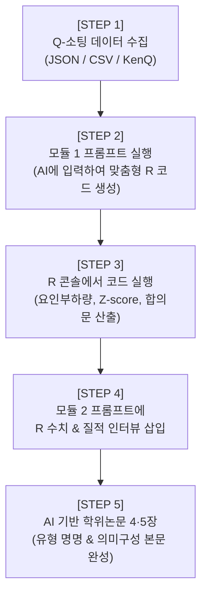

# [범용 가이드] Q-방법론 주관성 연구 R 분석 & 학술 논문화 마스터 프롬프트

> **문서 개요**: 본 문서는 어떤 학술 분야(재난관리, 행정학, 정책학, 보건의료, 사회복지, 교육학, 경영학 등)의 Q-방법론 연구에서도 변수(Placeholder)만 치환하여 재사용할 수 있는 **2단계 범용 표준 프롬프트**입니다.
> 
> * **[모듈 1] R 데이터 처리 및 Q-방법론 통계 분석 코드 생성 프롬프트** (R 스크립트 도출용)
> * **[모듈 2] R 분석 결과 기반 학위논문 제4장·제5장 심층 해석 프롬프트** (논문 본문 도출용)

---

## 🧭 [모듈 1] R 데이터 처리 및 Q-방법론 통계 분석 코드 생성 프롬프트

*(새로운 Q-연구 데이터를 R로 분석하기 위한 스크립트 생성을 요청할 때 사용하는 프롬프트입니다. 아래 블록 전체를 복사하여 AI에게 전달하십시오.)*

````markdown
# [지시문] 주관성 연구(Q-방법론) R 분석 파이프라인 코드 작성 요청

당신은 계량적 주관성 연구 방법론(Q-Methodology) 및 R 통계 분석 분야의 최고 권위 학술 연구자입니다.
아래 명시된 [연구 설계 파라미터]에 부합하는 전문적이고 재현 가능한 R 분석 스크립트를 작성해 주십시오.

---

### 1. 연구 설계 파라미터 (Research Parameters)
- **연구 주제**: {{연구 주제명을 입력하세요. 예: 공공 안전관리자의 위험 지각 및 현장지휘 의미구성 분석}}
- **Q-표본 크기 (N)**: {{Q-진술문 총 개수. 예: 36개}}
- **P-표본 크기 (P)**: {{응답자 총 수. 예: 16명 (직무군별 4개 층화)}}
- **강제분포 척도**: {{점수 범위 및 분포. 예: -4부터 +4까지 9점 quasi-normal forced distribution}}
  - 척도별 정원(Quota): {{예: -4(2), -3(3), -2(4), -1(5), 0(8), +1(5), +2(4), +3(3), +4(2)}}
- **입력 데이터 형식**: {{JSON 개별 파일 / CSV 행렬 / KenQ 형식 (.dat)}}
- **주요 질적 인터뷰 수집 항목**: 양 극단(+최대치, -최대치) 선택 사유 및 자유 서술 텍스트

---

### 2. R 분석 요구 사양 (Analysis Requirements)
1. **패키지 활용**: `qmethod` 패키지를 기본 엔진으로 활용하되, 상관행렬 및 스크리 플롯(Scree Plot) 시각화는 `psych` 및 `ggplot2`를 연계할 것.
2. **요인 추출 및 회전**:
   - 주성분 분석(PCA) 또는 중심인자분석(Centroid Factor Analysis) 적용.
   - 직교 회전인 배리맥스(Varimax Rotation)를 기본 수행하되, 고유값(Eigenvalue > 1.0) 기준과 스크리 검정(Scree Test)을 통해 최적 요인 수(보통 2~4개)를 탐색할 수 있는 코드 포함.
3. **P-표본 요인 부하량(Factor Loadings) 및 플래깅(Flagging)**:
   - 유의수준(p < 0.01) 기준 임계치 공식(2.58 * 1 / sqrt(N))을 적용하여 특정 요인에 순수하게 귀속되는 표본을 자동 Flagging 처리할 것.
4. **산출물 (Output Generation)**:
   - 요인별 고유값 및 분산 설명력 (Variance Explained %)
   - 요인별 표준화 Z-점수(Factor Z-scores) 및 표준 Q-배열(Factor Arrays / Q-Sort Values)
   - 요인 간 상관계수(Correlation between Factor Scores)
   - 합의 진술문(Consensus Statements) 및 구별 진술문(Distinguishing Statements) 도출
   - 연구자가 논문 작성 시 바로 인용할 수 있도록 요약 표를 CSV 및 텍스트 파일로 자동 저장.

위 요구조건을 모두 충족하며, 오류 처리와 상세한 한글 주석이 달린 완전한 R 실행 스크립트를 출력해 주십시오.
````

---

## 🎓 [모듈 2] R 분석 결과 기반 학위논문 제4장(결과)·제5장(논의) 심층 해석 프롬프트

*(R에서 도출된 수치 결과와 정성적 인터뷰 텍스트를 AI에 입력하여, 박사학위 논문이나 등재 학술지 수준의 본문 텍스트를 도출할 때 사용하는 프롬프트입니다.)*

````markdown
# [지시문] Q-방법론 통계 결과 심층 해석 및 학술논문 본문(제4장·제5장) 작성

당신은 Q-방법론 및 질적·양적 통합연구를 지도하는 저명한 박사학위 논문 지도교수입니다.
제공된 R 통계 분석 수치와 응답자 질적 인터뷰 텍스트를 바탕으로, 학술논문의 [연구 결과 및 논의] 장을 엄밀하고 통찰력 있게 작성해 주십시오.

---

### 1. 학술 연구 엄밀성 준수 5대 원칙 (Mandatory Academic Rules)
1. **환각(Hallucination) 방지 및 수치 왜곡 금지**: 제공된 R 수치(요인부하량, Z-점수, 고유값 등)를 임의로 변경하거나 가상의 수치를 생성하지 않는다.
2. **원 연구 수치와 연구자 해석의 엄격한 분리**: 통계적으로 검증된 객관적 결과와 질적 인터뷰를 종합한 주관성 해석을 명확히 구분하여 서술한다.
3. **핵심 학술 개념 견지**: '의미구성(Sensemaking)', '지각(Perception)', '다차원적 성과', '다원주의', '다중 관점', '네트워크 평가' 등 이론적 핵심 개념을 분석 틀거리로 상시 유지한다.
4. **이론/작동기제와의 입체적 매핑**: 진술문을 단순 요약 나열하지 말고, 각 진술문이 표상하는 '핵심 학술 개념' 및 '현장 작동기제'와 1:1로 결부하여 해석한다.
5. **질적 심층 인터뷰의 입체적 결합**: 각 유형을 대표하는 P-표본(Flagged Sample)의 실제 진술 이유를 인용하여 정량적 Z-점수의 질적 타당성을 입증한다.

---

### 2. 연구 컨텍스트 및 입력 데이터 (Data Inputs)

#### [기본 정보]
- **연구 주제**: {{연구 주제명}}
- **Q-표본 구성**: {{Q-표본 N수 및 차원별 구성 범주}}
- **P-표본 구성**: {{P-표본 집단별 층화 특성 (예: 직무별, 연차별, 기관별)}}

#### [입력 1: 요인별 고유값 및 P-표본 요인부하량 (Factor Loadings)]
```text
{{R에서 출력된 요인별 설명변량 표 및 응답자별 부하량/Flagging 결과 붙여넣기}}
```

#### [입력 2: 요인별 극단 선호/기피 진술문 및 Z-점수 (Factor Arrays & Z-Scores)]
```text
{{각 요인별 최동의(+), 최비동의(-) 진술문 번호, 텍스트, Z-점수 붙여넣기}}
```

#### [입력 3: 합의 진술문(Consensus) 및 구별 진술문(Distinguishing Statements)]
```text
{{R에서 도출된 유형 간 합의 진술문 및 p < 0.05 수준의 구별 진술문 목록 붙여넣기}}
```

#### [입력 4: 주요 응답자(Flagged P-Sample) 질적 인터뷰 원문]
```text
{{+극단 및 -극단 선택 이유, 자유 의견 텍스트 붙여넣기}}
```

---

### 3. 논문 본문 서술 체계 및 작성 지침 (Writing Structure)

아래 4개 절차에 맞추어 전문 학술지 게재 논문 형식으로 작성하십시오:

#### 제1절: Q-요인 추출 및 P-표본 분포 특성
- 요인 수 결정의 타당성(고유값, 스크리 검정, 누적 설명변량 %) 서술.
- P-표본의 직무/인구통계학적 특성이 각 요인에 어떻게 배속(Flagging)되었는지 집단별 층화 분포를 표(Table)와 함께 분석.

#### 제2절: 주관성 유형별 심층 프로파일링 (Type 1 ~ N)
각 유형마다 아래 세부 항목을 반드시 포함하여 작성:
1. **유형 명명(Typology Naming)**: 주관적 신념체계의 본질을 관통하는 명확하고 학술적인 명칭 부여 (예: `유형 1: [핵심 가치 기반 ~형]`).
2. **핵심 의미구성(Sensemaking) 논리**: 해당 유형 응답자들이 상황을 정의하고 판단하는 지각(Perception)의 틀거리 분석.
3. **선호 진술문(+)과 기피 진술문(-)의 심층 분석**:
   - Z-score 상위 및 하위 진술문들을 범주별로 묶어 서술.
   - 해당 진술문의 작동기제와 실제 응답자의 질적 인터뷰 진술문을 직접 인용(`"..."`)하여 정성적 타당성 부여.
4. **유형의 인구통계학적 배경 연계**: 특정 직무군이나 경력 집단이 왜 이 유형에 집중되었는지 실무 맥락(법령, 작업 환경, 책임 구조)과 결부하여 해석.

#### 제3절: 유형 간 비교 분석 (Consensus vs. Distinguishing 기제)
1. **합의 진술문(Consensus) 분석**: 모든 유형이 공유하는 직무 초월적 '보편적 규범 및 최소 기준' 규명.
2. **구별 진술문(Distinguishing) 분석**: 유형 간 극명한 인식 차이와 현장 갈등의 잠재적 진원지가 되는 핵심 기제 식별.

#### 제4절: 학술적·정책적 시사점 및 현장 적용 방안
1. **이론적 기여도**: 본 연구 결과가 기존 이론의 한계를 어떻게 보완하고 다차원적 성과 평가에 기여하는지 제시.
2. **실무 및 제도적 제언**: 주관성 유형 간 시각 차이(다원주의/다중 관점)를 조정하고 현장 협업을 촉진하기 위한 구체적인 제도·절차·교육훈련 개선안 도출.
````

---

## 📌 사용 권장 워크플로우


